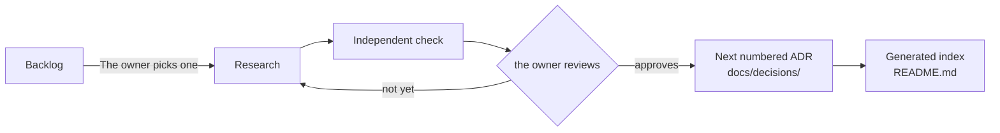

# Record decisions as one Markdown file each, with a generated index

## Context and Problem Statement

The Central Hub needs one place where each decision is recorded once, with its status visible, so anyone, human or agent, can tell what's decided and what's proposed. Today, decisions and the material behind them sit in five separate stores: chat threads, project files, two separate agent memories and the Research repo (see the decision map, §1).

Agents work under the owner's GitHub account, so nothing an agent writes can count as the owner's approval. The owner's principle (2026-10-10) is that every part of this must be replaceable later.

## Decision Drivers

- **One place to look:** a single index of every recorded decision and its status.
- **Only the owner accepts:** agents propose and never accept.
- **Replaceable:** the data stays in plain, portable form, so the tool, the format or the location can each be swapped.
- **One at a time, in the owner's order:** the owner picks the next decision. Nothing is bulk-created.
- **Visual first** (the owner's request, 2026-10-10): the shape of a decision is visible at a glance.
- **Follow established practice** where it exists.

## Considered Options

1. One Markdown file per decision (MADR 4), plus a generated `README.md` index, in `docs/decisions/`.
2. Records for proposed and decided items, plus one `register.yaml` for unwritten questions.
3. Records, with open questions held in GitHub Issues.
4. Signed approval events checked by a verifier outside the repo.

## Decision Outcome

*In words:* the owner picks one decision from the backlog. It's researched, then checked independently. The owner reviews it, and it goes back for more research or he approves it. Approval makes it the next numbered record, and the index is regenerated.

Chosen option: **1**. In the RB-0001 sample of 16 repos, decisions under consideration that had been written up appeared in the index as records marked Proposed or Open. None kept them in a separate file. Some sent raw questions or discussion to issues, pull requests or Discussions. One kind of file is the simplest to validate, migrate and replace.

### What the decision covers

- **Location:** `jonhill90/central-hub`, `docs/decisions/NNNN-slug.md`. A record is written only for the decision the owner picks next. It gets the lowest free number when its PR opens. A rejected or parked record keeps its number and is merged with that status, so a number is never reused (D-0004 sets the Foundation exceptions for a void or folded number). A draft in project files before that has `id: D-TBD` and sits outside this schema.
- **Backlog:** decisions not yet picked stay in the backlog in project files, with their options in the decision map. The index says where the backlog lives (project files aren't reachable from the repo, so it names the place rather than linking). Listing it doesn't set a review order.
- **Format:** the MADR 4 body and its optional front matter, plus the custom fields below. This file is the template.
- **Vocabulary:** who does the work is named by role, never by vendor, so any agent can fill any role and swapping one changes no record. Where a product is the subject of a decision (an option, evidence or configuration), the record names it accurately.
  - **Agent:** any AI worker, whoever makes it.
  - **Drafting agent:** the agent that writes the proposed record.
  - **Reviewing agent:** a different agent that checks the draft independently before the owner sees it.
  - Which agent filled a role is visible in git and PR history, not in the record.
- **Statuses:**
  - A record starts as `proposed`.
  - The owner moves it to `accepted`, `rejected` or `parked`.
  - An accepted record can later become `superseded` or `deprecated`.
  - Agents write only `proposed`.
- **What the owner approves:** the whole record at the PR head commit he approves. After that, only the acceptance changes may follow: `status`, `date` and `accepted-evidence`. A reviewing agent compares the merged record with the approved commit; any other difference needs the owner's approval again.
- **Immutability:** once a record is accepted, its body changes only through a correction or a decision change under D-0006, which the owner approves the same way. Either way, the record is edited so it reads as the current decision, and `CORRECTIONS.md` gets one line. When a later record changes part of an earlier one, the same PR updates the earlier record's text so it reads as the current rule, and the later record keeps the reasons. A record replaced in whole becomes `superseded`. Lifecycle fields (`status`, `superseded-by`) change only when the owner approves.
- **Diagrams:** a record includes a Mermaid diagram if the decision defines any of these:
  - two or more components and how they relate;
  - a sequence of three or more steps;
  - a dependency order.

  Otherwise it states `Diagram: not applicable` and why. GitHub renders Mermaid in Markdown ([GitHub docs](https://docs.github.com/en/get-started/writing-on-github/working-with-advanced-formatting/creating-diagrams), fetched 2026-10-10). The prose must make sense without the rendered diagram. This rule is a local extension of MADR.
- **Index:** `docs/decisions/README.md` is generated from each record's front matter by one small script (`.github/docs-check/gen_index.py`) and never edited by hand. The docs checks (D-0019) fail if it drifts. A dependency diagram built from `waits-on` is proposed for the index; it isn't built yet.

### Custom field contract

| Field | Type | Meaning | Validation |
|---|---|---|---|
| `id` | string `D-NNNN` | Permanent ID; reused only as D-0004 allows | Unique, matches the filename number |
| `proposed-by` | string | Agent or person who drafted it | Required |
| `waits-on` | list of IDs | Decisions that must be **accepted** before this one can be decided. The edge points from this record to its prerequisite. IDs may be records (`D-NNNN`) or backlog items (`BL-0111`, `BL-0021`…) | Record IDs resolve to a file; backlog IDs must be well formed, and a reviewing agent checks them against the backlog, because the backlog isn't in the repo; no cycles |
| `supersedes` / `superseded-by` | list / ID | Replacement links | Symmetric |
| `accepted-evidence` | block (below) | Proof that the owner approved this exact content | Required when `status: accepted` |
| `revisit-when` | string | What would make us reopen this decision (the replaceability principle) | Required |

### Who accepts, and how it's proven

**Now (Foundation): convention.**
- The owner approves in the project chat, where his messages are marked as written by a human.
- `accepted-evidence` holds these facts, inside the record itself (D-0016 rule 6), and never a quote of the message:
  - `approved-by`: `owner`;
  - `approved-at`: the UTC time of the approval message;
  - `approved-commit`: the full SHA of the PR head he approved;
  - `approval-ref`: the message id in the owner's chat archive, the one exact key into it;
  - `approval-names`: what the message named, for example "PR #19 and head ffd8dca";
  - `check`: who confirmed that the message names that PR and head, and when. If the message can't be read, the check is recorded as incomplete;
  - `merged`: who merged, and when, or "not yet".
- The block stays in the record after the record is superseded.
- A reviewing agent that can read the project chat checks that the message names the approved PR and head. Any reviewing agent can check everything else.

**Later: enforced by GitHub, only once all of these are verified (Foundation §6, AG1):**
- `central-hub` is removed from the GitHub App that all agents share today;
- each agent has its own GitHub App identity;
- a ruleset requires one approval and code-owner review, with `require_last_push_approval` and stale approvals dismissed on every push, and no agent can bypass it;
- CODEOWNERS gives `docs/decisions/` and the CODEOWNERS file itself to the owner, and to nobody else;
- The owner doesn't push to a decision PR himself (he asks for the change), because with him as the only reviewer, a last push by him can't be approved.

Until each of these is checked, acceptance stays by convention.

### Consequences

- Good:
  - One index answers "what's recorded and what's its status".
  - Standard MADR structure.
  - log4brains and Backstage are candidate readers, not yet verified with the custom fields.
  - The exit path is plain text in git, with the approval evidence carried inside each record.
- Bad: a small generator and validator script to maintain. RB-0001 didn't find a maintained tool that validates records.
- Bad: until AG1 is verified, "only the owner accepts" is a convention, with a review check.

### Confirmation

- The index matches the generator's output.
- Every `accepted` record has a complete `accepted-evidence` block, and its `check` confirms the message names the approved PR and head.
- Every record with a structure, flow or ordering has a diagram, or says `Diagram: not applicable` and why.

## Pros and Cons of the Options

### Option 2: YAML list for unwritten questions
- Good: fewer files.
- Bad: two places to keep in sync, and no repo in the RB-0001 sample did this.

### Option 3: Issues
- Good: suited to discussion.
- Bad: the data lives outside git and needs an export to move. That adds migration work under the replaceability principle.

### Option 4: Signed approval events
- Good: could strengthen the proof of the owner's approval, if agents can't reach the signing key and the verifier is trusted. It can be added on top of Markdown records rather than replacing them.
- Bad: needs a signing key agents can't reach and an external verifier. It assumes agents share the owner's identity, which AG1 is designed to end.
- Kept as the upgrade path if the AG1 controls prove too weak.

## More Information

- **Evidence:** [../research/0001-record-decisions-as-markdown-records.md](../research/0001-record-decisions-as-markdown-records.md): batch RB-0001, 10 practice sources, 16 repositories and two independent designs.
- **Exit path:**
  - Swapping the generator or site doesn't change the records.
  - Moving the location is a `git mv`.
  - A format change is a script that maps front-matter keys.
  - Moving to the future knowledge system means importing Markdown and front matter. The approval evidence travels inside each record.
