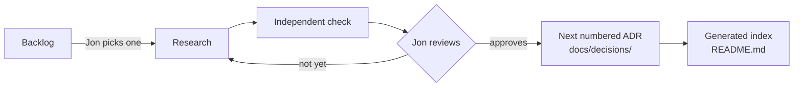

# Record decisions as one Markdown file each, with a generated index

## Context and Problem Statement

The Central Hub needs one place where each decision is recorded once, with its status visible, so anyone, human or agent, can tell what's decided and what's proposed. Today, decisions and the material behind them sit in five separate stores: chat threads, project files, two separate agent memories and the Research repo (see the decision map, §1).

Agents work under Jon's GitHub account, so nothing an agent writes can count as Jon's approval. Jon's principle (2026-10-10) is that every part of this must be replaceable later.

## Decision Drivers

- **One place to look:** a single index of every recorded decision and its status.
- **Only Jon accepts:** agents propose and never accept.
- **Replaceable:** the data stays in plain, portable form, so the tool, the format or the location can each be swapped.
- **One at a time, in Jon's order:** Jon picks the next decision. Nothing is bulk-created.
- **Visual first** (Jon, 2026-10-10: he describes himself as a visual person): the shape of a decision is visible at a glance.
- **Follow established practice** where it exists.

## Considered Options

1. One Markdown file per decision (MADR 4), plus a generated `README.md` index, in `docs/decisions/`.
2. Records for proposed and decided items, plus one `register.yaml` for unwritten questions.
3. Records, with open questions held in GitHub Issues.
4. Signed approval events checked by a verifier outside the repo.

## Decision Outcome

*In words:* Jon picks one decision from the backlog. It's researched, then checked independently. Jon reviews it, and it goes back for more research or he approves it. Approval makes it the next numbered record, and the index is regenerated.

Chosen option: **1**. In the RB-0001 sample of 16 repos, decisions under consideration that had been written up appeared in the index as records marked Proposed or Open. None kept them in a separate file. Some sent raw questions or discussion to issues, pull requests or Discussions. One kind of file is the simplest to validate, migrate and replace.

### What the decision covers

- **Location:** `jonhill90/central-hub`, `docs/decisions/NNNN-slug.md`. A record is written only for the decision Jon picks next. It gets the next number when its PR opens, so numbers follow the order Jon picks in. A rejected or parked record keeps its number and is merged with that status, so a number is never reused. A draft in project files before that has `id: D-TBD` and sits outside this schema.
- **Backlog:** decisions not yet picked stay in the backlog in project files, with their options in the decision map. The index says where the backlog lives (project files aren't reachable from the repo, so it names the place rather than linking). Listing it doesn't set a review order.
- **Format:** the MADR 4 body and its optional front matter, plus the custom fields below. This file is the template.
- **Vocabulary:** who does the work is named by role, never by vendor, so any agent can fill any role and swapping one changes no record. Where a product is the subject of a decision (an option, evidence or configuration), the record names it accurately.
  - **Agent:** any AI worker, whoever makes it.
  - **Drafting agent:** the agent that writes the proposed record.
  - **Reviewing agent:** a different agent that checks the draft independently before Jon sees it.
  - Which agent filled a role is visible in git and PR history, not in the record.
- **Statuses:**
  - A record starts as `proposed`.
  - Jon moves it to `accepted`, `rejected` or `parked`.
  - An accepted record can later become `superseded` or `deprecated`.
  - Agents write only `proposed`.
- **What Jon approves:** the whole record at the PR head commit he approves. After that, only the acceptance changes may follow: `status`, `date` and `accepted-evidence`. A reviewing agent compares the merged record with the approved commit; any other difference needs Jon's approval again.
- **Immutability:** once a record is accepted, its body never changes. Only its lifecycle fields (`status`, `superseded-by`, `date`) change later, and only when Jon approves. A changed decision is a new record that supersedes the old one.
- **Diagrams:** a record includes a Mermaid diagram if the decision defines any of these:
  - two or more components and how they relate;
  - a sequence of three or more steps;
  - a dependency order.

  Otherwise it states `Diagram: not applicable` and why. GitHub renders Mermaid in Markdown ([GitHub docs](https://docs.github.com/en/get-started/writing-on-github/working-with-advanced-formatting/creating-diagrams), fetched 2026-10-10). The prose must make sense without the rendered diagram. This rule is a local extension of MADR.
- **Index:** `docs/decisions/README.md` is generated from each record's front matter by one small script and never edited by hand. Once CI exists, CI fails if it drifts. A dependency diagram built from `waits-on` is proposed for the index; it isn't built yet.

### Custom field contract

| Field | Type | Meaning | Validation |
|---|---|---|---|
| `id` | string `D-NNNN` | Permanent ID, never reused | Unique, matches the filename number |
| `proposed-by` | string | Agent or person who drafted it | Required |
| `waits-on` | list of IDs | Decisions that must be **accepted** before this one can be decided. The edge points from this record to its prerequisite. IDs may be records (`D-NNNN`) or backlog items (`BL-0111`, `BL-0021`…) | Record IDs resolve to a file; backlog IDs must be well formed, and a reviewing agent checks them against the backlog, because the backlog isn't in the repo; no cycles |
| `supersedes` / `superseded-by` | list / ID | Replacement links | Symmetric |
| `accepted-evidence` | block (below) | Proof that Jon approved this exact content | Required when `status: accepted` |
| `legacy-id` | list | IDs from the backlog | Optional |
| `revisit-when` | string | What would make us reopen this decision (the replaceability principle) | Required |

### Who accepts, and how it's proven

**Now (Foundation): convention.**
- Jon approves in the project chat, where his messages are marked as written by a human.
- `accepted-evidence` holds, inside the record itself:
  - his message text, verbatim
  - the message ID
  - the timestamp (UTC)
  - the PR head commit SHA he approved
  - who checked the quote against the message, when, and the result. If the message can't be read, the check is recorded as incomplete.
- So the evidence survives any migration, because it doesn't depend on a link staying live. It stays in the record after the record is superseded.
- A reviewing agent that can read the project chat checks that the quote matches the message. Any reviewing agent can check everything else.

**Later: enforced by GitHub, only once all of these are verified (Foundation §6, AG1):**
- `central-hub` is removed from the GitHub App that all agents share today;
- each agent has its own GitHub App identity;
- a ruleset requires one approval and code-owner review, with `require_last_push_approval` and stale approvals dismissed on every push, and no agent can bypass it;
- CODEOWNERS gives `docs/decisions/` and the CODEOWNERS file itself to Jon, and to nobody else;
- Jon doesn't push to a decision PR himself (he asks for the change), because with him as the only reviewer, a last push by him can't be approved.

Until each of these is checked, acceptance stays by convention.

### Consequences

- Good:
  - One index answers "what's recorded and what's its status".
  - Standard MADR structure.
  - log4brains and Backstage are candidate readers, not yet verified with the custom fields.
  - The exit path is plain text in git, with the approval evidence carried inside each record.
- Bad: a small generator and validator script to maintain. RB-0001 didn't find a maintained tool that validates records.
- Bad: until AG1 is verified, "only Jon accepts" is a convention, with a review check.

### Confirmation

- The index matches the generator's output.
- Every `accepted` record has a complete `accepted-evidence` block, and its quote is checked against the source message.
- Every record with a structure, flow or ordering has a diagram, or says `Diagram: not applicable` and why.

## Pros and Cons of the Options

### Option 2: YAML list for unwritten questions
- Good: fewer files.
- Bad: two places to keep in sync, and no repo in the RB-0001 sample did this.

### Option 3: Issues
- Good: suited to discussion.
- Bad: the data lives outside git and needs an export to move. That adds migration work under the replaceability principle.

### Option 4: Signed approval events
- Good: could strengthen the proof of Jon's approval, if agents can't reach the signing key and the verifier is trusted. It can be added on top of Markdown records rather than replacing them.
- Bad: needs a signing key agents can't reach and an external verifier. It assumes agents share Jon's identity, which AG1 is designed to end.
- Kept as the upgrade path if the AG1 controls prove too weak.

## More Information

- **Evidence:** [../research/0001-record-decisions-as-markdown-records.md](../research/0001-record-decisions-as-markdown-records.md): batch RB-0001, 10 practice sources, 16 repositories and two independent designs.
- **Exit path:**
  - Swapping the generator or site doesn't change the records.
  - Moving the location is a `git mv`.
  - A format change is a script that maps front-matter keys.
  - Moving to the future knowledge system means importing Markdown and front matter. The approval evidence travels inside each record.

## Corrections

- **2026-10-23** (research batch IDs under D-0015): 4 research batch citations renamed: `R1` to `RB-0001` (3 times); `R1-SYNTHESIS.md` to `RB-0001-SYNTHESIS.md`. Reason: D-0015 numbers research batches `RB-NNNN`, and its rule 5 renames live references in place; no decision changes. Approval: the owner, 2026-10-23T04:59:42Z (approval-ref cmsg_01X43rfNYp4H1dL1V2dkfkwN7qM5qKKp8HDEfuF6EYoQkC), naming PR #27 and head 8d63c29; approved commit 8d63c29543a8adccdebb9704146d067b238e1c54. Check: the drafting agent read the message at 2026-10-23T04:59Z and confirmed it names that PR and head.
- **2026-10-23** (owner's words and approvals recorded in neutral form under D-0016). Reason: D-0016 rules 5 to 7 and its "What happens to the existing records"; no decision changes. Where the text removed is the owner's words, this entry names where it was and a commit that holds it (edac9fe) instead of copying it (D-0016 rule 7).
  1. `accepted-evidence` rewritten once into D-0016 rule 6 fields with D-0006 step 7's fixed mapping, as amended by D-0016: `timestamp` to `approved-at`, `message-id` to `approval-ref`, `quote-check` to `check`; `approved-by: owner` and `approval-names` added; `quote` removed (its text is in `accepted-evidence.quote` at commit edac9fe).
  2. In `check` (formerly `quote-check`), Jon's quoted words at 07:28:13Z (at commit edac9fe) replaced by a neutral summary, because D-0016 rule 5 bars owner quotes; the rest of the value is unchanged. After: "at 07:28:13Z Jon had said that he had approved the PRs".
  3. Decision Drivers, "Visual first": the quote of Jon's 2026-10-10 message (at commit edac9fe) replaced by a neutral summary. After: "(Jon, 2026-10-10: he describes himself as a visual person)".
  4. More Information, first bullet. Before: "**Research:** `central-hub/research/decision-register/RB-0001-SYNTHESIS.md` in project files. Both independent agent designs are kept there unedited." After: "**Evidence:** [../research/0001-record-decisions-as-markdown-records.md](../research/0001-record-decisions-as-markdown-records.md): batch RB-0001, 10 practice sources, 16 repositories and two independent designs." Reason: the old pointer is private; links the evidence file (D-0016 rule 1 as amended by D-0017).
  5. The closing note on tidied quotes removed (D-0016 rule 5). Before: "_Jon's quoted words are shown with spelling and punctuation tidied; his exact wording is kept in the original chat records._" After: none.

  Approval: the owner, 2026-10-23T05:22:43Z (approval-ref cmsg_01X43rfNYp4H1dL1V2dkfkwNJe6kJE76z6YiJbQ9y7Tg3i), naming PR #29 and head 97fd304; approved commit 97fd304459b3976d441c419564b8e082d64a1a47. Check: the drafting agent read the message at 2026-10-23T05:22Z and confirmed it names that PR and head.
- **2026-10-24** (backlog item numbers under D-0020): old backlog and decision-map labels renamed to `BL-NNNN`. Reason: D-0020 numbers every backlog item `BL-NNNN` and makes open decisions backlog items, and its rule 5 renames live references in place; no decision changes.
  1. `legacy-id`. Before: `[W1, W2]`. After: `[BL-0111, BL-0112]`.
  2. `revisit-when`. Before: "a knowledge system (K1) is chosen". After: "a knowledge system (BL-0036) is chosen".
  3. Diagram, first node. Before: "Backlog decision map". After: "Backlog".
  4. What the decision covers, **Backlog**. Before: "decisions not yet picked stay in the decision map in project files." After: "decisions not yet picked stay in the backlog in project files, with their options in the decision map."
  5. Custom field contract, `waits-on`. Before: "backlog items (`W1`, `S7`…)" and "checks them against the decision map, because the map isn't in the repo". After: "backlog items (`BL-0111`, `BL-0021`…)" and "checks them against the backlog, because the backlog isn't in the repo".
  6. Custom field contract, `legacy-id`. Before: "IDs from the decision map". After: "IDs from the backlog".

  Approval: the owner, 2026-10-24T02:50:34Z (approval-ref cmsg_01X43rfNYp4H1dL1V2dkfkwN6ZL4axtSm9grZd8Kszxagb), naming PR #40 and head 1453cb1; approved commit 1453cb11874422b8913f72a8687a220752d0d604. Check: the drafting agent read the message at 2026-10-24T02:50Z and confirmed it names that PR and head.
