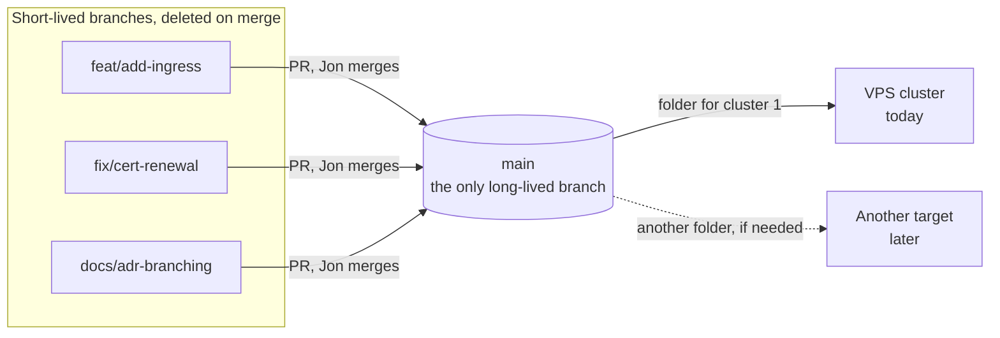

# Use one main branch, environments as folders, and type-named short-lived branches

## Context and Problem Statement

On 2026-10-11 Jon asked whether central-hub should have only `main` or environment branches such as dev/stage/prod, dev/QA/prod or dev/prod, and noted that branches would start with prefixes such as feature/, bug/ or chore/.

central-hub will be a GitOps repo once the Activation gate passes (Foundation §6): a cluster will pull its desired state from git. It starts with one VPS cluster and grows into home Kubernetes. One person, Jon, merges every PR, and agents open most of them. The repo is still empty, so its first branch needs a name, and the Foundation proposal (§3.1) assumes `main`.

## Decision Drivers

- **One place to read:** what each cluster runs is visible in one tree.
- **One owner, many agents:** every agent needs one simple rule for where a PR goes.
- **Replaceable:** each part can be switched later without a painful migration.
- **Vendor-neutral words:** who does the work is named by role, never by vendor (D-0001).
- **Follow established practice** where it exists.

## Considered Options

1. **One `main` branch, environments and clusters as folders on it.**
2. Long-lived environment branches, edited by hand (`dev`/`stage`/`prod`, `dev`/`qa`/`prod` or `dev`/`prod`).
3. `main` plus one promotion branch (`main` → `prod`).
4. `main` plus machine-rendered environment branches that nobody edits (the rendered manifests pattern).
5. A separate repository for production.

## Decision Outcome

*In words:* every change starts on a short-lived branch named for its type, goes through a PR to `main`, and Jon merges it. `main` is the only long-lived branch. Each deployment target reads its own folder on `main`.

Chosen option: **1**.
- **Mechanism:** promoting config by merging carries unwanted per-environment values and drifts. Kapelonis (2021) calls branches for environments an anti-pattern for config repos for that reason. Thoughtworks' 2021 Hold on GitOps named branch-per-environment drift as its concern (the blip moved to Assess in 2023 and is no longer on the radar).
- **Engines:** Flux's guide stores every environment's config on the same branch. Both Flux and Argo CD point a cluster at a path at a revision (fetched 2026-10-11), so folders work on either.
- **Sources that support the habit, not the question:** Kustomize's examples treat environments as overlay variants. Trunk-based development, GitHub flow and DORA favour one trunk with short-lived branches, but none of them discusses environment branches.
- **Practice (illustrative, not a survey):** of 19 repos read, 17 are cluster repos; 8 are vendor examples and 6 come from one homelab template family. So the sample confirms the documented pattern rather than testing it. In the configurations inspected, none deploys from hand-edited environment branches, and the 10 with several environments or clusters use folders. The branch-name search looked only for certain prefixes, so it could miss names like `env/prod`. The reviewing agent found one repo whose docs describe a `develop` branch for dev and `main` for prod; it is documented, not shown to work well.
- **Terraform is different:** Google Cloud recommends a branch per environment for push-based Terraform, which matches what Jon described as his work setup (thread, 2026-10-11 06:04 UTC). RB-0002 found no primary source in its search scope that recommends hand-edited environment branches for pull-based GitOps config, and app code reaches environments by promoting an image tag, not by branches.
- **Switching cost (inferred):** moving from folders to branches later is usually cheap, though any change of source is checked (see Exit path). Moving back from hand-edited branches is expensive, because the branches drift apart.

### What the decision covers

- **Scope:** branches inside central-hub. Whether tenant or application manifests live here or in their own repositories is a separate decision (repo boundaries); that decision may add repositories, not branches. Any push-based infrastructure code added later (Terraform, Ansible) follows the same rule: environments are folders or per-environment variable files, and pipeline stages gate each apply (inferred, RB-0002-gaps.md §1.3).
- **Long-lived branches:** `main` only. It is the default branch and, after the Activation gate, the state the clusters pull.
- **Environments:** folders on `main`, never branches.
  - **One deployment target now:** the VPS cluster.
  - Deferred to the layout and topology decisions: how many environments there are, how they're isolated (namespaces in one cluster, or separate clusters), and whether home hardware joins this cluster or forms another. This rule holds either way: environments and clusters are folders on `main`, never branches.
  - Promotion is a PR that changes the target environment's folder. What that PR must show (source revision, target, test results, rollback point) is a follow-up decision. Where no test environment sits in front of production, the PR says so.
  - Secrets: the secrets decision sets which deployment target may decrypt which secrets, and the folder layout follows that policy. A folder isn't the cryptographic boundary; the keys are. It doesn't depend on the branch choice (inferred).
- **Short-lived branch names:** `<type>/<short-description>`, for example `fix/cert-renewal`.
  - Lowercase letters, digits and hyphens after the slash, one slash only. An issue number may lead the description, as in `fix/123-cert-renewal`.
  - Deleted on merge.
  - The proposed types are below. `feat` and `fix` are Conventional Commits types; the others come from the commitlint conventional list. In Conventional Branch 1.1.0, `feat` and `fix` are standard aliases and the rest are documented custom types, which this record documents. Seven of the eight already head 1,714 of Jon's 2,379 PRs (72%) across his 7 readable repos; `revert` has not been used yet.

  | Type | Use for | Covers Jon's words |
  |---|---|---|
  | `feat` | a new component, app or capability | feature, enhance (Jon's answer A) |
  | `fix` | something broken, including urgent fixes | bug, bugfix, hotfix |
  | `docs` | docs, decision records, diagrams | |
  | `chore` | version bumps, housekeeping, and config changes that add nothing new and fix nothing (promotion, scaling, settings) | |
  | `refactor` | restructuring with no change in behaviour | |
  | `ci` | workflows and checks | |
  | `test` | tests only | |
  | `revert` | backing a change out | |

- **Not included:** `hotfix/` and `release/`. With no release branches, they mean nothing. A hotfix is a `fix/` that merges first.
- **The branch name says what, never who.**
  - Vendor-named prefixes are never part of the vocabulary.
  - Where a tool forces its own branch name, the branch is tolerated and deleted on merge. This covers agent tools that force a prefix, dependency bots (whose branches have their own shape; memory, not fetched), and the host's revert button.
  - Who did the work is recorded in the PR body (Jon's answer C).
- **Commit and PR title format:** `<type>: 
`, with no scope. This answers Foundation §8 decision 3 with its recommended option (Jon's answer B).
  - The repo's squash setting (Foundation §3.1: PR title plus commit details) makes the PR title the commit subject on `main`.
  - Dependency bots title their PRs with a type: Dependabot's `commit-message.prefix: chore` sets the PR title prefix (fetched 2026-10-11). Renovate has an equivalent setting (memory, not fetched). A bot whose title can't be configured is exempt from the check by author.
  - A PR made with the host's revert button keeps its `Revert "…"` title and is accepted by the check as a revert. The title shape is from memory and is to be tested.
- **What gets checked, and when:**
  - Until the Activation gate, nothing is enforced. Jon checks the PR title when he merges, reading the input diff knowing that it doesn't show the rendered manifests.
  - At the Activation gate, the trusted verifier (Foundation AG2) adds three things:
    - a required title check that runs when a PR is opened, edited or updated. It is a status check, not a commit-metadata rule, because the host applies metadata rules to every commit in a squashed PR (fetched 2026-10-11);
    - a rendered, manifest-level diff posted on each PR, comparing the base and the PR head with the renderer versions and resolved dependencies named. Production impact is marked by what renders differently for production, not by which folder changed, so a change to a shared base is caught. A render that fails or is incomplete fails the check. Secrets stay encrypted in the report;
    - a warning comment on non-conforming branch names. It never blocks: a blocking rule would need a bypass list naming tools, and whether this hosting plan can enforce a name pattern is unverified.
- **Rollout:** on acceptance, the repo's `AGENTS.md` gets the branch and title rule. Foundation §4's lines on branch names and commits are replaced by a pointer to this record (Foundation v0.4.3). That removes its vendor-named second pattern and the `enhance` type.

### Jon's answers (2026-10-11 07:14 UTC, in the thread)

Jon answered all three, the last two on the condition that the rule comes from something documented, not made up. The source for each:

- **A. `enhance`:** Jon chose to use `feat` instead. It folds into `feat`.
- **B. Commit format `<type>: 
`, no scope.** Documented in Hill90's `CONTRIBUTING.md` ("Commit Format": `<type>: <short description>`), and it's the subject-line form in Conventional Commits 1.0.0, where a scope is optional. Hill90's practice differs from its own doc: 43 of its 50 most recent commits on `main` add a scope, as in `fix(auth): …` (measured 2026-10-11 with `git log`). So the rule follows the documented form, not Hill90's current habit.
- **C. `Author-Lane: <lane name>` in the PR body.** Documented in the `skills` repo (`AGENTS.md`, "Merging PRs", and `docs/reference/merge-gate.md`). There it feeds a merge gate. Here it's only a label, not proof, because agents act under Jon's account until the Activation gate (Foundation C1). It is never a vendor name.

### Consequences

- Good: one target branch, one ruleset and one rule for every agent.
- Good: the difference between environments is a folder diff in one tree.
- Good: it works with Flux or Argo CD, so this decision doesn't decide the engine.
- Bad: a one-line change to a base, an overlay or a chart version can change every environment at once, and the PR diff shows the input, not the rendered manifests (RB-0002-gaps.md §3.2; Kapelonis 2022; Akuity 2025). This is the one drawback that matters today, with Jon reviewing agent PRs. The rendered diff at the Activation gate is the mitigation.
- Bad: per-environment access rules are per-path (required code-owner review; GitHub's file-path rules are for private repos only) or need a separate production repository, not per-branch. With one owner that protects nobody from anybody, so it costs nothing today.
- Bad: promotion is an edit and a PR, not a merge button.
- Bad: until the Activation gate, the format is a convention Jon checks by eye.

### Confirmation

- The branch list on central-hub shows `main`, plus only branches with an open PR. Jon checks by eye at merge until a tool does it.
- After the Activation gate, every PR shows a rendered manifest diff, and PRs that change what production renders are marked.
- Every commit subject on `main` matches `<type>: 
` with a type from the table, is a host revert (`Revert "…"`), or comes from an exempt bot. Checking commit subjects, not only PR titles, catches a title changed at merge time.
- Each cluster's GitOps source points at `main` and a folder, never at another branch.

## Pros and Cons of the Options

### Option 2: hand-edited environment branches
- Good: the host can protect each environment branch differently.
- Good: Google Cloud recommends it for push-based Terraform, and it's familiar from Jon's work.
- Good: a promotion is one visible merge.
- Bad: merging promotes everything on the branch, including per-environment values. Out-of-order changes need cherry-picks, and urgent fixes drift if they aren't copied back.
- Bad: one owner reviews the same change once per environment.
- Bad (inferred): leaving it later means reconciling the drift by hand.

### Option 3: one promotion branch
- Good: a simple two-step gate.
- Bad: Option 2's drift on a smaller scale, and two merges for every prod change, for the same reviewer.

### Option 4: machine-rendered environment branches
- Good: shows the real Kubernetes change per environment, and nobody edits these branches, so they avoid manual merge drift. The render job can still fail or go stale.
- Bad: it needs a render job, or Argo CD's Source Hydrator, which is beta and Argo-only.
- Not rejected outright: it can be added on top of Option 1 later without changing how anyone works.

### Option 5: a separate production repository
- Good: Flux documents it as the way to limit who can change production.
- Bad: promotion crosses repositories, and the tooling is duplicated. With one owner there is nobody to limit.
- Not rejected outright: it's the route if a second person ever gets merge rights.

## More Information

- **Evidence:** [../research/0002-use-one-main-branch-with-environment-folders.md](../research/0002-use-one-main-branch-with-environment-folders.md): batch RB-0002, about 30 primary sources, 19 repositories, every pull request in Jon's 7 readable repositories, and a gap-fill pass. The draft was reviewed three times before acceptance.
- **Exit path:**
  - To rendered environment branches: add the render job, compare its output with the current render, then repoint the clusters.
  - To pin prod to a release: point prod at a commit, or at a tag protected from being moved, and compare renders before switching.
  - Any change of source can change what the engine owns or prunes, so each switch is checked, not assumed cheap.
  - To change the type list or spelling: write a successor record and update the check. No cluster reads branch names.

## Corrections

- **2026-10-23** (research batch IDs under D-0015): 3 research batch citations renamed: `R2` to `RB-0002`; `R2b` to `RB-0002-gaps.md` (2 times). Reason: D-0015 numbers research batches `RB-NNNN`, and its rule 5 renames live references in place; no decision changes. Approval: the owner, 2026-10-23T04:59:42Z (approval-ref cmsg_01X43rfNYp4H1dL1V2dkfkwN7qM5qKKp8HDEfuF6EYoQkC), naming PR #27 and head 8d63c29; approved commit 8d63c29543a8adccdebb9704146d067b238e1c54. Check: the drafting agent read the message at 2026-10-23T04:59Z and confirmed it names that PR and head.
- **2026-10-23** (owner's words and approvals recorded in neutral form under D-0016). Reason: D-0016 rules 5 to 7 and its "What happens to the existing records"; no decision changes. Where the text removed is the owner's words, this entry names where it was and a commit that holds it (edac9fe) instead of copying it (D-0016 rule 7).
  1. `accepted-evidence` rewritten once into D-0016 rule 6 fields with D-0006 step 7's fixed mapping, as amended by D-0016: `timestamp` to `approved-at`, `message-id` to `approval-ref`, `quote-check` to `check`; `approved-by: owner` and `approval-names` added; `quote` removed (its text is in `accepted-evidence.quote` at commit edac9fe).
  2. In `check` (formerly `quote-check`), Jon's quoted words at 07:28:13Z (at commit edac9fe) replaced by a neutral summary, because D-0016 rule 5 bars owner quotes; the rest of the value is unchanged. After: "at 07:28:13Z Jon had said that he had approved the PRs".
  3. Context and Problem Statement, first paragraph: the quote of Jon's 2026-10-11 question (at commit edac9fe) replaced by a neutral summary. After: "On 2026-10-11 Jon asked whether central-hub should have only `main` or environment branches such as dev/stage/prod, dev/QA/prod or dev/prod, and noted that branches would start with prefixes such as feature/, bug/ or chore/."
  4. "Jon's answers", item A: the quote of Jon's answer (at commit edac9fe) replaced. Before, with the quote left out: "- **A. `enhance`:** [quote]. It folds into `feat`." After: "- **A. `enhance`:** Jon chose to use `feat` instead. It folds into `feat`."
  5. More Information, first bullet. Before: "**Research:** `central-hub/research/branching/` in project files: SPEC; R2-practice (about 30 primary sources); R2-repos (19 repos, plus every PR in Jon's 7 readable repos, 2,379 in all); R2-design-independent; R2b-gaps (Terraform, snowballing, counter-evidence); R2-SYNTHESIS. Every source is listed in SOURCES.md. Reviews of this draft: `NEXT-branching-REVIEW.md` (same model), `NEXT-branching-REVIEW-2.md` (a different model, 14 sources spot-checked) and `CROSS-VENDOR-REVIEW.md` (a different vendor, 22 pages opened)." After: "**Evidence:** [../research/0002-use-one-main-branch-with-environment-folders.md](../research/0002-use-one-main-branch-with-environment-folders.md): batch RB-0002, about 30 primary sources, 19 repositories, every pull request in Jon's 7 readable repositories, and a gap-fill pass. The draft was reviewed three times before acceptance." Reason: the old pointers are private and named agent makers; links the evidence file (D-0016 rule 1 as amended by D-0017).
  6. The closing note on tidied quotes removed (D-0016 rule 5). Before: "_Jon's quoted words are shown with spelling and punctuation tidied; his exact wording is kept in the original chat records._" After: none.

  Approval: the owner, 2026-10-23T05:22:43Z (approval-ref cmsg_01X43rfNYp4H1dL1V2dkfkwNJe6kJE76z6YiJbQ9y7Tg3i), naming PR #29 and head 97fd304; approved commit 97fd304459b3976d441c419564b8e082d64a1a47. Check: the drafting agent read the message at 2026-10-23T05:22Z and confirmed it names that PR and head.
- **2026-10-24** (backlog item numbers under D-0020): `legacy-id`. Before: `[S4]`. After: `[BL-0119]`. Reason: D-0020 numbers every backlog item `BL-NNNN`, and its rule 5 renames live references in place; no decision changes. Approval: to be added after the owner approves this correction's PR.
