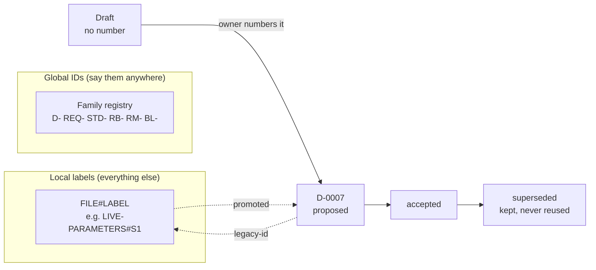

# Use a few registered global ID families; write every other label with its file name

## Context and Problem Statement

On 2026-10-12, after reading a table of IDs, the owner asked what the ID system was for and why it was needed. No ID system existed. Each agent had made up labels inside the file it was writing, and those labels now clash across files.

The research batch (RB-0003, [evidence](../research/0003-use-registered-id-families-and-file-qualified-labels.md), run after the owner chose to run it at 02:45 UTC) measured the problem:

- About 75 ID families. About 50 of them restart at 1 in each document.
- **21 labels clash.** `P1` has 7 meanings, and two of them are in the same file. "ADR 0001" names 3 different records.
- Every clash uses a one-letter prefix. No prefix of two or more letters clashed: `D-`, `SR`, `SRC-`, `FD`, `RM`, `WP-`, `AG` (as measured on 2026-10-12; `SR` is now `REQ-`, D-0014).

The owner's records already require stable IDs but never say how:
- Research `coordinator/system/REQUIREMENTS.md:75`
- Research `KNOWLEDGE-CONTRACT.md:7`
- (agent-estate `contract.md:23` and `inmaps-spec.md:44` say the same, but agent-estate is back-burnered (the owner, 2026-10-12), so they are cited as ideas mined, not as grounding.)

## Decision Drivers

- **One label, one thing:** a reference must land on exactly one item (REQUIREMENTS.md:75).
- **Many agents write in parallel:** two agents must never hand out the same number.
- **The owner can read and say it:** IDs that the owner sees must be short and recognisable.
- **Nothing breaks:** an existing reference keeps landing on its item.
- **Replaceable:** everything this decision creates can be swapped out later.
- **Follow established practice** where it exists (evidence, findings 2 and 3).

## Considered Options

1. **Hybrid:** a few registered global families, and file-qualified local labels for everything else.
2. **File-name qualification only:** no global IDs at all.
3. **Namespaced types:** `platform:PRD-R001`, from the Research documentation-contract draft that was never accepted.
4. **Opaque or time-based IDs:** ULID, UUIDv7 or timestamps.

## Decision Outcome

Chosen option: **1, the hybrid.** It is the only option that meets all six drivers (evidence, "How the decision used it").

### The rules

1. **Global IDs are only for things cited across files, repos and chats.** These are the registered families:

   | Family | Pattern | Example | Home register | Who numbers it |
   |---|---|---|---|---|
   | Decisions | `D-NNNN` | `D-0007` | central-hub `docs/decisions/` | Set by D-0001: the number is assigned when the PR opens |
   | Requirements | `REQ-NNNN` | `REQ-0022` | Research `coordinator/system/REQUIREMENTS.md` | The requirements register owner: the next number is assigned only after the owner says yes to the wording |
   | Standards | `STD-NNNN` | `STD-0001` | central-hub `docs/standards/` | The standards register owner: the number is assigned when the standard's PR opens |
   | Research batches | `RB-NNNN` | `RB-0077` | Research `areas/documentation/research/BATCHES.md` | The batch register owner: the number is assigned when the batch's SPEC.md is written |
   | Research methods | `RM-NNNN` | `RM-0033` | Research `areas/research-tooling/research/research-methods-crawl/methods/inventory.json` | The methods catalogue owner: the number is stored with the method and assigned only after the owner says yes to adding it, never from its place in the list |
   | Backlog items | `BL-NNNN` | `BL-0012` | project files `backlog/BACKLOG.md` | The backlog owner: the number is assigned when the row is added |

   A sources family is left out on purpose. Whether sources need a global family goes to the owner later, as its own question.

2. **One family registry.** The table above is the family registry.
   - A new family, or a change to a row (its home, who numbers it, or closing the family), is made only with the owner's approval, by its own decision record. That record's PR updates the row here.
   - A new prefix must have at least two characters and must not equal or start with an existing one, ignoring case.
3. **Number late, with one owner per family.** A draft has no number and is cited by its file path (`D-TBD`, `REQ-TBD`, `STD-TBD`, `RB-TBD`, `RM-TBD`, `BL-TBD`). Check that the number is unique before merging. Outside rule 5's Foundation exception, a number never changes after it is assigned.
4. **Everything else is a local label.** Outside its own file, write it with the file name: `LIVE-PARAMETERS#S1`. A bare one-letter label outside its own file is a mistake that reviewers flag.
5. **Old labels are not renamed, except during Foundation.**
   - Until the Activation gate passes, the owner may approve renaming an agent-made ID or label. The rename is then applied to every live file in central-hub, the Research repo and the project files, so the files read as if the new name had always been used. No inline "was D1" notes.
   - One corrections log per rename holds every old-to-new pair, the date and the owner's approval. Git history keeps the rest.
   - Records of what was said are never changed: the chat archive, captured transcripts and git history keep the old names.
   - Accepted decision records are corrected in place under D-0006, because a rename does not change any decision. Each correction PR lists every change, and the owner approves it by PR number and head SHA.
   - After the Activation gate passes, the old rule returns: when an item gets a new ID, its record lists the old one in `legacy-id`.
6. **Never reuse or delete an ID.** A superseded or withdrawn item keeps its ID, its status and a link to whatever replaced it. A decision record folded into another record keeps its number: the number is never reused, and [`CORRECTIONS.md`](CORRECTIONS.md) lists it with the record it was folded into. A retired method stays in the catalogue, marked `deprecated` or `replaced by RM-NNNN`. A done backlog item keeps its number and its row. D-0004's Foundation exception for void IDs still applies.
7. **Keep meaning out of the number.** The prefix names the family and nothing else. Status, topic and owner go in front matter or in the register's columns. A batch that continues another says so in its SPEC.md ("follows RB-0006"), not in its number.

### Consequences

- Good: today's 21 clashes stop spreading.
- Good: parallel agents cannot collide, because each family has one owner who hands out numbers.
- Good: a family's home can move by editing one registry row.
- Bad: local references get longer (`LIVE-PARAMETERS#S1` instead of `S1`).
- Bad: the registry is one more table to keep current.

### Confirmation

- A reviewing agent checks each new record and Library file for:
  - bare one-letter labels outside their own file;
  - a global ID that is not unique;
  - a prefix that is missing from the registry.
- Until a script exists, this is a review step, not CI.

## Pros and Cons of the Options

### 1. Hybrid
- Good: meets all six drivers. It matches what all 18 checked projects do: one owner numbers late, and numbers are never renumbered (evidence finding 3).
- Bad: two kinds of reference to learn, global and local.

### 2. File-name qualification only
- Good: no counter, no registry, nothing to migrate.
- Bad: file names are not unique (three `SPEC.md` files each have a `Q1`). Files move (LIBRARY.md:18 keeps an old-path column). Moving an item to another file changes its ID. The references are long to say. It also contradicts D-0001's "Permanent ID, never reused".

### 3. Namespaced types (`platform:PRD-R001`)
- Good: its lifecycle rules match practice (evidence finding 7).
- Bad: no rule for parallel minting and no registry. The parent is built into the ID, so `SPEC-001-B01` breaks if the item moves. ARK discourages project acronyms in prefixes.

### 4. Opaque or time-based IDs
- Good: no collisions, even offline.
- Bad: the owner cannot read or say them. They are fine as machine aliases underneath, but not as the IDs the owner sees.

## More Information

- **Evidence:** [../research/0003-use-registered-id-families-and-file-qualified-labels.md](../research/0003-use-registered-id-families-and-file-qualified-labels.md): batch RB-0003, an inventory of every ID family, a practice review, 18 projects and an independent design.
- Source limit: this environment blocked several primary sites (w3.org, ietf.org, doi.org and others), so those claims are search-summary only and are labelled.
- Reported, not fixed (agent-estate is back-burnered; noted only for whoever revives it):
  - agent-estate `register.go:571-591` may reuse a deleted `SRC-` number. Inferred from the code, not tested.
  - INMAPS has two 12-digit note-ID shapes that can look identical.
- Related records: D-0004 (void IDs). The records that add a family or change a rule here: D-0009 (standards), D-0014 (requirements, and rule 5's Foundation exception), D-0015 (research batches), D-0018 (research methods) and D-0020 (backlog items).
