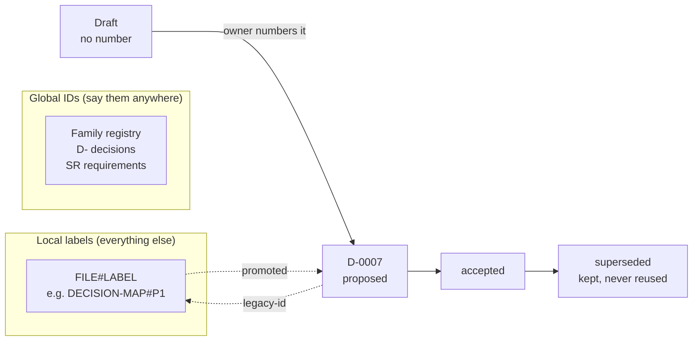

# Use a few registered global ID families; write every other label with its file name

## Context and Problem Statement

On 2026-10-12, after reading a table of IDs, Jon asked what the ID system was for and why it was needed. No ID system existed. Each agent had made up labels inside the file it was writing, and those labels now clash across files.

The research batch (RB-0003, [evidence](../research/0003-use-registered-id-families-and-file-qualified-labels.md), run after Jon chose to run it at 02:45 UTC) measured the problem:

- About 75 ID families. About 50 of them restart at 1 in each document.
- **21 labels clash.** `P1` has 7 meanings, and two of them are in the same file. "ADR 0001" names 3 different records.
- Every clash uses a one-letter prefix. No prefix of two or more letters clashed: `D-`, `SR`, `SRC-`, `FD`, `RM`, `WP-`, `AG`.

Jon's records already require stable IDs but never say how:
- Research `coordinator/system/REQUIREMENTS.md:75`
- Research `KNOWLEDGE-CONTRACT.md:7`
- (agent-estate `contract.md:23` and `inmaps-spec.md:44` say the same, but agent-estate is back-burnered (Jon, 2026-10-12), so they are cited as ideas mined, not as grounding.)

## Decision Drivers

- **One label, one thing:** a reference must land on exactly one item (REQUIREMENTS.md:75).
- **Many agents write in parallel:** two agents must never hand out the same number.
- **Jon can read and say it:** IDs that Jon sees must be short and recognisable.
- **Nothing renamed:** existing labels keep working.
- **Replaceable:** everything this decision creates can be swapped out later.
- **Follow established practice** where it exists (R3-practice, R3-repos).

## Considered Options

1. **Hybrid:** a few registered global families, and file-qualified local labels for everything else.
2. **File-name qualification only:** no global IDs at all.
3. **Namespaced types:** `platform:PRD-R001`, from the Research documentation-contract draft that was never accepted.
4. **Opaque or time-based IDs:** ULID, UUIDv7 or timestamps.

## Decision Outcome

Chosen option: **1, the hybrid.** It is the only option that meets all six drivers (see R3-SYNTHESIS, options table).

### The rules

1. **Global IDs are only for things cited across files, repos and chats.** Start with the two families that already exist in active records and have never clashed:

   | Family | Pattern | Example | Home register | Who numbers it |
   |---|---|---|---|---|
   | Decisions | `D-NNNN` | `D-0007` | central-hub `docs/decisions/` | Set by D-0001: the number is assigned when the PR opens |
   | Requirements | `SRNN` | `SR22` | Research `coordinator/system/REQUIREMENTS.md` | The Research requirements owner |

   A sources family is left out on purpose. The only existing one, `SRC-` from agent-estate's INMAPS, is back-burnered (Jon, 2026-10-12). Whether sources need a global family goes to Jon later, as its own question.

2. **One family registry.** The table above is the family registry. It lives in this record until it needs its own file; a change to it is a new decision record that supersedes this one. A new family is added only with Jon's approval. A new prefix must have at least two characters and must not equal or start with an existing one, ignoring case. A future sources family must not use `SRC-` without checking it against `SR` under this rule.
3. **Number late, with one owner per family.** A draft has no number and is cited by its file path (`D-TBD`, as today). Check the number is unique before merging. A number never changes after it is assigned.
4. **Everything else is a local label.** Outside its own file, write it with the file name: `DECISION-MAP#P1`, `LIVE-PARAMETERS#S1`. A bare one-letter label outside its own file is a mistake that reviewers flag.
5. **Old labels are never renamed.** When an item gets a global ID, its record lists the old label, written with its file name, in `legacy-id`, for example `legacy-id: [DECISION-MAP#W1]`.
6. **Never reuse, never delete.** A superseded or withdrawn record keeps its ID, its status and a link to whatever replaced it.
7. **Keep meaning out of the number.** The prefix names the family and nothing else. Status, topic and owner go in front matter.

### Consequences

- Good: today's 21 clashes stop spreading, and nothing has to be renamed.
- Good: parallel agents cannot collide, because each family has one owner who hands out numbers.
- Good: a family's home can move by editing one registry row.
- Bad: local references get longer (`DECISION-MAP#P1` instead of `P1`).
- Bad: the registry is one more file to keep current.
- Neutral: accepted records stay exactly as they are. D-0001's `legacy-id: [W1, W2]` stays as written, because only one file uses `W`.

### Confirmation

- A reviewing agent checks each new record and Library file for:
  - bare one-letter labels outside their own file;
  - a global ID that is not unique;
  - a prefix that is missing from the registry.
- Until a script exists, this is a review step, not CI.

## Pros and Cons of the Options

### 1. Hybrid
- Good: meets all six drivers. It matches what all 18 checked projects do: one owner numbers late, and numbers are never renumbered (R3-repos).
- Bad: two kinds of reference to learn, global and local.

### 2. File-name qualification only
- Good: no counter, no registry, nothing to migrate.
- Bad: file names are not unique (three `SPEC.md` files each have a `Q1`). Files move (LIBRARY.md:18 keeps an old-path column). Moving an item to another file changes its ID. The references are long to say. It also contradicts D-0001's "Permanent ID, never reused".

### 3. Namespaced types (`platform:PRD-R001`)
- Good: its lifecycle rules match practice (R3-practice Q4).
- Bad: no rule for parallel minting and no registry. The parent is built into the ID, so `SPEC-001-B01` breaks if the item moves. ARK discourages project acronyms in prefixes.

### 4. Opaque or time-based IDs
- Good: no collisions, even offline.
- Bad: Jon cannot read or say them. They are fine as machine aliases underneath, but not as the IDs Jon sees.

## More Information

- **Evidence:** [../research/0003-use-registered-id-families-and-file-qualified-labels.md](../research/0003-use-registered-id-families-and-file-qualified-labels.md): batch RB-0003, an inventory of every ID family, a practice review, 18 projects and an independent design.
- Source limit: this environment blocked several primary sites (w3.org, ietf.org, doi.org and others), so those claims are search-summary only and are labelled.
- Reported, not fixed (agent-estate is back-burnered; noted only for whoever revives it):
  - agent-estate `register.go:571-591` may reuse a deleted `SRC-` number. Inferred from the code, not tested.
  - INMAPS has two 12-digit note-ID shapes that can look identical.
- Open question for later: should open backlog items get a global family, or stay `DECISION-MAP#…`?

## Corrections

- **2026-10-23** (research batch IDs under D-0015): 3 research batch citations renamed: `R3` to `RB-0003`; `R3-SYNTHESIS.md` to `RB-0003-SYNTHESIS.md`; `R3-inventory.md` to `RB-0003-inventory.md`. Reason: D-0015 numbers research batches `RB-NNNN`, and its rule 5 renames live references in place; no decision changes. Approval: the owner, 2026-10-23T04:59:42Z (approval-ref cmsg_01X43rfNYp4H1dL1V2dkfkwN7qM5qKKp8HDEfuF6EYoQkC), naming PR #27 and head 8d63c29; approved commit 8d63c29543a8adccdebb9704146d067b238e1c54. Check: the drafting agent read the message at 2026-10-23T04:59Z and confirmed it names that PR and head.
- **2026-10-23** (owner's words and approvals recorded in neutral form under D-0016). Reason: D-0016 rules 5 to 7 and its "What happens to the existing records"; no decision changes. Where the text removed is the owner's words, this entry names where it was and a commit that holds it (edac9fe) instead of copying it (D-0016 rule 7).
  1. `accepted-evidence` rewritten once into D-0016 rule 6 fields with D-0006 step 7's fixed mapping, as amended by D-0016: `timestamp` to `approved-at`, `message-id` to `approval-ref`, `quote-check` to `check`; `approved-by: owner` and `approval-names` added; `quote` removed (its text is in `accepted-evidence.quote` at commit edac9fe). The acceptance message also raised two concerns for later: records pointing at files on one machine, and ties to one agent harness.
  2. In `check` (formerly `quote-check`), Jon's one-word earlier message (at commit edac9fe) is described instead of quoted. After: "An earlier one-word acceptance at 05:19:35Z". The rest of the value is unchanged.
  3. Context and Problem Statement, first paragraph: the quote of Jon's 2026-10-12 question (at commit edac9fe) replaced by a neutral summary. After: "On 2026-10-12, after reading a table of IDs, Jon asked what the ID system was for and why it was needed."
  4. Context and Problem Statement, second paragraph. Before: "The research batch (RB-0003, in the project files outside this repo at `central-hub/research/identifiers/`, run after Jon chose "Run it" at 02:45 UTC) measured the problem:" After: "The research batch (RB-0003, [evidence](../research/0003-use-registered-id-families-and-file-qualified-labels.md), run after Jon chose to run it at 02:45 UTC) measured the problem:" Reason: the old pointer is private; the decision card's option label is described instead of quoted.
  5. More Information, first bullet. Before: "Research (project files outside this repo): `central-hub/research/identifiers/`. SPEC.md has the gate, RB-0003-SYNTHESIS.md the recommendation and disagreements, RB-0003-inventory.md every clash with file:line, and SOURCES.md the sources." After: "**Evidence:** [../research/0003-use-registered-id-families-and-file-qualified-labels.md](../research/0003-use-registered-id-families-and-file-qualified-labels.md): batch RB-0003, an inventory of every ID family, a practice review, 18 projects and an independent design." Reason: the old pointer is private; links the evidence file (D-0016 rule 1 as amended by D-0017).
  6. The closing note on tidied quotes removed (D-0016 rule 5). Before: "_Jon's quoted words are shown with spelling and punctuation tidied; his exact wording is kept in the original chat records._" After: none.

  Approval: to be added after approval (D-0006 step 6).
