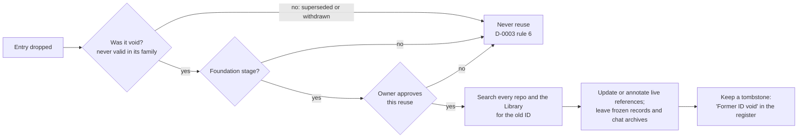

# During Foundation, allow a void ID's number to be reused, with the owner's approval and a tombstone

## Context and Problem Statement

D-0003 rule 6 says "Never reuse, never delete" for every registered ID family, including `REQ` requirements.

On 2026-10-13 the requirements register had a row, REQ-0021, that was a usage limit for one agent product. It broke two of the register's own rules: REQ-0008 (no vendor names) and REQ-0011 (everything replaceable). The owner dropped it at 04:23 UTC, because the system requirements should not name agent harnesses or vendors.

A new requirement (shared vocabulary) was then added as REQ-0022. The owner asked for the number REQ-0021 back (Central Hub project, Rules table thread, 2026-10-13 06:09 UTC), because the dropped row should never have been a rule and keeping the gap sat badly with building everything to be replaced. The reuse was done as a one-time exception in Research commit `f63ae969`. This record decides whether that exception becomes a rule, and on what conditions.

## Decision Drivers

- **The reason for "never reuse":** a reference must never silently point at a different item.
- **Early stage:** IDs are referenced only inside the owner's own repositories and project, and the number of references can be measured by search.
- **Gaps from mistakes:** a gap left by an entry that was never valid is noise in a small register.
- **Replaceable** (REQ-0011): the rule should be easy to tighten again later.

## Considered Options

1. **Reuse void IDs during Foundation only, under conditions** (below).
2. **Never reuse** (D-0003 rule 6 as written): revert REQ-0021 to REQ-0022.
3. **Reuse any dropped ID** while early.

## Decision Outcome

Chosen option: **1**.

*In words:* a dropped entry's number may be reused only if all of these are true:
1. The entry was **void**: it never met its family's own rules. A superseded or withdrawn entry that was once valid is never reused.
2. The system is still in **Foundation**: the Activation gate has not passed.
3. The **owner approves** that specific reuse.
4. The reuse is **traced**. Before the reuse:
   - search every repository and the Library for the old ID;
   - update or annotate every live reference;
   - leave frozen records and chat archives as they are.
5. The register keeps a **tombstone**: an entry such as "Former REQ-0021 (void)" that gives the old meaning, the reason, and what now holds the number. The decisions index is generated, so for a decision number the tombstone is a line in the numbers list of [`CORRECTIONS.md`](CORRECTIONS.md).

Everything else in D-0003 stays in force, and rule 6 still applies to every case these conditions don't cover.

### Consequences

- Good: a mistake doesn't leave a permanent gap while the system is small.
- Good: the tombstone and the search keep the reason for "never reuse" intact. Nobody following an old reference is misled without being told.
- Bad: this goes against published practice. ARK, McMurry, OBO, PEP and DOORS all say never reuse (D-0003's [evidence](../research/0003-use-registered-id-families-and-file-qualified-labels.md), finding 2). McMurry's rule covers identifiers "generated and publicly advertised" (McMurry et al., reference 4 there), and Foundation IDs are not public in that sense. That reading is inferred, not quoted from a source.
- Bad: one more condition for a reviewer to check.
- Neutral: two IDs have been reused so far: D-0006 (listed in [`CORRECTIONS.md`](CORRECTIONS.md)) and REQ-0021. REQ-0021's search found 6 files that meant the old entry: the 3 Rules table review files, the inbox row, Research `CURRENT-STATE.md`, and the register's own Dropped entry. All 6 were updated or annotated. 3 frozen study files and 20 chat archives were left as records. Results reported to the owner in the Rules table thread, 2026-10-13 06:13 UTC.

### Confirmation

- A reviewing agent checks every reused ID for a tombstone in its register and for a recorded search.
- The requirements register check (Research `areas/documentation/research/requirements-register/check/`) catches a duplicate REQ ID; it does not check reuse conditions.

## Pros and Cons of the Options

### 2. Never reuse
- Good: matches every source in the D-0003 research.
- Bad: keeps a gap made by an entry that should never have existed, against the owner's call.

### 3. Reuse any dropped ID while early
- Good: simplest.
- Bad: a superseded entry was once a real rule, and old references to it are meaningful. Reusing it would mislead them.

## More Information

- **Evidence:** no research batch of its own. It rests on D-0003's research: [../research/0003-use-registered-id-families-and-file-qualified-labels.md](../research/0003-use-registered-id-families-and-file-qualified-labels.md).
- **Exit path:** when the Activation gate passes, this exception ends and D-0003 rule 6 applies unchanged; no record needs editing. To end it sooner, a new record supersedes this one.
