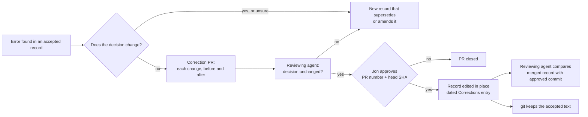

# Correct an accepted record in place when the decision does not change

## Context and Problem Statement

D-0001 says an accepted record's body never changes, and "a changed decision is a new record that supersedes the old one". It has no separate path for an error that leaves the decision the same.

D-0005 was accepted on 2026-10-16 with two internal inconsistencies and a wording slip. The decision is unchanged, but D-0001 left only one route: a full restatement of D-0005 with three small changes (drafted in PR #9, closed unmerged). Jon questioned that (Central Hub project, ADR corrections thread, 2026-10-16 07:56 UTC): "Got words wrong in the first one, so make an almost identical one with small changes. And oops, I got it wrong again, so I need to make a new one. This could be very bad for something that needs to be iterated on a lot."

This record decides how an error in an accepted record is fixed. It amends D-0001's immutability rule and does not supersede D-0001.

## Decision Drivers

- **Follow published practice.** Research batch RB-0029 (Research repo, `areas/documentation/research/adr-corrections/`) read 14 sources. None asks for a near-copy record to fix an error that leaves the decision the same. Supersede is described for a decision that is reversed or changed.
- **Only Jon accepts.** A correction must need the same approval as an acceptance.
- **Keep the history.** Anyone must be able to see what the record said when Jon accepted it.
- **Replaceable** (REQ-0011): easy to tighten back to strict immutability.

## Considered Options

1. **Correct in place, with a Corrections list in the record.** A changed decision still gets a new record.
2. **Supersede only** (D-0001 as written): every fix is a full new record.
3. **Separate errata list** (as IETF RFCs do): the record never changes, and errors are listed in a separate file.
4. **Living document:** edit accepted records freely, with date-stamped notes.

## Decision Outcome

Chosen option: **1**.

*In words:* if the decision would change, or it's unclear, write a new record. Otherwise open a correction PR that lists each change with its before and after text. A reviewing agent first says whether each change leaves the decision unchanged; if not, it becomes a new record. Jon then approves the PR the same way he accepts a record. If he declines, the PR closes, and a new record follows only if he says the decision should change. Once approved, the record is edited in place and gets a dated Corrections entry, and a reviewing agent compares the merged record with the approved commit. Git keeps the text as it was accepted.

### What counts as a correction

A correction fixes an error without changing what was decided:
- spelling, grammar or wording that doesn't change meaning;
- a broken link, path or file name;
- a wrong ID or cross-reference;
- two parts of the record that contradict each other, where the Decision Outcome shows which one was meant;
- a factual slip in the context or consequences that the decision does not rely on.

A changed fact that the decision relies on is a changed decision, even if the chosen option stays the same. Anything else is a changed decision too: a different chosen option, a changed rule, condition, scope or list that the record sets. That needs a new record that supersedes the old one, or amends it as this record amends D-0001.

### How a correction is made

1. Branch `docs/correct-d-nnnn-<short>`. PR title `docs: correct D-NNNN: 
`.
2. The PR body lists every change, quoting the text before and after, and says why it is a correction, not a changed decision.
3. The record gains, or extends, a `## Corrections` section at the end. Each entry has the date and each change with its before and after text and reason.
4. Before Jon sees it, a reviewing agent says for each change whether it leaves the decision unchanged. Any change it can't confirm moves to a new record.
5. Jon approves in the project chat, naming the PR number and head SHA, as for an acceptance.
6. After approval, only the Corrections entry's approval message ID and approved commit may be added. A reviewing agent compares the merged record with the approved commit, as for an acceptance.
7. `date` and `accepted-evidence` never change; they still describe the acceptance, and the quote in `accepted-evidence` stays verbatim. Another front-matter field changes only if a listed correction fixes it.

Spelling and punctuation tidies of Jon's quoted words in a record's body, as in commit `398a268` (PR #6), are corrections under this rule.

### Change to D-0001

This record amends one bullet of D-0001, "Immutability". From acceptance, it reads in effect: *once a record is accepted, its body changes only through a correction under D-0006 or a new record. A changed decision is a new record that supersedes the old one.*

D-0001's own body stays as it is. This record adds two optional fields to D-0001's field contract: `amends` (list of IDs) on a record that changes part of another record without replacing it, and `amended-by` (list of IDs) on the record it changes. The pair follows the `adr-tools` example link "Amends / Amended by". Like `supersedes` / `superseded-by`, they must be symmetric. From acceptance, `amended-by` joins D-0001's lifecycle fields, and D-0001's front matter gains `amended-by: [D-0006]`. The index generator reads both fields.

### What happens to D-0005 and PR #9

D-0005's three changes, as listed in the PR #9 draft, fit the definition above. If this record is accepted, D-0005 is corrected in place, as a separate step for Jon.

PR #9 is closed unmerged, so its draft never entered the log. This record reuses its number, D-0006, under D-0004: Jon approved the reuse (ADR corrections thread, 2026-10-16 08:25 UTC), and the only references to the old D-0006 were PR #9 itself and project chat, which stay as records. The tombstone is the line under More Information.

### Consequences

- Good: fixing a mistake is one small PR, not a near-copy record, so the index lists decisions, not versions of the same decision.
- Good: closest to the UK GDS Way and joelparkerhenderson's ADR guidance, and to the Python PEP 1 rule that resolved PEPs are "no longer substantially modified".
- Good: the text Jon accepted is still in git at the approved commit, and the Corrections list says what changed.
- Bad: goes against the strict "never edit" guidance from AWS, Azure Well-Architected and Fowler.
- Bad: "the decision did not change" is a judgment call. The guards are that Jon approves each correction, and that anything unsure is treated as a changed decision.
- Neutral: the 4-digit ID was not a reason for this record. Reading `D-NNNN` as at least four digits, D-10000 still works, as `printf "%04d"` already does (RB-0029 ledger rows 13 to 16).

### Confirmation

- Every merged change to an accepted record's body has a matching Corrections entry with an approval message ID and approved commit.
- A reviewing agent compares each correction PR's merged diff with its listed changes.
- Every correction PR has a reviewing agent's note, written before Jon's approval, on whether each change leaves the decision unchanged.
- `amends` and `amended-by` are symmetric.

## Pros and Cons of the Options

### 2. Supersede only
- Good: the strictest form, used by AWS, Azure Well-Architected and Fowler.
- Bad: a full new record for every slip, as with the PR #9 draft, and the index fills with near-copies.

### 3. Separate errata list
- Good: the accepted text never changes.
- Bad: readers must check two places to read a record correctly, and no ADR source in RB-0029 does this.
- Kept as the fallback if in-place corrections ever cause trust problems once agents have their own identities.

### 4. Living document
- Good: least work.
- Bad: a changed decision could slip in as an edit, which undermines "only Jon accepts".

## More Information

- **Research:** Research repo, `areas/documentation/research/adr-corrections/` (SYNTHESIS.md, LEDGER.md with 27 claims, VERIFY.md with an independent quote check: 21 of 21 quotes verbatim).
- **Former D-0006:** the PR #9 draft, a full restatement of D-0005; closed unmerged on 2026-10-16. Its number is reused here.
- **Exit path:** to return to strict immutability, a new record supersedes this one; past Corrections entries stay where they are. To switch to an errata list, a new record moves the Corrections entries into one file per record.

## Corrections

- **2026-10-23** (requirement IDs respelled under D-0014): 1 requirement ID renamed, `SR11` to `REQ-0011`. Before: `SR11`; after: `REQ-0011`, and the same for each pair listed. Reason: D-0014 retires the `SR` spelling and its rule 5 renames live references in place; no decision changes. Approval: Jon, "approve PR jonhill90/central-hub#23 cabb14e" (message cmsg_01X43rfNYp4H1dL1V2dkfkwNSXxbYGet6tcD4ggBBduwLF, 2026-10-23T04:04:08Z); approved commit cabb14e45f92ae73b089de0ce0ffb191dc47feea (PR #23).
- **2026-10-23** (research batch IDs under D-0015): 5 research batch citations renamed: `ADR-C1` to `RB-0029` (3 times); `ADR-C1` to `RB-0029` (2 times) in `evidence.md`. Reason: D-0015 numbers research batches `RB-NNNN`, and its rule 5 renames live references in place; no decision changes. Approval: the owner, 2026-10-23T04:59:42Z (approval-ref cmsg_01X43rfNYp4H1dL1V2dkfkwN7qM5qKKp8HDEfuF6EYoQkC), naming PR #27 and head 8d63c29; approved commit 8d63c29543a8adccdebb9704146d067b238e1c54. Check: the drafting agent read the message at 2026-10-23T04:59Z and confirmed it names that PR and head.

_Jon's quoted words are shown with spelling and punctuation tidied; his exact wording is kept in the original chat records._
