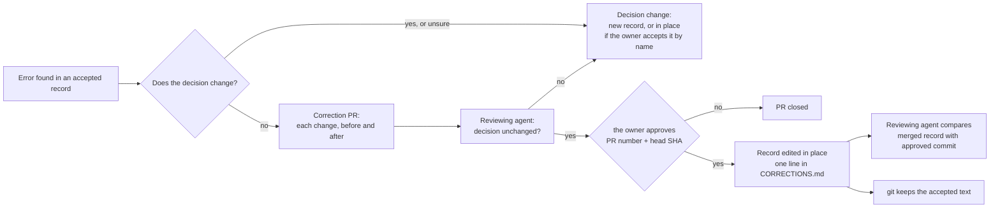

# Edit accepted records in place

## Context and Problem Statement

Without this record, the only route for an error in an accepted record is a full new record that supersedes the old one, even when the decision stays the same.

D-0005 was accepted on 2026-10-16 with two internal inconsistencies and a wording slip. The decision is unchanged, but D-0001 left only one route: a full restatement of D-0005 with three small changes (drafted in PR #9, closed unmerged). The owner questioned that route on 2026-10-16 (ADR corrections thread, 07:56 UTC): a near-copy record for every slip, and another for a slip in the copy, could work badly for records that are revised often.

This record decides how an error in an accepted record is fixed, and where the record of each fix is kept.

## Decision Drivers

- **Follow published practice.** Research batch RB-0029 ([evidence](../research/0006-allow-corrections-to-accepted-records.md)) read 14 sources. None asks for a near-copy record to fix an error that leaves the decision the same. Supersede is described for a decision that is reversed or changed.
- **Only the owner accepts.** A correction must need the same approval as an acceptance.
- **Keep the history.** Anyone must be able to see what the record said when the owner accepted it.
- **Replaceable** (REQ-0011): easy to tighten back to strict immutability.

## Considered Options

1. **Correct in place, with one corrections log for all records.** A changed decision is logged apart from corrections.
2. **Supersede only:** every fix is a full new record.
3. **Separate errata list** (as IETF RFCs do): the record never changes, and errors are listed in a separate file.
4. **Living document:** edit accepted records freely, with date-stamped notes.

## Decision Outcome

Chosen option: **1**.

*In words:* if the decision would change, or it's unclear, it is a decision change (below), not a correction. Otherwise open a correction PR that lists each change with its before and after text. A reviewing agent first says whether each change leaves the decision unchanged; if not, it is handled as a decision change. The owner then approves the PR the same way he accepts a record. If he declines, the PR closes, and a decision change follows only if he says the decision should change. Once approved, the record is edited in place so it reads as the current text, one line is added to the corrections log, and a reviewing agent compares the merged record with the approved commit. Git keeps the text as it was accepted.

### What counts as a correction

A correction fixes an error without changing what was decided:
- spelling, grammar or wording that doesn't change meaning;
- a broken link, path or file name;
- a wrong ID or cross-reference;
- two parts of the record that contradict each other, where the Decision Outcome shows which one was meant;
- a factual slip in the context or consequences that the decision does not rely on;
- adding an evidence file built under D-0016 rule 3, and its link from the record;
- updating an earlier record's text so it matches a later accepted record that changed part of it, where the later record keeps the reasons.

A changed fact that the decision relies on is a changed decision, even if the chosen option stays the same. Anything else is a changed decision too: a different chosen option, a changed rule, condition, scope or list that the record sets.

### A changed decision

A changed decision is never logged as a correction. It is made in one of two ways:
- a new record; or
- an edit in place, when the owner accepts that change by name in a PR. The record then reads as the current decision, with no "superseded" or "amended" notes.

A record may be edited this way whether or not its decision is built yet. Once it is built, the same PR must change the built thing to match, so the record and what runs never disagree.

Either way, the PR adds one line under "Decision changes" in [`CORRECTIONS.md`](CORRECTIONS.md): what changed, and the owner's request or choice it follows.

A record may be folded into another the same way. Its rules, reasons, considered options and revisit conditions move into the other record, and its file is removed. `CORRECTIONS.md` lists it, and the next new decision record takes its number (D-0004).

### How a correction is made

1. Branch `docs/correct-d-nnnn-<short>`. PR title `docs: correct D-NNNN: 
`.
2. The PR body lists every change, quoting the text before and after, and says why it is a correction, not a changed decision. Where the text removed is the owner's words, the PR body names where it was and a commit that holds it, instead of copying it (D-0016 rule 7).
3. The record is edited in place so it reads as the current text, with no Corrections section and no inline old-value notes. The PR adds one line to [`CORRECTIONS.md`](CORRECTIONS.md): the date, the record, what changed and the PR.
4. Before the owner sees it, a reviewing agent says for each change whether it leaves the decision unchanged. Any change it can't confirm is treated as a decision change.
5. The owner approves in the project chat, naming the PR number and head SHA, as for an acceptance.
6. After the merge, the next PR that edits `CORRECTIONS.md` adds that PR's approval facts (D-0016 rule 7: time, message id, approved head) and its merge commit to its lines. A reviewing agent compares the merged record with the approved commit, as for an acceptance.
7. `date` and the approval facts in `accepted-evidence` (`approved-by`, `approved-at`, `approved-commit`, `approval-ref`, `approval-names`) never change; they describe the acceptance. `check` and `merged` may be corrected so they state what happened. Another front-matter field changes only if a listed correction fixes it.

This process applies from PR #42 on. Each earlier correction is one line in `CORRECTIONS.md`, with its approval facts and merge commit; its full text is in git before the PR #42 merge.

### Consequences

- Good: fixing a mistake is one small PR, not a near-copy record, so the index lists decisions, not versions of the same decision, and each record reads as the current truth.
- Good: closest to the UK GDS Way and joelparkerhenderson's ADR guidance, and to the Python PEP 1 rule that resolved PEPs are "no longer substantially modified".
- Good: the text the owner accepted is still in git at the approved commit, and `CORRECTIONS.md` says what changed and in which PR.
- Bad: goes against the strict "never edit" guidance from AWS, Azure Well-Architected and Fowler.
- Bad: "the decision did not change" is a judgment call. The guards are that the owner approves each correction, and that anything unsure is treated as a changed decision.
- Neutral: the 4-digit ID was not a reason for this record. Reading `D-NNNN` as at least four digits, D-10000 still works, as `printf "%04d"` already does (evidence, finding 4).

### Confirmation

- Every merged change to an accepted record's body has a matching line in `CORRECTIONS.md`, with its PR, its approval facts and its merge commit.
- A reviewing agent compares each correction PR's merged diff with its listed changes.
- Every correction PR has a reviewing agent's note, written before the owner's approval, on whether each change leaves the decision unchanged.

## Pros and Cons of the Options

### 2. Supersede only
- Good: the strictest form, used by AWS, Azure Well-Architected and Fowler.
- Bad: a full new record for every slip, as with the PR #9 draft, and the index fills with near-copies.

### 3. Separate errata list
- Good: the accepted text never changes.
- Bad: readers must check two places to read a record correctly, and no ADR source in RB-0029 does this. The log chosen here differs: the record itself is fixed, and the log only says what changed.
- Kept as the fallback if in-place corrections ever cause trust problems once agents have their own identities.

### 4. Living document
- Good: least work.
- Bad: a changed decision could slip in as an edit, which undermines "only the owner accepts".

## More Information

- **Evidence:** [../research/0006-allow-corrections-to-accepted-records.md](../research/0006-allow-corrections-to-accepted-records.md): batch RB-0029, 14 sources read, 21 of 21 quoted passages matched the fetched text.
- **Exit path:** to return to strict immutability, a new record replaces this one; `CORRECTIONS.md` stays as the history. To switch to an errata list, the log's lines move into one file per record.
