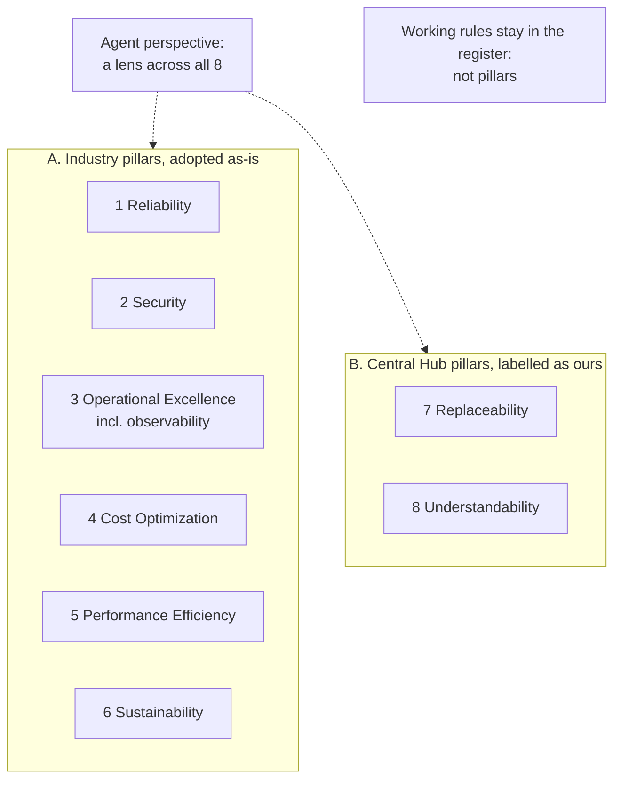

# Measure all of Central Hub against six industry pillars plus two labelled Central Hub pillars (corrected restatement of D-0005)

This record restates D-0005 in whole with two errors corrected, because D-0001 keeps accepted bodies unchanged. The decision itself is the same. The changes are listed under "Changes from D-0005" at the end.

## Context and Problem Statement

Jon wants the homelab to be "the prime example of K8s reliability, high availability, resiliency, cost optimisation, and all the other pillars of the Well-Architected Framework from Microsoft. But you know, the CNCF / our version." (Central Hub project, Kubernetes thread, 2026-10-15.) He scoped it to the whole system, not one cluster: "It's not to AKS, it's to my Central Hub as a whole."

There is no CNCF well-architected framework. Each cloud vendor publishes its own, and they overlap. Central Hub also has goals that no published framework treats as a pillar, above all that every component can be swapped. This record decides which pillars Central Hub is measured against, and where the line sits between adopting a standard and adding our own.

Research: batch R6 in the project Library (`central-hub/research/well-architected/`), a 96-claim ledger with an independent review, and the proposal `central-hub/operating-model/PILLARS.md`. Jon agreed the shape on 2026-10-15, where "B" was the proposal's name for what is option 1 below: "I love B. As long as we have the mapping distinction I love it. We just need to make sure it is assumed just like everything else that it could be replaced."

## Decision Drivers

- **Use the industry's words.** Someone who knows Azure, AWS or Google Well-Architected should recognise every standard pillar by name.
- **Whole system.** The pillars apply to the cluster, agents, identity, knowledge, documentation, the repository and the decision process.
- **Replaceable** (SR11 in the requirements register): this framework, too, must be easy to drop or swap.
- **Clear line.** Anything that is ours must be labelled as ours.

## Considered Options

1. **Six industry pillars adopted as-is, plus two labelled Central Hub pillars** (Replaceability, Understandability), with an agent perspective as a lens across them.
2. **Azure Well-Architected as-is**: five pillars.
3. **AWS or Google as-is**: six pillars, including Sustainability.
4. **A framework of our own**, with new names throughout.

## Decision Outcome

Chosen option: **1**, because it keeps every industry name and checklist and adds only what all of them leave out, with a label saying so.

*In words:* Central Hub is measured against eight pillars in two labelled groups. An agent perspective applies across all eight. Rules about how agents and decisions work are not pillars.

**The line between standard and ours:**
1. **Adopt as-is.** A pillar shared by 4 or more of the 5 frameworks compared (Microsoft, AWS, Google, GitHub, HashiCorp) keeps its industry name and checklist. Security is in all 5. Reliability, cost and operations are in 4.
2. **Extend only where every standard is silent,** and label the result as a Central Hub pillar. None of the five makes replaceability or portability a pillar.
3. **One exception to rule 1:** Sustainability is a pillar in only 2 of the 5 (AWS and Google; Azure treats it as guidance across pillars). It is still adopted as an industry pillar, with that difference noted, because two of the three cloud frameworks name it.
4. Observability stays inside Operational Excellence, as in Azure (OE:07), so the mapping back to Azure Well-Architected is one to one.

**The pillars:**

| # | Pillar | Group | Origin | Register rows today |
|---|---|---|---|---|
| 1 | Reliability | industry | Azure, AWS, Google; HashiCorp "resilient systems" | SR11, SR22 |
| 2 | Security | industry | all five | SR03, SR19 |
| 3 | Operational Excellence | industry | Azure, AWS, Google; HashiCorp "automate" | SR05, SR10 |
| 4 | Cost Optimization | industry | Azure, AWS, Google; HashiCorp "optimize" | SR23 |
| 5 | Performance Efficiency | industry | Azure, AWS, Google; HashiCorp "optimize" | SR24 |
| 6 | Sustainability | industry | AWS and Google pillar; Azure guidance | SR25 |
| 7 | Replaceability | Central Hub | ISO/IEC 25010:2023 "replaceability", under Flexibility | SR02, SR08, SR11 |
| 8 | Understandability | Central Hub | none as a pillar; documentation is its main area | SR01, SR05, SR06, SR18, SR20, SR21 |

The register rows are in the Research repo's requirements register (`coordinator/system/REQUIREMENTS.md`).

**Agent perspective.** Google adds cross-pillar "perspectives" instead of new pillars. Central Hub's perspective asks how each pillar applies when the worker is an agent: one identity per agent (Security), model and token spend per agent (Cost), agent access that survives a rebuild (Reliability), attributed and explained agent actions (Understandability).

**Not pillars.** SR07, SR09, SR12 and SR13 to SR17 describe how agents and decisions work, not how the system is built. They stay as rules in the register. GitHub's "Governance" pillar is the nearest match, and those rules already cover it.

### Consequences

- Good: anyone who knows a cloud framework can read pillars 1 to 6 without learning new words.
- Good: every pillar now has at least one requirement in the register.
- Good: the two extensions are visible as ours, so they can be dropped without touching the rest.
- Bad: eight pillars is more than any single vendor framework, so reviews take longer.
- Bad: how each pillar is checked outside the cluster (agents, knowledge, repository) is not yet researched.
- Neutral: no peer-reviewed papers were searched in R6.

### Confirmation

- Each pillar has at least one requirement in the register; the register check (`areas/documentation/research/requirements-register/check/` in the Research repo) catches broken rows.
- A future record proposing a component names how it affects each pillar.
- A reviewing agent checks that the pillar table here matches `PILLARS.md` in the Library.

## Pros and Cons of the Options

### 2. Azure Well-Architected as-is
- Good: the framework Jon already knows; no mapping needed.
- Bad: no Sustainability pillar, no replaceability, and it is written for Azure workloads.

### 3. AWS or Google as-is
- Good: six pillars, including Sustainability.
- Bad: still no replaceability or understandability, and both are written for their own clouds.

### 4. A framework of our own
- Good: fits Central Hub exactly.
- Bad: loses the industry names, so nothing maps back; against the "adopt where 4 or more agree" line.

## More Information

- **Exit path:** to move to plain Azure Well-Architected, drop or fold pillars 6 to 8. To move to plain AWS or Google Well-Architected, which both have Sustainability, drop or fold pillars 7 and 8 only. No content is lost, because every item already sits under a standard name or a labelled extension. A new record supersedes this one.
- **Sources** (fetched 2026-10-15):
  - Azure: https://learn.microsoft.com/en-us/azure/well-architected/pillars and the Operational Excellence checklist https://learn.microsoft.com/en-us/azure/well-architected/operational-excellence/checklist
  - AWS: https://docs.aws.amazon.com/wellarchitected/latest/framework/the-pillars-of-the-framework.html
  - Google: https://cloud.google.com/architecture/framework
  - GitHub: https://raw.githubusercontent.com/github/github-well-architected/main/docs/framework-overview.md
  - HashiCorp: https://developer.hashicorp.com/well-architected-framework/what-is
  - CNCF cloud native definition: https://raw.githubusercontent.com/cncf/toc/main/DEFINITION.md
  - ISO/IEC 25010 (secondary summary): https://quality.arc42.org/standards/iso-25010

- **Changes from D-0005** (found by a reviewing agent on PR #8 after merge):
  1. Pillar 3 listed SR09 and SR12, while "Not pillars" said they are working rules. Both are decision-authority rules in the register, so they are removed from pillar 3.
  2. The exit path said to drop or fold pillars 6 to 8 for Azure, AWS or Google. AWS and Google both have Sustainability, so for them only pillars 7 and 8 go.
  3. Wording only: rule 3 now says it is an exception to rule 1, and the "I love B" quote says that B is option 1.

_Jon's quoted words are shown with spelling and punctuation tidied; his exact wording is kept in the original chat records._
