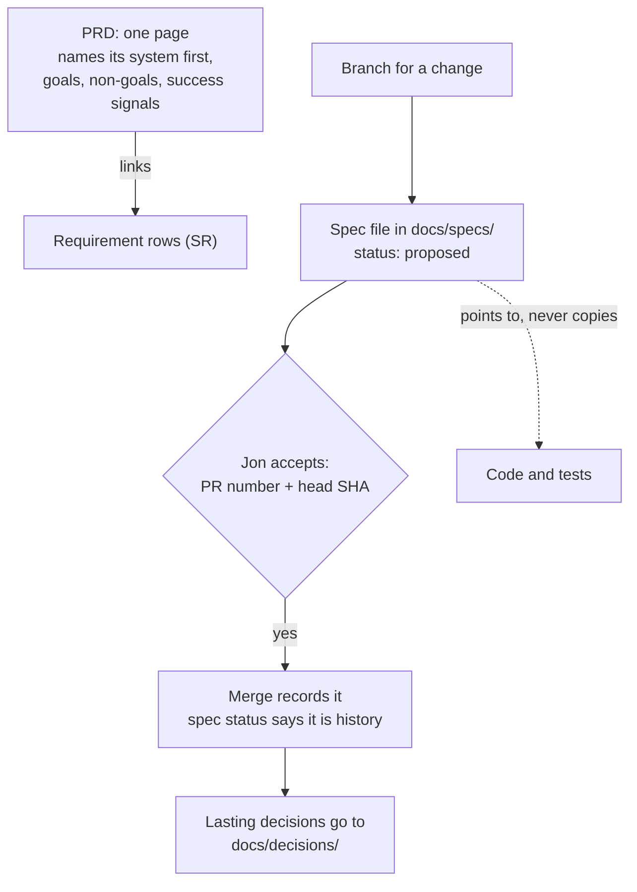

# Use a one-page PRD and frozen per-change specs as version 1 of Central Hub's requirement records

## Context and Problem Statement

Jon's project brief asks for a PRD and specifications, and for maintained, indexed documentation that shows detail step by step to people and agents (Research repo, `coordinator/platform-startup/BRIEF.md`, line 5). Jon also asked that a spec point to the code rather than repeat it, so code is never updated in two places (Central Hub project, 2026-10-17 21:30 UTC). He said he has to pick something for version 1, knowing it will be replaced (2026-10-17 20:36 UTC).

Three drafts exist in the Research repo and none is accepted: a platform PRD, a documentation contract and a first-slice spec. This record decides which documents hold "what and why" and "what changes", and what happens to them after a merge.

## Decision Drivers

- **What the evidence shows.** Research batch RB-0057 ([evidence](../research/0007-use-a-one-page-prd-and-frozen-per-change-specs.md)) found:
  - 81.5% of spec files in public repos have one commit, so most specs behave as frozen records.
  - Measured gains come from short, curated context and from checks, not from longer spec documents.
  - No study shows that a project-level PRD helps people or agents.
- **Jon's brief asks for a PRD.** The PRD is kept because Jon asked for it, not because the evidence requires it.
- **Point to the code.** IEEE 830-1998 says the same requirement "should not appear in more than one place". The modern sources agree.
- **Fit the accepted rules.** The fit was checked in RB-0057 (evidence finding 8):
  - Jon accepts work by a message naming the PR number and head SHA (AGENTS.md rule 1, D-0001).
  - Every document kind sits under `docs/`.
  - Labels are written with the file name (D-0003).
- **Replaceable** (REQ-0011).

## Considered Options

1. **Living spec:** one document per capability, kept current, with each change merged into it (Spec Kit "Living Spec", OpenSpec).
2. **Frozen spec per change, plus a one-page PRD:** one spec per change, frozen once the change is accepted (Python PEP 1, Kubernetes KEPs, Spec Kit "Flow-Forward").
3. **Throw-away plan:** a working file used while building, deleted afterwards (Pocock, agent plan modes).
4. **Tests are the spec:** acceptance criteria written as executable checks (Specification by Example).
5. **No separate document:** the PR or issue description holds the spec (GitLab, BMAD).

## Decision Outcome

Chosen option: **2**. Jon said yes to the proposed option on 2026-10-19 at 02:38 UTC, on a decision card that asked: "Use a one-page PRD plus frozen per-change specs in docs/specs/ as version 1?" That answer chose the option. This record still needs his acceptance under D-0001.

*In words:* there is one short PRD. A change big enough to need it gets one spec file, written on the change's branch. Jon accepts the spec with his PR-and-SHA message, and the merge records that acceptance. After merge the spec is history, and its status field says so. Anything that has to last becomes a decision record. Specs point to code and tests and never copy them.

### Rules

1. **PRD.** One page.
   - It names its system first (system 8, Platform) and leads with a drawing.
   - It holds goals, non-goals and success signals, and links to the requirement rows.
   - It holds no "how".
   - It replaces the Research repo's platform PRD draft, so there is one PRD.
2. **When a spec is needed.** Only for work that spans several sessions or crosses systems. Smaller changes need only the PR description.
3. **Where specs live.** One file per change in `docs/specs/`, named `YYYY-MM-<slug>.md`. The folder has a generated index, as `docs/decisions/` does.
4. **What a spec holds.**
   - What and why.
   - Acceptance criteria, split into automated (commands) and manual (what Jon checks).
   - A decision log for choices made during the change.
   - Sketches of code that does not exist yet are allowed.
   - The agent that writes the code does not edit the acceptance criteria in the same step.
5. **Acceptance and freezing.**
   - Jon accepts a spec as he accepts a record: a message naming the PR number and head SHA.
   - The merge records the acceptance.
   - A spec carries a status field, and after merge its body is not edited.
   - Agents treat a merged spec as history, not as current truth.
6. **Pointing to code.**
   - Never copy existing code, requirement rows or decision records. Link to them instead.
   - The PRD points at `main`.
   - A merged spec uses commit-pinned links.
   - Every link says when to read it.
   - Links go one level deep.
7. **Layers.** There are at most two. The PRD and the root agent file are the top layer, and everything else is one link away.
8. **Labels** inside a spec or the PRD are written with the file name (D-0003). No new global ID family is added.

### Not decided here

Each of these is a later decision for Jon:
- the final folder and document names, which follow the vocabulary work;
- whether the PRD sits at the repository root or under `docs/`;
- the status words for specs;
- which store holds one system's PRD and specs about another system;
- what happens to the documentation-contract and first-slice drafts;
- whether a decision record may be edited before it is implemented;
- a check that fails on a dead link to code. Version 1 adds none, because this repo has no code yet.

### Consequences

- Good: matches how specs behave in practice: most are written once and not touched again.
- Good: it fits D-0002 short-lived branches and Jon's PR-and-SHA acceptance.
- Good: code lives in one place, so nothing is updated twice.
- Bad: specs do not describe the current system. A reader must look at the code, the PRD and the decision records for that.
- Bad: the PRD rests on Jon's preference, not on measured evidence. BMAD's guidance would skip it for a one-owner project.
- Neutral: the rules are prose until code lands. The evidence favours checks, so checks are the next step.

### Confirmation

- Each merged spec has a status field and an acceptance message naming its PR and head SHA.
- No spec or PRD contains a copy of existing code, requirement rows or decision records. A reviewing agent checks each spec PR for this.
- `docs/specs/` has a generated index once its first spec exists.

## Pros and Cons of the Options

### 1. Living spec
- Good: one place says how the system works now.
- Bad: in practice, 47.4% of OpenSpec's "living" capability specs have one commit.
- Bad: someone must merge every change back into the spec.

### 3. Throw-away plan
- Good: cheapest.
- Bad: the acceptance criteria have no lasting home.
- Bad: a plan pushed to a branch of this public repo is published even after it is deleted.

### 4. Tests are the spec
- Good: has the strongest evidence. Rules turned into checks got 88.3% compliance versus 67.0%.
- Bad: there is no code yet, so nothing runs the checks.

### 5. No separate document
- Good: least to maintain.
- Bad: the record sits outside git, which D-0001 rejected for decisions.
- Bad: Jon's brief asks for a PRD.

## More Information

- **Evidence:** [../research/0007-use-a-one-page-prd-and-frozen-per-change-specs.md](../research/0007-use-a-one-page-prd-and-frozen-per-change-specs.md): batch RB-0057, with a recall check that found 194 of 220 known items, an independent check of 150 claims (140 supported, none false) and a check of the fit with the organization research.
- **Earlier proposal A2** (batches RB-0037 and RB-0040) is replaced by this record, which keeps its per-change rules.
- **Exit path:**
  - Delete the PRD; the requirement rows remain.
  - Stop writing specs; merged specs stay as history.
  - Nothing here adds a tool.

## Corrections

- **2026-10-23** (requirement IDs respelled under D-0014): 1 requirement ID renamed, `SR11` to `REQ-0011`. Before: `SR11`; after: `REQ-0011`, and the same for each pair listed. Reason: D-0014 retires the `SR` spelling and its rule 5 renames live references in place; no decision changes. Approval: Jon, 2026-10-23T04:04:08Z, message cmsg_01X43rfNYp4H1dL1V2dkfkwNSXxbYGet6tcD4ggBBduwLF, naming PR #23 and head cabb14e; approved commit cabb14e45f92ae73b089de0ce0ffb191dc47feea (PR #23).
- **2026-10-23** (research batch IDs under D-0015): 4 research batch citations renamed: `PS3` to `RB-0057` (2 times); `PS1` to `RB-0037`; `PS2` to `RB-0040`. Reason: D-0015 numbers research batches `RB-NNNN`, and its rule 5 renames live references in place; no decision changes. Approval: the owner, 2026-10-23T04:59:42Z (approval-ref cmsg_01X43rfNYp4H1dL1V2dkfkwN7qM5qKKp8HDEfuF6EYoQkC), naming PR #27 and head 8d63c29; approved commit 8d63c29543a8adccdebb9704146d067b238e1c54. Check: the drafting agent read the message at 2026-10-23T04:59Z and confirmed it names that PR and head.
- **2026-10-23** (owner's words and approvals recorded in neutral form under D-0016). Reason: D-0016 rules 5 to 7 and its "What happens to the existing records"; no decision changes. Where the text removed is the owner's words, this entry names where it was and a commit that holds it (ba5bb20) instead of copying it (D-0016 rule 7).
  1. `accepted-evidence` rewritten once into D-0016 rule 6 fields with D-0006 step 7's fixed mapping, as amended by D-0016: `timestamp` to `approved-at`, `message-id` to `approval-ref`, `quote-check` to `check`; `approved-by: owner` and `approval-names` added; `quote` removed (its text is in `accepted-evidence.quote` at commit ba5bb20). No value changes.
  2. Context and Problem Statement, first paragraph: the quotes of Jon's brief and of Jon's 2026-10-17 21:30 UTC message (at commit ba5bb20) replaced by neutral summaries. After: "Jon's project brief asks for a PRD and specifications, and for maintained, indexed documentation that shows detail step by step to people and agents (Research repo, `coordinator/platform-startup/BRIEF.md`, line 5). Jon also asked that a spec point to the code rather than repeat it, so code is never updated in two places (Central Hub project, 2026-10-17 21:30 UTC)."
  3. Decision Drivers, first bullet. Before: "Research batch RB-0057 (Research repo, `areas/documentation/research/prd-spec-ps3/`) found:" After: "Research batch RB-0057 ([evidence](../research/0007-use-a-one-page-prd-and-frozen-per-change-specs.md)) found:" Reason: the old pointer is private; links the evidence file (D-0016 rule 1 as amended by D-0017).
  4. Decision Drivers, fourth bullet. Before: "The fit was checked in RB-0057 `ORG-CHECK.md`:" After: "The fit was checked in RB-0057 (evidence finding 8):" Reason: the old pointer is private.
  5. More Information, first bullet and its four sub-bullets. Before: "- **Research:** Research repo, `areas/documentation/research/prd-spec-ps3/`.   - `SYNTHESIS.md` holds the options and the recommendation.   - `RECALL.md`: 194 of 220 known items found.   - `CHECK.md`: an independent check of 150 claims; 140 supported, none false.   - `ORG-CHECK.md`: the fit with the organization research." After: "- **Evidence:** [../research/0007-use-a-one-page-prd-and-frozen-per-change-specs.md](../research/0007-use-a-one-page-prd-and-frozen-per-change-specs.md): batch RB-0057, with a recall check that found 194 of 220 known items, an independent check of 150 claims (140 supported, none false) and a check of the fit with the organization research." Reason: the old pointers are private; links the evidence file (D-0016 rule 1 as amended by D-0017).
  6. The 2026-10-23 requirement-ID entry above: its approval, which quoted the approval message (at commit ba5bb20), rewritten as D-0016 rule 6 facts. After: "Approval: Jon, 2026-10-23T04:04:08Z, message cmsg_01X43rfNYp4H1dL1V2dkfkwNSXxbYGet6tcD4ggBBduwLF, naming PR #23 and head cabb14e; approved commit cabb14e45f92ae73b089de0ce0ffb191dc47feea (PR #23)." No value changes.
  7. The closing note on tidied quotes removed (D-0016 rule 5). Before: "_Jon's quoted words are shown with spelling and punctuation tidied; his exact wording is kept in the original chat records._" After: none.

  Approval: to be added after approval (D-0006 step 6).
