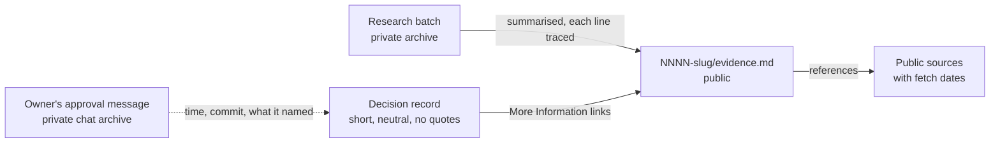

# Give each decision record a public evidence file, and record the owner's approval and reasons in neutral words

## Context and Problem Statement

The research behind each decision record lives in a private research repository and in project files. This repository is public. Of the 14 records on `main` at 05a48ff, 13 point to research a public reader cannot open: the private repository returns "not found" to an outside request. That repository is also expected to go away once the knowledge and documentation systems exist (D-0012, "Not decided here").

The records also quote the owner's chat messages word for word. 13 of 14 record bodies do so, and every `accepted-evidence` block holds a `quote:` field, as D-0001 requires. D-0015, accepted later, follows the same pattern.

On 2026-10-23 the owner asked for two changes. The research the records rely on should be included in this repository, with nothing invented. The records should stop quoting the owner, and should state what the owner asked or decided in a neutral, professional tone. An earlier request from 2026-10-12, to remove references to private, machine-local material from the records, points the same way.

This record decides what a decision record carries about its research, and how it records the owner's approval and reasons.

## Decision Drivers

- **Readable in public.** A reader of this repository can see the evidence without access to anything private.
- **Nothing invented.** Every line of evidence comes from research that already exists.
- **No private material** (CLAUDE.md rule 4). Research files hold the owner's words, chat ids and other private details.
- **Neutral tone.** Published guidance asks for records that are factual and plain: Nygard's context is "value-neutral", and Azure Well-Architected asks for records that are "pithy, assertive, on-topic, and factual".
- **Each record stands alone.** Azure Well-Architected says extra material can be linked, "but the decision must be clear and stand alone without that material".
- **Replaceable** (REQ-0011).

## Considered Options

1. **One evidence file next to each record**, built only from the existing research, with public references.
2. **References only:** a short public reference list in each record's More Information, and no evidence file.
3. **Copy the research folders** into `docs/research/`.
4. **Keep links to the private research** (today).

## Decision Outcome

Chosen option: **1**. On 2026-10-23 at 04:11 UTC the owner chose to write this as a decision record, on a decision card that offered options 1 to 3. That choice is not acceptance; this record still needs acceptance under D-0001.



*In words:* each record links one public evidence file. The evidence file summarises the research batch, and a reviewing agent traces every line to the batch before the owner sees it. The evidence file cites public sources. The record states the owner's request and approval as facts with dates; the owner's own words stay in the private chat archive.

### Rules

1. **Evidence file.** A record that rests on research gets `docs/decisions/NNNN-slug/evidence.md`, in a folder named like the record. It is created with the record, or later by a correction under D-0006. It holds:
   - the question the research answered;
   - the method and the date;
   - the findings, each with its label (sourced, measured or inferred) and a reference number;
   - the checks that were run, with their numbers (for example, a recall check or a claim check);
   - the limits: what was not read, and why;
   - references in two lists, "relied on" and "background", each a public locator with its fetch date (the normative and informative split of RFC 7322);
   - one line naming the research batch and saying its working files are private.
2. **No research, no file.** A record that rests on no research batch says so in one line under More Information, and names what it rests on instead.
3. **Nothing invented.** Every finding, number, quote and reference in an evidence file comes from a file that already exists in the batch: a ledger row, the synthesis or a check. One short section, "How the decision used it", is written from the record itself and says so. Before the owner sees it, a reviewing agent checks every line against the batch and lists anything it could not trace. Lines it cannot trace are removed.
4. **No private material.** An evidence file holds no owner quotes, chat ids, machine paths, hostnames or addresses. Published sources may be quoted.
5. **The owner's words.** A record and its evidence file never quote the owner. They state the owner's request, answer or reason in neutral third person, with its date, for example: "On 2026-10-22 the owner asked for a map of document kinds for every scenario." The owner's exact words stay in the private chat archive. The note at the end of a record about tidied quotes is no longer used.
6. **Approval block.** In D-0001's field contract, `accepted-evidence` becomes:

   ```yaml
   accepted-evidence:
     approved-by: owner
     approved-at: <UTC timestamp of the approval message>
     approved-commit: <full SHA of the approved head>
     approval-ref: <message id in the owner's chat archive>
     approval-names: <what the message named, e.g. "PR #19 and head ffd8dca">
     check: <who confirmed the message names that PR and head, and when>
     merged: <who merged, and when, or "not yet">
   ```

   `approval-ref` keeps the message id because it is the one exact key into the chat archive. It opens nothing without the owner's account, so it is not a private value under CLAUDE.md rule 4. It does tie the record to one chat product's ids; when the archive moves to another store, a correction can replace the id with that store's key.

   This follows the published processes read, none of which quotes the approver. Python's PEP 1 records a date linked to the decision post, Kubernetes KEPs list approvers by handle, and AWS adds "a timestamp, version, and list of stakeholders". The block gives up D-0001's reason for a verbatim quote, which was that the proof would not depend on a link staying live: a public reader now sees the facts but not the message. Until the Activation gate's per-agent identities exist, neither form is proof that an agent could not write. Both rest on convention plus a reviewing agent's check, as D-0001 says.
7. **Corrections that remove the owner's words.** D-0006 steps 2 and 3 quote the text before and after each change, in the PR body and in the record's Corrections section. When the text removed is the owner's words, the PR body and the Corrections entry name where it was and the commit that still holds it, instead of copying it. Every other correction keeps quoting its before and after text. The approval of a correction (D-0006 step 6) is recorded with rule 6's facts (time, commit, message id, what the message named), never a quote.

### Changes to D-0001 and D-0006

- **D-0001**, "Who accepts, and how it's proven": from acceptance, `accepted-evidence` holds the fields in rule 6, and "his message text, verbatim" no longer applies. The `quote-check` field becomes `check`: a check that the message names the approved PR and head. The Confirmation bullet "its quote is checked against the source message" reads, in effect, "its `check` confirms the message names the approved PR and head". D-0001's `amended-by` becomes `[D-0006, D-0016]`.
- **D-0006**, "What counts as a correction": the list gains one item, adding an evidence file built under rule 3 and its link from the record.
- **D-0006**, "How a correction is made":
  - Steps 2, 3 and 6 gain rule 7's exception.
  - Step 7 keeps "`date` and `accepted-evidence` never change", with one exception: a correction under rule 7 may rewrite the block once into rule 6's fields. The mapping is fixed: `timestamp` becomes `approved-at`, `message-id` becomes `approval-ref`, `approved-commit` and `merged` stay, `quote-check` becomes `check`, `approved-by: owner` and `approval-names` are added, and `quote` is removed. No value changes.
  - D-0006's `amended-by` becomes `[D-0016]`.
- The bodies of D-0001 and D-0006 stay as they are, as D-0006 did for D-0001.

### What happens to the existing records

Nothing changes in D-0001 to D-0015 through this record alone. After acceptance, the owner picks the order. For each group of records, one correction PR under D-0006 does four things: it rewords the owner's words in neutral terms, rewrites the `accepted-evidence` block under rule 6, rewrites any Corrections entry that quotes an approval message (D-0005 has one), and adds the evidence file and its link. D-0006's own evidence file is already in this PR, as the worked example (`0006-allow-corrections-to-accepted-records/evidence.md`); its link is added by D-0006's correction.

The old quotes stay in git history and in past PR text. This repository is public, and a commit cannot be un-published (CLAUDE.md rule 4). The cleanup changes what a reader sees on `main`, not the history.

### Consequences

- Good: a public reader can see what each decision rests on, and check each finding against a public source.
- Good: the evidence stays in this repository when the private research repository goes away.
- Good: records read as plain, factual documents, in the tone the published guidance asks for.
- Bad: a second frozen file per record, which has to be built and checked. The largest research batch cites 859 public addresses, so its evidence file has to choose what the decision relied on.
- Bad: the "every line traced" promise is checked against private files, so a public reader has to trust the reviewing agent's check. A reader can still check each finding against its public reference.
- Bad: the approval proof moves from a quote in the record to a pointer into a private archive.
- Neutral: there is little precedent for this exact form. PEP 1 allows a support-file folder per PEP (meant for files such as diagrams), each Kubernetes KEP is a folder, and 3 of the 646 entries in Rust's RFC folder are companion folders, one of which holds a "Rationale and alternatives" file.

### Confirmation

- A reviewing agent checks every evidence file line against its batch before the owner sees it, and lists what it could not trace.
- After the cleanup, a search of `docs/` finds no owner quotes and no `quote:` field. The count is recorded in the last correction PR.
- Every record either links an evidence file or says in one line that it rests on no research.
- `amends` and `amended-by` stay symmetric.

## Pros and Cons of the Options

### 2. References only
- Good: one file per record, and the record still stands alone.
- Good: everything in it can be checked by a public reader.
- Bad: drops the findings, the checks and the limits, so the research itself is not included, which the owner asked for.

### 3. Copy the research folders
- Good: nothing is summarised, so nothing is lost.
- Bad: about 4.2 MB of Markdown, and every folder quotes the owner. Every file would need a privacy scrub first.
- Bad: D-0012 rule 6 keeps learning material out of `docs/`, so this would change D-0012.

### 4. Keep links to the private research
- Good: no work.
- Bad: public readers cannot follow the links, and the links stop working when the private repository goes away.

## More Information

- **Evidence:** [0016-give-records-an-evidence-file-and-neutral-approval/evidence.md](0016-give-records-an-evidence-file-and-neutral-approval/evidence.md).
- **Worked example:** [0006-allow-corrections-to-accepted-records/evidence.md](0006-allow-corrections-to-accepted-records/evidence.md).
- **Exit path:** evidence files are plain Markdown in folders beside their records. Delete a folder to drop one, or move the folders into a future knowledge system. The approval fields map back to D-0001's fields one to one, except the quote, which stays in the chat archive.
- **Related records:** D-0001, D-0006, D-0012.

## Corrections

- **2026-10-23** (research batch IDs under D-0015): 2 research batch citations renamed: `DE1` to `RB-0073` (2 times) in `evidence.md`. Reason: D-0015 numbers research batches `RB-NNNN`, and its rule 5 renames live references in place; no decision changes. Approval: the owner, 2026-10-23T04:59:42Z (approval-ref cmsg_01X43rfNYp4H1dL1V2dkfkwN7qM5qKKp8HDEfuF6EYoQkC), naming PR #27 and head 8d63c29; approved commit 8d63c29543a8adccdebb9704146d067b238e1c54. Check: the drafting agent read the message at 2026-10-23T04:59Z and confirmed it names that PR and head.
