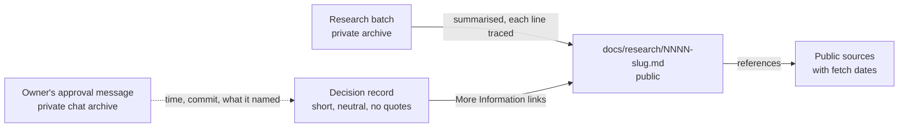

# Give each decision record a public evidence file, and record the owner's approval and reasons in neutral words

## Context and Problem Statement

The research behind each decision record lives in a private research repository and in project files. This repository is public. Of the 14 records on `main` at 05a48ff, 13 point to research a public reader cannot open: the private repository returns "not found" to an outside request. That repository is also expected to go away once the knowledge and documentation systems exist (D-0012, "Not decided here").

The records also quoted the owner's chat messages word for word. 13 of 14 record bodies did so, and every `accepted-evidence` block held a `quote:` field.

On 2026-10-23 the owner asked for two changes. The research the records rely on should be included in this repository, with nothing invented. The records should stop quoting the owner, and should state what the owner asked or decided in a neutral, professional tone. An earlier request from 2026-10-12, to remove references to private, machine-local material from the records, points the same way. The same day the owner asked for evidence files to sit in a directory of their own, so that the decisions folder holds only records, and chose `docs/research/` at 04:33 UTC on a decision card that offered four places.

This record decides what a decision record carries about its research, and how it records the owner's approval and reasons.

## Decision Drivers

- **Readable in public.** A reader of this repository can see the evidence without access to anything private.
- **Nothing invented.** Every line of evidence comes from research that already exists.
- **No private material** (CLAUDE.md rule 4). Research files hold the owner's words, chat ids and other private details.
- **Neutral tone.** Published guidance asks for records that are factual and plain: Nygard's context is "value-neutral", and Azure Well-Architected asks for records that are "pithy, assertive, on-topic, and factual".
- **The decisions folder holds records only.** A reader listing `docs/decisions/` sees one file per decision and the index.
- **Each record stands alone.** Azure Well-Architected says extra material can be linked, "but the decision must be clear and stand alone without that material".
- **Replaceable** (REQ-0011).

## Considered Options

1. **One evidence file per record**, built only from the existing research, with public references.
2. **References only:** a short public reference list in each record's More Information, and no evidence file.
3. **Copy the research folders** into this repository.
4. **Keep links to the private research** (today).

## Decision Outcome

Chosen option: **1**. On 2026-10-23 at 04:11 UTC the owner chose to write this as a decision record, on a decision card that offered options 1 to 3, and accepted this record on 2026-10-23 at 04:25 UTC.



*In words:* each record links one public evidence file. The evidence file summarises the research batch, and a reviewing agent traces every line to the batch before the owner sees it. The evidence file cites public sources. The record states the owner's request and approval as facts with dates; the owner's own words stay in the private chat archive.

### Rules

1. **Evidence file.** A record that rests on research gets one evidence file, `docs/research/NNNN-slug.md`, with the same file name as its record in `docs/decisions/`. `docs/research/` holds only these files and a README that lists each one with its record. The record links its evidence file under More Information as `../research/NNNN-slug.md`, and the evidence file's front matter names its record by ID. The file is created with the record, or later by a correction under D-0006, and is frozen with its record. It holds:
   - the question the research answered;
   - the method and the date;
   - the findings, each with its label (sourced, measured or inferred) and a reference number;
   - the checks that were run, with their numbers (for example, a recall check or a claim check);
   - the limits: what was not read, and why;
   - references in two lists, "relied on" and "background", each a public locator with its fetch date (the normative and informative split of RFC 7322);
   - one line naming the research batch and saying its working files are private.
2. **No research, no file.** A record that rests on no research batch says so in one line under More Information, and names what it rests on instead.
3. **Nothing invented.** Every finding, number, quote and reference in an evidence file comes from a file that already exists in the batch: a ledger row, the synthesis or a check. One short section, "How the decision used it", is written from the record itself and says so. Before the owner sees it, a reviewing agent checks every line against the batch and lists anything it could not trace. Lines it cannot trace are removed.
4. **No private material.** An evidence file holds no owner quotes, chat ids, machine paths, hostnames or addresses. Published sources may be quoted.
5. **The owner's words.** A record and its evidence file never quote the owner. They state the owner's request, answer or reason in neutral third person, with its date, for example: "On 2026-10-22 the owner asked for a map of document kinds for every scenario." The owner's exact words stay in the private chat archive.
6. **Approval block.** In D-0001's field contract, `accepted-evidence` is:

   ```yaml
   accepted-evidence:
     approved-by: owner
     approved-at: <UTC timestamp of the approval message>
     approved-commit: <full SHA of the approved head>
     approval-ref: <message id in the owner's chat archive>
     approval-names: <what the message named, e.g. "PR #19 and head ffd8dca">
     check: <who confirmed the message names that PR and head, and when>
     merged: <who merged, and when, or "not yet">
   ```

   `approval-ref` keeps the message id because it is the one exact key into the chat archive. It opens nothing without the owner's account, so it is not a private value under CLAUDE.md rule 4. It does tie the record to one chat product's ids; when the archive moves to another store, a correction can replace the id with that store's key.

   This follows the published processes read, none of which quotes the approver. Python's PEP 1 records a date linked to the decision post, Kubernetes KEPs list approvers by handle, and AWS adds "a timestamp, version, and list of stakeholders". The block gives up one reason for a verbatim quote, that the proof would not depend on a link staying live: a public reader now sees the facts but not the message. Until the Activation gate's per-agent identities exist, neither form is proof that an agent could not write. Both rest on convention plus a reviewing agent's check, as D-0001 says.
7. **Corrections that remove the owner's words.** D-0006 step 2 quotes the text before and after each change in the PR body. When the text removed is the owner's words, the PR body names where it was and a commit that still holds it, instead of copying it. Records and `CORRECTIONS.md` hold no before-and-after text. The approval of a correction (D-0006 step 6) is recorded with rule 6's facts (time, commit, message id, what the message named), never a quote.

### Consequences

- Good: a public reader can see what each decision rests on, and check each finding against a public source.
- Good: the evidence stays in this repository when the private research repository goes away.
- Good: records read as plain, factual documents, in the tone the published guidance asks for.
- Bad: a second frozen file per record, which has to be built and checked. The largest research batch cites 859 public addresses, so its evidence file has to choose what the decision relied on.
- Bad: the "every line traced" promise is checked against private files, so a public reader has to trust the reviewing agent's check. A reader can still check each finding against its public reference.
- Bad: the approval proof moves from a quote in the record to a pointer into a private archive.
- Bad: the old quotes stay in git history and in past PR text. This repository is public, and a commit cannot be un-published (CLAUDE.md rule 4). Removing them changes what a reader sees on `main`, not the history.
- Bad: a record and its evidence file sit in two folders, so each link needs `../research/`. The name `research` is also the name of the private research repository; the folder's README says what it holds and that the batches are not there.
- Neutral: there is little precedent for this exact form. PEP 1 allows a support-file folder per PEP (meant for files such as diagrams), each Kubernetes KEP is a folder, and 3 of the 646 entries in Rust's RFC folder are companion folders, one of which holds a "Rationale and alternatives" file. Backstage keeps a record's supporting file in a separate tree, and MADR keeps supporting files flat beside its records.

### Confirmation

- A reviewing agent checks every evidence file line against its batch before the owner sees it, and lists what it could not trace.
- A search of `docs/` finds no owner quotes and no `quote:` field.
- Every record either links an evidence file or says in one line that it rests on no research.
- `docs/decisions/` has no subfolders. Every file in `docs/research/` besides its README has a record with the same file name, that record links it, and the README lists it.

## Pros and Cons of the Options

### 2. References only
- Good: one file per record, and the record still stands alone.
- Good: everything in it can be checked by a public reader.
- Bad: drops the findings, the checks and the limits, so the research itself is not included, which the owner asked for.

### 3. Copy the research folders
- Good: nothing is summarised, so nothing is lost.
- Bad: about 4.2 MB of Markdown, and every folder quotes the owner. Every file would need a privacy scrub first.
- Bad: D-0012 rule 6 keeps learning material out of `docs/`, so this would change D-0012.

### 4. Keep links to the private research
- Good: no work.
- Bad: public readers cannot follow the links, and the links stop working when the private repository goes away.

### Evidence place: `docs/evidence/`
- Good: no confusion with the private research repository.
- Bad: the owner suggested `research`, and the files are summaries of research.

### Evidence place: `docs/decisions/evidence/`, one folder holding every evidence file
- Good: no new kind folder, so D-0012 does not change.
- Bad: the decisions folder still holds a subfolder, which the owner asked to avoid.

### Evidence place: a folder beside each record
- Good: a record and its evidence sit together.
- Bad: a folder per record in `docs/decisions/`, which the owner asked to avoid.

## More Information

- **Evidence:** [../research/0016-give-records-an-evidence-file-and-neutral-approval.md](../research/0016-give-records-an-evidence-file-and-neutral-approval.md).
- **Worked example:** [../research/0006-allow-corrections-to-accepted-records.md](../research/0006-allow-corrections-to-accepted-records.md).
- **Layout facts:** read on 2026-10-23 from public repositories: `backstage/backstage` at d723272 (`docs/assets/architecture-decisions/catalog-core-entities.png`, linked from `docs/architecture-decisions/adr005-catalog-core-entities.md`) and `adr/madr` at ba75bb1 (`docs/decisions/0008-example-table.png` and others, flat beside the records).
- **Exit path:** evidence files are plain Markdown, one file per record in `docs/research/`. Delete a file to drop one, or move the folder into a future knowledge system. The approval fields map one to one to the earlier quote form, except the quote itself, which stays in the chat archive.
- **Related records:** D-0001, D-0006, D-0012.
