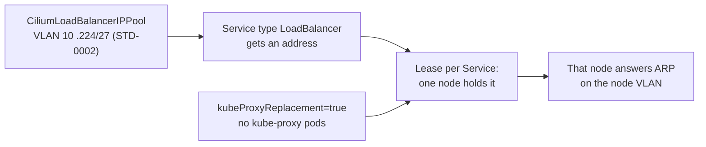

# On home-lab clusters, let Cilium replace kube-proxy and announce load-balancer addresses on the node VLAN with L2 announcements

## Context and Problem Statement

Kubernetes ships no load balancer for a cluster outside a cloud, so a Service of type LoadBalancer stays pending until something hands out an address and answers for it. STD-0002 already reserves `.224/27` at the end of each Kubernetes node VLAN for these addresses; at home that is prod `10.1.10.224/27`. Research batch RB-0067 listed seven ways to answer for those addresses and left the choice to the ingress decision.

Cilium is already c1's CNI. Its L2 announcements and its Gateway API both need Cilium to replace kube-proxy, while the kubeadm runbook was first written with kube-proxy kept.

On 2026-10-26 at 22:46 UTC the owner said yes to the proposed option a: load-balancer addresses from Cilium LB IPAM, announced on the node VLAN with Cilium L2 announcements, which means Cilium replaces kube-proxy. The agents then built c1 that way from the start. This record writes that choice down.

## Decision Drivers

- **Fewest tools** (agent pick): Cilium is already installed on every node.
- **One flat VLAN at home:** the router has no BGP set up, and the pool sits inside the node subnet (STD-0002).
- **The way in for web traffic** (D-0021) needs the same switch.
- **Replaceable** (REQ-0011): the pool and the Services must be able to move to another announcer.
- **Learning Kubernetes** (PRD goal 1): the cluster should stay readable while the owner learns it.

## Considered Options

1. **Cilium LB IPAM with L2 announcements, Cilium replacing kube-proxy.**
2. **Cilium LB IPAM with BGP**, the pool as its own routed subnet, the router peering with the nodes.
3. **MetalLB in L2 mode**, kube-proxy kept.
4. **HAProxy outside the cluster** on one address, forwarding to NodePorts, kube-proxy kept.
5. **kube-vip for Services**, kube-proxy kept.

## Decision Outcome

Chosen option: **1**. The owner said yes to it on 2026-10-26 at 22:46 UTC, on a choice card that listed options 1 to 3 with the RB-0067 table; options 4 and 5 come from RB-0067 and were not on the card.

*In words:* LB IPAM gives each LoadBalancer Service an address from the pool. A lease picks one node per Service, and that node answers ARP for the address on the node VLAN. This works only with Cilium in place of kube-proxy.

### Rules

1. **No kube-proxy.** `kubeadm init`, `kubeadm upgrade apply` and `kubeadm upgrade node` skip the `addon/kube-proxy` phase, and Cilium runs with `kubeProxyReplacement=true` and `k8sServiceHost` set to the cluster's API name (STD-0001).
2. **One pool per cluster, from STD-0002.** The cluster's `CiliumLoadBalancerIPPool` is the node VLAN's `.224/27`. The router's DHCP pool never overlaps it.
3. **L2 announcements on the node interface.** `l2announcements.enabled=true`, with the node's lab interface in `devices`, and one announcement policy for the pool.
4. **Addresses that names point at are pinned.** A Service or Gateway whose address a DNS name points at sets that address in its spec, so a rebuild keeps it (agent pick).

### Not decided here

- the ingress or Gateway controller (D-0021);
- BGP, for a later cluster or router;
- clusters outside the home lab, such as the VPS, which has no LAN neighbours to answer ARP to.

### Consequences

- Good: no new tool; one pool, one policy, both in Cilium.
- Good: the same switch lets Cilium serve the Gateway API (D-0021).
- Bad: L2 announcements are a beta feature in Cilium 1.20.
- Bad: one node takes all traffic for an address; failover takes 10 to 20 seconds by default; the feature can't be used with `externalTrafficPolicy: Local`.
- Bad: leases add API server traffic, and Cilium's client rate limit may need raising as Services grow.
- Bad: going back to kube-proxy breaks existing connections, so it is a rebuild, not a toggle.
- Bad: kube-proxy's iptables Service rules are absent, so lessons that read them do not match this cluster. The runbook keeps its kube-proxy practice for a kube-proxy build.
- Neutral: NFS or SMB mounts to a Service cluster IP and SCTP are known limits of the replacement; none is used today.

### Confirmation

- A LoadBalancer Service gets an address from the pool and answers from a machine outside the cluster (the runbook's step 9 check).
- `kubectl -n kube-system get ds kube-proxy` finds nothing.
- The docs check compares the home VLAN file with STD-0002 (D-0019).

## Pros and Cons of the Options

### 2. Cilium LB IPAM with BGP

- Good: traffic spread over nodes; no ARP limits.
- Bad: needs BGP on OPNsense and a separate routed subnet per cluster, which STD-0002 does not plan.

### 3. MetalLB in L2 mode

- Good: the established bare-metal load balancer; works with kube-proxy kept, so the runbook's first setting stays.
- Bad: one more tool, with the same one-node-per-address limit; Cilium's Gateway API still needs kube-proxy replacement.

### 4. HAProxy outside the cluster

- Good: no in-cluster load balancer; one place to filter.
- Bad: LoadBalancer Services stay pending; NodePorts must be reachable from the proxy; one more machine to keep up.

### 5. kube-vip for Services

- Good: one tool could also hold an API address for several control planes.
- Bad: same L2 limits as option 3; another tool beside Cilium.

## More Information

- **Evidence:** [../research/0017-replace-kube-proxy-and-announce-lb-addresses-with-cilium.md](../research/0017-replace-kube-proxy-and-announce-lb-addresses-with-cilium.md), from research batches RB-0067 and RB-0088.
- **Exit path:** the pool's range moves to MetalLB (option 3) or to BGP (option 2) without changing the Services. Bringing kube-proxy back is a cluster rebuild with the kube-proxy addon, which is cheap while clusters hold no data.
- **Where it is built:** `hosts/ansible/roles/k8s_control_plane/`, and the kubeadm runbook's steps 8, 9 and 17 with their home-lab place notes.
- Related records: D-0011, D-0021. Related standards: STD-0001, STD-0002, STD-0003.
