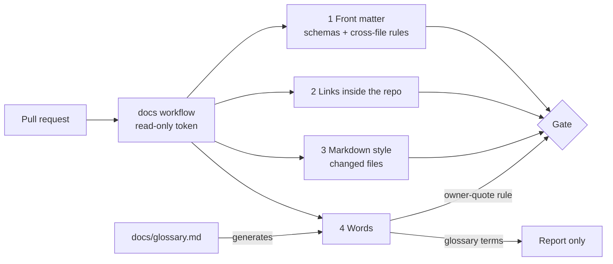

# Check the docs on every PR, with front matter and inside links as gates, Markdown style on changed files, and word checks built from the glossary

## Context and Problem Statement

Nothing in this repository checks its documents. `.github/` holds only CODEOWNERS and the PR template. D-0001 says the decision index will be checked "once CI exists", and no record had set a link check.

The gap showed on `main`. At 7915625 two files had front matter that was not valid YAML: D-0009 and the evidence file for D-0008. Each had a plain value containing ": ", which YAML 1.2.2 §7.3.3 does not allow. One record's back-link field also missed a record that changed it. All three were found by a draft check and fixed by D-0006 corrections (PR #33).

On 2026-10-23 the owner asked for the docs to be linted so that broken front matter cannot merge, and for help with vocabulary. Later the same day the owner asked that the methods, the organization of the checks (what lives where, who owns it, what runs locally and in CI) and the needed words be settled before any linting starts. On 2026-10-23 at 21:51 UTC the owner chose to write this as a decision record, and accepted it on 2026-10-24 at 01:50 UTC. On 2026-10-24 at 05:32 UTC the owner chose, on a decision card, to keep the linter settings under `.github/` rather than in the repository root, which D-0008 keeps for entry points. The owner approved that change with PR #41 at head c62cf99 on 2026-10-24 at 06:21 UTC.

This record decides which checks run on the docs, how strict each one is, where they live, and the words used for this work.

## Decision Drivers

- **Broken front matter cannot merge.** That is the owner's request.
- **Frozen records stay frozen.** Accepted records and evidence files change only by correction (D-0001, D-0006). A check must not force a correction for formatting alone.
- **No flaky gates.** A failure must mean this PR broke something, not that a website was down.
- **One source for words** (D-0012 rule 8). The glossary decides; checks follow it.
- **Public repository, no secrets** (CLAUDE.md rules 4 and 5).
- **Keep the root short** (D-0008). The root holds only what a reader needs before going deeper.
- **Replaceable** (REQ-0011). Each check can be dropped or swapped on its own.

## Considered Options

1. **Four checks: front matter and inside links as gates, Markdown style as a gate on changed files only, words as a report with one gated rule** (this record).
2. **Every check on every file, all as gates.**
3. **One Markdown toolchain** (remark-lint with a front-matter schema plugin) for everything.
4. **No CI.** The reviewing agent reads every PR, as now.

## Decision Outcome

Chosen option: **1**.

*In words:* every PR runs one workflow with a read-only token. Front matter, inside links and Markdown style on the files the PR changes must pass before the PR can merge. The word check reports glossary terms without blocking, and blocks only on quoting the owner, which D-0016 already forbids. The word rules are generated from the glossary.

### The checks

| # | Check | What it catches | Tool | On a PR |
|---|---|---|---|---|
| 1 | Front matter | front matter that is not valid YAML 1.2, including a repeated key; a missing or wrongly typed field; a status word not allowed for that kind; an ID that does not match the file name; `supersedes` and `superseded-by` that do not match; `waits-on` naming a record that does not exist or forming a cycle; an evidence file with no record, or a record that does not link its evidence file; a file missing from its folder's README index; a decision index row whose status differs from the record | one JSON Schema 2020-12 file per kind of document (decision, evidence, standard, spec, runbook, postmortem), plus one Python script for the rules that cross files, with test cases | **gate** |
| 2 | Links inside the repo | relative links and `#anchors` that do not resolve | lychee, offline | **gate** |
| 3 | Markdown style | heading, list, code-fence and spacing faults | markdownlint-cli2 | **gate** on files the PR adds or changes, except edits to existing records and evidence files |
| 4 | Words | a deprecated glossary word; a quote of the owner (D-0016 rule 5) | Vale, with its term rules generated from `docs/glossary.md` | glossary words: **report only**. Owner quotes: **gate** on changed files, except the approval template in `docs/specs/README.md` |
| — | Links outside the repo | dead outside URLs | lychee, online | weekly report, never a gate |

### Rules

1. **Same commands everywhere.** One command runs all four checks on a laptop or an agent's machine, and CI runs the same command. No commit hooks are added.
2. **Workflow safety.** The workflow runs on `pull_request` only, with `permissions: contents: read` and `persist-credentials: false`. Every action is pinned to a full commit SHA, and every downloaded binary to a version and checksum. It uses no secrets.
3. **Frozen records.** Checks 1, 2 and 4 read every file. Check 3 lints a record or evidence file only in the PR that adds it. A real fault in an existing record is fixed by a correction under D-0006.
4. **Where things live.** Scripts, schemas and tests go in `.github/docs-check/`; Vale styles in `.github/vale/`; the workflow in `.github/workflows/`. The linter settings are `.github/docs-check/markdownlint.jsonc` and `.github/vale/vale.ini`, and `run.sh` passes each to its tool with `--config`. `.github/.markdownlint.jsonc` extends `.github/docs-check/markdownlint.jsonc` and keeps the one exception for the PR template. No settings file in the repository root, no new root folder and no new `docs/` kind.
5. **Glossary drives the word check.** `docs/glossary.md` is one table: Term, Status, Meaning, Source, Instead of. Status is `preferred`, `admitted` or `deprecated`, the term statuses of ISO 10241-1. A script generates Vale's word lists from it, and CI fails if the generated files differ from the glossary. Nobody edits the generated files by hand.
6. **A new word.** An agent that meets an unsettled word proposes one glossary row in its own PR. The owner says yes or no. The check enforces only rows on `main`.
7. **Turning a report into a gate.** A report-only rule becomes a gate only by a new decision record.
8. **Required checks.** Once the workflow exists, the owner may mark checks 1, 2 and 3 and the owner-quote rule as required status checks in a ruleset.
9. **Changes to the checks.** A PR that changes anything in `.github/docs-check/`, `.github/vale/` or the workflow says so in its title, and the reviewing agent checks it by hand. The checks live in the repository they check, so a PR can change both; this record does not meet Activation gate item 2.

### Words for this work

Accepting this record accepts these meanings. They become the first rows of `docs/glossary.md`, with status `preferred`, in the PR that creates it (D-0012 rule 2).

| Term | Meaning | Source |
|---|---|---|
| check | An automated test of a document that passes or fails. | GitHub's term for a result is "status check". |
| lint, linter | A static check for errors, style and consistency, run without executing anything. | S. C. Johnson, "Lint, a C Program Checker", Bell Labs, 1978 |
| front matter | The YAML block between the two `---` lines at the top of a Markdown file. | YAML 1.2.2; MADR |
| schema | A JSON Schema 2020-12 file that lists the fields one kind of document must have. | JSON Schema 2020-12 |
| gate | A check that must pass before a PR can merge. | GitHub rulesets, "Require status checks to pass" |
| report-only check | A check whose findings are shown but never block a merge. | this record |
| false positive | A finding where the text is right and the check is wrong. | plain use |
| verification | Confirmation, through objective evidence, that specified requirements are fulfilled. | ISO 9000:2015, via NIST SP 800-160v1r1 |
| validation | Confirmation, through objective evidence, that the requirements for a specific intended use are fulfilled. | ISO 9000:2015, via NIST |
| preferred, admitted, deprecated term | A glossary word's status: use it; allowed, but a better word exists; do not use it. | ISO 10241-1 |

In these words, checks 1 to 4 are static checks. Replaying a runbook on a fresh machine (D-0012 `tested`) is verification by test. The owner's acceptance of a document is closest to validation.

### Order of work after acceptance

Each step is its own PR and can be dropped without the others.

1. Check 1 and check 2, with the workflow and the test cases. `main` passes them before the PR merges.
2. Check 3, with the PR template fixed (it has 19 findings today).
3. `docs/glossary.md` with the words above, then check 4.
4. The owner marks the gates as required status checks.

### Consequences

- Good: broken front matter, broken back-links and broken inside links can no longer merge unnoticed.
- Good: the glossary becomes something agents read before writing and something a check enforces, from one file.
- Good: every piece can be swapped. The schemas are plain JSON Schema that other validators read (AJV, check-jsonschema, remark-lint-frontmatter-schema, an editor); yamllint covers the YAML part; textlint can replace Vale; markdown-link-check can replace lychee.
- Bad: one more script to maintain, about 200 lines, because no tool found checks rules that cross files.
- Bad: the checks are a guard against mistakes, not proof. A PR can change a check and a document together until a verifier outside this repository exists.
- Bad: report-only word findings can be ignored. On today's files 78 of 79 glossary-term findings are in records written before the word was settled.
- Bad: an editor plugin for markdownlint or Vale does not find the settings by itself; its settings path is set once, as `.github/docs-check/README.md` says.
- Neutral: Markdown style faults in existing records stay until some correction touches them.

### Confirmation

- After step 1, check 1 and check 2 pass on `main`, and the test cases pass.
- A PR that adds a record with a repeated key or an unquoted ": " fails check 1.
- No action in the workflow is pinned to a tag or branch, and the workflow has no trigger other than `pull_request` and `schedule`.
- The generated Vale files match `docs/glossary.md`.
- No `.markdownlint*` or `.vale.ini` file is in the repository root.

## Pros and Cons of the Options

### 2. Every check on every file, all as gates

- Good: the strongest guard.
- Bad: 169 of 194 Markdown style findings today are in existing records and evidence files, so each would need a correction first.
- Bad: outside-link checks fail when a website is down or refuses the CI runner.

### 3. One remark-lint toolchain

- Good: one tool for Markdown and front matter.
- Bad: it still checks one file at a time, so the cross-file rules still need a script.

### 4. No CI

- Good: no tooling.
- Bad: the three front-matter faults reached `main` this way.

### Rule 4: linter settings in the repository root
- Good: tools and editor plugins find them without a flag.
- Bad: two settings files in a root that D-0008 keeps for entry points.

## More Information

- **Evidence:** [../research/0019-check-docs-on-every-pr.md](../research/0019-check-docs-on-every-pr.md)
- **Exit path:** delete `.github/docs-check/`, `.github/vale/` and the workflow. The schemas and the glossary stay usable without the scripts. A new record supersedes this one.
- **Related records:** D-0001 (index and validation column), D-0006, D-0008 (short root), D-0012 (glossary), D-0016 (no owner quotes; evidence files).
