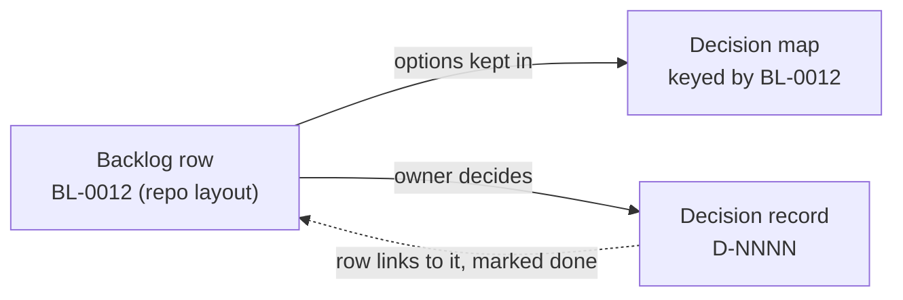

# Number backlog items BL-NNNN

## Context and Problem Statement

The owner's backlog is one table in the project files. It holds every item that is waiting, blocked, parked or done. Open decisions also sit in a decision map beside it, which keeps their options. Neither table had registered IDs:

- 49 decision-map rows used one capital letter plus a number. An agent made this scheme on 2026-10-10.
- 110 backlog rows used one of three label styles: decision-map labels, lowercase word labels such as `k8s-access-4a`, and other uppercase labels.

Research batch RB-0077 (evidence: [../research/0020-number-backlog-items-bl-nnnn.md](../research/0020-number-backlog-items-bl-nnnn.md)) found:

- A one-letter label such as `D1`, an open question about repo layout, looks like `D-0001`, an accepted record. Other files use their own `D1`, `A2` or `K1` for different things.
- None of the seven letters could become a registered prefix, because a prefix needs at least two characters (D-0003 rule 2).
- 24 decision-map rows were not in the backlog, and 15 of them were still open. So the backlog was not yet the one place for open questions.
- Every tracker the batch read gives each item one key from one sequence, and keeps the topic in the title.

On 2026-10-23 at 21:50 UTC the owner asked for the reasoning to be weighed without the cost of changing existing files, because the system is new. On that basis the batch recommended numbers over word labels. On 2026-10-24 at 01:57 UTC the owner chose `BL-0001` style on a decision card that also offered readable word labels, or keeping the letter codes.

## Decision Drivers

- **One shape for every cited ID:** `D-0007`, `REQ-0022`, `STD-0001`, `RB-0077`, `RM-0033`.
- **An ID that never has to change:** a word label stops fitting when an item's wording grows; a number does not.
- **No clashes without judgment:** numbers come from one sequence, so two threads cannot pick the same one.
- **Readable:** the title is always shown next to the number.
- **Replaceable** (REQ-0011): the backlog can move into a task management system later.

## Considered Options

1. **`BL-NNNN` for every backlog item.**
2. **Readable word labels for every row,** such as `repo-layout`, as most rows had. No new family is needed. But a word label changes when the item's wording changes, and two threads can choose the same word.
3. **Keep the letter codes.** `D1` and `D-0001` keep looking alike.

## Decision Outcome

Chosen option: **1**, which the owner chose on 2026-10-24 at 01:57 UTC.

This adds the Backlog items row to D-0003's registry, and D-0003 rule 6 says that a done backlog item keeps its number and its row. `BL-` passes D-0003 rule 2's prefix check against every registered prefix.

### The backlog numbers

*In words:* every backlog item, open decisions included, is one backlog row with a `BL-NNNN` number. The decision map keeps an open decision's options under the same number. When the owner decides, the decision gets its own record, and the backlog row links to it and is marked done.

- Every backlog row has a `BL-NNNN` number, done rows included. Open decisions are backlog items, so they have one too.
- The decision map keeps its option tables, keyed by the same `BL-NNNN` numbers. The backlog is the one list. The map is where an open decision's options are written down. Every decision-map row has a backlog row.
- Each new row takes the next free number.
- In prose, the title goes next to the number: `BL-0012 (repo layout)`. Tables already have an Item column.
- When the owner decides an open question, the decision gets its own `D-NNNN`. The backlog row links to that record and is marked done.
- The backlog's render script refuses a duplicate row label and a row label that is not `BL-NNNN`.
- Project instructions that cite a backlog item are drafted by the agent, approved by the owner and saved by the coordinator.

### Exit path

If the backlog moves into a task management system, each item moves once and takes that system's key. A mapping table from `BL-NNNN` to the new key is kept in that system, so citations still lead somewhere. The `BL` family is then marked closed in D-0003's registry by its own record.

### Consequences

- Good: every cited ID has one shape, and a backlog ID cannot be mistaken for a decision ID.
- Good: the backlog is the one list of open questions, with none missing.
- Good: moving to a task system later is a one-to-one swap.
- Bad: numbers say less than words, so the title has to travel with them.
- Neutral: `BL` could also be read as "baseline". The registry and the title next to the number settle which is meant.

### Confirmation

- The backlog render script's check passes: every row label is `BL-NNNN`, and there are no duplicates.
- Every decision-map row has a backlog row.

## Pros and Cons of the Options

### 1. BL-NNNN for every backlog item

- Good: one shape for every ID, stable, and no clashes.
- Bad: numbers are less readable than words without the title beside them.

### 2. Readable word labels

- Good: readable on their own, and no registry change.
- Bad: a label goes stale when an item's wording changes, and two threads can pick the same word.

### 3. Keep the letter codes

- Good: no work.
- Bad: `D1` and `D-0001` keep looking alike, and three label styles stay in one table.

## More Information

- **Evidence:** [../research/0020-number-backlog-items-bl-nnnn.md](../research/0020-number-backlog-items-bl-nnnn.md)
- Related records: D-0001, D-0003, D-0006, D-0016, D-0018.
