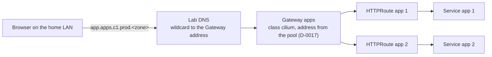

# Use the Kubernetes Gateway API as the way in for web traffic, served on home-lab clusters by Cilium's Gateway API controller through one shared Gateway

## Context and Problem Statement

Apps on c1 need a way in for web traffic. Kubernetes has two APIs for it: Ingress, which the Kubernetes project has frozen and no longer adds to, and the Gateway API, which it recommends instead. ingress-nginx, the controller most older tutorials use, stopped getting fixes in March 2026. Either API needs a controller.

Research batch RB-0088 compared four Gateway API controllers: Cilium's own, Envoy Gateway, Traefik and NGINX Gateway Fabric. All four show as conformant on the Gateway API site, and their own v1.6 conformance reports pass the core tests, except Traefik's HTTP profile, marked partial for one skipped test. Cilium's controller needs Cilium to replace kube-proxy, which D-0017 already does.

On 2026-10-26 at 22:47 UTC the owner said yes to the proposed option a, Cilium's Gateway API, on a choice card that listed options 1 to 4 below. The agents then built it. The shape of the build (one shared Gateway, a pinned address, a wildcard name) was the agents' pick. This record writes the choice and the picks down.

## Decision Drivers

- **The standard API first** (agent pick): routes written to the Gateway API move to another controller unchanged.
- **Fewest tools** (agent pick): Cilium is already on every node, and D-0017 turned on the switch its controller needs.
- **Replaceable** (REQ-0011): the controller must be swappable without rewriting routes.
- **No public exposure decided yet:** this is the way in from the home LAN; reaching apps from the internet is a separate decision.

## Considered Options

1. **Gateway API, served by Cilium's Gateway API controller.**
2. **Gateway API, served by Envoy Gateway.**
3. **Gateway API, served by Traefik.**
4. **Gateway API, served by NGINX Gateway Fabric.**
5. **The Ingress API**, with any Ingress controller.

## Decision Outcome

Chosen option: **1**. The owner said yes to it on 2026-10-26 at 22:47 UTC. Option 5 was not on the card; it is listed because the Ingress API is still the most common way in tutorials.

*In words:* every web app name under `apps.c1.prod.<zone>` points at one Gateway address. The Gateway hands each request to the HTTPRoute for its host name, and the route sends it to the app's Service. Cilium runs the Gateway with an Envoy proxy on each node.

### Rules

1. **Gateway API, not Ingress.** New web routes are HTTPRoutes (or GRPCRoutes, TLSRoutes) on a Gateway. No Ingress objects for platform apps.
2. **Standard channel CRDs, pinned.** The Gateway API CRDs come from the standard channel at the version the Cilium release's docs name, pinned by URL and SHA-256, and chosen by STD-0003. The experimental channel is added only when an app needs one of its fields (agent pick).
3. **One shared Gateway per cluster for apps** (agent pick). It is named for its job, `apps`, in namespace `gateway`, with listeners for `*.apps.<cluster>.<env>.<zone>` (STD-0001), and accepts routes from every namespace.
4. **A pinned address.** The Gateway's address is set in `spec.addresses` from the pool (D-0017 rule 4), so the DNS name can be set once (agent pick).
5. **One wildcard DNS name** (agent pick). The lab DNS holds one wildcard override for `*.apps.<cluster>.<env>.<zone>` that points at the Gateway address, so a new app needs no DNS change.

### Not decided here

- certificates and HTTPS listeners (BUILD-PATH step S12, its own record);
- whether any app is reachable from the internet;
- per-tenant Gateways;
- the DNS tool that replaces the OPNsense override (AdGuard Home is planned, BL-0164).

### Consequences

- Good: no new pods to run; routes are portable.
- Good: one address and one DNS wildcard cover every app.
- Bad: the way in is tied to the CNI. Replacing Cilium also replaces the gateway controller, and the GatewayClass changes with it.
- Bad: Cilium's Gateway runs on iptables TPROXY in its default setting, so nodes need iptables and its netfilter modules, and port 80 must be open in the node firewall.
- Bad: conformance figures disagree: Cilium's report and badge say v1.6.1, the site's text v1.4.0, Cilium's docs v1.6.3. Cilium supports fewer extended HTTP features in its report (32 of 38) than Envoy Gateway (36 of 38).
- Bad: one shared Gateway is one failure domain for every app.
- Neutral: the runbook's Traefik step stays as CKA practice beside it; it is not the platform's way in.

### Confirmation

- `kubectl get gatewayclass cilium` shows `ACCEPTED True`, and the Gateway shows its pinned address.
- The smoke test (`hosts/ansible/roles/k8s_gateway/tasks/smoke.yml`) calls a test app through the Gateway with its host name, gets a 404 for a name with no route, and resolves the name from a node.

## Pros and Cons of the Options

### 2. Envoy Gateway

- Good: the same Envoy proxy, as its own project under Envoy's CNCF governance; names no CNI or kube-proxy need on the pages read; the most extended HTTP features of the four in its report; the way in that a widely used home-lab template, onedr0p/cluster-template, picks.
- Bad: a controller and an Envoy fleet per Gateway to run and upgrade.

### 3. Traefik

- Good: MIT licence; the runbook already installs it for practice; documents the standard channel at v1.6.3.
- Bad: its own v1.6 report marks HTTP core as partial (one test skipped), and it supports 19 of 38 extended HTTP features.
- Bad: one more tool to run beside Cilium; TCPRoute needs the experimental channel.

### 4. NGINX Gateway Fabric

- Good: the newest conformance report (v1.6.3, dated 2026-10-13).
- Bad: a controller and an NGINX Deployment per Gateway; some features need the paid NGINX Plus.

### 5. The Ingress API

- Good: the most tutorials.
- Bad: frozen by the Kubernetes project; its best-known controller no longer gets fixes.

## More Information

- **Evidence:** [../research/0021-use-gateway-api-on-cilium-as-the-way-in-for-web-traffic.md](../research/0021-use-gateway-api-on-cilium-as-the-way-in-for-web-traffic.md), from research batch RB-0088, with RB-0067 and the Kubernetes tool map behind it.
- **Exit path:** keep the Gateway and HTTPRoutes, install another conformant controller, and change `gatewayClassName`; routes that use only core features move unchanged, and any extended feature is checked against the new controller's conformance report first. The address moves with the pool (D-0017). Under option 5 the routes would need rewriting, which is why it was not picked.
- **Where it is built:** `hosts/ansible/roles/k8s_control_plane/` (CRDs and Cilium values), `hosts/ansible/roles/k8s_gateway/` (Gateway and smoke test), the OPNsense role's DNS override, and the kubeadm runbook's step 10a.
- Related records: D-0011, D-0017. Related standards: STD-0001, STD-0002, STD-0003.
