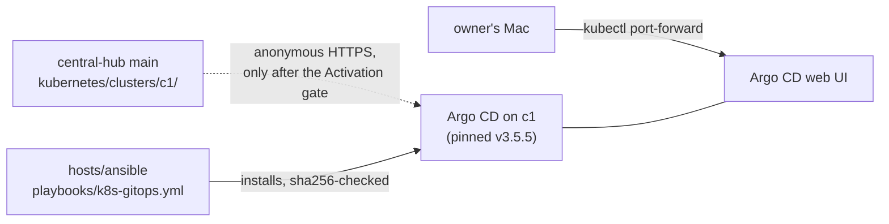

# Use Argo CD with its web UI as the GitOps engine on c1, installed from the pinned upstream manifest with no git credential

## Context and Problem Statement

central-hub is meant to become a GitOps repository: a cluster pulls its desired state from `main` (D-0002). Activation gate item 4 asks for "a pinned, no-writer GitOps engine install", and the engine was not chosen (AGENTS.md, CLAUDE.md).

On 2026-10-13 the owner asked to compare Flux and Argo CD and said either way the system must let him switch. Research batch RB-0009 compared them; the owner answered "I don't know. You pick", so Flux became an agent working pick, not a decision.

Cluster c1 now runs at home: Proxmox, kubeadm, Kubernetes 1.37.1, Cilium and Gateway API. Research batch RB-0089 updated the comparison for c1. On 2026-10-27 at 02:23 UTC the owner said yes to the proposed Argo CD with its web UI.

## Decision Drivers

- **Learn Kubernetes.** The owner is learning Kubernetes; a view of the objects the engine manages helps.
- **No git write credential in the cluster** (Activation gate items 3 and 4), and no image automation (item 6).
- **Replaceable** (REQ-0011, CLAUDE.md rule 6): the repository holds plain manifests any engine reads, and the engine is one swappable layer.
- **Pinned versions** (STD-0003): the newest release at least two weeks old.

## Considered Options

1. **Argo CD, full install with the web UI.**
2. **Argo CD core install**, with no API server and no UI.
3. **Flux**, the working pick since 2026-10-13.

## Decision Outcome

Chosen option: **1**. The owner said yes to the proposed Argo CD with its web UI on 2026-10-27 at 02:23 UTC, after reading options 1 and 3 with the agent's pick (Flux), Microsoft's practice and the fit with this repository's patterns.

### Rules

1. **Engine.** c1's GitOps engine is Argo CD, installed from its upstream `install.yaml`, which includes the API server and web UI.
2. **Install.** Ansible installs it (`hosts/ansible/roles/k8s_gitops`) from the release's manifest at a pinned version, checked against a SHA-256 kept in the role. `kubectl apply` adds no git credential, and nothing writes to git.
3. **Version.** The pin follows STD-0003. The first pin is v3.5.5.
4. **No source before the gate.** The engine runs with no Application pointing at central-hub until the Activation gate passes. The role turns the source on only with `k8s_gitops_source_enabled: true`.
5. **Source, once allowed.** One Application reads `kubernetes/clusters/c1/` on `main` over anonymous HTTPS, with no repository secret (D-0002; D-0011 diagram).
6. **UI access.** The UI is reached from the owner's Mac with `kubectl port-forward`, not through the cluster's Gateway, until the identity provider (BUILD-PATH S15) and lab certificates (S12) exist. Exception to best practice (D-0013 rule 3): the initial admin password is stored in clear text in the `argocd-initial-admin-secret` Secret until it is changed. Compensating controls: the UI is not exposed outside the cluster, the password is changed at first sign-in and kept in the password manager, and that Secret is then deleted, as Argo CD's getting-started guide says.

### Not decided here

- whether c1 may read central-hub before the Activation gate passes;
- moving add-ons that Ansible installs today (Cilium, the Gateway) under Argo CD;
- single sign-on for the UI;
- Argo CD Image Updater (Activation gate item 6 rules out image automation).

### Consequences

- Good: a web UI shows each application's objects, their health and their sync state, which helps the owner learn.
- Good: Microsoft offers Argo CD as an AKS cluster extension (generally available on AKS), so the same engine works on AKS later.
- Good: Argo CD is used more widely than Flux (RB-0009), so examples are easier to find.
- Bad: Argo CD 3.5 lists Kubernetes 1.33 to 1.36 as tested, and c1 runs 1.37.1. The first install on c1 is the test.
- Bad: the full install adds an API server, a UI and a local admin login to protect (rule 6).
- Bad: Argo CD renders Helm charts with `helm template`, so the Helm CLI does not see releases Argo CD manages (RB-0009).
- Neutral: Activation gate wording that named Flux was already changed to "GitOps engine" on 2026-10-24 (CORRECTIONS.md); AGENTS.md and CLAUDE.md item 4 still say the engine is not chosen and need a correction when this record is accepted.

### Confirmation

- After the first install on c1, every Argo CD Deployment and its StatefulSet are ready, a second Ansible run reports no change, and no Application exists.
- A reviewing agent checks that no PR adds a repository credential or an Image Updater to the cluster.

## Pros and Cons of the Options

### 2. Argo CD core install

- Good: no API server, UI or admin login to protect.
- Bad: no UI, which removes the main reason to prefer Argo CD here.

### 3. Flux

- Good: Flux supports every Kubernetes version supported upstream, so 1.37 is covered.
- Good: no built-in UI, API server or admin login; Helm releases stay real Helm releases.
- Good: Microsoft offers Flux as an AKS cluster extension too.
- Bad: no built-in UI; add-ons exist.
- Bad: its release manifest ships the image automation controllers, which this repository would have to drop (Activation gate item 6).

## More Information

- **Evidence:** [../research/0023-use-argo-cd-as-the-gitops-engine.md](../research/0023-use-argo-cd-as-the-gitops-engine.md), batches RB-0009 and RB-0089.
- Related records: D-0002, D-0011, D-0013. Related standard: STD-0003.
