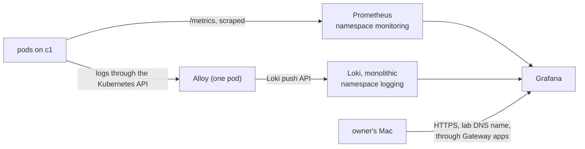

# Run metrics and logs on c1 with Prometheus, Grafana and Loki, installed by Ansible from pinned Helm charts

## Context and Problem Statement

BUILD-PATH S15 asks for metrics and logs on cluster c1 (BL-0020). The decision queue marked the observability stack "thin" (Q24), and the choice walk (J10) listed kube-prometheus-stack plus Loki, VictoriaMetrics plus VictoriaLogs, or waiting for the first app. On 2026-10-27 the owner asked for the build to keep moving while he is away, and the lab is greenfield. Research batch RB-0092 (Library `research/c1-observability/`) compared the two stacks for c1: licences, maintainers, versions allowed by STD-0003 and fit with c1 (kubeadm, no kube-proxy, no StorageClass, 2-vCPU nodes).

This record is proposed: the stack was built as agent picks (hosts/AGENT-PICKS.md picks 89-96), and the owner has not said yes to it.

## Decision Drivers

- **Learn Kubernetes** with the tools the field uses most: Prometheus is CNCF graduated, and Azure Monitor's managed Prometheus and Managed Grafana use the same query language and UI.
- **Replaceable** (REQ-0011, CLAUDE.md rule 6): each part can be swapped without touching the apps.
- **Pinned versions** (STD-0003): the newest release at least two weeks old.
- **Small nodes**: c1's worker has 2 vCPU.

## Considered Options

1. **kube-prometheus-stack plus Loki (monolithic) and Alloy.**
2. **VictoriaMetrics k8s-stack plus VictoriaLogs.**
3. **Nothing until the first app.**

## Decision Outcome

Proposed option: **1**, built as agent picks.

### Rules

1. **Install.** Ansible installs every part (`hosts/ansible/playbooks/k8s-observability.yml`, role `k8s_observability`) from pinned Helm charts. A release is upgraded only when its chart version or values differ.
2. **Versions.** STD-0003: kube-prometheus-stack 92.3.1, Loki chart 18.15.1 from grafana-community, Alloy chart 1.13.1, metrics-server chart 3.14.0.
3. **Way in.** Grafana is reached only by its lab name `grafana.apps.c1.prod.<zone>` through Gateway `apps` (D-0021), HTTPS with the wildcard certificate.
4. **Data.** Until c1 has storage (S17), Prometheus and Loki keep data in `emptyDir` with a size limit and a short retention. Metrics and logs can be lost on a pod move.
5. **Exit path.** Alloy talks the Loki push API, which VictoriaLogs also accepts, so the log store changes by one URL. Grafana reads any Prometheus-compatible store, so the metrics store changes the same way.

### Not decided here

- Alerting and where alerts go (no notification target is picked yet).
- Traces.
- Scraping etcd, the controller manager and the scheduler (kubeadm binds them to 127.0.0.1).
- Moving these releases under Argo CD.

### Consequences

- Good: one UI for metrics and logs, the same tools as Azure Monitor's managed Prometheus and Managed Grafana.
- Good: `kubectl top` works (metrics-server).
- Bad: Loki and Grafana are AGPL-3.0-only. They are free software, but a change to them that is offered as a service to others must be published.
- Bad: metrics-server skips the kubelet certificate check (`--kubelet-insecure-tls`), which its README allows "for testing purposes only", until kubelet serving certificates are signed by the cluster CA.
- Bad: no data survives a pod move until S17 adds storage.

## More Information

- Research: RB-0092 (Library `research/c1-observability/`), and RB-0045 (Library `research/k8s-tool-map/`) rows A25-A41.
- Agent picks 89-96 in `hosts/AGENT-PICKS.md`.
