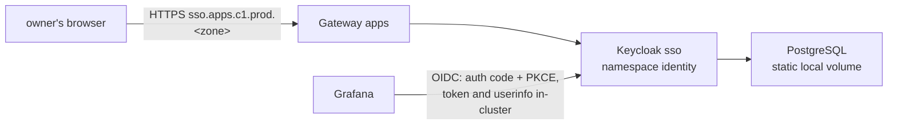

# Use Keycloak, reached by apps only over OIDC, for sign-in to lab apps on c1

## Context and Problem Statement

BUILD-PATH S15 asks for sign-in for lab apps on c1 (BL-0019). Research batch RB-0087 (Library `research/central-identity/`) compared self-hosted identity providers for people, machines and agents, and made no pick. On 2026-10-27 at 04:14 UTC the owner was asked Keycloak or authentik, and on 2026-10-28 at 02:17 UTC the owner said yes to the proposed Keycloak. How it is installed and wired is agent picks 96 and 98-102 in hosts/AGENT-PICKS.md. Research batch RB-0092 added how Keycloak is installed on c1.

## Decision Drivers

- **No paywall on what we need**: Keycloak is fully Apache-2.0; authentik keeps agent accounts and mTLS client auth in its paid tier (RB-0087).
- **Replaceable** (REQ-0011): apps trust a standard protocol, not a product.
- **Pinned versions** (STD-0003).
- **Learn the standard way**: the official operator and a real database.

## Considered Options

1. **Keycloak** through its official operator, PostgreSQL as its database.
2. **authentik**.
3. **No identity provider yet**: each app keeps its own admin account.

## Decision Outcome

Proposed option: **1**. The owner said yes to the proposed Keycloak on 2026-10-28 at 02:17 UTC.

### Rules

1. **Protocol seam.** Apps sign in only through OIDC: authorization endpoint, token endpoint, userinfo endpoint and the issuer `https://sso.apps.c1.prod.<zone>/realms/lab`. No app uses a Keycloak-only API.
2. **Install.** Ansible (`hosts/ansible/playbooks/k8s-identity.yml`, role `k8s_identity`) installs Keycloak 26.8.1's operator from its upstream files at that tag, each checked against a SHA-256 kept in the role.
3. **Database.** PostgreSQL 18.6, one pod, on a static local volume on one worker with reclaim policy `Retain`, until S17 brings storage. Exit path: `pg_dump`, then restore.
4. **Realm as code.** Realm `lab` is created from code once (KeycloakRealmImport, create-only). It holds the owner's account and one client per app.
5. **Secrets.** Client secrets and the owner's first password are random values made in the cluster, never in this repository. Anyone with cluster-admin on c1 can read them, agents included. The owner's first password is temporary.
6. **Break-glass.** The operator's master-realm admin Secret stays in the cluster; agents don't read it. The cluster's own break-glass (D-0022) doesn't depend on Keycloak.

### Not decided here

- Machine and agent identities (RB-0087 M2-M6), and Kubernetes API sign-in with OIDC.
- Multi-factor sign-in and Argo CD's sign-in through Keycloak.

### Consequences

- Good: Grafana, and later Argo CD and other lab apps, share one sign-in.
- Good: the issuer name is by job (`sso`), so a provider swap can keep it.
- Bad: Keycloak needs about 1 GB of memory, which is why c1's worker needs more than 4 GB.
- Bad: realm changes after the first import aren't in git until a tool that updates realms is added.

## More Information

- Research: RB-0087 (Library `research/central-identity/`), RB-0092 rows L20-L29.
- Agent picks 96 and 98-102 in `hosts/AGENT-PICKS.md`.
