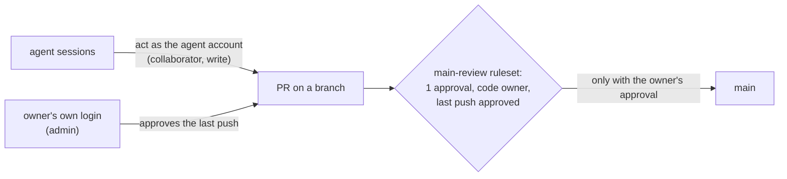

# Give the cloud agents one GitHub account of their own, separate from the owner's, so GitHub can require the owner's approval

## Context and Problem Statement

Activation gate item 1 asks for per-agent GitHub identities, with the owner's approval required by GitHub. Today every agent session acts on GitHub as the owner's account, so GitHub can't tell the owner's approval from an agent's, and `protect-main` asks for no approval at all.

The Foundation proposal (v0.4.3 §6, AG1) planned one GitHub App per agent, with the Claude GitHub App removed from this repository. On 2026-10-28 research batch RB-0093 measured that the agents' cloud environment replaces the GitHub token a request carries with the owner's: a request sent with a made-up token still came back as the owner's account. A real App token was not tried, and it is likely replaced the same way, so per-agent Apps would leave the cloud agents with no way to write here.

On 2026-10-28 at 05:12 UTC the owner said yes to the proposed option a on a decision card: one agent account, connected in place of the owner's, with the owner approving from their own login. This record writes that down and replaces Foundation AG1 (a), (b), (c) and (e).

## Decision Drivers

- **GitHub must see the agent as someone other than the owner** (RB-0018). Every other part of item 1 rests on it.
- **Works with the tools the agents run on today**, not only after new plumbing is built.
- **A non-human account for automation.** Microsoft's practice is non-human accounts for automated sign-in; GitHub's is an App for long-lived automation.
- **Replaceable** (REQ-0011): the ruleset names only the owner, so the agent identity can change without touching it.

## Considered Options

1. **One machine account for the cloud agents**, connected to the agents' environment in place of the owner's account.
2. **One GitHub App per agent** (Foundation AG1).
3. **Not yet.**

## Decision Outcome

Chosen option: **1**. The owner said yes to it on 2026-10-28 at 05:12 UTC, after reading the agent's pick (option 1 now, option 2 later), GitHub's and Microsoft's practice, and a correction that option 1 had not been tested and does not meet gate item 2 on its own.

*In words:* the agents push and open PRs as their own account. A PR reaches `main` only with an approval from the code owner, who is the owner, on its last push.

### Rules

1. **One account for the cloud agents.** The owner creates one machine account (GitHub allows one free machine account per person) and invites it as a collaborator on this repository. A collaborator on a personal repository always has write access.
2. **Test before the switch.** Before the agents' environment is switched to the agent account, a test shows that a session acts as that account and can push a branch and open a PR here. If the test fails, the switch does not happen and this record is revisited.
3. **The owner keeps their own login for approvals and admin.** No agent holds the owner's credentials or signing key.
4. **Review rule.** After the switch, a second ruleset `main-review` holds only the review rule: 1 approval, code-owner review (CODEOWNERS `* @jonhill90`), approval of the last push, and the repository admin role as its one bypass actor in `pull_request` mode, so the owner's own PRs merge without self-approval. `protect-main` keeps no bypass.
5. **The Foundation-era token** of the owner's account in the agents' environment is disconnected at the switch.
6. **Workflow files.** The agent account can still push files under `.github/workflows/`, and a public repository can't block that with a ruleset. Gate item 2's verifier therefore runs from outside this repository, decided separately.

### Not decided here

- where gate item 2's verifier lives;
- identities for agents outside the cloud project (each gets its own before write access, AGENTS.md rule 1);
- the agent account's name;
- per-agent Apps later (option 2), once a write route that keeps an agent's own token exists.

### Consequences

- Good: GitHub can tell the owner from the agents, so approval becomes something GitHub enforces, not only a convention.
- Good: works with the agents' current environment, if rule 2's test passes.
- Bad: one identity for every cloud agent, not one per agent, so GitHub can't tell one agent lane from another.
- Bad: GitHub's terms make the owner responsible for the machine account's actions.
- Bad: the account has write access, so it can still merge a PR the owner approved and can push workflow files (item 2).
- Bad: untested until rule 2 runs.

### Confirmation

- Foundation V12: an agent's commit and PR show the agent account; an agent's PR can't merge until the owner approves its last push; a PR with a failing required check can't merge, even through the owner's bypass.
- `GET /repos/jonhill90/central-hub/collaborators?permission=admin` lists only the owner.

## Pros and Cons of the Options

### 2. One GitHub App per agent

- Good: GitHub's recommended form for long-lived automation: short-lived tokens, fine-grained permissions, no seat.
- Good: one identity per agent.
- Bad: the agents' environment replaces an agent's own token (measured for a made-up token), so cloud agents could not write here until a new route exists.

### 3. Not yet

- Good: no work now.
- Bad: gate item 1 stays open, and c1 reads nothing from this repository.

## More Information

- **Evidence:** [../research/0026-give-cloud-agents-one-github-account-of-their-own.md](../research/0026-give-cloud-agents-one-github-account-of-their-own.md), from research batches RB-0093 and RB-0018.
- **Exit path:** remove the collaborator, revoke its tokens, delete the account, and reconnect another identity; the rulesets name only the owner and don't change.
- Related: AGENTS.md "Activation gate" item 1; docs/specs/2026-10-activation-gate.md; D-0013.
