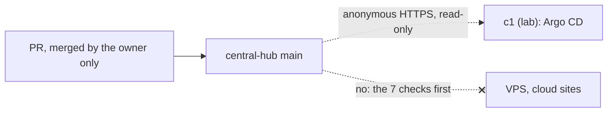

# Let the lab cluster c1 read central-hub through Argo CD before the Activation gate passes

## Context and Problem Statement

The Activation gate (AGENTS.md) says no cluster reads this repository until all 7 checks pass. Item 1, per-agent GitHub identities with the owner's approval required by GitHub, is the longest of them. D-0023 installed Argo CD on c1 with no source, and it left open "whether c1 may read central-hub before the Activation gate passes". On 2026-10-28 at 04:29 UTC the owner said "Keep the gate".

On 2026-11-08 at 07:06 UTC the owner asked to switch all of c1's Kubernetes work to GitOps as soon as possible. Measured that morning: everything on c1 was applied by Ansible (seven Helm releases and several sets of manifests), and Argo CD managed nothing. Asked on a card whether c1 may read central-hub before the gate passes, the owner chose "Yes, for c1 only" at 07:16 UTC. That option read: a new decision record; lab cluster c1 may pull central-hub `main` read-only now; the 7 checks still apply before the VPS or cloud join.

## Decision Drivers

- **Learn Kubernetes the GitOps way now.** The owner's goal for c1 is learning, and GitOps is the target way of working (D-0002).
- **Greenfield.** On 2026-10-26 at 06:30 UTC the owner said all the infrastructure is "greenfield not in use... v0.1".
- **Replaceable and documented.** On 2026-11-08 at 07:09 UTC the owner asked that every piece be replaceable and documented (REQ-0011).
- **What the gate protects against.** An agent acting as the owner's GitHub account could change `main`, and a cluster that reads `main` would then apply the change (AGENTS.md rule 2, Foundation C9).

## Considered Options

1. **c1 only, now:** c1 reads `main` read-only, and the full gate still holds for every other cluster.
2. **Finish the gate first:** Argo CD stays empty until all 7 checks pass.
3. **Read now, sync by hand:** Argo CD reads `main`, but nothing applies until someone presses sync.

## Decision Outcome

Chosen option: **1**. The owner chose it on 2026-11-08 at 07:16 UTC (card in the project thread).

### Rules

1. **Scope.** Only cluster c1 in the home lab may read central-hub before the Activation gate passes. Every other cluster still waits for all 7 checks.
2. **How it reads.** It reads as D-0023 rule 5 says: one root Application reads `hosts/kubernetes/home/c1/` on `main` over anonymous HTTPS, with no repository credential in the cluster. Nothing writes to git (gate item 3), and there is no image automation (gate item 6).
3. **Switch.** The Ansible switch `k8s_gitops_source_enabled` is set to true only in c1's inventory.
4. **Private names stay out of git.** The lab zone reaches the cluster only as a Helm parameter on the root Application, set from the private inventory (CLAUDE.md rule 4).
5. **Way back.** Deleting the root Application stops all reading at once. The Applications have no resources finalizer, so the objects stay, and the Ansible roles take over again.

### Consequences

- Good: each component moves to GitOps one PR at a time, with a runbook, and the owner sees it in the Argo CD UI.
- Good: drift on c1 is visible, and self-heal puts it back.
- Bad: until gate item 1 exists, anything that can merge to `main` can change c1. Compensating controls: a PR merges only when every check passes, and a record is accepted only on the owner's named approval (D-0031); c1 is greenfield and holds nothing that can't be rebuilt; the way back (rule 5) is one deletion; the UI and the cluster are reachable only from the lab network (D-0023 rule 6).
- Neutral: the Activation gate's wording now names this exception (AGENTS.md).

### Confirmation

- On c1, `kubectl -n argocd get applications` lists the root Application `c1` and its children, and `kubectl -n argocd get secret -l argocd.argoproj.io/secret-type=repository` returns nothing.
- No other cluster's inventory sets `k8s_gitops_source_enabled: true`; a reviewing agent checks each PR that touches an inventory template.

## Pros and Cons of the Options

### 2. Finish the gate first

- Good: no exception to the gate.
- Bad: GitOps waits for per-agent identities, which are parked (BL-0022), so the move the owner asked for "as soon as we can" waits indefinitely.

### 3. Read now, sync by hand

- Good: nothing changes on c1 without a person pressing sync.
- Bad: a manual step at every change, which the owner has asked to avoid ("deterministic idempotent code", 2026-10-27 02:49 UTC); the spec still starts each component with automatic sync off until its diff is clean.

## More Information

- **Evidence:** [../evidence/0027-let-c1-read-central-hub-before-the-activation-gate.md](../evidence/0027-let-c1-read-central-hub-before-the-activation-gate.md).
- **Spec:** [../specs/2026-11-c1-apps-under-argo-cd.md](../specs/2026-11-c1-apps-under-argo-cd.md).
- Related records: D-0002, D-0011, D-0023.
