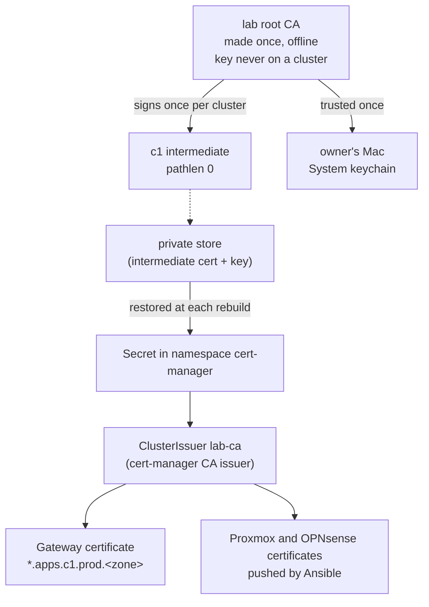

# Run the lab's own certificate authority with the root kept off every cluster and one intermediate per cluster, restored into cert-manager on each rebuild

## Context and Problem Statement

c1's apps get one Let's Encrypt wildcard certificate today, through cert-manager and DNS-01 (spec [2026-10-c1-way-in-for-web-traffic](../specs/2026-10-c1-way-in-for-web-traffic.md)). That spec left "a private certificate authority" out of scope, as its own step.

On 2026-11-08 at 07:08 UTC the owner asked for that step: a PKI that still works after a rebuild, its root trusted on the owner's Mac so the certificates on c1 are trusted there, and Proxmox and the other hosted apps using it. At 07:09 UTC the owner asked that every piece be replaceable and documented (REQ-0011). An earlier home lab kept both CA keys only inside the cluster, so each rebuild made a new root that every device had to trust again (evidence finding 1).

## Decision Drivers

- **Survive a rebuild.** Rebuilding c1 must not change the root that devices trust.
- **Trust once.** Each device trusts one root, one time.
- **Replaceable** (REQ-0011). Any issuer can be swapped by signing it a new intermediate under the same root.
- **Nothing extra to run** unless it is needed. On 2026-11-08 at 07:41 UTC the owner wrote: "I feel like a vm just forr a ca is alot."
- **No names in public logs.** Public certificates put every name in Certificate Transparency logs; private ones don't.

## Considered Options

1. **Root off-cluster, one intermediate per cluster restored into a cert-manager CA issuer** (a pattern the owner used on an earlier cluster).
2. **The same root, with a step-ca server in a small Proxmox container as the intermediate**, so Proxmox and OPNsense order their own certificates over ACME.
3. **Option 1 for c1 apps, and public Let's Encrypt certificates on Proxmox and OPNsense.**

## Decision Outcome

Proposed option: **1**. The owner chose it on 2026-11-08 at 07:42 UTC ("i feel b", the card's option for this shape).

### Rules

1. **Root.** The root CA is made once, by hand, on the owner's machine, following the runbook [Create the lab root CA](../runbooks/create-lab-root-ca.md). Its private key is never copied to any cluster, VM or this repository.
2. **One intermediate per cluster.** Each cluster gets its own intermediate, signed by the root with path length 0. c1's is the first.
3. **Restore, never re-create.** The intermediate certificate (with the root appended) and its key are kept in the private store. A rebuild restores them into the Secret that the ClusterIssuer `lab-ca` reads. A rebuild never makes a new root or intermediate.
4. **Issuer.** cert-manager's CA issuer is the only issuer that uses the intermediate. The ClusterIssuer and the root bundle are Kubernetes objects in this repository, applied by Argo CD (D-0023, D-0027).
5. **Hosts outside Kubernetes.** Proxmox and OPNsense get certificates issued by `lab-ca` on c1, copied to them by Ansible.
6. **Trust.** Devices trust the root, never the intermediate. The owner's Mac trusts it in the System keychain, following the runbook [Trust the lab root CA on a Mac](../runbooks/trust-lab-root-ca-on-mac.md).
7. **Names.** Certificates carry names under the lab zone as STD-0001 sets them; never `.local`.
8. **Exit path.** Any other issuer (step-ca, OpenBao, a cloud CA) gets a new intermediate signed by the same root, so no device has to trust anything new. Let's Encrypt stays installed as a ClusterIssuer and can be pointed back to by changing one `issuerRef`.

### Not decided here

- Where the root's private key is kept (the owner's question, open on 2026-11-08).
- Name constraints on the intermediate (limiting it to the lab zone), until a test shows macOS and iOS accept them.
- Trust on devices other than the owner's Mac.

### Consequences

- Good: a c1 rebuild keeps the same root, so no device is touched.
- Good: no CA server to run, patch or back up.
- Good: lab names stay out of public Certificate Transparency logs.
- Bad: Proxmox and OPNsense depend on c1 to renew their certificates. Leaf certificates last 90 days and renew 30 days early, so c1 can be down for up to 30 days before one lapses.
- Bad: the CA issuer doesn't rotate its own intermediate. That is a manual step before it expires, written in the root runbook.
- Bad: cert-manager v1.21 lists Kubernetes 1.33 to 1.36 as supported, and c1 runs 1.37.
- Neutral: devices that don't trust the root see a warning. That is why the Let's Encrypt issuer stays as the exit path.

## More Information

- Evidence: [docs/evidence/0028](../evidence/0028-run-a-lab-ca-with-the-root-off-cluster-and-one-intermediate-per-cluster.md).
- Spec: [2026-11-lab-pki](../specs/2026-11-lab-pki.md).
