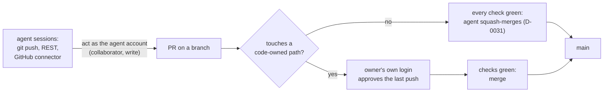

# Give the cloud agents one GitHub account of their own, separate from the owner's, so GitHub can require the owner's approval

## Context and Problem Statement

Activation gate item 1 asks for per-agent GitHub identities, with the owner's approval required by GitHub. Today every agent session acts on GitHub as the owner's account, so GitHub can't tell the owner's approval from an agent's. Measured again on 2026-11-08: `protect-main` requires 0 approving reviews, no code-owner review and no last-push approval, and has no bypass actors; a request from the agents' environment with no token, and one with a made-up token, both came back as the owner's account.

The Foundation proposal (v0.4.3 §6, AG1) planned one GitHub App per agent. Research batch RB-0093 (2026-10-28) measured that the agents' environment puts the owner's token on GitHub requests. RB-0094 (2026-10-28, later the same day) found that the agents act as the owner through two separate channels, the environment's GitHub proxy and the GitHub connector the agents call as tools, and it found two more routes this record had not listed (options 4 and 5 below).

This record was first drafted after a decision-card answer on 2026-10-28 at 05:12 UTC that picked the recommended option, one agent account. The owner typed no words about the choice. On 2026-11-08 at 19:01 UTC the owner said that past card answers that took the recommended option are agent picks, not the owner's decisions, and are to be re-checked at the lab rebuild. On 2026-10-29 the owner asked what needs an agent identity during the infrastructure build, and the work was set aside. On 2026-11-08 at 22:58 UTC the owner parked this record, and asked right after for its gaps to be closed. This version is that rewrite: every choice in it is an agent pick, for the owner to take, change or reject.

Nothing needs this record while only c1 reads the repository (D-0027). It is needed before any other cluster reads it.

### Gaps in the first draft, and where this version answers them

| # | Gap | Answered in |
|---|---|---|
| 1 | It recorded a card answer as the owner's decision. | Context (above); Decision Outcome says no option is chosen |
| 2 | It was never tested: no agent has pushed a branch or opened a PR as another account. | Rule 2, the switch test, with pass conditions |
| 3 | Its review rule (1 approval on every PR) would stop agents merging green PRs, which D-0031 allows. | Rule 4 and "How this fits D-0031" |
| 4 | One account for every cloud agent is one identity per lane, not per agent, so it does not meet item 1 as written on its own. | Rule 1 and "What this route does not give" |
| 5 | The agent account can push workflow files, so gate item 2's verifier has no home. | Rule 6 and "Not decided here" |
| 6 | It covered only the proxy channel, not the GitHub connector, so a session could still act as the owner after the switch. | Rules 2 and 5 |
| 7 | It left out RB-0094's routes (the Claude coding agent on GitHub, an App through a GitHub Action) and its re-ranking. | Considered Options 4 and 5 |

## Decision Drivers

- **GitHub must see the agent as someone other than the owner** (RB-0018, RB-0093). Every other part of item 1 rests on it.
- **Works with the tools the agents run on today**, not only after new plumbing is built.
- **Agents keep merging green PRs** where D-0031 allows it, so the lab build doesn't wait on the owner for every merge.
- **Replaceable** (REQ-0011): the rulesets name only the owner, so the agent identity can change without touching them.

## Considered Options

1. **One machine account for the cloud agents**, connected to the agents' environment and to their GitHub connector in place of the owner's account.
2. **One GitHub App per agent, through a token set in the agents' environment** (Foundation AG1; RB-0094 route A).
3. **Not yet.**
4. **The Claude coding agent on GitHub** (RB-0094 route E): GitHub installs an App for the agent, and work starts from GitHub, not from the cloud sessions.
5. **Our own GitHub App through a GitHub Actions workflow** (RB-0094 route B).

## Decision Outcome

**No option is chosen.** The owner parked this record on 2026-11-08 at 22:58 UTC. The drafting agent's pick, if the owner resumes it, is option 1, because it is the only route RB-0094 found documented end to end for the cloud sessions, with option 4 tested first if the owner has a paid Copilot plan. That is an agent pick, not the owner's choice.

*In words:* the agents push and open PRs as their own account. A PR that touches only paths with no code owner merges once its checks are green, as D-0031 allows. A PR that touches a code-owned path, such as what a cluster reads, needs the owner's approval on its last push first.

### Rules (apply only if the owner takes option 1)

1. **One account for the cloud agent lane.** The owner creates one machine account (GitHub allows one free machine account per person, and the person is responsible for it) and invites it as a collaborator here. A collaborator on a personal repository always has write access. The account is one identity for every cloud session, so GitHub can tell the cloud lane from the owner, but not one cloud agent from another.
2. **Test before the switch.** The switch happens only after one cloud session, with both channels connected as the agent account, shows all of these, recorded with the commands' output in the evidence file:
   - `GET /user` through the proxy returns the agent account;
   - the GitHub connector's own identity call returns the agent account;
   - `git push` of a new branch succeeds, and GitHub shows the agent account as the pusher;
   - a PR the session opens shows the agent account as its author;
   - the owner, from their own login, can approve that PR, and the approval counts for the last push.

   If any step fails, the switch does not happen, the owner's account is reconnected, and this record is revisited.
3. **The owner keeps their own login for approvals and admin.** No agent holds the owner's credentials or signing key.
4. **Review rule, scoped by path.** After the switch, a second ruleset `main-review` holds only the review rule: 0 required approvals, code-owner review on, approval of the last push on, and the repository admin role as its one bypass actor in `pull_request` mode, so the owner's own PRs merge without self-approval. CODEOWNERS names the owner only for the paths that need the owner's review, for example what a cluster reads (`hosts/kubernetes/clusters/`), `AGENTS.md` and `.github/`. `protect-main` keeps no bypass, and the required checks move into it, so nobody merges red.
5. **Both channels switch together.** At the switch, the owner's account is disconnected from the agents' environment and from their GitHub connector, and the Foundation-era token of the owner's account is revoked. A session that can still reach GitHub as the owner fails item 1.
6. **Workflow files.** The agent account can still push files under `.github/workflows/`, and a ruleset can block that only on private and internal repositories. Gate item 2's verifier therefore has to run from somewhere a PR can't edit. This record doesn't choose where.

### How this fits D-0031

D-0031 lets agents squash-merge a PR once every check passes. The first draft's ruleset (1 approval on every PR) would have ended that. Rule 4 keeps both: a PR that changes only paths with no code owner needs no review, so agents still merge it when it is green; a PR that changes a code-owned path needs the owner's approval on its last push. GitHub documents that code-owner review applies to PRs that modify code-owned content. It does not say how that setting behaves with 0 required approvals, so the switch test adds one PR on each side of the line and records whether GitHub blocks only the code-owned one. If GitHub needs 1 approval for code-owner review to apply, the owner chooses between that (agents no longer merge on their own) and keeping D-0031 until the gate.

### What this route does not give

- **Per-agent identity.** One account for every cloud session. Item 1 says per-agent. Whether one identity per lane meets item 1, until a lane can carry its own App token, is the owner's call; the `Author-Lane` line in each PR body is a convention, not something GitHub enforces.
- **Gate item 2.** See rule 6.
- **Protection from the account's own write access.** It can still merge a PR once the rules are met, and it can push workflow files.

### Not decided here

- where gate item 2's verifier lives;
- identities for agents outside the cloud project (each gets its own before write access, AGENTS.md rule 1);
- the agent account's name;
- the exact CODEOWNERS paths, which the switch PR proposes;
- per-agent Apps later (option 2), once a write route that keeps an agent's own token exists.

### Consequences

- Good: GitHub can tell the owner from the agents, so the owner's approval on what reaches a cluster becomes something GitHub enforces.
- Good: agents keep merging green PRs outside the code-owned paths (D-0031).
- Bad: one identity for every cloud agent, not one per agent.
- Bad: GitHub's terms make the owner responsible for the machine account's actions.
- Bad: the account has write access, so it can push workflow files (item 2).
- Bad: untested until rule 2 runs, and the path scoping in rule 4 rests on a setting GitHub's page does not fully describe.

### Confirmation

- Rule 2's test output, in the evidence file.
- Foundation V12: an agent's commit and PR show the agent account; an agent's PR that touches a code-owned path can't merge until the owner approves its last push; a PR with a failing required check can't merge, even through the owner's bypass.
- `GET /repos/jonhill90/central-hub/collaborators?permission=admin` lists only the owner.

## Pros and Cons of the Options

### 2. One GitHub App per agent, through a token in the environment

- Good: GitHub's recommended form for long-lived automation: short-lived tokens, fine-grained permissions, no seat; one identity per agent.
- Bad: most unknowns (RB-0094). Whether the proxy forwards a token set in the environment is untested. An installation token lasts one hour and an environment variable is static, so something has to mint tokens, and an App key in the environment is readable by anyone using it. If `git push` still goes out as the owner, last-push approval blocks the owner.

### 3. Not yet

- Good: no work now, and nothing needs it while only c1 reads the repository (D-0027).
- Bad: gate item 1 stays open, so no cluster but c1 may read this repository, and anything that can merge to `main` can change c1.

### 4. The Claude coding agent on GitHub

- Good: the agent gets its own App identity on GitHub, the same way other vendor bots do.
- Bad: it needs a paid Copilot plan, and it runs from GitHub, not from the cloud sessions. Under GitHub's rules the person who asked for such a PR can't approve it; on a one-person repository that may leave nobody to approve. Which identity its PRs show is not documented. All untested.

### 5. Our own GitHub App through a GitHub Actions workflow

- Good: documented; the App acts as its own `[bot]` identity.
- Bad: it runs only from `workflow_dispatch` or a schedule (AGENTS.md rule 5 bars agent workflows on `pull_request_target`, `issue_comment` or `issues`), not from the cloud sessions, and the App key is a repository secret, which gate items 2 and 3 then have to cover.

## More Information

- **Evidence:** [../evidence/0030-give-cloud-agents-one-github-account-of-their-own.md](../evidence/0030-give-cloud-agents-one-github-account-of-their-own.md), from research batches RB-0093, RB-0094 and RB-0018, and the measurements of 2026-11-08.
- **Exit path:** remove the collaborator, revoke its tokens, delete the account, reconnect another identity on both channels, and delete `main-review`; `protect-main` names nobody and doesn't change.
- Related: AGENTS.md "Activation gate" item 1; docs/specs/2026-10-activation-gate.md; D-0013; D-0027; D-0031.
- **Number:** drafted as D-0026 on 2026-10-28; main gave D-0026 to another record (PR #55), so this one takes D-0030, the next number not used or held (D-0027 on main, D-0028 in PR #65, D-0029 held for the Cilium record).
