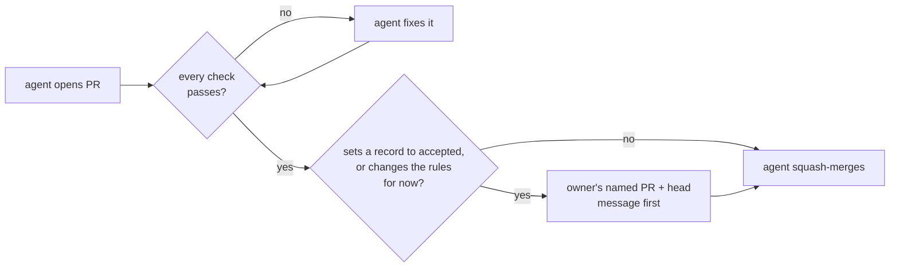

# Let agents squash-merge a PR once every check on it passes, while the owner still accepts every decision record

## Context and Problem Statement

AGENTS.md says each loosening of the rules for now is its own decision record that the owner accepts. Rule 2 says agents don't merge or enable auto-merge, and the owner merges.

On 2026-11-08 at 07:55 UTC the owner said in the project chat that agents may merge PRs whose checks are green. From 08:35 UTC that day agents merged central-hub PRs themselves, starting with #64, and about 40 PRs across the project's repositories by the evening. No record was written, so rule 2 and the practice disagreed for the rest of the day. This record writes the order down and changes rule 2 to match.

## Decision Drivers

- **The owner's order of 2026-11-08 at 07:55 UTC**, given during the lab build, together with the owner's statement at 07:51 UTC that the first build should go ahead without process questions, and that the records get rewritten in order once it is built.
- **The owner's earlier plan for autonomy.** On 2026-10-12 at 06:20 UTC the owner said the rules are for now, and that once the owner understands all of it and trusts the system, it could be allowed to do things like auto-merge. AGENTS.md carries the same intent.
- **What decides stays with the owner** (AGENTS.md rule 1, D-0001). Merging a PR is not the same as accepting a record in it.
- **Replaceable** (REQ-0011): the change can be undone by editing one rule and removing one allow rule.

## Considered Options

1. **Agents merge a PR once every check passes; the owner still accepts records.**
2. **Agents enable auto-merge on their PRs**, so GitHub merges when the checks pass.
3. **Keep rule 2:** the owner merges every PR.

## Decision Outcome

Chosen option: **1**. It is what the owner ordered on 2026-11-08 at 07:55 UTC. The definition of green in rule 1, the ban on auto-merge, the split between merging and accepting, the squash method and the exceptions in rules 3 and 4 are agent picks, for the owner to accept or change with this record.

*In words:* an agent merges its PR once every check is green. A PR that sets a record to `accepted`, or that loosens the rules for now, still needs the owner's message naming the PR and its head first.

### Rules

1. **Green.** A PR is green when every check GitHub runs on its head has passed, none is pending, and GitHub reports no merge conflict. A skipped check counts as passed only when its workflow skips it on purpose (for example a path filter).
2. **How.** The agent squash-merges, because `main` keeps a linear history, and deletes the branch (D-0002). It never pushes to `main` and never enables auto-merge.
3. **Accepting.** A PR that sets a decision record to `accepted`, `rejected` or `parked`, or that sets a standard to `active`, merges only with the reviewer's and the council's pass for its head (D-0042 rules 1 and 3), which since D-0042 takes the place of the owner's message (the owner's messages of 2026-11-14, 07:42 to 07:44 UTC, asking not to be asked to approve PRs; who approves in his place is an agent pick). A PR that adds or changes a record that stays `proposed` may be merged by an agent.
4. **Rule changes.** A PR that loosens AGENTS.md "Rules for now" merges only with the reviewer's and the council's pass for its head (D-0042 rules 1 and 11; the owner's messages of 2026-11-14, 07:42 to 07:44 UTC, asking not to be asked to approve PRs; who approves in his place is an agent pick). Before D-0042 it needed the owner's message naming the PR and its head.
5. **Nothing else changes.** Rules 3 to 6 of AGENTS.md stay as they are. Before a merge the agent checks the PR for secrets and private names (rule 4) the same way as before.

### Consequences

- Good: the record and the practice agree again.
- Good: work moves without waiting for the owner, which is what the owner asked for during the lab build.
- Bad: until the agents have a GitHub identity of their own (D-0030), GitHub can't tell an agent's merge from the owner's, and anything that can merge can change c1 through Argo CD (D-0027). Compensating controls: every check must pass; c1 is greenfield and holds nothing that can't be rebuilt; the way back for c1 is one deletion (D-0027 rule 5); records still need the owner's named approval (rule 3).
- Bad: a check that misses something now lets it reach `main` with no human look first.
- Neutral: D-0002's diagram and D-0012's runbook rule said the owner merges every PR. This PR changes them to point here.

### Confirmation

- AGENTS.md rule 2 reads as this record's rules.
- A reviewing agent checks each agent-merged PR after the fact: its head had every check green, it was a squash merge, and it set no record to `accepted` without the owner's named message.

## Pros and Cons of the Options

### 2. Agents enable auto-merge

- Good: no agent has to wait for the checks.
- Bad: GitHub merges when the required checks pass, and `protect-main` may not list every check as required, so a PR could merge with a failing check that isn't required.

### 3. Keep rule 2

- Good: a human looks at every PR before it reaches `main`.
- Bad: it goes against the owner's order of 2026-11-08 at 07:55 UTC, and the lab build would wait on the owner for every merge.

## More Information

- **Evidence:** no research batch of its own. It rests on the owner's statements of 2026-11-08 at 07:55 UTC in the project chat (the order), of 2026-11-08 at 07:51 UTC in the thread "Finish lab setup and move k8s to GitOps" (build first, rewrite the records after), and of 2026-10-12 at 06:20 UTC in the Central Hub Foundation thread (the rules are for now; auto-merge once the owner understands all of it and trusts the system). It also rests on these measurements of 2026-11-08: the `protect-main` ruleset requires 0 reviews (read from the owner's Mac at about 07:58 UTC); the first agent merge after the order was central-hub #64, squash, at about 08:35 UTC; and AGENTS.md rule 2 still said agents don't merge at 22:30 UTC, on `main` at 2da68dd.
- **Exit path:** put rule 2 back to "the owner merges" and remove the agents' `gh pr merge` allow rule on the owner's machine. Nothing else depends on this record.
- Related records: D-0001, D-0002, D-0012, D-0027, D-0030.
