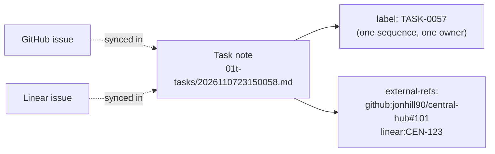

# Number tasks TASK-NNNN, and keep other trackers' keys as references

## Context and Problem Statement

D-0020 numbered every row of the one-page backlog `BL-NNNN`. On 2026-11-08 the backlog was split into the notebook's task kind, `01-notes/01t-tasks/`, one note per task, and the backlog became a state (every task not `done`), not a list (ORGANIZE 1.22). The prefix still says "backlog", so a done task reads as a backlog item.

On 2026-11-09 at 01:18 UTC the owner said the `BL` label "doesn't make any sense", asked for another way to represent tasks, and asked for it to be future-proof, because third-party trackers such as Linear or GitHub issues might sync their tasks into the notebook.

Evidence: [../evidence/0032-number-tasks-task-nnnn-and-keep-tracker-keys-as-references.md](../evidence/0032-number-tasks-task-nnnn-and-keep-tracker-keys-as-references.md).

## Decision Drivers

- **The owner's words of 2026-11-09 at 01:18 UTC:** drop `BL`, and keep tasks ready for syncing in from other trackers.
- **One shape for every cited ID** (D-0003): `D-0007`, `REQ-0022`, `STD-0001`, `RB-0077`, `RM-0033`.
- **An ID that never has to change:** another tracker's key can change when its item moves, and two trackers can hand out the same number.
- **Readable in chat:** the owner and agents cite tasks by ID, so the ID must say it is a task.
- **Replaceable** (REQ-0011): a tracker can be added or dropped without renumbering the notebook.

## Considered Options

1. **`TASK-NNNN`, with the same numbers, and other trackers' keys kept as references** in the task's front matter.
2. **`TK-NNNN`,** the same as option 1 with a shorter prefix.
3. **No label: cite a task by its note id** (such as `2026110723150058`).
4. **Use the source tracker's own key as the ID** (such as `CEN-123` or `central-hub#101`), and `TASK-NNNN` only for tasks made in the notebook.
5. **Keep `BL-NNNN`.**

## Decision Outcome

Chosen option: **1**, which the owner accepted on 2026-11-09 at 01:31 UTC. The prefix, keeping the numbers and the reference field's shape were agent picks.

*In words:* every task, wherever it came from, has one notebook number, `TASK-NNNN`. A task that also lives in another tracker lists that tracker's key in `external-refs`. The notebook number is what files cite; the other key is how a sync tool finds the same item.

### Rules

1. **`TASK-NNNN` for every task.** The `BL-NNNN` numbers keep their digits: `BL-0057` becomes `TASK-0057`. The next new task takes the next free number. In prose, the title goes next to the number, as D-0020 said.
2. **One sequence for every source.** A task synced in from another tracker gets the next free `TASK-NNNN` too. Its source key never becomes its notebook ID.
3. **Other trackers' keys go in `external-refs`,** a list of `<system>:<key>` strings in the task's front matter, such as `github:jonhill90/central-hub#101` or `linear:CEN-123`. A task made in the notebook has `external-refs: []`. The front matter key `source` keeps its meaning (where the task was first written down).
4. **The registry row changes.** D-0003's Backlog items row becomes Tasks, `TASK-NNNN`, example `TASK-0012`, home Research `01-notes/01t-tasks/`, numbered by the task owner when the note is added. `TASK-` passes D-0003 rule 2's prefix check: no registered prefix equals it or starts it.
5. **The rename runs under D-0003 rule 5,** with one line in [`CORRECTIONS.md`](CORRECTIONS.md), after this record is accepted. The notebook, central-hub and INPARA files are renamed by script in their own PRs; the chat archive and git history stay as they are.

### Exit path

If tasks move into another tracker for good, each task moves once and takes that tracker's key. `external-refs` already holds the mapping from `TASK-NNNN` to the new key, so citations still lead somewhere. The `TASK` family is then marked closed in D-0003's registry by its own record.

### Consequences

- Good: the ID says what the item is, done or not.
- Good: a synced task cannot clash with a notebook task, and a key that changes in its own tracker changes only one reference.
- Good: the numbers stay, so the rename is one prefix swap.
- Bad: about 2,300 citations change, in about 290 notebook files, 38 central-hub files and 2 INPARA files (counted 2026-11-09).
- Bad: a sync tool has to keep `external-refs` current; until one exists, they are written by hand.

### Confirmation

- After the rename, no live file in central-hub, the notebook or INPARA holds `BL-NNNN` outside the chat archive and git history.
- Every task note has a `label` that matches `TASK-\d{4}`, no two are the same, and every note has an `external-refs` list.

## Pros and Cons of the Options

### 1. TASK-NNNN with references

- Good: readable, can't be mistaken for "baseline" (a D-0020 note), and stable whatever the source.
- Bad: two more characters than `BL-`.

### 2. TK-NNNN

- Good: short.
- Bad: less readable; `TK` is not a word the owner uses.

### 3. Note id only

- Good: no second identifier at all.
- Bad: sixteen digits are hard to say or type in chat, and the ID gives no hint that it is a task.

### 4. Source tracker key as the ID

- Good: no mapping for synced tasks.
- Bad: two ID shapes in one list; a key can change when the item moves in its own tracker; two trackers can clash.

### 5. Keep BL-NNNN

- Good: no work.
- Bad: the owner has said it doesn't make sense, and the backlog is now a state, not the list.

## More Information

- **Evidence:** [../evidence/0032-number-tasks-task-nnnn-and-keep-tracker-keys-as-references.md](../evidence/0032-number-tasks-task-nnnn-and-keep-tracker-keys-as-references.md)
- Related records: D-0003, D-0020.
