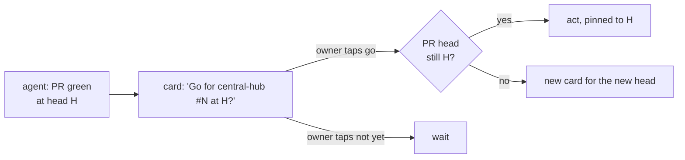

# Let the owner's tap on a decision card that names a PR and its head count as the owner's go, the same as a typed line

## Context and Problem Statement

AGENTS.md rule 1 says that, for agents in the project's chat, the owner's approval is a message the owner writes there, naming the PR number and its head SHA. D-0031 rules 3 and 4 use the same message for a PR that accepts a record or loosens the rules for now. Agents also ask the owner most choices on decision cards in the project's threads: a question with two to four options, answered by a tap.

On 2026-11-12 at 22:44 UTC an agent asked, on a card, "Let a card tap naming a PR and its head count as your go?" The option "Yes, write the record" said: "I write a decision record so that a tap on a card naming the PR number and head counts as your typed go; you accept that record once, in words." The other option, "Keep typed words only", said that accepting records, prod changes and firewall changes would still need a typed line naming the PR and head. The owner tapped "Yes, write the record" at 23:25 UTC. This is that record.

## Decision Drivers

- **The owner's answer of 2026-11-12 at 23:25 UTC** to the card of 22:44 UTC.
- **What decides stays with the owner** (AGENTS.md rule 1, D-0001). A tap changes how the owner says yes, not who says it.
- **Exactness.** A typed line is trusted because it names one PR and one head, so nothing pushed after it rides on it. A card can carry the same two names.
- **Who tapped.** The platform records a tap as the member's own answer, from that member's own client, with the card's text as the member read it. A line pasted into the chat by anyone else is not a tap.
- **Replaceable** (REQ-0011): undone by putting rule 1's old sentence back.

## Considered Options

1. **A tap on a card that names the repository, the PR and its head counts as the owner's go**, except for a PR that loosens the rules for now.
2. **The same, with no exception.**
3. **Keep typed lines only.**

## Decision Outcome

Chosen option: **1**. The owner chose a tap as the go. The rules below, the exception for rule changes among them, are agent picks, for the owner to accept or change with this record.

*In words:* the agent puts one card to the owner that names the repository, the PR and its head. A tap on the go option is the owner's go for that head only. A new head needs a new card.

### Rules

1. **What the card names.** The card's question names the repository, the PR number and at least the first 7 characters of its head SHA, for example "Go for central-hub #199 at 35a83b3?". The go option's label says what happens on a tap (merge, accept, apply). One option says no or not yet.
2. **Where.** Only a card in this project's threads, put by an agent with the platform's decision tool, and answered by the owner's own tap. Text on GitHub, a card's text quoted elsewhere, or another agent's word that the owner tapped is not a tap.
3. **What it covers.** Everything AGENTS.md rule 1 and D-0031 rule 3 send to the owner's message: accepting, rejecting or parking a record, setting a standard to `active`, a production change and a firewall change, each for the one PR and head the card names.
4. **The exception.** A PR that loosens AGENTS.md "Rules for now" needed a line the owner types (D-0031 rule 4), because a tap there could widen what a tap covers. Since D-0042 the reviewer's and the council's pass approves such a PR, and a card is put to the owner only for the steps in D-0042 rule 6.
5. **Pinned to the head.** The agent acts on the named head only, as it does for a typed line. If the head moves, the tap covers nothing and a new card goes out.
6. **A disowned tap is void.** If the owner says a tap was a slip before the agent acts, the agent puts the same card again. If the agent has already merged, the way back is a revert PR; a production step is put back by its runbook's way back.
7. **The record of it.** An acceptance written from a tap fills `accepted-evidence` as for a typed line, with the card's message id as `approval-ref`, and `approval-names` quoting the card's question and the option tapped.
8. **Typed lines still work.** Nothing here takes away the owner's typed line.

### Consequences

- Good: the owner can approve from the phone with one tap, while the go still names one PR and one head.
- Good: the decision trail gets a fixed shape: the card's text, the option, the time, and who tapped.
- Bad: one tap is easier to slip on than a typed line. On 2026-11-12 at 22:21 UTC the owner said a tap on an earlier card that day was a misclick. Compensating controls: the card names the PR and head in its question; the go option says what will happen; a disowned tap before the act is void (rule 6); merges are pinned to the head and can be reverted; rule changes still need typed words (rule 4).
- Bad: the card's words are an agent's. A card could describe a PR wrongly. Compensating control: the PR and head named in the card are what the agent acts on, and the PR itself stays readable on GitHub.
- Neutral: AGENTS.md rule 1 changes in this PR to point here. D-0031's text is not edited; its "owner's message" in rules 3 and 4 is read with this record.

### Confirmation

- AGENTS.md rule 1 names this record.
- A reviewing agent checks each act taken on a tap: the card named that repository, PR and head; the tap came from the owner; the act was pinned to that head; and no rule change merged on a tap.

## Pros and Cons of the Options

### 2. No exception for rule changes

- Good: one rule for every go.
- Bad: a loosening of the rules is the one change that can widen what a single tap may do next, so it is the place a slip costs most.

### 3. Keep typed lines only

- Good: a typed line is the hardest to give by accident.
- Bad: it goes against the owner's answer of 2026-11-12 at 23:25 UTC.

## More Information

- **Evidence:** no research batch of its own. It rests on the card of 2026-11-12 at 22:44 UTC in the project thread "Plan path to permanent infra decisions", the owner's tap at 23:25 UTC, the owner's message of 22:21 UTC that day about a misclicked card, and the platform's record of a tap, which states that the tap came from the member's own client and stands as the member's reply.
- **Exit path:** take the card tap out of AGENTS.md rule 1, so that only the owner's typed message naming the PR number and its head SHA counts again. Nothing else depends on this record.
- Related records: D-0001, D-0030, D-0031.
