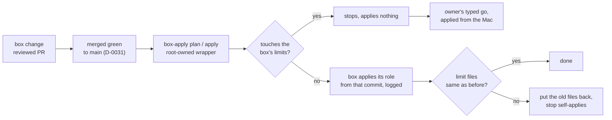

# Let the agent box apply its own setup from reviewed main, and stop for the owner on any change to its own limits

## Context and Problem Statement

The agent box (VM 258) is set up by the Ansible role `agent_box`. Every change to it is a reviewed PR, which the box merges once it is green (D-0031). The role is then applied from the owner's Mac, by an agent lane running the Mac's allowed apply script. On 2026-11-11 at 04:20:39 UTC the owner tapped that the box's role stays "behind my go". So the Mac is still a step in every box change, though the review and the green merge already decide what lands.

On 2026-11-14 at 02:24 UTC an agent asked, on a decision card, "Should the agent box apply its own setup changes, instead of the Mac?" The option "Box applies, limits wait" said: "Agents write a decision record; once you type your accept, the box applies reviewed changes itself and stops on any change to its own limits." The card's picture named the limits as "sudo rules, guard settings, allow and deny lists". The other option kept the Mac applying. The owner tapped "Box applies, limits wait" at 02:26 UTC. This is that record.

It loosens "Rules for now", because the box's role no longer waits for the owner's go through the Mac. Under D-0034 rule 4 it needs the owner's typed line naming this PR and its head, not a tap.

## Decision Drivers

- **The owner's answer** of 2026-11-14 at 02:26 UTC to the card of 02:24 UTC.
- **An agent can't loosen its own limits.** The files that set what a session on the box may do stay behind the owner.
- **Review and the green merge are the real controls** (D-0031). An apply from the Mac adds no review of its own, only a second check by the Mac's guard.
- **Deterministic** (the owner's ranking of 2026-11-11): the stop is decided by a fixed check on files, not by an agent's reading.
- **Replaceable** (REQ-0011): undone by going back to the Mac apply.

## Considered Options

1. **The box applies its own role from reviewed main, through one root-owned wrapper with fixed arguments, and stops on any change to its limits.** Limit changes are applied from the Mac.
2. **Every box apply waits for the owner's approval on GitHub** (D-0035's channel).
3. **Keep the Mac applying every change.**

## Decision Outcome

Chosen option: **1**. The owner chose the box applying and the limits waiting. The rules below are agent picks, for the owner to accept or change with this record.

*In words:* a merged change to the box goes to a fixed wrapper on the box. If it touches the box's limits, nothing is applied and the owner's go is needed, applied from the Mac. Otherwise the box applies it, then checks that its limit files are unchanged, and puts them back and stops if they are not.

### Rules

1. **What the box may apply.** Only the `agent_box` role, from the commit that `origin/main` points to when the run starts, in a checkout that only root can write. Never a branch, a PR head or a local edit. The commit and the result of each run go to a log on the box.
2. **How it is started.** One root-owned wrapper, `box-apply`, with two fixed first arguments: `plan` (a check run with its diff) and `apply`. A session may start it through sudo, as it starts the other wrappers. No other arguments pass.
3. **The box's limits.** These never change by a self-apply:
   (a) the sudo rules: the sudoers file the role writes, and the wrapper list with its arguments that it is made from;
   (b) the guard settings: Claude Code's managed settings on the box, with their allow and deny lists and auto mode's settings;
   (c) the users the box runs as (the session user, the keys user, the runner user) and their groups, and the key folder's owner and mode;
   (d) `box-apply` itself and its list of limit files.
4. **The stop, before.** `box-apply` compares the commit it last applied with the new one. If any file that makes a limit in rule 3 changed (the role's sudoers, managed-settings and front-script templates, the wrapper list, the allow and deny lists, auto mode's settings, the user tasks, `box-apply` and its list), it stops and applies nothing. It also runs the role in check mode, and stops if a limit file would change.
5. **The check, after.** `box-apply` records the limit files' contents before an apply and compares them after. If one changed, it puts the old file back, logs it and refuses further self-applies until an apply from the Mac.
6. **Limit changes.** A change to a limit is applied from the Mac, by an agent lane, after the owner's go naming the PR and its head (AGENTS.md rule 1, D-0034). When D-0035 is in effect, an approval on its GitHub environment may replace the Mac for this by a later record.
7. **Values stay where they are.** Private values the role needs (the box's name, the allow lists, auto mode's settings) stay in the private inventory, which reaches the box only through the prod files copy from the Mac. A self-apply never edits them.
8. **What this does not change.** OPNsense, the Proxmox host's firewall, the tailnet's admin settings, and the lab teardown and rebuild (D-0035) stay behind the owner's words. This record covers the box's own role only.

### Consequences

- Good: a reviewed, merged change to the box applies without the Mac, so the Mac lane has no box job left.
- Good: the files that set what a session may do still change only with the owner's go.
- Bad: **root on the box runs whatever reviewed main says.** The check before and after catches a plain change to a limit, by mistake or not. It does not stop merged code written to get around it, for example a task that kills the wrapper before its check after. Compensating control: review and the green merge, which already decide what the Mac applies today.
- Bad: **a wrapper script is not a limit.** A reviewed change to a wrapper's code can widen what a session can do as the keys user, and it applies by itself. Compensating control: review; the wrapper's allowed first arguments are in the sudo rules, so a new verb still stops. The owner may add the wrapper scripts to rule 3 when accepting.
- Bad: this replaces the owner's tap of 2026-11-11 04:20:39 UTC ("behind my go") for the box's role. Compensating control: rules 3 to 6 keep that go for the limits.
- Neutral: the `box-apply` wrapper and its tests are built in a later PR, and run from the Mac once to install, because the wrapper is itself a limit.

### Confirmation

- `box-apply`'s tests show a stop for each kind of limit file in rule 3, a stop when the check run shows a limit file would change, and a put-back when one changes during an apply.
- A reviewing agent checks the box's apply log against main's merged PRs.
- The first self-apply after acceptance is `plan`, then `apply` of a change that touches no limit.

## Pros and Cons of the Options

### 2. Every apply waits for the owner on GitHub

- Good: the strictest; GitHub proves it was the owner.
- Bad: it can't start until D-0035 is in effect, which waits on D-0030 (D-0035 rule 8(c)). The owner chose to keep his own account for now (2026-11-14 02:05 UTC).

### 3. Keep the Mac applying

- Good: nothing new to trust.
- Bad: goes against the owner's answer of 2026-11-14 at 02:26 UTC, and keeps the Mac a step in every box change.

## More Information

- **Evidence:** no research batch of its own. It rests on the card of 2026-11-14 at 02:24 UTC in the project thread "Coordinate the project in my place", the owner's tap at 02:26 UTC, and his earlier tap of 2026-11-11 at 04:20:39 UTC that this replaces for the box's role.
- **Exit path:** remove the `box-apply` wrapper's sudo line and the wrapper, by an apply from the Mac. Box changes then wait for the Mac again, as before this record.
- Related records: D-0001, D-0031, D-0034, D-0035.
