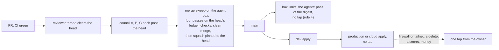

# Let the reviewer and the council approve in the owner's place, except the steps he keeps

## Context and Problem Statement

Today the owner types or taps a go for almost every step:

- a merge of a PR that accepts a record or a standard, or loosens the rules (AGENTS.md rules 1 and 2, D-0031 rules 3 and 4, D-0034);
- a production run of a lab layer (D-0035 rule 3) and every production or cloud apply (D-0041 rule 6);
- a change to the agent box's limits, applied from the Mac (D-0036 rule 6).

In practice he also types merge lines for ordinary green PRs. D-0031 already lets agents merge those, but two tools stop them: the box session's safety check refuses the `pr-merge` wrapper unpredictably, and the Mac session's guard counts only words the owner typed. The cloud sessions' GitHub tools have no merge call, but they can start a `workflow_dispatch` workflow (evidence, findings 1 and 2).

On 2026-11-14 the owner asked, in these messages, that approvals for the lab's greenfield build-out no longer come to him:

- at 06:31:02 UTC (cmsg_01X43rfNYp4H1dL1V2dkfkwNNmDuqYAAd97e7MWLy7w5j9) he asked when the agents would take these approvals over;
- at 07:36:24 UTC (cmsg_01X43rfNYp4H1dL1V2dkfkwN1HaQyfWs523TENpj3y4GrB) he raised the approval prompts still being sent to him;
- at 07:36:52 UTC (cmsg_01X43rfNYp4H1dL1V2dkfkwNVWniFNwFdxHd6saXpoKLKg) he said the greenfield lab should not need typed or clicked approvals from him;
- at 07:42:15 UTC (cmsg_01X43rfNYp4H1dL1V2dkfkwNPCDvrtDZGccQzAi27X4YGH) he asked whether this was the last thing he would have to type, and that agents work out every other step he would need to type so that he would not have to;
- at 07:42:30 UTC (cmsg_01X43rfNYp4H1dL1V2dkfkwNHGFshMgp6jwdfeuyZWEdj6), in the orchestrator thread, he gave his go and said no further PRs should come to him for approval;
- at 07:43:25 UTC (cmsg_01X43rfNYp4H1dL1V2dkfkwNQZSPJDASxzgXUwb36fceaH), in the same thread, he said agents should ask him for nothing beyond the steps he had already said need his approval;
- at 07:44:46 UTC (cmsg_01X43rfNYp4H1dL1V2dkfkwNLj5JuE8JmYT3juteQ3eMJm) he said this covers the lab for now, during its greenfield phase, not every PR, and that the lab holds no personal data or anything of value.

Since that morning, every plan, record and done-claim already passes a reviewer thread and a council of three threads before it reaches him. This record makes that pass the approval.

### What the owner said, and what agents picked

The owner's words, above, decide only this much:

- PRs no longer go to him for approval;
- the things his earlier standing rules gave him still need him; at 07:43:25 UTC he pointed to those rules without listing them. Which things they are is the agents' reading: firewall and tailnet changes (D-0036 rule 8 keeps them behind his words), and deletes and secrets [agent pick: the agents' reading of his earlier rules, with no record of their own];
- the lab is greenfield, so agents finish it;
- this covers the lab, for now, during its greenfield build-out, not every PR (07:44:46 UTC).

Everything else in this record is an agent pick, labelled `[agent pick]` in its rule, which the owner can change at any time (REQ-0035). That includes the reviewer and the council approving in his place: that role is one the agents gave themselves, because his messages end his own approval but do not name who approves instead.

His messages are a change of mind (REQ-0030). They reverse REQ-0009 (the owner makes every decision) and REQ-0012 (only the owner accepts a record; agents must not mark one accepted) in the requirements register, the project's standing instruction 1 (never mark anything accepted), and the second of the three Central Hub outcomes in the project's topic (he picks each permanent piece), whose work his card of 2026-11-11 at 04:03 UTC put ahead of other work, for the changes this record covers. The register and that outcome's text are kept outside this repository; both need updating, by their own process.

## Decision Drivers

- **The owner's requests of 2026-11-14** above.
- **What can't be undone stays with a person.** A merge can be reverted and a lab layer rebuilt from code; a deleted backup, money spent or a leaked secret can't be taken back.
- **Checks a machine runs.** What a job can check itself (the head, the checks, a clean merge) it checks, so it doesn't rest on the caller's word.
- **Everything logged.** Each approval names the reviewer's and the council's messages, in a log the owner can read.
- **Replaceable** (REQ-0011): undone by a PR that puts the old rules back.

## Considered Options

1. **The agents' pass approves merges, acceptances and production and cloud applies.** The steps the owner named, and the box's own limits, keep one tap.
2. **The agents' pass approves merges only**, records "as proposed" included. Acceptances, box limits and production and cloud applies keep the owner's tap.
3. **Keep the owner's typed lines and taps**, as today.

## Decision Outcome

Chosen option: **1**, because the owner ended his own approval of the lab's build-out, and option 2 would leave him a tap for every acceptance and every production apply. Rule 6 keeps a tap for firewall and tailnet changes, deletes and secrets. These are the agents' reading of the earlier standing rules he pointed to at 07:43:25 UTC without listing them: firewall and tailnet from D-0036 rule 8, deletes and secrets as agent picks. The rest of rule 6 (money, access rights), where in each step the tap falls, and rule 7, are agent picks. The box's limits need no tap since the owner's order of 2026-11-17 (rule 4).

*In words:* a PR whose CI is green goes to the reviewer thread and then to the three council threads. When all four pass the same head, the orchestrator records the four passes on the agent box's ledger. The box's sweep checks the head, the checks and the merge itself before it squash-merges. What lands on `main` is then applied as the other records set out, with no tap, except for the steps in rule 6: firewall and tailnet applies, deletes, secrets and money.

### Rules

1. **The agents' pass.** [agent pick] The agents' pass for a head is:
   - the reviewer thread's clearance of that head, and
   - a pass from each of the three council threads for the same head, recorded by the orchestrator thread in one message.

   It takes the place of the owner's go, typed or tapped, wherever these rules asked for it: AGENTS.md rules 1 and 2, D-0001's statuses, D-0031 rules 3 and 4, D-0034, D-0035 rule 3(b) and (c), and D-0041 rule 6. Rule 6 below is the exception. That a pass is needed at all follows from the owner's messages; that the reviewer and the council give it is the agents' own pick.
2. **The merge job.** [agent pick] The merge sweep on the agent box merges a PR whose exact head holds the reviewer's pass and the passes of the three councils on its ledger of recorded passes (D-0056). The workflow `merge.yml` that this rule first named was removed (D-0056).
   - A timer on the agent box runs `pr-merge sweep` as the keys user. For each open PR it reads the ledger of recorded passes for the head, and considers only a head with the reviewer's pass and the passes of councils A, B and C (D-0056 rules 1 and 3).
   - It merges as the project's GitHub App with the key kept inside the wrapper (D-0031), and refuses otherwise:
     - the PR is open, not a draft, and targets `main`;
     - its head is the one the ledger names;
     - GitHub reports a clean merge;
     - every check on that head has completed and passed or was skipped, and at least one ran;
     - fewer than 3000 files changed (the most GitHub lists for a PR).
   - It squash-merges pinned to that head, never enables auto-merge and never passes `--admin`, and comments on the PR with the head and the ledger's lines.
   - It can't read the project's chat, so it can't check the relay ids in the ledger. A pass is the recorder's word, with the id it gave (D-0056 rules 1 and 2).
   - No session's safety check stands in this path, because the sweep is a timer, not a session.
3. **Records and standards.** [agent pick for the route; the owner's words for not asking him] An agent may set a record to `accepted`, `rejected` or `parked`, or a standard to `active`, with the agents' pass, the same way the owner did:
   - the proposal merges first, or the pass names the head that holds it (D-0001);
   - the acceptance PR changes only `status`, `date` and `accepted-evidence`, with `approved-by: agents`, `approval-ref` the orchestrator's message that records the pass, and `approval-names` naming the PR and head;
   - the reviewer compares the accepted text with the passed head, as D-0001 asks.
4. **The box's limits.** [the owner's words: "drop the box-install cards" (2026-11-17 06:21:09 UTC, cmsg_01X43rfNYp4H1dL1V2dkfkwN9ubbtsV3Wpcx228ZrApLVh), and the rules still apply (06:21:43 UTC, cmsg_01X43rfNYp4H1dL1V2dkfkwN6X5bWTsHaTJ5KvG5fBAwzx); where the line falls is an agent pick] A change to a limit (D-0036 rule 3) needs the agents' pass of its exact digest (rule 1) and no tap from the owner. This replaces the tap that his answer of 2026-11-14 02:26 UTC on D-0036's card kept for him.
   - A change that also holds a step of rule 6 keeps that step's tap, at that step: a firewall apply, such as a change to a packet filter on the box (D-0036 rule 8; the lifeline's filter runs only from the controller), a new credential for agents or wider rights for one in another system, a secret, a delete, or money. A sudo rule, wrapper or user on the box is a limit, not an access right.
   - It is applied from the controller or, since D-0044, by the box itself from a line in main's approvals file naming its exact baseline, commit and digest with the pass's id and the owner's approval id (his order above, or his tap where the change keeps one), which the box only logs and cannot check (D-0044 rule 3; D-0036 rule 6); without such a line, the `box-apply` installed on the box stops on it.
   - The merge sweep (rule 2) and the acceptances of rule 3 rest on limit changes of this kind: `pr-merge`, the verdict script, `pass-record` and the sweep's units, installed from the controller (D-0056 rule 9). D-0044 is how they reach the box without the Mac, after one apply from the controller (D-0044 rule 5).

5. **Production and cloud applies.** [the owner's words: finish the greenfield lab (07:44:46 UTC); the pass as approver is an agent pick] Dev is the dev guests, VMs 250 to 257, with the dev secrets store, which runs in namespace `openbao` of dev's c1 (D-0058 rule 2). The production secrets store, in prod's c1, is production. A production run (D-0035) or a production or cloud apply (D-0041) needs no tap, apart from rule 6:
   - a layer with a dev twin runs once the same commit passed that layer on dev (D-0035 rule 3(a));
   - a layer with no dev twin (the Proxmox host's own configuration, OPNsense, the tailnet, Azure, Cloudflare and Tailscale) runs once its saved plan's hash has the agents' pass;
   - the log names the pass's message id where it named the card.
6. **Still one tap.** These still need the owner's tap on a card that names the step and the commit (D-0034), at the step itself. A merge of their code needs no tap; the apply or the act does. The first three are the agents' reading of the earlier standing rules the owner pointed to at 07:43:25 UTC without listing them: firewall and tailnet from D-0036 rule 8; deletes and secrets [agent pick]. The rest are agent picks:
   - **firewall and tailnet:** an apply to the firewall layers (the Proxmox host's firewall, OPNsense's rules, a packet filter on the agent box) or to the tailnet, which includes opening a lab service to the internet;
   - **deletes:** deleting data or a backup, tearing down a whole environment's guests outside dev, a `restore` of the secrets store, on dev too, since it puts the lab's secrets back, and a `destroy` of the production secrets store, which a teardown of prod's c1 counts as. A teardown of dev's c1, which wipes the dev secrets store inside it, is not a store `destroy` and needs no tap, like other dev teardowns and rebuilds;
   - **secrets:** exposing a secret, copying secrets onto the agent box, or rotating the owner's own credentials;
   - **access rights:** [agent pick] a new credential for agents, or wider rights for an existing one, such as the agents' Proxmox token;
   - **money:** [agent pick, from the owner's rule of 2026-11-09 against unexpected Azure charges] anything that starts a charge.
7. **What stays with the owner by choice.** [agent pick] Scanning his own sign-in code into his authenticator, the settings of his own claude.ai and GitHub accounts, and the Proxmox console when everything else is down (D-0035 rule 9).
8. **The owner's no.** A message from the owner that says no, stop or revert about a change wins at once. Agents stop starting jobs for it, and open a revert PR or run the layer's way back. A revert goes through the same pass and job.
9. **Logs.** The sweep's comment on a merged PR is public on GitHub, so it holds only the PR, the head and the ledger's lines (roles, relay ids and times). The orchestrator lists every merge and apply made under this record in its next report to the owner.
10. **Unchanged.** Never enable auto-merge. No workflow on `pull_request_target`, `issue_comment` or `issues` that runs an agent or touches secrets. No secrets or private names in this repository. AGENTS.md rules 3 to 6 stand.
11. **Changing this record.** [agent pick] A change that narrows this record, or adds a check to the merge sweep, needs the agents' pass, like any other change. A change that removes a step from rule 6, or drops or loosens a check in a file that guards the merge, is itself a rule 6 step and needs the owner's tap. The files that guard the merge are listed in D-0056 rule 4 (the runner hook, `pr-merge.sh`, the verdict script, `pass-record.sh`, the sweep's unit templates, and the role's `defaults/main.yml` except the five pinned-tool lines) and in the verdict script's `RULE11` list, which also holds the Mac's checked merge wrapper. Every change to either is listed in the orchestrator's report.

### Consequences

- Good: the owner no longer types or taps for merges, acceptances and production and cloud applies. He keeps one tap for firewall and tailnet applies, deletes, secrets, access rights and money.
- Good: each approval names a reviewer's and a council's message, and the sweep's own checks don't rest on the caller.
- Good: merges made by the sweep show as the project's GitHub App in the PR's history, and each has a comment that names its passes.
- Bad: agents approve agents' work, and all four checkers are the same kind of model, so they can share a blind spot. Compensating controls: four separate threads, each told to look for what is missing; the four-check rule before any "supported" or "not supported" claim; the public run log; the owner's no at any time (rule 8); every merge can be reverted and every lab layer rebuilt from code.
- Bad: the sweep can't check the reviewer's and the council's messages. A session that can run `pass-record` could record a pass with a made-up id. Compensating controls: the ids are in the PR's comment and the orchestrator's report, so a made-up one shows; the sweep checks everything GitHub can tell it. This is the same gap D-0035 and D-0041 accept for card taps.
- Bad: the sweep's checks live in this repository, so a PR can change them (Activation gate item 2 is still open). Compensating controls: a change that drops or loosens a check, or removes a step from rule 6, needs the owner's tap (rule 11); the box runs the copy an approved install put there, never a PR's; every change to it is in the orchestrator's report.
- Bad: a production or cloud apply now runs without the owner seeing its plan first. A wrong apply can break the lab until it is rebuilt. The owner gave his reason at 07:44:46 UTC: the lab is greenfield and holds no personal data or anything of value. If that stops being true, this record is revisited. Compensating controls: dev first for every layer that has a twin; the saved plan and the council's pass for those that don't; rule 6 for firewall, tailnet, deletes, secrets and money; the restore checks of D-0035 rule 5 before any teardown.
- Bad: rule 7's steps still need the owner in person.
- Bad: the sweep depends on the agent box. If the box is down, merges wait, or fall back to the Mac's checked merge or the owner's own merge on GitHub.
- Bad: a box limit change, including the sweep's files, reaches the box on the agents' pass with no card for the owner, from the controller or from a line in main's approvals file (rule 4, D-0044). Compensating controls: the digest pins the bytes that were passed, every line is in the repository's history and the box's log, the orchestrator lists each install in its report (rule 9), and the owner's no wins at once (rule 8).
- Bad: most of this record is agent picks the owner did not see. Compensating controls: each is labelled, the owner can change any of them, and his no wins at once (rule 8).

### Confirmation

- The first docs-only PR merged through the job shows the project's App as the merger, a merge commit signed by GitHub, and the run summary of rule 2.
- A cloud session starts the job with its GitHub tools. If its safety check refuses that, the orchestrator's session starts it, and the refusal is written into the runbook.
- The first production apply under this record logs the pass's message id instead of a card's.

## Pros and Cons of the Options

### 2. Merges only

- Good: a smaller change; acceptances and applies keep the owner's eye.
- Bad: the owner still taps for every acceptance and every production or cloud apply, which his messages were meant to end.

### 3. Keep typed lines and taps

- Good: nothing changes.
- Bad: the owner keeps typing approvals, which his messages were meant to end; and merges stall whenever the box's safety check or the Mac's guard refuses.

## More Information

- **Evidence:** [0042](../evidence/0042-let-agents-approve-every-reversible-change-in-the-owners-place.md).
- **Records it changes, in this PR:** D-0001 (statuses), D-0031 rules 3 and 4, D-0034 rule 4, D-0035 rule 3, D-0036 rule 6, and AGENTS.md rules 1 and 2. D-0041 rules 2, 6 and 11 too, each saying what it was before.
- **How a PR is merged:** [Merge a PR through the merge sweep](../runbooks/merge-a-pr-through-the-merge-job.md).
- **How this record is accepted.** It loosens AGENTS.md's rules for now, which D-0034 rule 4 sends to a line the owner types naming the PR and its head. It is accepted, for the scope his messages cover, on the owner's typed messages in the orchestrator thread at 07:42:30 UTC (cmsg_01X43rfNYp4H1dL1V2dkfkwNHGFshMgp6jwdfeuyZWEdj6), where he gave his go and said no further PRs should come to him for approval, and at 07:43:25 UTC (cmsg_01X43rfNYp4H1dL1V2dkfkwNQZSPJDASxzgXUwb36fceaH), where he said PRs should no longer come to him for approval and referred to the steps his earlier rules keep with him. His message at 07:44:46 UTC (cmsg_01X43rfNYp4H1dL1V2dkfkwNLj5JuE8JmYT3juteQ3eMJm), relayed from the project chat, says this covers the lab, for now. These messages name no PR and no head. That departs from D-0034 rule 4's form. The reviewer and the council judge whether they count, and their passes are this PR's gate.
