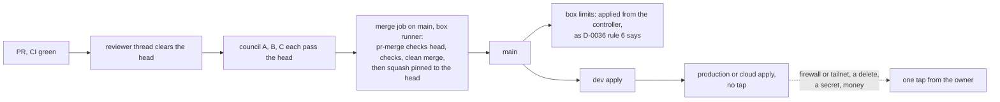

# Let the reviewer and the council approve in the owner's place, except the steps he keeps

## Context and Problem Statement

Today the owner types or taps a go for almost every step:

- a merge of a PR that accepts a record or a standard, or loosens the rules (AGENTS.md rules 1 and 2, D-0031 rules 3 and 4, D-0034);
- a production run of a lab layer (D-0035 rule 3) and every production or cloud apply (D-0041 rule 6);
- a change to the agent box's limits, applied from the Mac (D-0036 rule 6).

In practice he also types merge lines for ordinary green PRs. D-0031 already lets agents merge those, but two tools stop them: the box session's safety check refuses the `pr-merge` wrapper unpredictably, and the Mac session's guard counts only words the owner typed. The cloud sessions' GitHub tools have no merge call, but they can start a `workflow_dispatch` workflow (evidence, findings 1 and 2).

On 2026-11-14 the owner asked, more than once, to stop typing and tapping approvals for the lab:

- at 06:31:02 UTC (cmsg_01X43rfNYp4H1dL1V2dkfkwNNmDuqYAAd97e7MWLy7w5j9) he asked when agents would approve these themselves;
- at 07:36:24 UTC (cmsg_01X43rfNYp4H1dL1V2dkfkwN1HaQyfWs523TENpj3y4GrB) he asked why he was still pasting approval prompts;
- at 07:36:52 UTC (cmsg_01X43rfNYp4H1dL1V2dkfkwNVWniFNwFdxHd6saXpoKLKg) he said the greenfield lab should not need him to type or click anything;
- at 07:42:15 UTC (cmsg_01X43rfNYp4H1dL1V2dkfkwNPCDvrtDZGccQzAi27X4YGH) he asked that this be the last thing he types;
- at 07:42:30 UTC (cmsg_01X43rfNYp4H1dL1V2dkfkwNHGFshMgp6jwdfeuyZWEdj6), in the orchestrator thread, he said go and not to ask him for another PR;
- at 07:43:25 UTC (cmsg_01X43rfNYp4H1dL1V2dkfkwNQZSPJDASxzgXUwb36fceaH), in the same thread, he said agents should not ask him to do anything more, that he had already said which things need his approval, and that they should stop asking him to approve PRs;
- at 07:44:46 UTC (cmsg_01X43rfNYp4H1dL1V2dkfkwNLj5JuE8JmYT3juteQ3eMJm) he said not to ask him to approve another PR, that he meant the lab for now rather than every PR, and that the lab is greenfield and holds no personal data or anything of value.

Since that morning, every plan, record and done-claim already passes a reviewer thread and a council of three threads before it reaches him. This record makes that pass the approval.

### What the owner said, and what agents picked

The owner's words, above, decide only this much:

- agents don't ask him to approve or go a PR;
- the things he named before still need him: firewall and tailnet changes, deletes and secrets;
- the lab is greenfield, so agents finish it;
- this is for the lab, for now, not for every PR (07:44:46 UTC).

Everything else in this record is an agent pick, labelled `[agent pick]` in its rule, which the owner can change at any time (REQ-0035). That includes the reviewer and the council approving in his place: that role is one the agents gave themselves, because his words say not to ask him but not who approves instead.

His words are a change of mind (REQ-0030). They reverse REQ-0009 (the owner makes every decision) and REQ-0012 (only the owner accepts a record; agents must not mark one accepted) in the requirements register, the project's standing instruction 1 (never mark anything accepted), and the second of the three Central Hub outcomes the owner ranked by card on 2026-11-11 at 04:03 UTC (he picks each permanent piece), for the changes this record covers. The register and that outcome's text are kept outside this repository; both need updating, by their own process.

## Decision Drivers

- **The owner's requests of 2026-11-14** above.
- **What can't be undone stays with a person.** A merge can be reverted and a lab layer rebuilt from code; a deleted backup, money spent or a leaked secret can't be taken back.
- **Checks a machine runs.** What a job can check itself (the head, the checks, a clean merge) it checks, so it doesn't rest on the caller's word.
- **Everything logged.** Each approval names the reviewer's and the council's messages, in a log the owner can read.
- **Replaceable** (REQ-0011): undone by a PR that puts the old rules back.

## Considered Options

1. **The agents' pass approves merges, acceptances and production and cloud applies.** The steps the owner named, and the box's own limits, keep one tap.
2. **The agents' pass approves merges only**, records "as proposed" included. Acceptances, box limits and production and cloud applies keep the owner's tap.
3. **Keep the owner's typed lines and taps**, as today.

## Decision Outcome

Chosen option: **1**, because the owner asked to stop approving the lab himself, and option 2 would leave him a tap for every acceptance and every production apply. Rule 6 keeps a tap for firewall and tailnet changes, deletes and secrets, which he named (07:43:25 UTC). The rest of rule 6 (money, the box's limits, access rights), where in each step the tap falls, and rule 7, are agent picks.

*In words:* a PR whose CI is green goes to the reviewer thread and then to the three council threads. When all four pass the same head, an agent starts the merge job on the agent box's runner. The box's `pr-merge` wrapper checks the head, the checks and the merge itself before it squash-merges. What lands on `main` is then applied as the other records set out, with no tap, except for the steps in rule 6: firewall and tailnet applies, deletes, secrets and money.

### Rules

1. **The agents' pass.** [agent pick] The agents' pass for a head is:
   - the reviewer thread's clearance of that head, and
   - a pass from each of the three council threads for the same head, recorded by the orchestrator thread in one message.

   It takes the place of the owner's go, typed or tapped, wherever these rules asked for it: AGENTS.md rules 1 and 2, D-0001's statuses, D-0031 rules 3 and 4, D-0034, D-0035 rule 3(b) and (c), and D-0041 rule 6. Rule 6 below is the exception. That a pass is needed at all follows from the owner's words; that the reviewer and the council give it is the agents' own pick.
2. **The merge job.** [agent pick] `.github/workflows/merge.yml` merges a PR that has the agents' pass. Until the box limits it needs are applied (rule 4), merges go as they do today.
   - It runs only by `workflow_dispatch`, only from `main`, on the agent box's runner, whose job-started hook refuses any other workflow, branch or event. Its own token is read-only (Activation gate item 3).
   - Its inputs are the PR number, the full head, and the message ids of the reviewer's clearance and of the council's passes.
   - It hands the merge to the box's `pr-merge` wrapper, which merges as the project's GitHub App with the key kept inside the wrapper (D-0031). The wrapper checks itself, and refuses otherwise:
     - the PR is open, not a draft, and targets `main` (the last is added to `pr-merge` by one of the limit changes rule 4 names);
     - its head is the one named;
     - GitHub reports a clean merge;
     - every check on that head has completed and passed or was skipped, and at least one ran;
     - fewer than 100 files changed.
   - It squash-merges pinned to that head, and the run summary shows the PR, the head, the wrapper's verdict and merge commit, and the two message ids.
   - It can't read the project's chat, so it can't check the two message ids. The agent that starts it checks them first, and the ids stay in the log.
   - No session's safety check stands in this path, because a runner job is not a session.
3. **Records and standards.** [agent pick for the route; the owner's words for not asking him] An agent may set a record to `accepted`, `rejected` or `parked`, or a standard to `active`, with the agents' pass, the same way the owner did:
   - the proposal merges first, or the pass names the head that holds it (D-0001);
   - the acceptance PR changes only `status`, `date` and `accepted-evidence`, with `approved-by: agents`, `approval-ref` the orchestrator's message that records the pass, and `approval-names` naming the PR and head;
   - the reviewer compares the accepted text with the passed head, as D-0001 asks.
4. **The box's limits.** [agent pick] A change to a limit (D-0036 rule 3) keeps the owner's approval, now as a tap (rule 6), because his card of 2026-11-14 02:24 UTC, which he answered at 02:26 UTC, kept limit changes for him (D-0036), and his words of 07:42 to 07:44 UTC did not take that back.
   - It is still applied from the controller, as D-0036 rule 6 says, and the `box-apply` installed on the box still stops on it.
   - The merge job (rule 2) and the acceptances of rule 3 rest on limit changes of this kind: the runner hook and the wrapper list letting the runner start `pr-merge`, and `pr-merge` no longer stopping on records, standards and `AGENTS.md` and checking that the PR targets `main`. Until they are applied, merges go as they do today. How they reach the box without the Mac is open, and is designed separately.

5. **Production and cloud applies.** [the owner's words: finish the greenfield lab (07:44:46 UTC); the pass as approver is an agent pick] Dev is the dev guests, VMs 250 to 257, and the dev secrets store, VMs 550 to 599 (D-0038 rule 2; central-hub #276). The production secrets store, VM 500, is production. A production run (D-0035) or a production or cloud apply (D-0041) needs no tap, apart from rule 6:
   - a layer with a dev twin runs once the same commit passed that layer on dev (D-0035 rule 3(a));
   - a layer with no dev twin (the Proxmox host's own configuration, OPNsense, the tailnet, Azure, Cloudflare and Tailscale) runs once its saved plan's hash has the agents' pass;
   - the log names the pass's message id where it named the card.
6. **Still one tap.** These still need the owner's tap on a card that names the step and the commit (D-0034), at the step itself. A merge of their code needs no tap; the apply or the act does. The first three are the owner's own list (07:43:25 UTC); the rest are agent picks:
   - **firewall and tailnet:** an apply to the firewall layers (the Proxmox host's firewall, OPNsense's rules) or to the tailnet, which includes opening a lab service to the internet;
   - **deletes:** deleting data or a backup, tearing down a whole environment's guests outside dev, and a `destroy` or `restore` of the secrets store, on dev too, since it holds the lab's secrets (other dev teardowns and rebuilds need no tap, as now);
   - **secrets:** exposing a secret, copying secrets onto the agent box, or rotating the owner's own credentials;
   - **access rights:** [agent pick] a new credential for agents, or wider rights for an existing one, such as the agents' Proxmox token;
   - **money:** [agent pick, from the owner's rule of 2026-11-09 against unexpected Azure charges] anything that starts a charge;
   - **the box's limits:** [agent pick, rule 4] a change to a limit of the agent box (D-0036 rule 3). The tap replaces the typed line D-0036 rule 6 asked for, because the owner said at 07:47:50 UTC (cmsg_01X43rfNYp4H1dL1V2dkfkwNNLn48f4BruWkqptU1TmBMV) that he will not type go lines anymore.
7. **What stays with the owner by choice.** [agent pick] Scanning his own sign-in code into his authenticator, the settings of his own claude.ai and GitHub accounts, and the Proxmox console when everything else is down (D-0035 rule 9).
8. **The owner's no.** A message from the owner that says no, stop or revert about a change wins at once. Agents stop starting jobs for it, and open a revert PR or run the layer's way back. A revert goes through the same pass and job.
9. **Logs.** The merge job's summary is public on GitHub for at most 90 days, so it holds only the PR, the heads and the message ids. The orchestrator lists every merge and apply made under this record in its next report to the owner.
10. **Unchanged.** Never enable auto-merge. No workflow on `pull_request_target`, `issue_comment` or `issues` that runs an agent or touches secrets. No secrets or private names in this repository. AGENTS.md rules 3 to 6 stand.
11. **Changing this record.** [agent pick] A change that narrows this record, or adds a check to the merge job, needs the agents' pass, like any other change. A change that removes a step from rule 6, or drops or loosens a check in `merge.yml`, the runner hook or `pr-merge`, is itself a rule 6 step and needs the owner's tap. Every change to either is listed in the orchestrator's report.

### Consequences

- Good: the owner stops typing and tapping for merges, acceptances and production and cloud applies. He keeps one tap for firewall and tailnet applies, deletes, secrets, access rights, money and the box's limits.
- Good: each approval names a reviewer's and a council's message, and the merge job's own checks don't rest on the caller.
- Good: merges made by the job show as the project's GitHub App in the PR's history, and each has a run on GitHub that names its pass.
- Bad: agents approve agents' work, and all four checkers are the same kind of model, so they can share a blind spot. Compensating controls: four separate threads, each told to look for what is missing; the four-check rule before any "supported" or "not supported" claim; the public run log; the owner's no at any time (rule 8); every merge can be reverted and every lab layer rebuilt from code.
- Bad: the merge job can't check the reviewer's and the council's messages. An agent could start it with made-up ids. Compensating controls: the ids are in the public log and the orchestrator's report, so a made-up one shows; the job checks everything GitHub can tell it. This is the same gap D-0035 and D-0041 accept for card taps.
- Bad: the merge job's checks live in this repository, so a PR can change them (Activation gate item 2 is still open). Compensating controls: a change that drops or loosens a check, or removes a step from rule 6, needs the owner's tap (rule 11); the job runs `main`'s copy, never a PR's; every change to it is in the orchestrator's report.
- Bad: a production or cloud apply now runs without the owner seeing its plan first. A wrong apply can break the lab until it is rebuilt. The owner gave his reason at 07:44:46 UTC: the lab is greenfield and holds no personal data or anything of value. If that stops being true, this record is revisited. Compensating controls: dev first for every layer that has a twin; the saved plan and the council's pass for those that don't; rule 6 for firewall, tailnet, deletes, secrets and money; the restore checks of D-0035 rule 5 before any teardown.
- Bad: rule 7's steps still need the owner in person.
- Bad: the merge job depends on the agent box and its runner. If the box is down, merges wait, or fall back to the owner's own merge on GitHub.
- Bad: a box limit change, including the ones the merge job needs, keeps the owner's tap and is still applied from the controller (rule 4). Until a later change moves that apply off the Mac, the merge job can't run, and merges go as they do today.
- Bad: most of this record is agent picks the owner did not see. Compensating controls: each is labelled, the owner can change any of them, and his no wins at once (rule 8).

### Confirmation

- The first docs-only PR merged through the job shows the project's App as the merger, a merge commit signed by GitHub, and the run summary of rule 2.
- A cloud session starts the job with its GitHub tools. If its safety check refuses that, the orchestrator's session starts it, and the refusal is written into the runbook.
- The first production apply under this record logs the pass's message id instead of a card's.

## Pros and Cons of the Options

### 2. Merges only

- Good: a smaller change; acceptances and applies keep the owner's eye.
- Bad: the owner still taps for every acceptance and every production or cloud apply, which he asked to stop.

### 3. Keep typed lines and taps

- Good: nothing changes.
- Bad: the owner keeps typing, the thing he asked to end; and merges stall whenever the box's safety check or the Mac's guard refuses.

## More Information

- **Evidence:** [0042](../evidence/0042-let-agents-approve-every-reversible-change-in-the-owners-place.md).
- **Records it changes, in this PR:** D-0001 (statuses), D-0031 rules 3 and 4, D-0034 rule 4, D-0035 rule 3, D-0036 rule 6, and AGENTS.md rules 1 and 2. D-0041 rules 2, 6 and 11 too, each saying what it was before.
- **How to start the job:** [Merge a PR through the merge job](../runbooks/merge-a-pr-through-the-merge-job.md).
- **How this record is accepted.** It loosens AGENTS.md's rules for now, which D-0034 rule 4 sends to a line the owner types naming the PR and its head. It is accepted, for the scope his words cover, on the owner's typed messages in the orchestrator thread at 07:42:30 UTC (cmsg_01X43rfNYp4H1dL1V2dkfkwNHGFshMgp6jwdfeuyZWEdj6), where he said go and not to ask him for another PR, and at 07:43:25 UTC (cmsg_01X43rfNYp4H1dL1V2dkfkwNQZSPJDASxzgXUwb36fceaH), where he said he had already named what needs his approval and agents should stop asking him to approve PRs. His message at 07:44:46 UTC (cmsg_01X43rfNYp4H1dL1V2dkfkwNLj5JuE8JmYT3juteQ3eMJm), relayed from the project chat, says the same for the lab. These messages name no PR and no head. That departs from D-0034 rule 4's form. The reviewer and the council judge whether they count, and their passes are this PR's gate.
