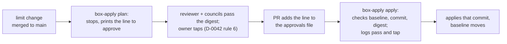

# Let the agent box apply a change to its own limits that main approves by its exact digest, with the owner's tap logged but not checked

## Context and Problem Statement

D-0036 lets the agent box apply its own role from reviewed main, and keeps the box's limits (rule 3: the sudo rules, the guard settings, the wrappers, the users, the units that run with the keys, and `box-apply` itself) behind the owner. Rule 6 sends every limit change to an apply from the controller, the owner's Mac. D-0042 rule 4 kept that, made the owner's approval a tap (rule 6), and left open how limit changes "reach the box without the Mac".

**This record reverses an answer of the owner's and weakens a step he kept.**

- It reverses his answer of 2026-11-14 02:26 UTC on D-0036's card: an agent can't loosen its own limits. Under this record an agent can, with a made-up tap id that the box can't tell from a real one (rule 3).
- It makes D-0042 rule 6's tap for the box's limits something the box only logs, not enforces. A change that weakens a rule 6 step is itself a rule 6 step (D-0042 rule 11).

So it is accepted only by the owner's own tap on a card naming this record's PR and head, as a change of his mind (REQ-0030), and never by the agents' pass. Until then it stays proposed, and the approvals file stays empty.

On 2026-11-14 at 07:47:50 UTC the owner said he will not type go lines anymore, and the Mac's guard accepts only typed words. So no limit change has reached the box since its baseline, 9d519572. Main has 19 limit changes since then, from #276, #284, #288, #289 and #302, and the installed `box-apply` stops on all of them (evidence, finding 1). The owner's end goal is that an agent rebuilds the whole lab from the box or a cloud session with no Mac step (project memory, 2026-11-13).

## Decision Drivers

- **The owner's words.** He won't type go lines (07:47:50 UTC), and agents don't ask him to approve PRs (07:42 to 07:44 UTC). At 07:43:25 UTC he pointed to his earlier rules without listing them; D-0042 reads them as firewall and tailnet (D-0036 rule 8), deletes and secrets (agent picks).
- **The owner's earlier answer that an agent can't loosen its own limits** (his tap of 2026-11-14 02:26 UTC on D-0036's card). D-0042 rule 6 keeps his tap for limit changes.
- **What the box can check, it checks.** It can check commits and bytes. It can't read chat messages or decision cards.
- **Deterministic** (the owner's ranking of 2026-11-11).
- **Replaceable** (REQ-0011): undone by emptying the approvals file, or by an older `box-apply`.

## Considered Options

1. **An approvals file on main, pinned by digest.** Each line names the baseline, a commit, the sha256 of the limit files' diff between them, the pass's message id and the owner's tap id. `box-apply apply` applies that commit when the bytes match.
2. **A new `box-apply` argument that a runner job calls with the approval.** This needs a new sudo argument and a runner workflow, and it checks no more than option 1.
3. **A line signed with a key on the box.** The agents hold every key the box holds, so a signature proves no more than a merged line.
4. **A protected GitHub environment approval.** GitHub can stop the person who started a deployment from approving it (evidence, finding 5). But every agent acts as the owner's one account (AGENTS.md rule 1), so there is no second person. This waits for D-0030.
5. **Keep the Mac for every limit change** (D-0036 rule 6 as it stands).

## Decision Outcome

Chosen option: **1**. It needs no new sudo argument, and the box checks everything it can: the baseline, the commit and the exact bytes. Option 5 leaves every limit change waiting on typed words the owner said he won't give.

*In words:* a limit change merges. `box-apply plan` stops and prints the line that would approve it. The reviewer and the council pass that digest, and the owner taps the card that names it. A PR adds the line. `box-apply apply` checks the baseline, the commit and the digest, logs the pass and the tap ids, applies the change, and moves the baseline.

### Rules

1. **The approvals file.** `hosts/ansible/agent-box-limit-approvals.txt` holds one line per approved limit change: `<from> <to> <digest> <pass> <tap>`.
   - `from` is the baseline.
   - `to` is a commit on main after which no limit changes.
   - `digest` is the sha256 of `git diff --no-renames --binary --full-index <from> <to> -- <the limit files that changed>`, the bytes the reviewer and the council read.
   - `pass` is the id of the orchestrator's message that records the agents' pass of that digest (D-0042 rule 1).
   - `tap` is the id of the owner's tap on a card naming the digest (D-0042 rule 6). A tap of `none` never counts.

   The file sits outside the role, so adding a line is not itself a limit change. A line is added by a PR that merges like any other.
2. **What the box checks.** `box-apply apply` uses a line only when its `from` is the baseline, its `to` is on main with no later limit change, and the digest matches. It then applies `to`, with the tasks that write `box-apply`, its settings and its list of limits switched on. The apply may change only the limit paths that its check run named. Any other change puts back every limit change of the run, and self-applies stop until an apply from the controller (D-0036 rule 5). After a good run, the baseline moves to `to`.
3. **What the box can't check.** The box can't read the chat or the cards. It only logs the `pass` and `tap` ids, and it can't tell a real id from a made-up one. **So an agent can write a line with a made-up tap id and loosen the box's own limits without the owner.** Nothing on the box stops that. The controls are outside the box:
   - the line merges only through review and the agents' pass, like every merge (D-0042 rules 1 and 2);
   - every line, with its ids, is in the repository's history and in the box's log;
   - the orchestrator lists every approved limit change in its next report to the owner (D-0042 rule 9), so a made-up id shows there;
   - the owner's no wins at once (D-0042 rule 8): a revert PR empties the line, and an apply from the controller puts the old limits back.
4. **The inventory stays the controller's.** `box-apply`'s inventory, the box's private host variables, is still written only by an apply from the controller (D-0036 rule 7). A limit change that needs a new private value still fails and waits for one.
5. **The one apply from the controller this needs.** The code for rules 1 and 2 (central-hub #308) is itself a limit change. The installed `box-apply` stops on it, and a self-apply never writes `box-apply`. So it reaches the box by one full apply from the controller, under D-0036 rule 6 as it stands. That apply also installs the 19 limit changes waiting since 9d519572. After it, limit changes go by rules 1 to 3.
6. **What this changes, on acceptance.** D-0036 rule 3(f) (`box-apply` and its list now also change by an approved limit apply), rule 6 (a limit change is applied from the controller or by rules 1 and 2), and rule 7 (unchanged in substance; the inventory still only from the controller). D-0042 rule 4 ("still applied from the controller"). The acceptance PR edits each so it reads as the current rule (D-0001, Immutability), and adds one line to `CORRECTIONS.md`.
7. **Unchanged.** D-0042 rule 6 keeps the owner's tap for limit changes; this record only says where the box records it. D-0036 rules 4 and 5 (the stop before, and the check after) stand for every run without a matching line.

### Consequences

- Good: after one more apply from the controller, limit changes reach the box with no Mac step, which the owner's end goal needs.
- Good: the box checks the bytes. A line approves exactly the diff that was passed, and a later change to those files needs its own line.
- Good: no new sudo argument, and the stop and the put-back of D-0036 still hold for every run without a line.
- Bad: **an agent can loosen the box's limits with a made-up tap id** (rule 3). This is what D-0036 was written to prevent, and the box itself no longer prevents it. Compensating controls: review and the agents' pass on every line, the public history, the orchestrator's report, and the owner's no. This is the same gap D-0042 accepts for the merge job's message ids.
- Bad: the approvals file is not a limit, so the gate is the merge, not the box. Compensating control: a line counts only for its exact `from` and digest, so an old line can't be reused.
- Bad: check mode can miss what a task does, for example a command task. Then an approved apply stops with nothing applied to the limits, and the controller has to end the stop. Compensating control: the stop is safe, and the run's output is kept.
- Bad: one more apply from the controller is still needed (rule 5). That apply is the gap named in the design, reported to the owner once as a result.

### Confirmation

- `test_box_apply.sh` checks 8a to 8h pass: a stop with the line to approve, a tap of `none` refused, a wrong digest refused, a matching line applied and logged, the next run going on to main, a later limit change needing its own line, and an unnamed limit change put back.
- After the controller's apply, the first approved limit change is planned, then applied, and its log line names the pass and tap ids. The orchestrator checks both against the chat.

## Pros and Cons of the Options

### 2. A new argument through a runner job

- Good: the approval would arrive as a job input, logged by GitHub too.
- Bad: a new sudo argument and a new workflow, both limits, for no check the box can make beyond option 1's.

### 3. A signed line

- Good: a signature on the bytes.
- Bad: the agents hold the key, so it proves nothing about the owner.

### 4. A GitHub environment approval

- Good: GitHub would check the approval itself.
- Bad: one account for owner and agents, so it can't tell them apart until D-0030.

### 5. Keep the Mac

- Good: nothing new to trust.
- Bad: no limit change reaches the box while the owner won't type go lines, and the lab can't be rebuilt from the box.

## More Information

- **Evidence:** [0044](../evidence/0044-let-the-agent-box-apply-limit-changes-main-approves-by-digest.md).
- **The code:** central-hub #308. Runbook: [Apply the agent box's setup from the box itself](../runbooks/apply-the-agent-box-from-itself.md), section "Apply an approved limit change".
- **How this record is accepted:** only by the owner's tap on a card naming this PR and its head (REQ-0030, D-0042 rule 11), never by the agents' pass (Context).
- **Exit path:** empty the approvals file. `box-apply` then stops on every limit change, as before this record. To remove the code too, an apply from the controller of an older `box-apply`.
- Related records: D-0001, D-0030, D-0036, D-0042.
