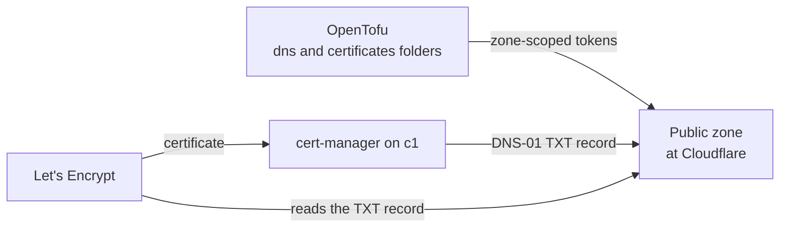

# Keep the public DNS zone at Cloudflare, in OpenTofu, and prove names to Let's Encrypt through it by DNS-01, with RFC 2136 or ACME-DNS as the way off

## Context and Problem Statement

The owner's public zone has been hosted at Cloudflare since before the lab; the old VPS set-up wrote its records there ([manage-public-dns-records.md](../runbooks/manage-public-dns-records.md)). On 2026-10-16 at 02:57:51 UTC he said yes to putting a cluster's API name in that zone. On 2026-10-25 at 03:38 UTC he moved the lab's own names to the lab's DNS instead, and at 05:23 UTC said yes to a split-horizon zone with the lab resolver in front (cmsg_01X43rfNYp4H1dL1V2dkfkwN23ZxXCZHNDQfEpqrAG7UEB).

The lab now uses the public zone in two ways:

- OpenTofu holds every record (`hosts/terraform/home/dns/`, with a zone-scoped token from `dns-token/`).
- cert-manager proves c1's names to Let's Encrypt by DNS-01 with a second zone-scoped token (`hosts/terraform/home/certificates/`, role `k8s_certs`). On 2026-10-26 at 23:05 UTC the owner asked that the lab use cert-manager with Let's Encrypt (cmsg_01X43rfNYp4H1dL1V2dkfkwNHxEx2s28nVHvJ1yyL3y9ps), and the c1 way-in spec records that as his yes. D-0028 keeps Let's Encrypt as the issuer for Proxmox and OPNsense and as c1's way out.

At main 3d90375, 42 files in 19 `hosts/` folders and 7 runbooks name Cloudflare. D-0041 and D-0042 name the Cloudflare account as one the pipeline changes, and D-0038 names its token as a secret to store, but no decision record chose Cloudflare.

Cloudflare is a closed hosted service. REQ-0032 judges such a service by its exit path.

## Decision Drivers

- **An exit path off the vendor** (REQ-0032).
- **FOSS for everything the lab runs, with no paid feature in use** (the owner, 2026-11-14, 04:43:45 to 04:44:57 UTC: cmsg_01X43rfNYp4H1dL1V2dkfkwNR46AufLXRC146Xo4CSXG6t, cmsg_01X43rfNYp4H1dL1V2dkfkwNQV7TsveqXKdLbddnuYc8v7, cmsg_01X43rfNYp4H1dL1V2dkfkwN5A1ezB3rCi7zkVswXeZkB4, as D-0040 records); a hosted service is judged by its way out.
- **Everything in code** (the owner, 2026-10-27 at 02:49 UTC, after asking about the Cloudflare token): no record or token made by hand after the first bootstrap token.
- **Public certificates without opening the lab to the internet:** DNS-01 needs no inbound port.

## Considered Options

1. **Keep the zone at Cloudflare**, all records in OpenTofu, DNS-01 through Cloudflare's API with zone-scoped tokens.
2. **Keep the zone at Cloudflare, but delegate only the challenge names** to a self-hosted ACME-DNS server, so certificates no longer use Cloudflare's API.
3. **Move the zone to a self-hosted authoritative server** that cert-manager updates by RFC 2136.

## Decision Outcome

Proposed: **option 1**, because it is what runs and every record is already in code. Options 2 and 3 are the ways off, both built into cert-manager. Neither has been compared on cost or effort by a research batch.

*In words:* OpenTofu writes the zone's records and makes the two tokens. cert-manager writes a challenge record with its token, Let's Encrypt reads it, and issues the certificate.

### Rules

1. **What it is.** Cloudflare's hosted DNS on its free plan; a closed service. The OpenTofu provider used is Apache-2.0, pinned to one version in each folder's `versions.tf`. Let's Encrypt is a free service run by a nonprofit on the open ACME standard.
2. **No paid feature.** The lab uses no paid Cloudflare feature. DNS and account-owned API tokens are on every plan.
3. **Records in code.** Every record in the zone is in OpenTofu state; nothing is changed in the dashboard. Changes go through the pipeline (D-0041).
4. **Least scope.** Each token may only read the one zone and edit its DNS, has an expiry, and is made and replaced by OpenTofu. cert-manager's token also works only from the home's public address (agent pick 78 in `hosts/AGENT-PICKS.md`).
5. **Lab names stay inside.** Lab-only names live in the lab's own DNS (OPNsense, D-0040), not in the public zone, as the owner asked on 2026-10-25.

### Consequences

- Good: no change; certificates and records keep working.
- Good: two built-in ways off, so a move touches one issuer and the record list, not the apps.
- Bad: the zone and the challenge path depend on one closed company.
- Neutral: the free plan caps records per zone, at 200 for a zone added on or after 2024-09-01 and 1,000 for an older one. The zone's age and its live record count were not measured.

### Confirmation

- A plan of `hosts/terraform/home/dns/` shows no changes against the live zone.
- The ClusterIssuers name no Cloudflare credential broader than one zone.

### Exit path

- **Certificates first:** run ACME-DNS, point `_acme-challenge` names at it with CNAME records, and switch cert-manager's solver to `acmeDNS`. Cloudflare's API is then used only for the zone itself.
- **The zone:** export the records (`export-records.sh`), load them into another host or a self-hosted server, and change the zone's name servers at the registrar; cert-manager then uses `rfc2136`.

## Pros and Cons of the Options

### Option 1: Cloudflare with DNS-01

- Good: running, in code, zone-scoped tokens.
- Bad: closed service.

### Option 2: ACME-DNS for challenges

- Good: certificate issuing stops needing Cloudflare's API.
- Good: ACME-DNS is MIT-licensed.
- Bad: one more server, reachable from the internet on port 53.

### Option 3: Self-hosted authoritative DNS with RFC 2136

- Good: no hosted DNS company.
- Bad: a public server to run; the software was not chosen or checked.

## More Information

- Evidence: [`docs/evidence/0045-keep-the-public-zone-at-cloudflare-with-dns-01-for-certificates.md`](../evidence/0045-keep-the-public-zone-at-cloudflare-with-dns-01-for-certificates.md).
- Related: D-0028 (the lab CA, with Let's Encrypt as its exit), D-0040 (the lab's own DNS), spec [2026-10-c1-way-in-for-web-traffic](../specs/2026-10-c1-way-in-for-web-traffic.md).
