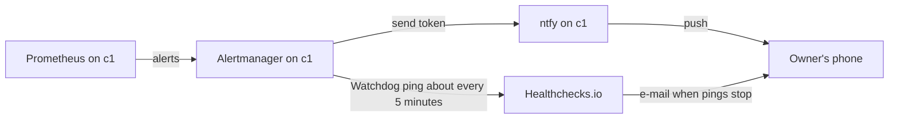

# Send c1's alerts to a self-hosted, locked-down ntfy, and its heartbeat to Healthchecks.io's free plan, with self-hosted Healthchecks as the way off

## Context and Problem Statement

c1's Alertmanager sends alerts to an ntfy server running on c1 (`hosts/kubernetes/home/c1/apps/alerts/`). Prometheus's always-firing Watchdog alert goes about every 5 minutes to a check on Healthchecks.io (`hosts/kubernetes/home/c1/apps/kube-prometheus-stack/values.yaml`), which e-mails the owner when the pings stop. No decision record chose either.

ntfy reached c1 in PR #72 on 2026-11-08 as an agent pick, with no comparison behind it. The owner's words this rests on:

- 2026-11-09 at 23:00 UTC (cmsg_01X43rfNYp4H1dL1V2dkfkwNEqt6eUmcny6bD1AKPp86uJ): alerting needs proper research, because ntfy was probably picked from memory rather than researched. Research batch RB-0181 then compared how alerts can work and what comparable home labs use.
- 2026-11-12 at 22:20 UTC (agent pick 171, which records his answer): keep ntfy with everyone denied by default, send-only tokens for Alertmanager and Proxmox, and a read login for him.
- 2026-11-12 at 22:21 UTC (agent pick 213): an outside heartbeat on Healthchecks.io's free plan.

At main 07408f9, ntfy is named in 22 files in `hosts/` and 8 runbooks, and Healthchecks in 7 files in `hosts/` and 3 runbooks. No record names either.

Between 04:43:45 and 04:44:57 UTC on 2026-11-14 the owner ruled that no piece of the lab may hold something back behind a paywall (cmsg_01X43rfNYp4H1dL1V2dkfkwNR46AufLXRC146Xo4CSXG6t, cmsg_01X43rfNYp4H1dL1V2dkfkwNQV7TsveqXKdLbddnuYc8v7, cmsg_01X43rfNYp4H1dL1V2dkfkwN5A1ezB3rCi7zkVswXeZkB4). STD-0006 rule 2 turns that into a test for software, and rule 3 lets a hosted service pass only with a stated exit path. Healthchecks.io is a hosted service with paid plans. This record states both pieces, their licences, their paid sides and the ways out.

## Decision Drivers

- **FOSS with nothing held back behind a paywall** (REQ-0032; the owner, 2026-11-14; STD-0006 rules 2 and 3).
- **Know when c1 is down:** the watcher of the heartbeat must sit outside c1 and the home.
- **Replaceable** (CLAUDE.md rule 6).

## Considered Options

Alert channel:

1. **Self-hosted ntfy on c1**, locked down.
2. **Pushover.**
3. **Discord.**

Heartbeat watcher:

- A. **Healthchecks.io, free plan.**
- B. **A self-hosted watcher (Gatus or Healthchecks) on a machine outside the home.**

## Decision Outcome

Proposed: **option 1 with A**, the owner's answers of 2026-11-12. Options 2 and 3 are the most common channels in the five public home labs RB-0181 read, but both are closed services. B needs a machine outside the home, which the lab does not have yet.

*In words:* alerts go from Prometheus through Alertmanager to ntfy on c1 and on to the owner's phone. The Watchdog pings Healthchecks.io, which e-mails the owner when the pings stop.

### Do the paid sides make either fail?

- **ntfy** is dual-licensed Apache-2.0 and GPL-2.0. Its paid plans are for the ntfy.sh hosted service: its terms "apply specifically to the ntfy.sh hosted service". Selling hosting is allowed by STD-0006 rule 2, and the self-hosted server is the whole product. The register lists it as a pass.
- **Healthchecks** is BSD-3-Clause software. Healthchecks.io is its maker's hosted service: the free plan monitors 20 jobs, and paid plans add jobs, log entries, SMS and phone-call credits and support. That is hosting, and the register lists Healthchecks.io as `hosted` with an exit path (STD-0006 rule 3).
- **So this record stays `proposed`.** The heartbeat rests on a hosted service, which, like D-0045's public zone, is a weighed choice for the owner rather than a clear pass.

### Rules

1. **Licences.** ntfy, Apache-2.0 and GPL-2.0, self-hosted from the project's own image. Healthchecks.io's hosted free plan for the heartbeat.
2. **No paid plan.** The lab uses no paid plan of ntfy.sh or Healthchecks.io, and does not forward to ntfy.sh.
3. **Locked down.** ntfy denies everyone by default; only the senders' tokens and the owner's read login exist (pick 171).
4. **One secret.** The heartbeat URL is one secret (`healthchecks-ping-url`), so changing the watcher changes one value (pick 213).

### Consequences

- Good: the alert path is free and self-hosted; the heartbeat is watched from outside the home.
- Bad: ntfy runs on the cluster it reports on; when c1 is down, only the heartbeat speaks.
- Bad: without forwarding to ntfy.sh, iOS delivery from self-hosted ntfy "can take hours, depending on the state of the phone" (ntfy's configuration docs).
- Bad: the heartbeat depends on a hosted service's free plan.

### Confirmation

- The Healthchecks.io check is green, and stopping the Watchdog route turns it red and sends the e-mail.
- An anonymous request to ntfy is refused.

### Exit path

- **Heartbeat:** run Healthchecks (BSD-3-Clause) or Gatus on any machine outside the home and change the one secret.
- **Channel:** Alertmanager has native receivers for many channels and a generic webhook, so another channel is a receiver change.

## Pros and Cons of the Options

### Option 1: self-hosted ntfy

- Good: free; self-hosted; locked down.
- Bad: on the same cluster; slow iOS delivery without an upstream.

### Option 2: Pushover

- Good: used by two of the five labs read; a one-time price per platform.
- Bad: a closed service.

### Option 3: Discord

- Good: used by two of the five labs read.
- Bad: a closed service.

### Option A: Healthchecks.io free plan

- Good: outside the home; the software is BSD-3-Clause and can be self-hosted later.
- Bad: a hosted service with paid plans.

### Option B: self-hosted watcher outside the home

- Good: no hosted service.
- Bad: needs a machine outside the home.

## More Information

- Evidence: [`docs/evidence/0053-send-alerts-to-self-hosted-ntfy-and-the-heartbeat-to-healthchecks-io.md`](../evidence/0053-send-alerts-to-self-hosted-ntfy-and-the-heartbeat-to-healthchecks-io.md).
- Related: D-0024 (metrics and alerts on c1), D-0045 (a hosted service kept as proposed), STD-0006 and its register (`docs/standards/components.yaml`).
