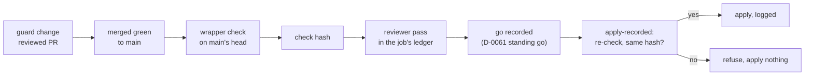

# Let the agent box hold the firewall, tailnet-policy and private inventory keys, each behind its own user and a reviewed, recorded apply

## Context and Problem Statement

On 2026-11-11 at 04:20:39 UTC the owner tapped "Keep behind my go" on the question of the keys that guard the agent box itself. That answer, called collision B in the Library plan `plans/agent-workstation/MOVE-MAC-LANE.md`, kept four things off the box: the firewall's (OPNsense) API key, root on the Proxmox host for its firewall, the tailnet's policy key, and the private inventory the box's own role is built from. D-0036 rule 7 and rule 8 wrote that down.

Since then two things changed:

- D-0041 put a key for the Proxmox host on the box, used by one wrapper as its own user (`hostops`, `proxmox-host.sh`), so a host job runs from reviewed main without the Mac.
- D-0061 made the owner's standing go of 2026-11-18 07:40:44 UTC his go for firewall and tailnet applies.

So the Mac lane's remaining jobs are mostly these keys. In the Mac lane's 25 newest posts before 2026-11-20 01:05 UTC, 6 jobs were firewall applies, secret copies and inventory edits, and 1 used a browser (agent-notebook research batch RB-0286, synthesis note 2026112001100001, table "What the Mac does today").

On 2026-11-20 the orchestrator asked, on a decision card, "Move the firewall, tailnet and box keys off your Mac to the agent box?" The option "Move them to the box" said: "Firewall and tailnet applies, secret copies and inventory edits run from the box, so most Mac lane jobs end. The box then holds the keys to the firewall." The owner tapped it at 03:13:29 UTC. It was the recommended option, so under D-0034 rule 9 it is the agents' pick. Copying a secret to a place it is not kept today still needs the owner's own words (D-0061 rule 2, the line on leaking data), and that question went to him on its own card. This record says how the box holds and uses the keys once they are there.

## Decision Drivers

- **The owner's first goal is to get off his Mac** (project memory, "THREE SIGNALS", signal 1).
- **A box that can change its own guard is less guarded.** A session that can rewrite the firewall can open the way to anything behind it. The control has to be the review of main and a recorded pass, not where the key lives.
- **Least privilege per job** (Library `plans/agent-workstation/MOVE-MAC-LANE.md`, "How least privilege still holds"): a key file readable by one user, used by one wrapper with fixed arguments.
- **Deterministic:** what is applied is decided by a check hash on main's code, not by an agent's reading.
- **Replaceable:** undone by deleting the key files and the sudo lines; the Mac copy stays until the Mac lane is stopped by its own card.

## Considered Options

1. **Move the keys to the box, each behind its own user and a recorded apply.** OPNsense and tailnet-policy keys go to a new user `guardops`; the Proxmox host firewall becomes one more job of the existing `hostops` wrapper; the private inventory goes to a root-owned folder each wrapper reads only the part it needs from.
2. **Move the keys into the `keys` user's folder** with the other lab keys.
3. **Keep them on the Mac** (D-0036 rules 7 and 8 as they are).

## Decision Outcome

Chosen option: **1**, the agents' pick, for the owner to accept or change with this record. Option 2 lets every wrapper that runs as `keys` (more than twenty) read the firewall key. Option 3 keeps the Mac a step in most of its remaining jobs.

*In words:* a firewall or tailnet change is a reviewed PR merged to main. The wrapper checks main's head and prints a hash. The reviewer records its pass for that hash, the orchestrator records the go, and only then does the wrapper re-check and apply, refusing if the hash changed.

### Rules

1. **Where each key lives.** A key moved under this record is, where the service allows it, a new key made for the box rather than a copy of the Mac's, and the Mac's key is revoked once the box's works (rule 6). On 2026-11-20 03:18 UTC the Mac lane reported that a command printed the OPNsense key into its own session's output, so that key is replaced this way in any case.
   (a) The OPNsense API key and secret and the Tailscale OAuth client that edits the policy live in `/etc/agent-keys-guard/`, owned by a new user `guardops`, mode 0700 for the folder and 0600 for each file.
   (b) The Proxmox host key stays where D-0041 put it (`/etc/agent-keys-host/`, user `hostops`).
   (c) The private inventory (`hosts.yml`) and the run folders' `home.tfvars` live in `/etc/agent-keys-guard/inventory/`. A wrapper that needs a private value reads it there; nothing copies the file into a session's reach. A copy of `hosts.yml` already reached the box on 2026-11-19, into `/etc/agent-keys/prod/` as the `keys` user, through the role's `prod_files` tag (the Mac lane's report of 2026-11-20 03:18 UTC); the firewall key itself is not in that file but in a key file it points to, which stays on the Mac until the copy.
2. **Who may use them.** Only these wrappers, each through one sudo line with fixed first arguments: `opnsense-prod.sh` (new, runs `playbooks/opnsense.yml`) and `tailnet-policy.sh` as `guardops`; `proxmox-host.sh` as `hostops`, with one more job, `safety` (`playbooks/proxmox-safety.yml`). The `keys` user and every session user cannot read the folder.
3. **How a guard job applies.** Every guard wrapper has the shape `proxmox-host.sh` has today: `check` on the code at `origin/main`, printing a 12-digit hash; `pass` and `go` lines in the job's own ledger; and `apply-recorded <hash>`, which re-checks main's head and refuses unless the hash matches, the ledger holds a reviewer pass for this job, commit and hash, and a go line no earlier apply used. The go line holds the message id of the owner's standing go (D-0061 rule 3), or his own message where D-0061 rule 2 applies.
4. **The way back.** A host firewall apply keeps `proxmox-safety.yml`'s dead-man timer, which puts the old rules back if the run does not finish. `playbooks/opnsense.yml` has no rollback of its own (read 2026-11-20: no rollback or savepoint task in the playbook or the `opnsense_lab` role), and OPNsense 26.7's API has none either: 26.1's `FilterBaseController.php` had `savepoint`, `apply/<revision>` with a rollback timer and `cancelRollback`, and 26.7's has only a plain `apply` (opnsense/core, branches `stable/26.1` and `stable/26.7`, read 2026-11-20). So an OPNsense apply from the box is guarded on the Proxmox host instead (`playbooks/opnsense-guard.yml`, run by the host job as `hostops`): before the playbook runs, a disk snapshot of the firewall's VM and a timer on the host that rolls the VM back to it; after the run, the snapshot is deleted and the timer stopped only if a fresh check through the firewall's API works and the box still reaches GitHub through the firewall; otherwise the wrapper rolls back at once, or, if it can't reach the host, the host's timer does. The box's lifeline link to the Proxmox host (`set-up-the-box-lifeline.md`) and the daily firewall configuration backup (`copy-opnsense-backup-off-box.md`) stay as the last way back.
5. **The box's own role.** D-0036 rule 7's inventory for `box-apply` may be rewritten on the box, from rule 1(c)'s inventory, only by an approved limit apply (D-0044), never by a self-apply. It stays a limit under D-0036 rule 3(f).
6. **The Mac copy.** The Mac keeps its copies until the owner answers the card that stops the Mac lane (Library plan, collision E). Until then each key exists in two places, which the access register lists.
7. **What this changes elsewhere.** It replaces D-0036 rule 7's "stay in the private inventory on the Mac" and rule 8's list for these keys; the owner's go for firewall and tailnet applies stays as D-0061 says.

### Consequences

- Good: firewall, tailnet and inventory jobs run from the box, with no Mac step and no typed line.
- Good: each key is read by one user and one or two wrappers, as the other lab keys are.
- Bad: **the box can change the firewall that guards it.** A merged change can open a path to the box. Compensating controls: the review and green merge, the reviewer's recorded pass for the exact hash, the apply's re-check, the way back in rule 4, and the owner's no (D-0061 rule 4).
- Bad: root on the box can read every key folder. Root already runs reviewed main (D-0036, "root on the box runs whatever reviewed main says"), so this adds keys, not a new path.
- Bad: two copies of each key until the Mac lane stops. Compensating control: the register lists both, and rotation after the secrets store exists (topic outcome 3) replaces both.

### Confirmation

- `sudo -l` for `claude` on the box shows the new lines and nothing wider.
- `ls -l /etc/agent-keys-guard` as `claude` is refused.
- A `check` then `apply-recorded` of a no-change firewall run from the box ends with zero changes and logs the commit and hash.
- A reviewing agent checks each guard apply in the logs against a pass and a go in the ledger.

## Pros and Cons of the Options

### 2. Keys in the `keys` user's folder

- Good: no new user.
- Bad: every wrapper that runs as `keys` can read the firewall key.

### 3. Keep them on the Mac

- Good: nothing new to trust.
- Bad: the Mac stays a step in most of its remaining jobs, against the owner's first goal.

## More Information

- **Evidence:** agent-notebook research batch RB-0286 (agent-notebook PR #805), the Library plan `plans/agent-workstation/MOVE-MAC-LANE.md`, and the box's `sudo -l` read on 2026-11-20.
- **Exit path:** delete `/etc/agent-keys-guard/`, the `guardops` user and the sudo lines by a limit apply; the Mac copies (kept until collision E) take over again.
- Related records: D-0036, D-0041, D-0042, D-0044, D-0061.
