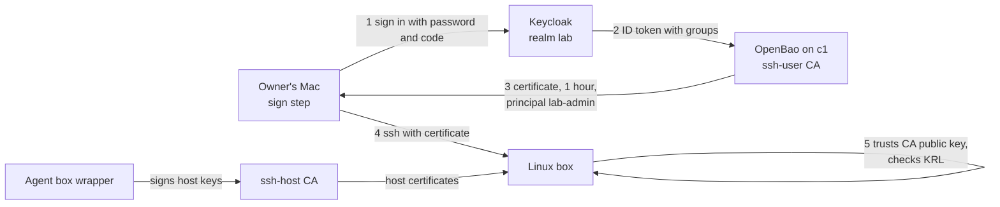

# Sign in to the lab's Linux boxes with short-lived SSH certificates that OpenBao signs after a Keycloak sign-in

## Context and Problem Statement

On 2026-11-21 between 00:58 and 01:00 UTC the owner asked for the Linux version of an AD domain join: one identity for every Linux box, nothing to rotate on the boxes, free and open source only, with Keycloak as the lab's "Entra" for VM sign-in. Today each box takes SSH by key: keys for the agents (D-0063 and the box's key folders) and the owner's keys on his Mac. A key on a box has to be added and removed by hand, and it never expires.

Research batch RB-0296 (agent-notebook PRs #873, #878, #880 and #883) compared six routes and ran the top two on dev. The route recommended there is Keycloak sign-in to OpenBao, which signs a user certificate that lives about an hour, with every box trusting only OpenBao's public key. Microsoft's own Entra sign-in to Linux VMs is built the same way. On dev run 2 (2026-11-21 06:45 UTC, central-hub `c78c3f3e`) this route passed end to end: a Keycloak token got an OpenBao token, OpenBao signed a certificate for one account and refused one for `root`, ssh with the certificate logged in, the bare key was refused, an expired certificate was refused and a revoked one was refused. That was a throwaway OpenBao on one node; none of it ran against the real store, and host certificates were never run. The owner tapped the recommended option, "OpenBao certificates", at 08:29:32 UTC on 2026-11-21 on the pick card; the agents had recommended it, so under D-0034 rule 9 it is the agents' pick, not his typed go.

## Decision Drivers

- **Nothing to rotate on a box:** a box holds one public key, not a secret and not a user list.
- **One identity:** the owner signs in at Keycloak (password and one-time code, D-0037 rule 6) and gets rights from his group, as the lab's apps do (D-0025).
- **FOSS only, no open core** (the owner's rule of 2026-11-14): OpenSSH, OpenBao (MPL-2.0, settled in D-0058) and Keycloak (settled) are all free with no paid edition in use.
- **A way in that does not need c1:** OpenBao runs on c1, so the existing local ways in must stay (D-0037 rule 2).
- **Replaceable:** the box side is plain OpenSSH, so any CA that signs OpenSSH certificates takes the signer's place.

## Considered Options

1. **OpenBao's SSH CA, after a Keycloak OIDC sign-in** (the agents' pick; proven on dev with a throwaway OpenBao).
2. **opkssh** (Cloudflare, Apache-2.0): the Keycloak ID token rides inside the SSH key and each box checks it. Passed dev run 3; no revocation list; a binary, two config files and a SELinux module on every box.
3. **FreeIPA with SSSD**, the Linux domain join: central users, sudo rules and Kerberos, but a heavy server and a second user store beside Keycloak and lldap.
4. **Kanidm unixd**: hands out long-lived keys, not certificates, and is a second identity provider.
5. **step-ca**: a second CA beside OpenBao, and its maker sells a paid platform (open core).
6. **Teleport Community**: ruled out by the FOSS rule (a commercial licence since v16).
7. **Keep long-lived keys** as they are.

## Decision Outcome

Chosen option: **1**, with the rules below. Option 2 stays the runner-up. Options 3 to 6 fail a stated driver in RB-0296's comparison; option 7 keeps what the owner asked to be rid of.

*In words:* the owner signs in at Keycloak, OpenBao turns that into a one-hour certificate, and the box checks it against one public key and a revocation list. Separately, the agent box has OpenBao sign each box's host key so that clients can tell a real box from a fake one.

### Rules

1. **Two signing keys, both inside OpenBao.** The in-cluster store (D-0058) gets two SSH engines: `ssh-user` (signs user certificates) and `ssh-host` (signs host certificates). OpenBao generates each CA key, which never leaves the store. A store restore brings them back with the rest of its data (D-0058 rule 7). Only the CA public keys leave the store, and only to boxes and clients.
2. **The sign-in is OpenBao's existing OIDC login** (the `oidc` mount and Keycloak client `openbao` that the owner's page sign-in already uses, `docs/runbooks/set-up-the-secrets-store.md`), with a new role `ssh-admin`: bound to Keycloak's `groups` claim containing `lab-admins`, 15-minute OpenBao tokens, and the policy `ssh-sign` that allows `create` and `update` on `ssh-user/sign/admin` and nothing else. The owner's page role keeps its own policy. Members of `lab-viewers` get no SSH role, so they get no shell anywhere. Keycloak's one-time code is asked at every sign-in (D-0037 rule 6); OpenBao's own MFA does not work with OIDC (openbao/openbao#3281), so the second factor is checked at Keycloak only.
3. **A Keycloak group maps to a principal, not to a user name.** `lab-admins` gives the principal `lab-admin`. Role `admin` signs only that principal (`allowed_users: lab-admin`, no user-supplied principals, `permit-pty` only, no critical options), for 1 hour at most (`ttl` and `max_ttl` both 1h), with the key ID taken from the OpenBao token's display name so a log line names who signed. A new group later gets its own principal and its own role by a change to code, never by a value typed into the store.
4. **A box maps principals to accounts.** Each box's sshd gets one drop-in, `/etc/ssh/sshd_config.d/02-lab-ssh-ca.conf` (it sorts after `01-central-hub-hardening.conf` and before cloud-init's `50-` file), with `TrustedUserCAKeys /etc/ssh/lab-user-ca.pub`, `RevokedKeys /etc/ssh/lab-user.krl` and `AuthorizedPrincipalsFile /etc/ssh/auth_principals/%u`. The file `/etc/ssh/auth_principals/<account>` lists `lab-admin` for each account the inventory says admins may reach on that box (the agent box's `claude`, the nodes' `ansible_user`, `root` where it already allows key logins). An account with no file takes no certificate. The change is written to a temporary file, checked with `sshd -t -f`, and applied with a reload, never a restart.
5. **The ways in that exist today stay.** The role changes no `authorized_keys`, no `AuthorizedKeysFile`, no `PasswordAuthentication` and no `PermitRootLogin` setting, and refuses to run if the drop-in would. The agents' keys on the box and in the nodes, Proxmox's root@pam with TOTP and SSH by key, and OPNsense's local root (D-0037 rule 2) are the break-glass path while c1 or OpenBao is down. No new break-glass secret is made here. A rollout step is checked from a second open session before the first one is closed.
6. **Host certificates.** Role `hosts` of `ssh-host` signs a box's public host key for its names, 30 days at most. The agent box's wrapper reads each box's `/etc/ssh/ssh_host_ed25519_key.pub` over the existing ssh route, signs it, and the role puts `ssh_host_ed25519_key-cert.pub` and `HostCertificate` in the drop-in. Clients trust the host CA by one `@cert-authority` line for the lab's zone in `/etc/ssh/ssh_known_hosts` (on the box) and in what the sign step prints for the Mac. Each apply re-signs; a weekly timer is a later change.
7. **Revocation.** A revoked certificate is listed by serial in a spec file in this repository (`hosts/ssh-ca/revoked.txt`, serials only, no names), the agent box builds `lab-user.krl` from it with `ssh-keygen -k` against the user CA's public key, and the role puts it on every box. With one-hour certificates the list is a second line of defence, and disabling the user in Keycloak stops new certificates at once.
8. **The sign step on the owner's Mac saves nothing there.** A script in `hosts/wrappers/mac/` makes an ed25519 key and signs it in a private temporary folder, logs in with `bao login -method=oidc -no-store` (the pinned `bao` binary run from that folder, never installed), signs the public key at `ssh-user/sign/admin`, loads key and certificate into `ssh-agent` with a one-hour lifetime (`ssh-add -t 3600`), and deletes the folder, so the key exists only in the agent's memory. The Keycloak client `openbao` gets the extra redirect `http://localhost:8250/oidc/callback` that the CLI uses.
9. **Everything is code, run from the agent box.** One wrapper, `ssh-ca.sh`, behind `secrets-store.sh` and built like `secrets-store-owner.sh` (the admin AppRole, from the box's /32 only, D-0062), writes both engines, the role, the policy and the OIDC role; a role of the Ansible code puts the trust on the boxes. Nothing is typed into a console and no value is printed.
10. **Order of work.** (a) Dev: a new dev stage proves the real engine and the box trust against the dev store and dev's nodes, with the proof's checks (sign-in, signed, refused for `root`, bare key refused, expiry, revocation) plus the host certificate. Two clean dev runs in a row (project outcome 1). (b) Prod nodes, one box at a time. Each box's trust is an access right under D-0042 rule 6, so it goes through D-0061's standing go with the PR or the run's log naming the step and its commit, and the reviewer clears each head. The agent box and the Proxmox host come last, because a lock-out there costs most.
11. **FOSS only.** Every part is free and open source in the edition used: OpenSSH, OpenBao 2.x (MPL-2.0), Keycloak. No paid feature is relied on.
12. **Exit.** Remove the drop-in, `/etc/ssh/lab-user-ca.pub`, `lab-user.krl`, the principals folder and the host certificate lines; the boxes are back to key logins with nothing lost. The CA keys are deleted by deleting the two mounts. A different signer (opkssh, step-ca, a later OpenBao) replaces this by signing a certificate with the same principal names, because the box side is plain OpenSSH.

### Consequences

- Good: no key to add or remove on a box when the owner changes; leaving `lab-admins` stops new certificates at once and old ones end within the hour.
- Good: nothing secret on a box, and nothing saved on the owner's Mac.
- Good: the box side is plain OpenSSH, so the signer is replaceable (rule 12).
- Bad: **when c1 or OpenBao is down, no new certificate can be signed.** Certificates already signed last up to an hour. The way in is the local keys of rule 5, which must be tested on each box at its rollout and then with the lab's other break-glass tests.
- Bad: **a bad sshd drop-in can lock people out.** Compensating controls: `sshd -t -f` before the file lands, a reload not a restart, authorized keys untouched, a second session open during each step, and a box-by-box rollout with the agent box and Proxmox last.
- Bad: a stolen certificate works until its hour ends or its serial is on the KRL, which only reaches boxes at the next apply.
- Bad: the sign-in needs the `bao` binary on the Mac for a moment (pinned by hash, from a temporary folder). That is software the owner's Mac runs, so its first run is his own step.
- Bad: host certificates last 30 days and are re-signed only by an apply until the weekly timer exists.
- Bad: the OIDC sign-in's browser step runs on the Mac (loopback port 8250), which the owner sees; the agents cannot do it for him.

### Confirmation

- The dev stage prints a `PASS` for each check in rule 10 (a) from the box's `rebuild.sh log`, twice in a row.
- On a rolled-out box, `sshd -T` shows the three settings, `ssh-keygen -L` on a fresh certificate shows principal `lab-admin` and a life of one hour or less, and the bare key and an expired certificate are both refused.
- On each rolled-out box a login with a local key still works with OpenBao stopped.
- A reviewing agent compares each prod step with its recorded pass and standing-go line in the ledger.

## Pros and Cons of the Options

### 2. opkssh

- Good: only Keycloak needs to be up; no CA to run.
- Bad: no revocation list; a binary, two config files and a SELinux module on every box, against "one public key".

### 3. FreeIPA with SSSD

- Good: central Unix users, sudo rules, Kerberos.
- Bad: a heavy server with its own user store beside Keycloak and lldap; nothing was asked for that this adds.

### 4 to 6. Kanidm, step-ca, Teleport

- Bad: long-lived keys instead of certificates (Kanidm), a second CA with a paid platform beside it (step-ca), or a commercial licence (Teleport).

### 7. Keep long-lived keys

- Good: nothing new.
- Bad: keys that never expire and are added by hand, which is what the owner asked to be rid of.

## More Information

- **Evidence:** agent-notebook research batch RB-0296 (PRs #873, #878, #880, #883), the dev stage `ssh-ca-proof` (central-hub #834, #849, #852) and its logs of 2026-11-21.
- **What is not proven:** the real in-cluster store's SSH engine and OIDC role, host certificates, the Mac sign step, the sshd drop-in on a real node, and the Proxmox host (plain Debian sshd, inferred). Each is "written, not run" until its dev run.
- **Exit path:** rule 12.
- Related records: D-0025, D-0037, D-0042, D-0058, D-0061, D-0062, D-0063.
