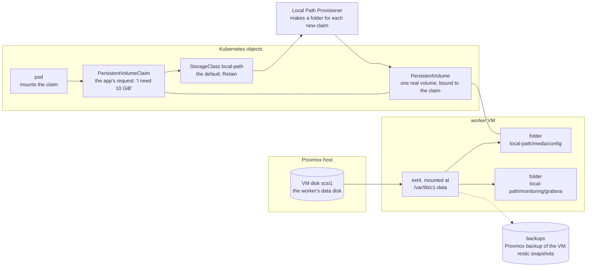

# How c1 keeps its data

An app that must remember something, such as Grafana's dashboards or Jellyfin's library, asks for a **volume**. On c1 each volume is a plain folder on the worker's **data disk**. Nothing copies it to a second machine while it runs. The copies are the backups.

The claim and folder names in the drawing are examples. On dev each folder is named `<namespace>/<claim>` (`hosts/kubernetes/home/c1/apps/local-path/values.yaml` line 25).

## The words

| Word | What it is | On c1 |
|---|---|---|
| **VM disk** | A disk image that Proxmox gives a VM. | The worker has a second disk just for app data. The node sees it as Proxmox's `scsi1` (`hosts/ansible/roles/k8s_storage/defaults/main.yml` line 11). Ansible formats it as ext4 and mounts it at `/var/lib/c1-data` (same file, lines 2-4 and 13). |
| **StorageClass** | A kind of storage the cluster offers. A claim that names no class gets the default class ([Kubernetes: Storage Classes](https://kubernetes.io/docs/concepts/storage/storage-classes/)). | One class, `local-path`, and it is the default. It keeps a volume's folder when its claim is deleted (`Retain`), and it uses only nodes labelled `central-hub/data-disk=true` ([Move c1's volume provisioner to Argo CD](../runbooks/move-local-path-to-argo-cd.md), line 17). |
| **PersistentVolumeClaim (PVC)** | An app's request for storage: how much, and of which class ([Kubernetes: Persistent Volumes](https://kubernetes.io/docs/concepts/storage/persistent-volumes/)). | Grafana, Prometheus, Loki and Jellyfin each have claims (same runbook, line 17), and so does the secrets store where it runs in the cluster. |
| **PersistentVolume (PV)** | One real piece of storage, bound to one claim (same Kubernetes page). | A folder under `/var/lib/c1-data/local-path` on the worker (`hosts/kubernetes/home/c1/apps/local-path/values.yaml` line 10). |
| **Provisioner** | The program that makes a volume when a claim asks for one. | The Local Path Provisioner v0.0.37, pinned by digest (`hosts/kubernetes/home/c1/apps/local-path/values.yaml` line 6), Apache-2.0 ([D-0051](../decisions/0051-use-external-secrets-and-local-path-as-c1s-secret-and-storage-add-ons.md)). |
| **Mount** | Where a volume appears inside a container, as a folder. | Set in each app's chart. |

## What Ceph is, and why c1 doesn't use it

**Ceph** is storage spread across many machines. Its monitors keep the map of the cluster, and its OSD daemons store the data as objects and keep copies on other machines ([Ceph: The Ceph Storage Cluster](https://docs.ceph.com/en/latest/architecture/storage-cluster/)). One disk or one machine can die and the data stays, because another machine holds a copy.

That needs several machines. Proxmox's guide says a Proxmox and Ceph cluster needs "at least three (preferably) identical servers" ([Proxmox: Deploy Hyper-Converged Ceph Cluster](https://pve.proxmox.com/wiki/Deploy_Hyper-Converged_Ceph_Cluster)).

The lab has one Proxmox host (`docs/architecture.md` line 13), so Ceph would have no other machine to copy to. The only Ceph lines in this repository turn off Proxmox's paid Ceph package source (`docs/runbooks/set-up-proxmox-host.md` lines 99-109).

| | local-path, as c1 has it | Ceph |
|---|---|---|
| Machines needed | one | at least three |
| A disk dies | its volumes are lost until a backup is restored | the data stays on the other copies |
| Parts to run | one small pod | monitors, managers and OSDs on every machine |
| Fits one Proxmox host | yes | no |

## Copies, and how to swap it

- **The risk.** A volume lives on one node's disk, so losing that disk loses everything since the last backup ([D-0051](../decisions/0051-use-external-secrets-and-local-path-as-c1s-secret-and-storage-add-ons.md), Consequences).
- **The copies.** The nightly Proxmox backup of the VM, and restic snapshots of every volume folder and of etcd, with a weekly restore test ([Back up c1 off the box](../runbooks/back-up-c1-off-box.md), line 17). A dev rebuild puts prod's newest volume snapshot on dev's data disk, so every dev rebuild proves the volumes come back ([Rebuild one cluster's Kubernetes layer](../runbooks/rebuild-k8s-layer-with-one-command.md#restore-on-dev)).
- **The swap.** Apps name only a claim and, at most, the class name. To move to other storage, make a new class, restore the backups into claims of that class, and change the class name in the app, or nothing if the new class becomes the default ([D-0051](../decisions/0051-use-external-secrets-and-local-path-as-c1s-secret-and-storage-add-ons.md), Exit path). The ones named so far are NFS or Proxmox's own CSI driver (`hosts/ansible/roles/k8s_storage/defaults/main.yml` line 7), and a data-only VM disk is the next test (spec [2026-11-c1-rebuild](../specs/2026-11-c1-rebuild.md), P6). Ceph becomes an option only when the lab has three machines.

## Sources

- In this repository: [D-0051](../decisions/0051-use-external-secrets-and-local-path-as-c1s-secret-and-storage-add-ons.md), [Move c1's volume provisioner to Argo CD](../runbooks/move-local-path-to-argo-cd.md), `hosts/ansible/roles/k8s_storage/defaults/main.yml`, `hosts/kubernetes/home/c1/apps/local-path/values.yaml`.
- Upstream: Kubernetes [Persistent Volumes](https://kubernetes.io/docs/concepts/storage/persistent-volumes/) and [Storage Classes](https://kubernetes.io/docs/concepts/storage/storage-classes/); Ceph [The Ceph Storage Cluster](https://docs.ceph.com/en/latest/architecture/storage-cluster/); Proxmox [Deploy Hyper-Converged Ceph Cluster](https://pve.proxmox.com/wiki/Deploy_Hyper-Converged_Ceph_Cluster).
