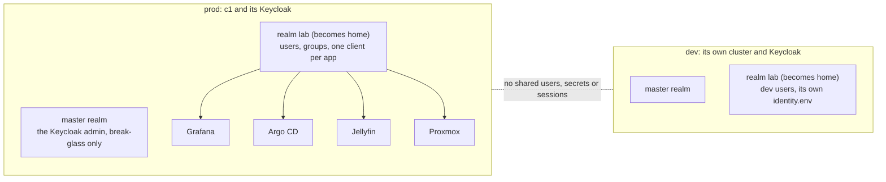

# How Keycloak's realms are laid out

Each environment has its own Keycloak, and each Keycloak has one realm for people and apps, with a client for every app. There is no separate realm for staging or for management, because there is no staging environment and the people who administer the lab are already in that one realm's `lab-admins` group. This page says why, and what would make the layout change.

*In words:* prod and dev are two clusters, so they are two Keycloak servers. Each one has the same realm, made from the same code, with its own users and its own secrets. Inside one environment every app is a client of that one realm, so one sign-in works for all of them.

## Why the boundary is the Keycloak server, not a realm

Keycloak's guide says a realm is "a space where you manage objects, including users, applications, roles, and groups," that realms are isolated from each other, and that when you choose how many to make you weigh how much isolation users and applications need (Server Administration Guide, "Configuring realms" and "Creating a realm", read 2026-11-19, [Keycloak docs](https://www.keycloak.org/docs/latest/server_admin/index.html)). It gives no advice on separating development, test and production, so the split between environments is a choice made here, not a rule from Keycloak.

Here it follows the machines. Dev and prod are separate clusters (the dev rebuild's `identity-keycloak` stage runs only on dev and writes `identity.env` in the dev folder, `hosts/rebuild-k8s.sh` lines 731-745). Putting a dev realm beside the prod one in prod's Keycloak would couple them: a change to realm lab's code or values runs a realm import, and "a realm import ... ends open sign-ins" (D-0037, `docs/decisions/0037-sign-in-to-proxmox-and-opnsense-through-keycloak.md` line 76). A dev rehearsal would then risk prod's sign-ins. The same reasoning is Active Directory's: a forest is the security boundary, and here the cluster is the boundary.

## One realm per environment, with a client per app

- Every app of an environment is a client of its realm: `grafana`, `argocd` and `argocd-cli`, `jellyfin`, `proxmox`, `opnsense` and `openbao` (`hosts/ansible/roles/k8s_identity/templates/realm.yaml.j2` lines 111-236). One realm is what makes one sign-in work across them. A community answer says the same: "one realm, client per application, otherwise the 'sso' part won't work" (xgp, Keycloak forum, "Multiple realms questions", 2025-09-03, [forum thread](https://forum.keycloak.org/t/multiple-realms-questions/31087); one forum post, not Keycloak's own advice).
- The groups are in the realm: `lab-admins` and `lab-viewers`, with a one-time-code seed for every admin (`defaults/main.yml` line 45; D-0037 rule 6).
- Both environments use the same realm name and the same code, so what dev proves is what prod gets [pick]. They differ in users and secrets.

## Why no staging realm and no management realm

- **Staging.** The owner said "right now, realistically, we only can really manage two environments, yeah? A dev and a prod, or a lab and a prod" (2026-11-08; the quote is cut off in the copy this page was written from). The repository has dev and prod and nothing between them. A third environment would need a third Keycloak and its database to run, which is more to keep than the owner said he can manage [inferred]. If a staging cluster appears, it gets its own Keycloak with the same realm, not a new realm inside prod's.
- **Management.** Keycloak already has one realm for that. The master realm exists "only to create and manage the realms in your system" and the guide advises against making users in it (Server Administration Guide, "The master realm"). Its break-glass admin Secret stays in the cluster and nothing reads it (`templates/keycloak.yaml.j2` line 6). People who administer Proxmox, OPNsense or Argo CD sign in through the app realm and are in `lab-admins`, with a second factor (D-0037 rule 6), so a mgmt realm would only duplicate that group.

## The name

The realm is `lab` today (`defaults/main.yml` line 28). The accepted rebuild spec decides it becomes `home`, in its row P9 and step 5 (`docs/specs/2026-11-c1-rebuild.md` lines 39 and 65). That rename is the open draft PR #180: it renames the realm, its groups and its URLs, and runs when prod is rebuilt, because it ends open sign-ins and re-runs `proxmox_sso` (D-0037 "Not decided here", line 67). Until it merges, runbooks and checks still say `lab`.

## What would change this

- A real staging or QA cluster: its own Keycloak, same realm.
- A second user population that must not share people, groups or sign-in with the lab (guests, a business), where the guide's own example applies: another realm in the same Keycloak.
- Realm config kept by code across several Keycloak servers: the realm's code is already the one source, and community advice for realm config as code points at Terraform or keycloak-config-cli (Keycloak forum, "How do you manage and sync Keycloak realm config across environments", [forum thread](https://forum.keycloak.org/t/how-do-you-manage-and-sync-keycloak-realm-config-across-environments/31083)); this repository uses an Ansible role, and nothing here depends on that choice.

## Not proven

- The Keycloak guide was read to character 100,000 of 136,303; the rest was not read.
- The owner's full words for the staging and management questions (2026-11-08) were cut in the copy this was written from; the full text is in the chat archive.
- Whether any staging need exists beyond what the owner said on 2026-11-08 is not known.
