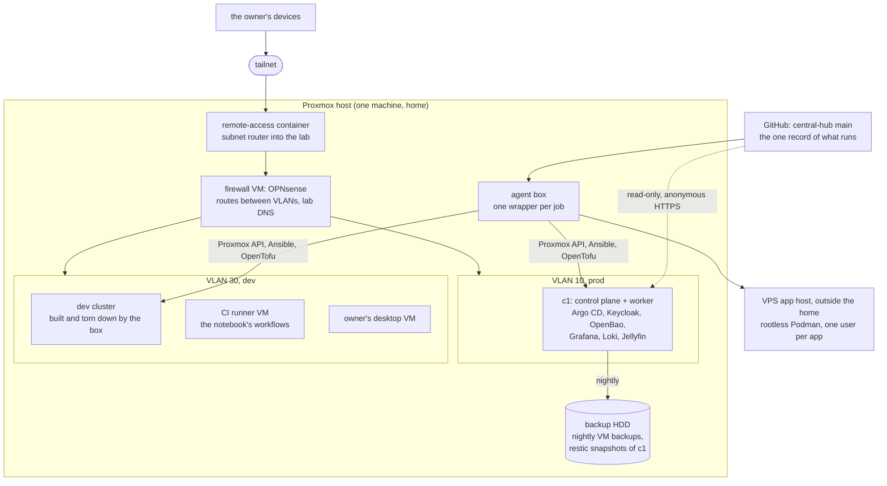
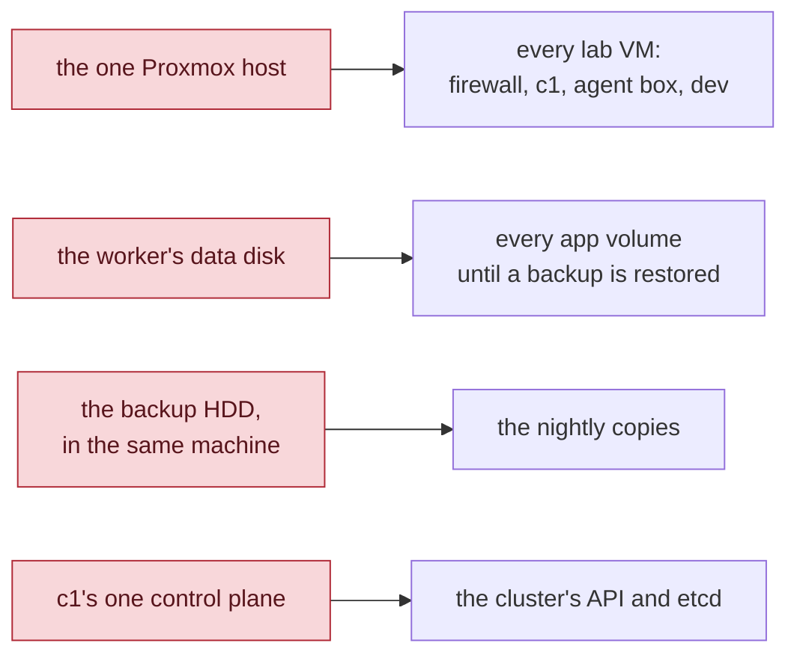

# How the whole lab fits together

The lab is one Proxmox host at home. On it, a firewall VM splits the lab into VLANs, the Kubernetes cluster c1 runs the apps, and an agent box applies every change from this repository. A small VPS outside the home runs a few apps of its own. This page draws all of it on one picture, then marks the places where one failure stops a lot.

## What each part does

| Part | What it does | Read more |
|---|---|---|
| Proxmox host | One machine at home that runs every lab VM and container. Its network is split into VLANs: 10 prod, 20 QA and stage, 30 dev, 50 management. | [architecture.md](../architecture.md), [STD-0002](../standards/0002-ip-address-plan.md) |
| Firewall VM | OPNsense routes and filters traffic between the VLANs, and answers the lab's DNS names. | [Set up the lab network and firewall](../runbooks/set-up-lab-network-and-firewall.md), [Set up lab DNS](../runbooks/set-up-lab-dns.md) |
| Remote-access container | A tailnet device that routes the owner's devices into the lab from anywhere. | [Set up the tailnet client](../runbooks/set-up-tailnet-client-in-ct-900.md) |
| c1 | The prod Kubernetes cluster: one control plane and one worker. Argo CD on it reads this repository and installs every app. | [What c1 is made of](what-c1-is-made-of.md), [When Argo CD takes over from Ansible](when-argo-cd-takes-over-from-ansible.md) |
| Sign-in and secrets | Keycloak signs people in to Grafana, Argo CD and Jellyfin, each through its own client. OpenBao is the secrets store inside the cluster, and External Secrets turns its entries into the Secrets the apps read. | [Set up lab sign-in](../runbooks/set-up-lab-sign-in.md), [Set up the secrets store](../runbooks/set-up-the-secrets-store.md) |
| Agent box | The VM the agents work from. Each job, such as a rebuild, runs through its own wrapper with fixed arguments, and the agents can't read the keys themselves. | [Set up the agent box](../runbooks/set-up-the-agent-box.md) |
| Dev cluster | A copy of c1 on VLAN 30 that the box builds from code, fills with prod's newest backup and tears down, to prove a change before prod. | [Rebuild one cluster's Kubernetes layer](../runbooks/rebuild-k8s-layer-with-one-command.md) |
| CI runner, desktop | Two VMs on VLAN 30 with no lab keys: one runs the notebook's CI jobs, the other is the owner's remote desktop. | [Set up the CI runner](../runbooks/set-up-the-ci-runner.md), [Set up the desktop](../runbooks/set-up-the-desktop.md) |
| Backups | Every night the Proxmox backup job copies the lab's guests to the host's backup HDD. The restic snapshots of c1's etcd and volumes, with a weekly restore test, are written to go to the same HDD; the runbook's `last-tested` line shows that target tested in CI, not yet on the host. | [Back up c1 off the box](../runbooks/back-up-c1-off-box.md) |
| VPS app host | A rented server outside the home. Each app has its own Linux user and rootless Podman, and nothing new listens on a public address. | [Set up the VPS app host](../runbooks/set-up-the-vps-app-host.md) |

## Where one failure stops a lot

Red marks a part with no second copy today. Each line under the drawing gives its source.

- **The one host.** Every VM and container in the lab runs on one Proxmox node (`docs/architecture.md` line 13). If it is down, the whole lab is down.
- **The data disk.** A local-path volume lives on one node's disk, so losing that disk loses the data since the last backup ([D-0051](../decisions/0051-use-external-secrets-and-local-path-as-c1s-secret-and-storage-add-ons.md), Consequences). [How c1 keeps its data](how-c1-keeps-its-data.md) explains why there is no second copy while it runs.
- **The backups sit in the same machine.** The nightly Proxmox backup is on the host's backup HDD, and the restic repository is set to go there too ([Back up c1 off the box](../runbooks/back-up-c1-off-box.md), "The Proxmox host's backup HDD"). A fire or theft that takes the host takes the copies too.
- **One control plane.** c1 has one control-plane VM, and it holds the API server and etcd ([What c1 is made of](what-c1-is-made-of.md)). Every change to the cluster goes through it. The backup runbook snapshots etcd every night.

## Sources

Every row above links its runbook or record in this repository. The VLAN numbers are STD-0002's Home VLANs table. The parts on the drawing are the ones those runbooks build. No address, hostname or zone is drawn (CLAUDE.md rule 4).
