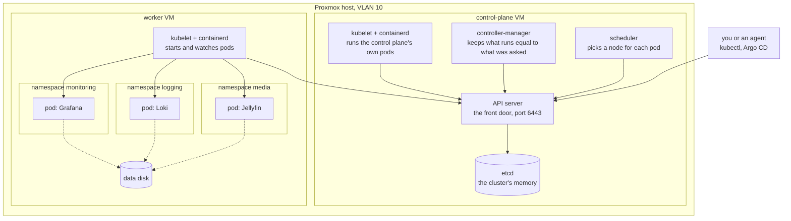

# What c1 is made of

c1 is the lab's Kubernetes cluster. It runs on two virtual machines on the one Proxmox host: a **control plane** that runs the cluster, and a **worker** that runs the apps. Every app runs in **pods**, and each pod sits in a **namespace** that groups it with its own parts.

The drawing shows three of c1's namespaces. The table below lists all of them.

## The parts

| Word | What it is | On c1 |
|---|---|---|
| **Node** | One machine that Kubernetes runs pods on. It can be a VM or a physical machine ([Kubernetes: Nodes](https://kubernetes.io/docs/concepts/architecture/nodes/)). | Two VMs on the Proxmox host: one with role `control-plane`, one with role `worker` (the made-up example `hosts/terraform/home/k8s/home.tfvars.example` lines 7-8 shows the shape; the real names stay private). Both are on VLAN 10 (`docs/architecture.md` line 18). |
| **Control plane** | The parts that run the cluster itself: the API server, etcd, the scheduler and the controller-manager ([Kubernetes: Kubernetes Components](https://kubernetes.io/docs/concepts/overview/components/)). | One VM. kubeadm puts a taint on it that keeps app pods off, and on c1 that taint stays because c1 has a worker (`hosts/ansible/roles/k8s_control_plane/tasks/main.yml` line 248). |
| **API server** | The front door. Every change, from `kubectl` or Argo CD, goes through it. | Port 6443 (`docs/runbooks/build-kubeadm-cluster.md` line 61). |
| **etcd** | The store that holds every object the API server knows. | On the control-plane VM. The nightly backups save a snapshot of it ([Back up c1 off the box](../runbooks/back-up-c1-off-box.md)). |
| **kubelet** | The agent on each node. It asks the container runtime to start the pods the API server gives that node. | On both VMs. The runtime is containerd (`docs/runbooks/build-kubeadm-cluster.md` line 66). |
| **Pod** | The smallest unit Kubernetes runs: one or more containers that share an address and storage ([glossary](../glossary.md)). | Each pod gets an address from 10.240.0.0/16, handed out by Cilium (`docs/architecture.md` lines 19-20; `docs/runbooks/build-kubeadm-cluster.md` line 67). |
| **Namespace** | A named group of objects inside one cluster, so two apps' parts don't mix ([Kubernetes: Namespaces](https://kubernetes.io/docs/concepts/overview/working-with-objects/namespaces/)). | One per job. The list is below. |

## c1's namespaces

Argo CD makes each app's namespace from `hosts/kubernetes/home/c1/root/values.yaml`. The Ansible roles make the rest.

| Namespace | What runs there | Source |
|---|---|---|
| `kube-system` | Kubernetes' own parts, Cilium and metrics-server | `hosts/kubernetes/home/c1/root/values.yaml` line 150 |
| `argocd` | Argo CD | `hosts/ansible/roles/k8s_identity/defaults/main.yml` line 93 |
| `gateway` | the shared Gateway that every app's web address goes through | `hosts/kubernetes/home/c1/root/values.yaml` line 315 |
| `cert-manager` | the certificates | `hosts/kubernetes/home/c1/root/values.yaml` line 300 |
| `identity` | Keycloak, the sign-in | `hosts/ansible/roles/k8s_identity/defaults/main.yml` line 11 |
| `external-secrets` | External Secrets, which turns entries in the secrets store into Kubernetes Secrets | `hosts/kubernetes/home/c1/root/values.yaml` line 236 |
| `openbao` | the secrets store, where the root value `openbaoInCluster` is on | `hosts/kubernetes/home/c1/root/values.yaml` line 381 |
| `local-path-storage` | the provisioner that makes volumes ([How c1 keeps its data](how-c1-keeps-its-data.md)) | `hosts/kubernetes/home/c1/root/values.yaml` line 160 |
| `monitoring` | Prometheus, Grafana and Alertmanager | `hosts/kubernetes/home/c1/root/values.yaml` line 203 |
| `logging` | Loki and Alloy | `hosts/kubernetes/home/c1/root/values.yaml` line 182 |
| `alerts` | ntfy, which sends alerts to the owner's phone | `hosts/kubernetes/home/c1/root/values.yaml` line 346 |
| `media` | Jellyfin | `hosts/kubernetes/home/c1/root/values.yaml` line 169 |

The `hosts/kubernetes/home/c1/root/values.yaml` line numbers are as of central-hub main d333499.

## How a request reaches a pod

1. A change comes in at the API server, for example "run Jellyfin", from `kubectl` or from Argo CD.
2. The API server writes it to etcd.
3. The scheduler sees a pod with no node and picks the worker.
4. The worker's kubelet sees the pod, and containerd pulls the image and starts it.
5. The controller-manager keeps checking. If the pod dies, a new one is started, so what runs stays equal to what was asked.

## Sources

- In this repository: [Build a single-node kubeadm cluster by hand](../runbooks/build-kubeadm-cluster.md) (each part, built one step at a time), [Build cluster c1 with Ansible](../runbooks/build-c1-with-ansible.md) (the same steps as code), and [architecture.md](../architecture.md).
- Upstream: [Kubernetes Components](https://kubernetes.io/docs/concepts/overview/components/), [Nodes](https://kubernetes.io/docs/concepts/architecture/nodes/), [Pods](https://kubernetes.io/docs/concepts/workloads/pods/), [Namespaces](https://kubernetes.io/docs/concepts/overview/working-with-objects/namespaces/).
