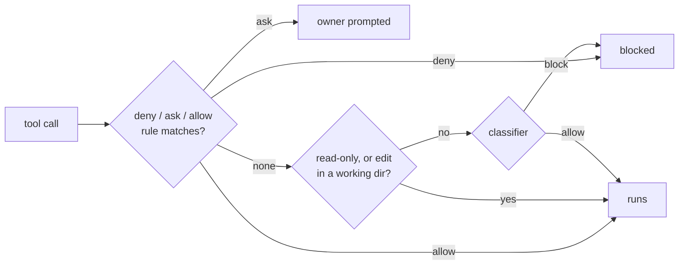

# Let agents run a new command without a permission block

Agent sessions on the owner's Mac run in auto mode. Each call goes through three gates in order: permission rules (deny, then ask, then allow), then the built-in read-only list and working-directory edits, then a classifier model. A matching allow rule skips the classifier; a deny rule in any settings file wins over every allow rule.

※ Claude Code docs, "Configure auto mode" (<https://code.claude.com/docs/en/auto-mode-config>) and "Configure permissions", sections "Compound commands" and "Settings precedence" (<https://code.claude.com/docs/en/permissions>).

## Before you start

- Agents never edit `~/.claude/settings.json` themselves, and never write a script whose purpose is to get a blocked command past the guard. The classifier blocks both as Self-Modification or Auto-Mode Bypass, and they stay the owner's decision.
- Read the block reason in brackets, such as `[Blind Apply]`. `claude auto-mode defaults --label '<name>'` prints the rule's full text.

## Steps

1. Rewrite the call so a rule can match it.
   why: an allow rule matches only the command text as written. In a compound command every part must match, a `cd` outside the working directories is not read-only, a `cd` followed by `git` always prompts, an assignment like `FOO=1 cmd` stops an allow match, and commands inside loops or `$(...)` go to the classifier.
   - One command per call. No `cd … &&` chains, loops or `$(...)`.
   - Use the tool's own directory flag (`git -C <dir>`, `tofu -chdir=<dir>`), or start the session in the right folder.
   - Pass settings as flags, not leading environment assignments.
   - Spell wrapper scripts exactly as the rule does, starting with `~/.config/central-hub/`.
   expect: many blocks disappear here, because the rule already existed.

2. Prefer the reversible form of the action.
   why: the classifier's soft blocks clear for actions that can be undone or that name their target.
   - Discarding a local change: `git -C <repo> stash push -m "<why>" -- <file>`, not `git restore` or `git checkout --`.
   - Applying infrastructure: plan to a file, show the plan, apply that file (the wrappers do this).
   - Secrets: never `cat` a secret file; a wrapper loads it into the environment without printing it.
   expect: the reversible form runs, or is blocked for a reason step 3 or 4 can fix.

3. If the command loads a secret or applies infrastructure, propose a wrapper in `~/.config/central-hub/` that does exactly one job with fixed arguments, like `tofu-azure.sh <stack> plan|apply|output`. Put the script text in the proposal; the owner installs it in step 5.
   why: a rule for a fixed wrapper approves one known action. A rule for the raw tool (`tofu apply *`) approves every argument the agent could add.
   ※ the plan-then-apply form comes from step 2.
   expect: the proposal holds the whole script, with no secret values in it.

4. Write the proposed rule in the narrowest form that covers the task:
   - exact command: `Bash(tofu version)`
   - one subcommand with any arguments: `Bash(gh pr view *)`
   - one wrapper action: `Bash(~/.config/central-hub/tofu-azure.sh * apply)`
   - file edits in one folder: `Edit(~/source/repos/Personal/agent-notebook/**)`
   - a destination the classifier treats as external: one prose line in `autoMode.environment`, such as `Source control: github.com/jonhill90 and every repository under it.`
   Never propose `Bash(*)`, an interpreter wildcard like `Bash(python*)`, or a bare tool with a wildcard in the middle of its subcommand. Auto mode drops the broad forms anyway. Give the owner one block: the rule, what it matches, the denial it fixes, and its exit (delete the line).
   why: allow rules skip the classifier, so each rule is the whole review for the commands it matches.
   ※ a wrapper from step 3 gets a rule for its one action, not for the raw tool.
   expect: one rule per block, each naming the denial it clears.

5. (Owner) Paste the rule into the `permissions.allow` list (or `autoMode.environment`) in `~/.claude/settings.json`, then run `claude auto-mode config` to see the effective list.
   why: `autoMode` is read only from user or managed settings, never from a repository's `.claude/settings*.json`, and project allow rules apply only after the folder's trust dialog.
   ※ the rule text comes from step 4.
   expect: the agent's next call runs without a block. Sessions already running may need a new session to pick up the change.

## If it fails

- Still blocked with an allow rule in place: check every settings file for a deny rule that matches (central-hub's own `.claude/settings.json` denies `gh pr merge` and `gh api`; a deny always wins), then check the command text against step 1.
- `Not run · auto mode's check had no usable answer`: the classifier gave no verdict; retry once, then ask the owner.
- After 3 blocks in a row or 20 in a session, auto mode pauses and prompts the owner for everything; start a fresh session once the rule is in.

## Afterwards

Record the rule you added, and the denial it fixed, in the task note that needed it, so the next agent can find why the rule exists. When the task no longer needs the rule, delete the line.

## Related

- [D-0031](../decisions/0031-let-agents-merge-green-prs.md): the rule on when agents may merge a PR, which no allow rule changes.
- [Give agents their own access to the owner's Azure tenant](give-agents-access-to-azure.md): where `~/.config/central-hub/azure.env`, which the wrappers load, comes from.
