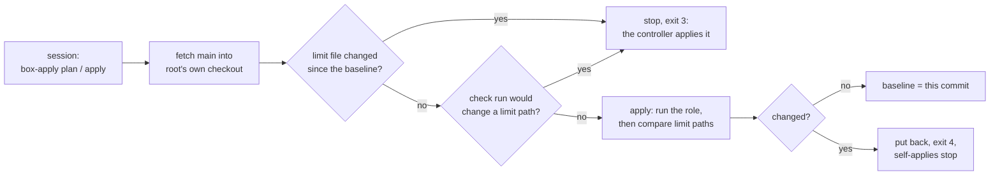

# Apply the agent box's setup from the box itself

**Status:** draft. Written 2026-11-14 from the code in this change and tested offline only. Not installed on the box yet.

## Why

D-0036 (accepted on the owner's message of 2026-11-14 03:16 UTC) lets the box apply its own role from reviewed main, so a merged change no longer waits for the controller. The files that set what a session on the box may do stay behind the owner: a change to one of them stops, and is applied from the controller after the owner's go.

## How it works (pick 223)



*In words:* `box-apply` fetches main into a checkout only root can write. If any limit file changed since the baseline, it stops. Otherwise it runs the role in check mode and stops if the run would touch a limit path on the box. `apply` then runs the role for real, compares every limit path with its state before, puts back any that changed, and stops self-applies until the controller's next full apply.

| Piece | Where |
|---|---|
| **The wrapper.** `box-apply.py`, root-owned in `/usr/local/libexec/agent-box/`, started as root through one sudo line that allows `plan` and `apply` only. The front script `/usr/local/bin/box-apply` calls it. Every run is one JSON line in `/var/log/box-apply.log`, and the role's output is kept in `/var/lib/box-apply/runs/` (the last 50) | `files/box-apply.py`, `tasks/self_apply.yml`, `templates/sudoers.j2` |
| **The limits.** `/etc/box-apply/limits.txt`, written only by an apply from the controller. Every file of the role is a limit, except its argument specs and its defaults. In the defaults, only the pinned tools' versions and SHA-256s may change (tofu, kubectl, Tailscale), and only to plain literals. Ansible's own pins are limits, because a self-apply runs from that virtual environment. Also limits: the playbook, `ansible.cfg`, the collections' requirements, and the certificate script the off-box copy runs. On the box, `box-apply` compares the sudo rules, the managed settings, the private CAs it trusts, every script in the wrapper folder, the front scripts, the units in `/etc/systemd/system`, its own files, the wrappers' settings files, the key and work folders' owner and mode, and the three users | `templates/box-apply-limits.txt.j2` |
| **The baseline.** The commit of the controller's last full apply, written by the role's last task, and only when the run had no `--tags`, `--skip-tags` or `--start-at-task` and came from a clean git checkout: no tracked file changed, and no untracked file in the role, the playbook, `ansible.cfg`, `requirements.yml` or the certificate script (or named its commit with `-e agent_box_self_apply_commit=<40 hex>`). A narrow apply never moves it, so it can't hide a limit change it didn't make. A good self-apply moves it to the commit it applied | `/var/lib/box-apply/baseline` |
| **The inventory.** The role's `agent_box_*` host variables as the controller had them (only names the role declares in its defaults or argument specs; a result the play registered is not written), written by the controller's apply (D-0036 rule 7). Role defaults are not host variables, so a merged change to a free default still applies | `/etc/box-apply/inventory.yml` |
| **What a self-apply skips.** The tags `ca`, `prod_files` and `opnsense_offbox` (they read files on the controller), `lifeline` (the box's firewall, D-0036 rule 8), `proxmox_host_inventory` (the Proxmox host job's private inventory, rule 7) and `verify` | `agent_box_self_apply_skip_tags` |
| **Approved limit changes (pick 232).** One line per change on main, outside the role: `<from> <to> <digest> <pass> <tap>`. `box-apply` checks the baseline, that `to` is on main with no limit change after it, and the digest of the limit files' diff. It can't check the pass or the tap, which it only logs. With a matching line it applies `to` with `agent_box_limit_apply=true`, so the tasks that write `box-apply`, its settings and its limits run too (never its inventory), and lets change only the limit paths its check run named | `hosts/ansible/agent-box-limit-approvals.txt` |

## Steps

### Install it (once, from the controller, after the owner's go)

1. In the private inventory, set `agent_box_self_apply: true` for the box.
2. Run the role in full, with no `--tags`, from a clean checkout of main:

   ```sh
   ansible-playbook -i inventories/home/ playbooks/agent-box.yml
   ```

   why: a full run is the only one that writes the baseline. If the controller runs from a pinned copy that is not a git checkout, add `-e agent_box_self_apply_commit=<the commit it was made from>`.
   expect: `failed=0`. On the box, `sudo -l` as the session user lists the one `(root)` line for `box-apply.py plan` and `apply`. The proofs check that line and accept no other root line.
3. If sessions on the box need an allow rule to run it, add `Bash(box-apply plan)` and `Bash(box-apply apply)` to the private allow list. That list is itself a limit, so it is part of this same apply.

### Apply a merged change (on the box)

Run `box-apply` as the session user, without `sudo`: the front script calls `sudo -n` itself, and sudo allows only that one root line. `sudo box-apply` doesn't find it, because `/usr/local/bin` is not on root's `secure_path`.

1. Plan:

   ```sh
   box-apply plan
   ```

   expect: `main <commit>, baseline <commit>`, `<n> file(s) changed since the baseline, none of them a limit`, then the tasks the check run would change. Nothing is applied.
2. Apply:

   ```sh
   box-apply apply
   ```

   expect: `applied <commit>: <n> task(s) changed`. The baseline is now that commit.

The box also runs this apply on its own: `box-apply.timer` starts `box-apply.service` every `agent_box_self_apply_interval` (10 minutes by default), as root, so a merged change reaches the box without a session remembering it. It runs `box-apply.py tick`, which sudoers doesn't give sessions: the same run as `apply`, except that it ends at once with `nothing new on main since the baseline` (log result `nothing-new`) when main has not moved, so the role isn't re-run every 10 minutes and the last 50 runs' output stays useful. A stop on a limit with no approval line (exit 3) counts as a normal end of that service; the run's record is the same log as a session's. A session's run while the timer's is going gets `another box-apply run is going`. Stop it with `systemctl stop box-apply.timer` from the controller; a plain self-apply never starts it again, because the timer tasks run only from the controller or in an approved limit apply. `agent_box_self_apply_timer: false` leaves it out.

### Apply a limit change (from the controller)

`box-apply` exits 3 and names the limit. The change is applied from the controller, by an agent lane, after the agents' pass of its digest (D-0036 rule 6, D-0042 rule 4). A change that also holds another D-0042 rule 6 step waits for the owner's tap on that step's card (see the list below). Apply it in full, so the baseline moves past it. A narrow `--tags` apply doesn't move the baseline, so `box-apply` keeps stopping until a full one.

### Apply an approved limit change (on the box, no controller)

D-0044 (accepted) lets the box apply a change to its own limits when one line in the approvals file names it, so no run from the controller is needed (D-0036 rules 3(f) and 6 carry it). Write a line only after the agents' pass of the digest: the box would apply it. The owner's order of 2026-11-17 06:21:09 UTC (cmsg_01X43rfNYp4H1dL1V2dkfkwN9ubbtsV3Wpcx228ZrApLVh) dropped the owner's card for a limit change (D-0042 rule 4). A change that also holds another D-0042 rule 6 step keeps that step's card, and its line waits for the owner's tap. The limit paths that make a firewall change, so a change to them keeps the owner's firewall card (D-0036 rule 8, D-0042 rule 6):

- the lifeline's packet filter, table `inet lifeline`: `hosts/ansible/roles/agent_box/templates/lifeline.nft.j2`, `templates/lifeline-nft.service.j2`, `templates/lifeline-up.service.j2`, `tasks/lifeline.yml` and `tasks/lifeline_cleanup.yml`, and the private inventory's `agent_box_lifeline_allow`, `agent_box_lifeline_interface` and `agent_box_lifeline_address`. Only an apply from the controller runs them, because `lifeline` is in `agent_box_self_apply_skip_tags`, so their card goes with that apply;
- `agent_box_self_apply_skip_tags` in the role's defaults, when a change takes `lifeline` off it;
- a change that would load another nftables table on the box, such as setting `agent_box_opnsense_test` in the private inventory, which turns on the OPNsense test stack's filter (`tasks/main.yml`, the include gated on that setting). Installing code whose filter stays off because its setting is empty loads nothing and needs no card.

A change that copies secrets onto the box keeps the owner's secrets card (D-0042 rule 6): the controller's private lab files, `agent_box_prod_files` with the `prod_files` tasks, which run only from the controller when `agent_box_copy_prod_files` is turned on for one run (the `prod_files` tag is in `agent_box_self_apply_skip_tags` too), and a change to that list or that switch.

A new credential for agents, or wider rights for one in another system (Proxmox, GitHub, the tailnet, OpenBao), keeps its access-rights card even when a wrapper uses it; a sudo rule, wrapper or user on the box is a limit and needs none.

What this route never does: it does not change the box's inventory (D-0036 rule 7, so a setting that only the private inventory sets stays as it is), and it skips the firewall tasks, which the self-apply's skipped tags leave to a run from the controller (`agent_box_self_apply_skip_tags`).

1. Plan, and copy what the stop prints:

   ```sh
   box-apply plan
   ```

   expect: exit 3, `main holds no approval line for it`, the limit files, and a line to approve: `<baseline> <main> <digest> <pass> <tap>`.
2. The reviewer reads that diff. Anyone can recompute the digest in a checkout of main:

   ```sh
   git diff --no-renames --binary --full-index <baseline> <main> -- <the limit files it named> | sha256sum
   ```

   why: the digest pins the exact bytes they passed, so a later change to those files needs its own line.
3. Add the line to `hosts/ansible/agent-box-limit-approvals.txt` by a PR that merges like any other. Its five fields are `<from> <to> <digest> <pass> <tap>` (the baseline, the commit on main, and the digest, as `box-apply plan` printed them), `pass` is the id of the orchestrator's message that records the agents' pass of that digest, and `tap` the owner's approval: the id of their order that dropped the box-install cards, `cmsg_01X43rfNYp4H1dL1V2dkfkwN9ubbtsV3Wpcx228ZrApLVh`, or, for a change that keeps a card (above), the id of the owner's decide event (the choice, not the card) on a card that named the digest (D-0042 rule 4). A tap of `none` never counts. The box applies `to` itself, never main, so a limit that changed after `to` doesn't spoil the line: it waits for its own line, from `to`, which the next `box-apply plan` prints.
4. Plan, then apply:

   ```sh
   box-apply plan
   box-apply apply
   ```

   expect: `approved limit change, ... line <n>`, the limit paths the check run would change, then `applied the approved limit change <to>`. The baseline is now `<to>`.
5. Run `box-apply apply` once more. It goes on to main as a plain apply, since adding the line changed no limit.

## If it fails

| Message | Cause and fix |
|---|---|
| `no baseline` | The role has not run in full from the controller since `agent_box_self_apply` was set. Run it in full. If the full run printed "box-apply's baseline is left as it was", that line names what was missing: a run from the first task, all tags, no skip tags, a commit, or a clean checkout (the files that weren't clean are listed). |
| `a limit changed since the baseline` (exit 3) | Expected for a change to the role's tasks, templates, files, playbook, or a defaults key that isn't a pinned tool. It needs the agents' pass of its digest (D-0042 rule 4), and an approvals line or a full apply from the controller. A pinned tool's new value must be a plain literal (a version of digits and dots, or 64 hex digits for a SHA-256); anything else, Jinja included, stops with `must be a plain literal`. |
| `the check run would change a limit on the box` (exit 3) | The box's limit files differ from what the role makes, for example after a narrow apply or a hand edit. A full apply from the controller sets them right. |
| `the apply changed a limit on the box ... Put back` (exit 4) | A task changed a limit file anyway. It was put back, and `/var/lib/box-apply/stopped` says what. A changed user can't be put back safely: the message names it, and it needs the controller. Read the run's output in `/var/lib/box-apply/runs/`, fix the change by a PR, and end the stop with a full apply from the controller. |
| `self-applies are stopped` | As above: only a full apply from the controller ends it. |
| `main holds no approval line for it` (exit 3) | A limit changed and no line approves it. Approve it (above) or apply it from the controller. Lines that don't count are named first: `malformed` (wrong field count or format, or a tap of `none`), `not on main`, `no limit changed`, or `its digest is not the diff of`. |
| `the approved apply changed limit paths its check run did not name` (exit 4) | The apply changed a limit path that its check run didn't list, so every limit change of the run was put back, and self-applies stop. Check mode can miss what a task does, for example a command task. It also gives a file that is not on the box yet no path, so a looped task that can add a limit file labels each item with its destination (`loop_control: label:`), and `box-apply` reads that label; CI (`check-loop-labels.py`) fails a looped task that writes a file at a path built from its item without that label, and a new loop with a non-path label would stop here the first time it adds a file. A task that copies a file of the repository without a loop (`copy` with `src`) gives a new destination no label either: the check run's only path is the source in the checkout, so `box-apply` prints the sources ("files it copies to a destination it cannot name") and lets the apply add a limit file only if its bytes equal one of those sources; a template's output is not equal to its source and still stops here. Read `/var/lib/box-apply/runs/`, then end the stop with a full apply from the controller. |
| `the check run failed` or `the apply failed` | The role failed on the box. Its JSON output is in `/var/lib/box-apply/runs/`. The baseline didn't move. |
| `does not descend from the baseline` | main's history was rewritten. Run the role in full from the controller. |

## Limits

- Root on the box runs whatever reviewed main says. The checks before and after catch a plain change to a limit. They don't stop merged code written to get around them, for example a task that changes a limit file and then puts back its hash. Review and the green merge are the control (D-0036, Consequences).
- Pinned tools and package sources change by a self-apply, and so change what a wrapper runs with the keys (D-0036, Consequences).
- Users are compared, not put back.
- An approved limit change rests on ids the box can't check: a made-up pass id, or the standing order's id on a change that needs a card, would be applied. The approvals file is not a limit, so any merged PR can add a line. Review, the green merge and the agents' pass are the control, as for the merge job (D-0042, Consequences).

## Exit

Set `agent_box_self_apply: false` and run the role in full from the controller. That removes the sudo line. Then delete `/usr/local/libexec/agent-box/box-apply.py`, `/usr/local/bin/box-apply`, `/etc/box-apply/` and `/var/lib/box-apply/` as root. Box changes then wait for the controller again.
