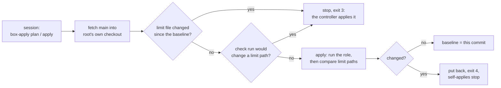

# Apply the agent box's setup from the box itself

**Status:** draft. Written 2026-11-14 from the code in this change and tested offline only. Not installed on the box yet.

## Why

D-0036 (accepted on the owner's message of 2026-11-14 03:16 UTC) lets the box apply its own role from reviewed main, so a merged change no longer waits for the controller. The files that set what a session on the box may do stay behind the owner: a change to one of them stops, and is applied from the controller after the owner's go.

## How it works (pick 223)



*In words:* `box-apply` fetches main into a checkout only root can write. If any limit file changed since the baseline, it stops. Otherwise it runs the role in check mode and stops if the run would touch a limit path on the box. `apply` then runs the role for real, compares every limit path with its state before, puts back any that changed, and stops self-applies until the controller's next full apply.

| Piece | Where |
|---|---|
| **The wrapper.** `box-apply.py`, root-owned in `/usr/local/libexec/agent-box/`, started as root through one sudo line that allows `plan` and `apply` only. The front script `/usr/local/bin/box-apply` calls it. Every run is one JSON line in `/var/log/box-apply.log`, and the role's output is kept in `/var/lib/box-apply/runs/` (the last 50) | `files/box-apply.py`, `tasks/self_apply.yml`, `templates/sudoers.j2` |
| **The limits.** `/etc/box-apply/limits.txt`, written only by an apply from the controller. Every file of the role is a limit, except its argument specs and its defaults. In the defaults, only the pinned tools' versions and SHA-256s may change (tofu, kubectl, Tailscale). Ansible's own pins are limits, because a self-apply runs from that virtual environment. Also limits: the playbook, `ansible.cfg`, the collections' requirements, and the certificate script the off-box copy runs. On the box, `box-apply` compares the sudo rules, the managed settings, every script in the wrapper folder, the front scripts, the units in `/etc/systemd/system`, its own files, the wrappers' settings files, the key and work folders' owner and mode, and the three users | `templates/box-apply-limits.txt.j2` |
| **The baseline.** The commit of the controller's last full apply, written by the role only when the run had no `--tags` or `--skip-tags` and came from a clean git checkout (or named its commit with `-e agent_box_self_apply_commit=<40 hex>`). A narrow apply never moves it, so it can't hide a limit change it didn't make. A good self-apply moves it to the commit it applied | `/var/lib/box-apply/baseline` |
| **The inventory.** The box's own `agent_box_*` host variables as the controller had them, written by the controller's apply (D-0036 rule 7). Role defaults are not host variables, so a merged change to a free default still applies | `/etc/box-apply/inventory.yml` |
| **What a self-apply skips.** The tags `ca`, `prod_files` and `opnsense_offbox` (they read files on the controller), `lifeline` (the box's firewall, D-0036 rule 8) and `verify` | `agent_box_self_apply_skip_tags` |

## Steps

### Install it (once, from the controller, after the owner's go)

1. In the private inventory, set `agent_box_self_apply: true` for the box.
2. Run the role in full, with no `--tags`, from a clean checkout of main:

   ```sh
   ansible-playbook -i inventories/home/ playbooks/agent-box.yml
   ```

   why: a full run is the only one that writes the baseline. If the controller runs from a pinned copy that is not a git checkout, add `-e agent_box_self_apply_commit=<the commit it was made from>`.
   expect: `failed=0`. On the box, `sudo -l` as the session user lists the one `(root)` line for `box-apply.py plan` and `apply`. The proofs check that line and accept no other root line.
3. If sessions on the box need an allow rule to run it, add `Bash(box-apply plan)` and `Bash(box-apply apply)` to the private allow list. That list is itself a limit, so it is part of this same apply.

### Apply a merged change (on the box)

1. Plan:

   ```sh
   box-apply plan
   ```

   expect: `main <commit>, baseline <commit>`, `<n> file(s) changed since the baseline, none of them a limit`, then the tasks the check run would change. Nothing is applied.
2. Apply:

   ```sh
   box-apply apply
   ```

   expect: `applied <commit>: <n> task(s) changed`. The baseline is now that commit.

### Apply a limit change (from the controller)

`box-apply` exits 3 and names the limit. The change is applied from the controller, by an agent lane, after the owner's go naming the PR and its head (D-0036 rule 6). Apply it in full, so the baseline moves past it. A narrow `--tags` apply doesn't move the baseline, so `box-apply` keeps stopping until a full one.

## If it fails

| Message | Cause and fix |
|---|---|
| `no baseline` | The role has not run in full from the controller since `agent_box_self_apply` was set. Run it in full. |
| `a limit changed since the baseline` (exit 3) | Expected for a change to the role's tasks, templates, files, playbook, or a defaults key that isn't a pinned tool. It needs the owner's go and a full apply from the controller. |
| `the check run would change a limit on the box` (exit 3) | The box's limit files differ from what the role makes, for example after a narrow apply or a hand edit. A full apply from the controller sets them right. |
| `the apply changed a limit on the box ... Put back` (exit 4) | A task changed a limit file anyway. It was put back, and `/var/lib/box-apply/stopped` says what. A changed user can't be put back safely: the message names it, and it needs the controller. Read the run's output in `/var/lib/box-apply/runs/`, fix the change by a PR, and end the stop with a full apply from the controller. |
| `self-applies are stopped` | As above: only a full apply from the controller ends it. |
| `the check run failed` or `the apply failed` | The role failed on the box. Its JSON output is in `/var/lib/box-apply/runs/`. The baseline didn't move. |
| `does not descend from the baseline` | main's history was rewritten. Run the role in full from the controller. |

## Limits

- Root on the box runs whatever reviewed main says. The checks before and after catch a plain change to a limit. They don't stop merged code written to get around them, for example a task that changes a limit file and then puts back its hash. Review and the green merge are the control (D-0036, Consequences).
- Pinned tools and package sources change by a self-apply, and so change what a wrapper runs with the keys (D-0036, Consequences).
- Users are compared, not put back.

## Exit

Set `agent_box_self_apply: false` and run the role in full from the controller. That removes the sudo line. Then delete `/usr/local/libexec/agent-box/box-apply.py`, `/usr/local/bin/box-apply`, `/etc/box-apply/` and `/var/lib/box-apply/` as root. Box changes then wait for the controller again.
