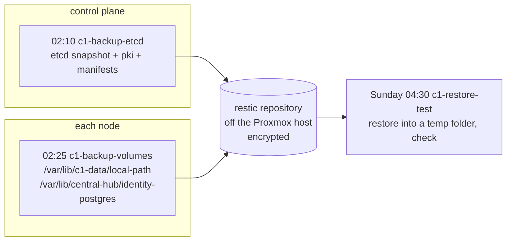
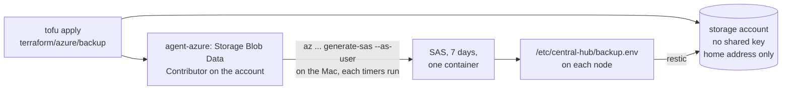

# Back up c1 off the box

Until now the only copy of c1's data is the nightly Proxmox backup on one old HDD in the same PC (TASK-0139). This runbook adds a second copy somewhere else: restic snapshots of etcd and of every volume folder, sent off the Proxmox host each night, and a weekly test that restores them.



Every part is an agent pick ([hosts/AGENT-PICKS.md](../../hosts/AGENT-PICKS.md), picks 144-152, and 179-182 for the Azure storage).

## Before you start

- c1 is up: `kubectl get nodes` shows both nodes `Ready`.
- The worker's data disk is mounted: `findmnt /var/lib/c1-data` on the worker shows it ([Storage on c1](../../hosts/ansible/README.md#storage-on-c1)).
- You have a place for the repository that is not the Proxmox host. restic can write to many kinds of target; this role works with any of them, because the target lives only in the env file:

  | Target | `RESTIC_REPOSITORY` | Extra lines in the env file |
  |---|---|---|
  | Azure Blob storage, the owner's pick (2026-10-16), made by [the Azure steps below](#azure-blob-without-a-key) | `azure:c1-backup:/c1` | none: the playbook adds `AZURE_ACCOUNT_NAME` and a short-lived `AZURE_ACCOUNT_SAS` |
  | Any S3-compatible store | `s3:https://<endpoint>/<bucket>/c1` | `AWS_ACCESS_KEY_ID`, `AWS_SECRET_ACCESS_KEY` |
  | A restic REST server on another machine | `rest:https://<user>:<password>@<host>:8000/c1` | none |
  | An SFTP account on another machine | `sftp:<user>@<host>:/srv/restic/c1` | none (an SSH key for root on each node) |

  (restic's docs, "Preparing a new repository": <https://restic.readthedocs.io/en/stable/030_preparing_a_new_repo.html>)

Stop if c1 is not up. Without a target you can still run step 2 with `k8s_backup_enabled: false`: it installs the tools and nothing runs.

## Azure Blob without a key

The owner wants no raw key that a person or an agent can read (2026-11-08 23:42 UTC). So the storage account refuses its own keys (shared key access off) and answers only the home's public address. c1 gets a user delegation SAS instead: a token for the one container, signed by the agents' service principal `agent-azure` through Entra ID, that lasts at most 7 days. The playbook mints a new one on the Mac at each run and copies it to the nodes.



A1. (Agent, on the Mac) Make the storage:

   ```sh
   cd hosts/terraform/azure/backup
   cp azure.tfvars.example azure.tfvars && chmod 600 azure.tfvars   # git-ignored
   # in azure.tfvars: location, a free storage_account_name, and the home's public address:
   curl -s https://api.ipify.org; echo
   export ARM_SUBSCRIPTION_ID="$(az account show --query id -o tsv)"   # az is signed in as agent-azure
   tofu init -backend-config="path=$HOME/.local/state/central-hub/azure-backup.tfstate"
   tofu plan -var-file=azure.tfvars -out=backup.tfplan
   tofu apply backup.tfplan
   tofu output
   ```

   why: everything about the account is code, so a rebuild makes it the same way. All of it is management-plane work, which the network rule doesn't block, and the state holds no secret because no key is ever read.
   ※ [hosts/terraform/README.md](../../hosts/terraform/README.md); azurerm `azurerm_storage_account` 5.11.0, "shared_access_key_enabled" and "network_rules"
   expect: three resources added; outputs `storage_account_name`, `restic_repository` (`azure:c1-backup:/c1`) and `storage_account_id`.

A2. Nothing to do by hand: step A1's apply also gives `agent-azure` (the identity running tofu) Storage Blob Data Contributor on the account. That needs `agent-azure` to hold Owner, or another role that may assign roles, on the subscription; the owner gave it Owner on 2026-11-09 at 03:33 UTC, for agent work in a subscription with no payment method (owner, 2026-11-09 03:32 UTC). Agents make nothing else billable there without the owner's yes (03:33 UTC).

   why: a user delegation SAS can only do what its signer may do, and the signer needs a data role. Azure lets the signer request its signing key only with a role at the account or wider, and this account holds only the backup container.
   ※ Microsoft Learn, "Create a user delegation SAS for a container or blob with the Azure CLI" (<https://learn.microsoft.com/azure/storage/blobs/storage-blob-user-delegation-sas-create-cli>)
   expect: the apply shows `azurerm_role_assignment.sas_signer` created. Role assignments can take a few minutes to take effect.

A3. In step 1, leave out the `AZURE_` lines: the env file holds only `RESTIC_REPOSITORY=azure:c1-backup:/c1` and `RESTIC_PASSWORD`. In step 2, also set `k8s_backup_azure_sas: true` and `k8s_backup_azure_account: <storage_account_name>` in the private inventory. Run the playbook from the home network, since the account answers only that address.

A4. Run `ansible-playbook -i inventories/home/ playbooks/k8s-backup.yml --tags timers` again at least every 6 days, from the Mac at home, so the SAS on the nodes never runs out. `AZURE_ACCOUNT_SAS_EXPIRES` in the node env file shows when it does. No scheduler on the Mac does this (the owner's rule: no launchd jobs there), so an agent lane runs it.

The way off the SAS is workload identity federation, or Azure Arc for the nodes ([Give agents access to Azure, "Afterwards"](give-agents-access-to-azure.md#afterwards)). The restic password stays a plaintext value in the env file until then.

## Steps

1. On the controller, make the env file once, mode 0600, outside the repository:

   ```sh
   mkdir -p ~/.config/central-hub
   (umask 077; cat > ~/.config/central-hub/c1-backup.env <<EOF
   RESTIC_REPOSITORY=azure:c1-backup:/c1
   RESTIC_PASSWORD=$(head -c 32 /dev/urandom | base64)
   EOF
   )
   ```

   For a target other than Azure, add its lines from the table above.
   why: the repository's address and password are private, so they never go in git. The password encrypts every snapshot; without it the backups can't be read, so keep a copy of this file somewhere other than the Mac.
   ※ CLAUDE.md rule 4; restic encrypts everything it writes with a key derived from the password (restic's docs, "Design")
   expect: `ls -l ~/.config/central-hub/c1-backup.env` shows `-rw-------`.

2. In the private inventory, set `k8s_backup_enabled: true` and `k8s_backup_env_file: ~/.config/central-hub/c1-backup.env`. Then, from `hosts/ansible`:

   ```sh
   ansible-playbook -i inventories/home/ playbooks/k8s-backup.yml --check --diff
   ansible-playbook -i inventories/home/ playbooks/k8s-backup.yml
   ```

   why: the role puts restic 0.19.1 on every node and etcd 3.7.2's `etcdctl`, `etcdutl` and `etcd` on the control plane, each checked against its SHA-256, in `/usr/local/libexec/central-hub-backup` (off the `PATH`). It copies the env file to `/etc/central-hub/backup.env` (0600) and turns on three timers.
   ※ [hosts/ansible/README.md, "Backups of c1"](../../hosts/ansible/README.md#backups-of-c1)
   Step 2 also makes the restic repository, once, from one node, if it isn't there yet. Two nodes making it at the same time leave a repository that can't be read (seen on c1, 2026-11-09).
   expect: `systemctl list-timers 'c1-*'` on the control plane lists `c1-backup-etcd`, `c1-backup-volumes` and `c1-restore-test`; on the worker, the last two.

3. Run a backup and the restore tests now, instead of waiting for the night:

   ```sh
   ansible-playbook -i inventories/home/ playbooks/k8s-backup.yml --tags drill -e k8s_backup_drill=true
   ```

   why: a backup counts only once a restore of it has worked. The drill starts the same services the timers start, one node at a time, so it tests what runs every night.
   ※ [Test the etcd restore](test-etcd-restore.md)
   expect: the last task shows `PASS: etcd restore test, revision …` on the control plane and `PASS: volume restore test, N folders` on the worker. The control plane has no volume folders, so its volume test says `nothing to test`.

4. Look at the repository from the control plane:

   ```sh
   sudo bash -c 'set -a; . /etc/central-hub/backup.env; /usr/local/libexec/central-hub-backup/restic snapshots'
   ```

   expect: one snapshot tagged `etcd,c1` from the control plane and one tagged `volumes,c1` from the worker.

## Restore a volume

The restore test never writes over a volume. To bring one back for real:

1. Stop the app that uses it: `kubectl -n <namespace> scale deploy/<name> --replicas=0` (or the StatefulSet).
2. On the node that holds it, find the folder: `kubectl get pv <pv> -o jsonpath='{.spec.hostPath.path}{.spec.local.path}'`.
3. Move the broken folder aside, then restore it from the newest snapshot of this node, into place:

   ```sh
   sudo mv <folder> <folder>.broken
   sudo bash -c 'set -a; . /etc/central-hub/backup.env; /usr/local/libexec/central-hub-backup/restic restore latest \
     --host "$(hostname -s)" --tag volumes --include <folder> --target /'
   ```

   Snapshots keep each folder's full path, so `--target /` puts it back where it was. Pick an older snapshot by its ID from `restic snapshots` instead of `latest`. Delete `<folder>.broken` once the app works.

   If restic exits 1 saying it can't set `security.selinux`, the files are back but some SELinux labels are not. Copy the labels from the folder you moved aside, so the app can read them as before:

   ```sh
   sudo chcon -R --reference=<folder>.broken <folder>
   ls -Zd <folder> <folder>.broken
   ```

   expect: both lines show the same label. The weekly restore test leaves the labels out on purpose (`--exclude-xattr security.selinux`), because SELinux refuses them in its temporary folder (c1's worker, 2026-11-09).
4. Scale the app back up.

why: each volume is a plain folder on one node ([Storage on c1](../../hosts/ansible/README.md#storage-on-c1)), so restoring the folder is restoring the volume. The copy was taken while the app ran: for PostgreSQL that is like a power cut, and it replays its log on start.

## If it fails

- **The env file check stops the run:** the file is missing, empty, or readable by others. Fix it on the controller; nothing on the nodes was changed.
- **A backup fails at night:** `journalctl -u c1-backup-etcd -u c1-backup-volumes --since yesterday` on the node. The timers retry the next night; `Persistent=true` runs a missed one at boot.
- **`AuthorizationFailure` or 403 from Azure:** the SAS ran out (see `AZURE_ACCOUNT_SAS_EXPIRES` in the node env file; run step A4), the home's public address changed (set the new one in `azure.tfvars` and apply step A1 again), or the role from step A2 is missing or not yet in effect.
- **`ciphertext verification failed`** on every restic command: the repository holds keys from two `restic init` runs. If it holds no backup you need, tell the owner, delete the `c1/` folder in the container, and run step 2 again to make it once.
- **The repository is locked** (a run was cut off): `restic unlock` with the env file loaded, as in step 4.
- **The way back:** set `k8s_backup_enabled: false` and run step 2 again. The timers stop and the env file is removed from the nodes; the tools stay, and the repository and its snapshots are untouched.
- Tell the owner before deleting snapshots or the repository.

## Afterwards

- Set `last-tested` here, with the date, who ran it and on what.
- Close TASK-0194 once step 3 passes on c1 (done 2026-11-09).
- Replace the SAS with a workload identity once c1's token issuer can be reached by Entra ID.

## Related

- [Test the etcd restore](test-etcd-restore.md): the etcd half, and how a real etcd restore goes.
- [Set up a Proxmox VE host, step 9](set-up-proxmox-host.md): the nightly whole-VM backups on the HDD, which this does not replace.
- [Build a kubeadm cluster, step 11](build-kubeadm-cluster.md#11-backup-and-restore): the manual etcd backup and restore this automates.
