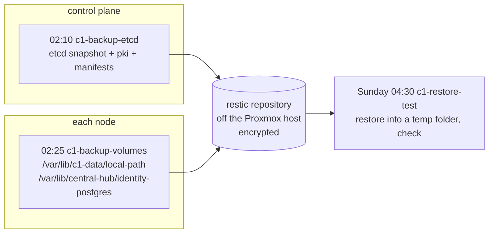
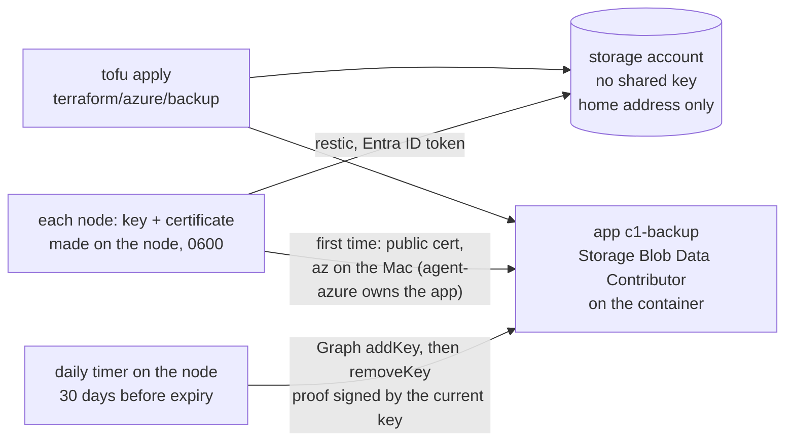

# Back up c1 off the box

Until now the only copy of c1's data is the nightly Proxmox backup on one old HDD in the same PC (TASK-0139). This runbook adds a second copy somewhere else: restic snapshots of etcd and of every volume folder, sent off the Proxmox host each night, and a weekly test that restores them.



Every part is an agent pick ([hosts/AGENT-PICKS.md](../../hosts/AGENT-PICKS.md), picks 144-152, 179-181 for the Azure storage, and 189 for the nodes' sign-in).

## Before you start

- c1 is up: `kubectl get nodes` shows both nodes `Ready`.
- The worker's data disk is mounted: `findmnt /var/lib/c1-data` on the worker shows it ([Storage on c1](../../hosts/ansible/README.md#storage-on-c1)).
- You have a place for the repository that is not the Proxmox host. restic can write to many kinds of target; this role works with any of them, because the target lives only in the env file:

  | Target | `RESTIC_REPOSITORY` | Extra lines in the env file |
  |---|---|---|
  | Azure Blob storage, the owner's pick (2026-10-16), made by [the Azure steps below](#azure-blob-without-a-key) | `azure:c1-backup:/c1` | none: the playbook adds `AZURE_ACCOUNT_NAME` and the nodes' own sign-in lines |
  | Any S3-compatible store | `s3:https://<endpoint>/<bucket>/c1` | `AWS_ACCESS_KEY_ID`, `AWS_SECRET_ACCESS_KEY` |
  | A restic REST server on another machine | `rest:https://<user>:<password>@<host>:8000/c1` | none |
  | An SFTP account on another machine | `sftp:<user>@<host>:/srv/restic/c1` | none (an SSH key for root on each node) |

  (restic's docs, "Preparing a new repository": <https://restic.readthedocs.io/en/stable/030_preparing_a_new_repo.html>)

Stop if c1 is not up. Without a target you can still run step 2 with `k8s_backup_enabled: false`: it installs the tools and nothing runs.

## Azure Blob without a key

The owner wants no raw key that a person or an agent can read (2026-11-08 23:42 UTC), and no agent doing a job a timer should do (2026-11-09 06:50 UTC). So the storage account refuses its own keys (shared key access off) and answers only the home's public address. The nodes sign in to Entra ID as the backup's own app registration, `c1-backup`, with a certificate. Each node makes its key itself, and the key never leaves the node. The playbook uploads the node's public certificate once. After that a daily timer on the node rolls the certificate before it expires, through Microsoft Graph, with no person, agent or stored Azure secret involved.



A1. (Agent, on the Mac) Make the storage and the app:

   ```sh
   cd hosts/terraform/azure/backup
   cp azure.tfvars.example azure.tfvars && chmod 600 azure.tfvars   # git-ignored
   # in azure.tfvars: location, a free storage_account_name, and the home's public address:
   curl -s https://api.ipify.org; echo
   export ARM_SUBSCRIPTION_ID="$(az account show --query id -o tsv)"   # az is signed in as agent-azure
   tofu init -backend-config="path=$HOME/.local/state/central-hub/azure-backup.tfstate"
   tofu plan -var-file=azure.tfvars -out=backup.tfplan
   tofu apply backup.tfplan
   tofu output
   ```

   why: everything about the account and the app is code, so a rebuild makes it the same way. All of it is management-plane work, which the network rule doesn't block, and the state holds no secret: no account key is read, and the app's certificates are not in tofu.
   ※ [hosts/terraform/README.md](../../hosts/terraform/README.md); azurerm `azurerm_storage_account` 5.11.0, "shared_access_key_enabled" and "network_rules"; azuread 3.10.0, `azuread_application`
   expect: outputs `storage_account_name`, `restic_repository` (`azure:c1-backup:/c1`), `storage_account_id`, `client_id`, `app_object_id` and `tenant_id`. The plan for a folder applied before 2026-11-09's change also destroys `azurerm_role_assignment.sas_signer`. That ends the old SAS on the nodes at once, so run step A3 straight after.

A2. Nothing to do by hand, but two grants make step A1 work:

   First, `agent-azure` holds Owner on the subscription, so it can give the app its role (the owner, 2026-11-09 03:33 UTC). Agents make nothing else billable there without the owner's yes. An app registration costs nothing.

   Second, `agent-azure` holds the Microsoft Graph application permission `Application.ReadWrite.OwnedBy`, with admin consent (the owner, 2026-11-09 07:09 UTC). It can make apps and change only the apps it owns. tofu makes it the one owner of `c1-backup`, so it can upload a node's first certificate.

   why: a node can roll its own certificate with no permission at all, but only while one of its certificates is still valid. The first one, and one after a long outage, must come from the app's owner.
   ※ Microsoft Graph, "application: addKey" (<https://learn.microsoft.com/graph/api/application-addkey>): "An application doesn't need any specific permission to roll its own keys."
   expect: `az ad app permission list --id <agent-azure appId>` lists `18a4783c-866b-4cc7-a460-3d5e5662c884` (`Application.ReadWrite.OwnedBy`).

A3. In step 1, leave out the `AZURE_` lines: the env file holds only `RESTIC_REPOSITORY=azure:c1-backup:/c1` and `RESTIC_PASSWORD`. In step 2, also set these in the private inventory, from `tofu output`:

   ```yaml
   k8s_backup_azure_identity: true
   k8s_backup_azure_account: <storage_account_name>
   k8s_backup_azure_client_id: <client_id>
   k8s_backup_azure_tenant_id: <tenant_id>
   k8s_backup_azure_app_object_id: <app_object_id>
   ```

   Run the playbook from the home network, since the account answers only that address. Then run step 3's drill.
   why: the `timers` tag makes each node's key and certificate (`/etc/central-hub/azure/backup.pem`, 0600), uploads the public certificate with `az ad app credential reset --append` when Entra ID doesn't know it yet, waits until Entra ID takes it, and removes the app's expired certificates. It writes `AZURE_CLIENT_ID`, `AZURE_TENANT_ID` and `AZURE_CLIENT_CERTIFICATE_PATH` into the node env file, which restic's Azure sign-in reads.
   ※ restic 0.19.1, `internal/backend/azure/azure.go`: with no account key or SAS it signs in through azidentity's default credential chain, whose first link reads those three variables.
   expect: the drill passes; `systemctl list-timers c1-backup-azure-cert` on each node shows the daily check; the node env file has no `AZURE_ACCOUNT_SAS`.

A4. Nothing runs by hand after that. Each certificate lasts 90 days. Every day at 01:40 `c1-backup-azure-cert.timer` checks it, and with 30 or fewer days left it makes a new key and certificate, adds it to the app with Graph `addKey`, waits until Entra ID takes it, switches the file, and removes the old one with `removeKey`. A failure leaves the current certificate in use and fails the unit, so `systemctl --failed` on the node shows it. The next day's run tries again. Check it with:

   ```sh
   sudo /usr/local/libexec/central-hub-backup/c1-backup-azure-cert.py check
   journalctl -u c1-backup-azure-cert --since -3d --no-pager
   ```

   expect: `ok: Entra ID accepts certificate <thumbprint>, N days left`.

## Steps

1. On the controller, make the env file once, mode 0600, outside the repository:

   ```sh
   mkdir -p ~/.config/central-hub
   (umask 077; cat > ~/.config/central-hub/c1-backup.env <<EOF
   RESTIC_REPOSITORY=azure:c1-backup:/c1
   RESTIC_PASSWORD=$(head -c 32 /dev/urandom | base64)
   EOF
   )
   ```

   For a target other than Azure, add its lines from the table above.
   why: the repository's address and password are private, so they never go in git. The password encrypts every snapshot; without it the backups can't be read, so keep a copy of this file somewhere other than the Mac.
   ※ CLAUDE.md rule 4; restic encrypts everything it writes with a key derived from the password (restic's docs, "Design")
   expect: `ls -l ~/.config/central-hub/c1-backup.env` shows `-rw-------`.

2. In the private inventory, set `k8s_backup_enabled: true` and `k8s_backup_env_file: ~/.config/central-hub/c1-backup.env`. Then, from `hosts/ansible`:

   ```sh
   ansible-playbook -i inventories/home/ playbooks/k8s-backup.yml --check --diff
   ansible-playbook -i inventories/home/ playbooks/k8s-backup.yml
   ```

   why: the role puts restic 0.19.1 on every node and etcd 3.7.2's `etcdctl`, `etcdutl` and `etcd` on the control plane, each checked against its SHA-256, in `/usr/local/libexec/central-hub-backup` (off the `PATH`). It copies the env file to `/etc/central-hub/backup.env` (0600) and turns on three timers.
   ※ [hosts/ansible/README.md, "Backups of c1"](../../hosts/ansible/README.md#backups-of-c1)
   Step 2 also makes the restic repository, once, from one node, if it isn't there yet. Two nodes making it at the same time leave a repository that can't be read (seen on c1, 2026-11-09).
   expect: `systemctl list-timers 'c1-*'` on the control plane lists `c1-backup-etcd`, `c1-backup-volumes` and `c1-restore-test`; on the worker, the last two.

3. Run a backup and the restore tests now, instead of waiting for the night:

   ```sh
   ansible-playbook -i inventories/home/ playbooks/k8s-backup.yml --tags drill -e k8s_backup_drill=true
   ```

   why: a backup counts only once a restore of it has worked. The drill starts the same services the timers start, one node at a time, so it tests what runs every night.
   ※ [Test the etcd restore](test-etcd-restore.md)
   expect: the last task shows `PASS: etcd restore test, revision …` on the control plane and `PASS: volume restore test, N folders` on the worker. The control plane has no volume folders, so its volume test says `nothing to test`.

4. Look at the repository from the control plane:

   ```sh
   sudo bash -c 'set -a; . /etc/central-hub/backup.env; /usr/local/libexec/central-hub-backup/restic snapshots'
   ```

   expect: one snapshot tagged `etcd,c1` from the control plane and one tagged `volumes,c1` from the worker.

## Restore a volume

The restore test never writes over a volume. To bring one back for real:

1. Stop the app that uses it: `kubectl -n <namespace> scale deploy/<name> --replicas=0` (or the StatefulSet).
2. On the node that holds it, find the folder: `kubectl get pv <pv> -o jsonpath='{.spec.hostPath.path}{.spec.local.path}'`.
3. Move the broken folder aside, then restore it from the newest snapshot of this node, into place:

   ```sh
   sudo mv <folder> <folder>.broken
   sudo bash -c 'set -a; . /etc/central-hub/backup.env; /usr/local/libexec/central-hub-backup/restic restore latest \
     --host "$(hostname -s)" --tag volumes --include <folder> --target /'
   ```

   Snapshots keep each folder's full path, so `--target /` puts it back where it was. Pick an older snapshot by its ID from `restic snapshots` instead of `latest`. Delete `<folder>.broken` once the app works.

   If restic exits 1 saying it can't set `security.selinux`, the files are back but some SELinux labels are not. Copy the labels from the folder you moved aside, so the app can read them as before:

   ```sh
   sudo chcon -R --reference=<folder>.broken <folder>
   ls -Zd <folder> <folder>.broken
   ```

   expect: both lines show the same label. The weekly restore test leaves the labels out on purpose (`--exclude-xattr security.selinux`), because SELinux refuses them in its temporary folder (c1's worker, 2026-11-09).
4. Scale the app back up.

why: each volume is a plain folder on one node ([Storage on c1](../../hosts/ansible/README.md#storage-on-c1)), so restoring the folder is restoring the volume. The copy was taken while the app ran: for PostgreSQL that is like a power cut, and it replays its log on start.

## If it fails

- **The env file check stops the run:** the file is missing, empty, or readable by others. Fix it on the controller; nothing on the nodes was changed.
- **A backup fails at night:** `journalctl -u c1-backup-etcd -u c1-backup-volumes --since yesterday` on the node. The timers retry the next night; `Persistent=true` runs a missed one at boot.
- **`AuthorizationFailure` or 403 from Azure:** the home's public address changed (set the new one in `azure.tfvars` and apply step A1 again), or the app's role from step A1 is missing or not yet in effect (role assignments can take a few minutes).
- **`AADSTS700027` or no token:** Entra ID doesn't know the node's certificate, usually because it expired while the node was off for more than 60 days. Run step 2 with `--tags timers`: it uploads the node's certificate again. Look at `journalctl -u c1-backup-azure-cert` for why the roll failed.
- **`ciphertext verification failed`** on every restic command: the repository holds keys from two `restic init` runs. If it holds no backup you need, tell the owner, delete the `c1/` folder in the container, and run step 2 again to make it once.
- **The repository is locked** (a run was cut off): `restic unlock` with the env file loaded, as in step 4.
- **The way back:** set `k8s_backup_enabled: false` and run step 2 again. The timers stop and the env file is removed from the nodes; the tools stay, and the repository and its snapshots are untouched.
- Tell the owner before deleting snapshots or the repository.

## Afterwards

- Set `last-tested` here, with the date, who ran it and on what.
- Close TASK-0194 once step 3 passes on c1 (done 2026-11-09).
- A revisit of Azure Arc or workload identity federation for the nodes' sign-in is backlogged (TASK-0223, agent notebook).

## Related

- [Test the etcd restore](test-etcd-restore.md): the etcd half, and how a real etcd restore goes.
- [Set up a Proxmox VE host, step 9](set-up-proxmox-host.md): the nightly whole-VM backups on the HDD, which this does not replace.
- [Build a kubeadm cluster, step 11](build-kubeadm-cluster.md#11-backup-and-restore): the manual etcd backup and restore this automates.
