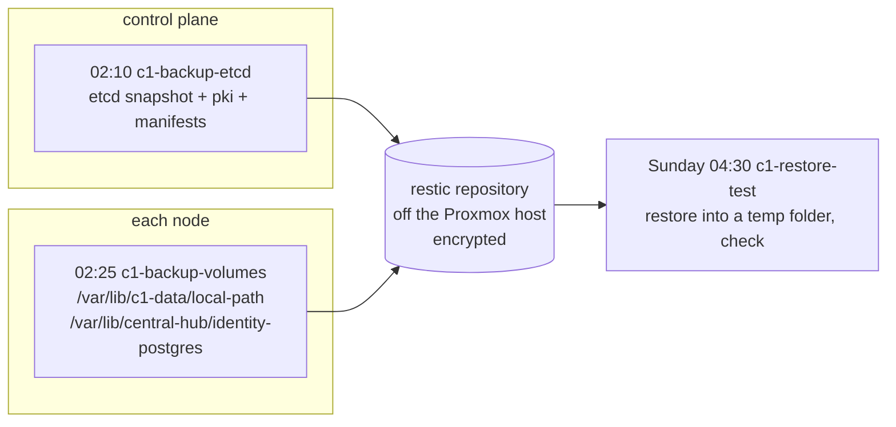
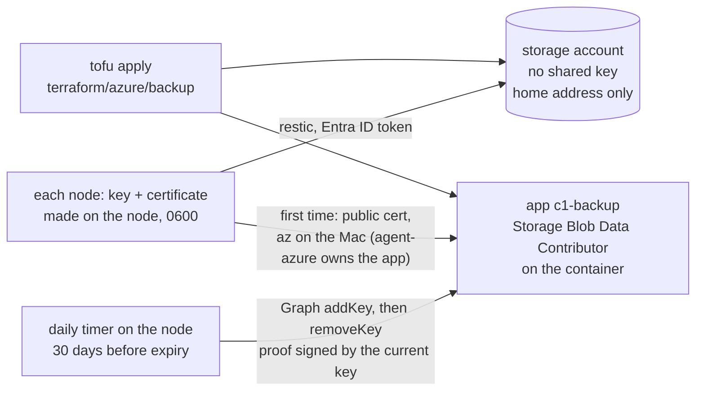
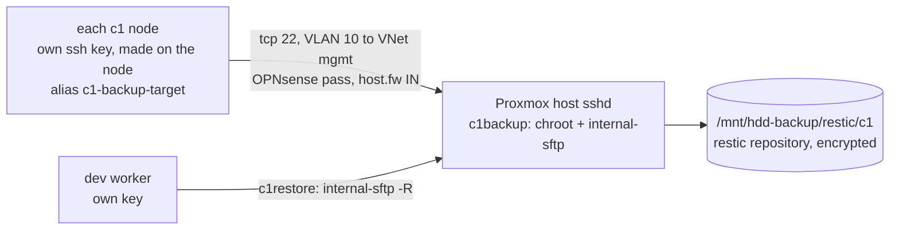

# Back up c1 off the box

Until now the only copy of c1's data is the nightly Proxmox backup on one old HDD in the same PC (TASK-0139). This runbook adds a second copy: restic snapshots of etcd and of every volume folder, sent off the Proxmox host each night, and a weekly test that restores them.



Every part is an agent pick ([hosts/AGENT-PICKS.md](../../hosts/AGENT-PICKS.md), picks 144-152, 179-181 for the Azure storage, 189 and 193 for the nodes' sign-in, and 190 and 192 for the database dumps).

## Before you start

- c1 is up: `kubectl get nodes` shows both nodes `Ready`.
- The worker's data disk is mounted: `findmnt /var/lib/c1-data` on the worker shows it ([Storage on c1](../../hosts/ansible/README.md#storage-on-c1)).
- You have a place for the repository. The owner's words of 2026-11-18 07:44 UTC put it on the Proxmox host for now ("just ... back on the proxmox for now"), on the backup HDD, through [The Proxmox host](#the-proxmox-host) below. That copy shares the PC with the data it protects, so a lost PC loses both: it is a second, file-level copy, not an off-site one. Azure Blob is parked, and its steps stay below, off. restic can write to many kinds of target; this role works with any of them, because the target lives only in the env file:

  | Target | `RESTIC_REPOSITORY` | Extra lines in the env file |
  |---|---|---|
  | The Proxmox host's backup HDD, the owner's words of 2026-11-18 (below) | none: the playbook adds `sftp:c1-backup-target:/c1` | none: each node makes its own ssh key |
  | Azure Blob storage, the owner's pick (2026-10-16), parked on 2026-11-18, made by [the Azure steps below](#azure-blob-without-a-key) | `azure:c1-backup:/c1` | none: the playbook adds `AZURE_ACCOUNT_NAME` and the nodes' own sign-in lines |
  | Any S3-compatible store | `s3:https://<endpoint>/<bucket>/c1` | `AWS_ACCESS_KEY_ID`, `AWS_SECRET_ACCESS_KEY` |
  | A restic REST server on another machine | `rest:https://<user>:<password>@<host>:8000/c1` | none |
  | An SFTP account on another machine | `sftp:<user>@<host>:/srv/restic/c1` | none (an SSH key for root on each node) |

  (restic's docs, "Preparing a new repository": <https://restic.readthedocs.io/en/stable/030_preparing_a_new_repo.html>)

Stop if c1 is not up. Without a target you can still run step 2 with `k8s_backup_enabled: false`: it installs the tools and nothing runs.

## Azure Blob without a key

The owner wants no raw key that a person or an agent can read (2026-11-08 23:42 UTC), and no agent doing a job a timer should do (2026-11-09 06:50 UTC). So the storage account refuses its own keys (shared key access off) and answers only the home's public address. The nodes sign in to Entra ID as the backup's own app registration, `c1-backup`, with a certificate. Each node makes its key itself, and the key never leaves the node. The playbook uploads the node's public certificate once. After that a daily timer on the node rolls the certificate before it expires, through Microsoft Graph, with no person, agent or stored Azure secret involved.



A1. (Agent, on the Mac) Make the storage and the app:

   ```sh
   cd hosts/terraform/azure/backup
   cp azure.tfvars.example azure.tfvars && chmod 600 azure.tfvars   # git-ignored
   # in azure.tfvars: location, a free storage_account_name, and the home's public address:
   curl -s https://api.ipify.org; echo
   export ARM_SUBSCRIPTION_ID="$(az account show --query id -o tsv)"   # az is signed in as agent-azure
   tofu init -backend-config="path=$HOME/.local/state/central-hub/azure-backup.tfstate"
   tofu plan -var-file=azure.tfvars -out=backup.tfplan
   tofu apply backup.tfplan
   tofu output
   ```

   why: everything about the account and the app is code, so a rebuild makes it the same way. All of it is management-plane work, which the network rule doesn't block, and the state holds no secret: no account key is read, and the app's certificates are not in tofu.
   ※ [hosts/terraform/README.md](../../hosts/terraform/README.md); azurerm `azurerm_storage_account` 5.11.0, "shared_access_key_enabled" and "network_rules"; azuread 3.10.0, `azuread_application`
   expect: outputs `storage_account_name`, `restic_repository` (`azure:c1-backup:/c1`), `storage_account_id`, `client_id`, `app_object_id`, `tenant_id`, and `reader_client_id` and `reader_app_object_id` for dev's read-only app ([below](#dev-reads-a-copy)), and the three `opnsense_` outputs for the agent box's OPNsense copies, in their own container ([Copy the OPNsense configuration backups off the agent box](copy-opnsense-backup-off-box.md)). The plan for a folder applied before 2026-11-09's change also destroys `azurerm_role_assignment.sas_signer`. That ends the old SAS on the nodes at once, so run step A3 straight after.

A2. Nothing to do by hand, but two grants make step A1 work:

   First, `agent-azure` holds Owner on the subscription, so it can give the app its role (the owner, 2026-11-09 03:33 UTC). Agents make nothing else billable there without the owner's yes. An app registration costs nothing.

   Second, `agent-azure` holds the Microsoft Graph application permission `Application.ReadWrite.OwnedBy`, with admin consent (the owner, 2026-11-09 07:09 UTC). It can make apps and change only the apps it owns. tofu makes it the one owner of `c1-backup`, so it can upload a node's first certificate.

   why: a node can roll its own certificate with no permission at all, but only while one of its certificates is still valid. The first one, and one after a long outage, must come from the app's owner.
   ※ Microsoft Graph, "application: addKey" (<https://learn.microsoft.com/graph/api/application-addkey>): "An application doesn't need any specific permission to roll its own keys."
   expect: `az ad app permission list --id <agent-azure appId>` lists `18a4783c-866b-4cc7-a460-3d5e5662c884` (`Application.ReadWrite.OwnedBy`).

A3. In step 1, leave out the `AZURE_` lines: the env file holds only `RESTIC_REPOSITORY=azure:c1-backup:/c1` and `RESTIC_PASSWORD`. In step 2, also set these in the private inventory, from `tofu output`:

   ```yaml
   k8s_backup_azure_identity: true
   k8s_backup_azure_account: <storage_account_name>
   k8s_backup_azure_client_id: <client_id>
   k8s_backup_azure_tenant_id: <tenant_id>
   k8s_backup_azure_app_object_id: <app_object_id>
   ```

   Run the playbook from the home network, since the account answers only that address. Then run step 3's drill.
   why: the `timers` tag makes each node's key and certificate (`/etc/central-hub/azure/backup.pem`, 0600), uploads the public certificate with `az ad app credential reset --append` when Entra ID doesn't know it yet, one node at a time, and waits until Entra ID lists it. After every node's upload it removes each certificate on the app that no node holds, but only when the run covers every node in `k8s_nodes` (agent pick 193). It writes `AZURE_CLIENT_ID`, `AZURE_TENANT_ID` and `AZURE_CLIENT_CERTIFICATE_PATH` into the node env file, which restic's Azure sign-in reads.
   ※ restic 0.19.1, `internal/backend/azure/azure.go`: with no account key or SAS it signs in through azidentity's default credential chain, whose first link reads those three variables.
   expect: the drill passes; `systemctl list-timers c1-backup-azure-cert` on each node shows the daily check; the node env file has no `AZURE_ACCOUNT_SAS`.

### A rebuilt node keeps its certificate

When the agent box rebuilds prod ([Rebuild prod from the box](rebuild-k8s-layer-with-one-command.md#rebuild-prod-from-the-box)), it copies each node's `backup.pem` and `backup.pem.keyid` into its keys folder before the teardown and sets `k8s_backup_azure_seed_dir` to that folder. The `timers` tag then gives each rebuilt node its earlier certificate back (`tasks/azure_seeded_cert.yml`; a node that already has one keeps it), checks that Entra ID still accepts it, and stops if not. Nothing is uploaded to or removed from the app, so the box needs no Azure sign-in: the node's own daily roll (Graph `addKey`, proved by the current key) goes on as before. The restore stage, with backups off, reads the snapshot with the same carried certificate. A certificate Entra ID no longer knows needs a `timers` run from a controller with the Azure CLI and `k8s_backup_azure_seed_dir` empty.

### Dev reads a copy

The same folder also makes `c1-backup-reader`, a second app registration with Storage Blob Data Reader on the container only (agent pick 205). Dev's worker signs in as it, with its own certificate made and uploaded the same way, and restores prod's newest volume snapshot at each dev rebuild, with `restic --no-lock`. It can list and read blobs and can't write or delete any. The steps are in [Rebuild one cluster's Kubernetes layer with one command, "Restore on dev"](rebuild-k8s-layer-with-one-command.md#restore-on-dev). Dev runs no timer, so its certificate isn't rolled: each rebuild makes a new node, which uploads a new certificate and removes the ones no dev worker holds.

A4. Nothing runs by hand after that. Each certificate lasts 90 days. Every day at 01:40 `c1-backup-azure-cert.timer` checks it, and with 30 or fewer days left it makes a new key and certificate, adds it to the app with Graph `addKey`, waits until Entra ID accepts it four times in a row, switches the file, and removes the old one with `removeKey`, trying again for up to 15 minutes. If the old one can't be removed in that time, the unit logs a `WARN` and the next full `timers` run removes it (agent pick 193). A failure leaves the current certificate in use and fails the unit, so `systemctl --failed` on the node shows it. The next day's run tries again. Check it with:

   ```sh
   sudo /usr/local/libexec/central-hub-backup/c1-backup-azure-cert.py check
   journalctl -u c1-backup-azure-cert --since -3d --no-pager
   ```

   expect: `ok: Entra ID accepts certificate <thumbprint>, N days left`.

## The Proxmox host

The repository sits on the Proxmox host's backup HDD, at `/mnt/hdd-backup/restic/c1`, served by the host's own OpenSSH (agent pick 262). Nothing new is installed on the host. The nodes sign in as `c1backup`, which gets nothing but `internal-sftp` inside `/mnt/hdd-backup/restic`: no shell, no forwarding, no tty, key only, and each key only from its own node's address. Root can't sign in from those addresses at all. Dev reads as `c1restore`, whose `internal-sftp -R` refuses every write, the way the Azure reader app can't write.



`playbooks/k8s-backup.yml` does all of it in one run when `k8s_backup_sftp` is true: play 1 makes each node's key (`/etc/central-hub/backup-ssh/id_ed25519`, 0600), play 2 runs role `proxmox_restic_sftp` on the host with those public keys, play 3 is the usual backup role, which writes the ssh alias (`/etc/ssh/ssh_config.d/40-central-hub-backup.conf`, the host's key pinned) and adds `RESTIC_REPOSITORY=sftp:c1-backup-target:/c1` last in the node env file, and play 4 makes the repository readable by the reader's group. The host role stops if nothing is mounted at `/mnt/hdd-backup`, so a missing disk never fills the host's root disk.

why: rest-server would add append-only mode, but it needs a binary on the host from a release this lane could not download or check (2026-11-18), and sftp needs only what the host has. The cost: a node can delete snapshots, as the Azure Contributor role allows today.
※ sshd_config(5), `ChrootDirectory`, `ForceCommand`, the keywords allowed in `Match`; sftp-server(8), `-R` and `-u`; restic's docs, "SFTP" (<https://restic.readthedocs.io/en/stable/030_preparing_a_new_repo.html#sftp>); restic 0.14.0 changelog, "Support for group-accessible repositories"; CI's `test_backup_sftp.sh` proves each point against a real sshd and restic.

P1. Firewall. The nodes are on VLAN 10 and the host's address is on VNet mgmt, and today OPNsense passes VLAN 10 only ping and DNS to the firewall, and the internet (`opnsense_lab` `tasks/rules.yml`). Two rules open tcp 22 from the two nodes to the host, and nothing else. Both are firewall changes, so applying them waits on the owner's go: his typed words naming this step and the commit, or a tap on an option the agents did not recommend (D-0036 rule 8, D-0034 rule 9). In the private inventory:

   ```yaml
   # opnsense_fw (playbooks/opnsense.yml, tags rules):
   opnsense_lab_backup_target:
     vlan: 10
     host: <proxmox_host_mgmt_address>
     sources:
       - { name: prod node 200, address: <VM 200's address> }
       - { name: prod node 201, address: <VM 201's address> }
       # P3, dev's read-only restore: a source may name its own VLAN (sequence 17):
       # - { name: dev worker, address: <dev worker's address>, vlan: 30 }
   # proxmox_host (playbooks/proxmox-safety.yml), only if proxmox_firewall_enable is true:
   proxmox_firewall_extra_rules:
     - { action: ACCEPT, source: "<VM 200's address>,<VM 201's address>", proto: tcp, dport: "22", comment: "restic sftp from the c1 nodes" }
   ```

   ```sh
   ansible-playbook -i inventories/home/ playbooks/opnsense.yml --tags backup_target --check --diff
   ansible-playbook -i inventories/home/ playbooks/opnsense.yml --tags backup_target
   ```

   expect: two rules on the VLAN 10 interface, "Allow prod node 200 to Proxmox backup SSH" and the same for 201, at sequences 13 and 14, each from one node's /32 to the host's /32 on tcp 22. Then from each node, `timeout 5 bash -c '</dev/tcp/<host's mgmt address>/22' && echo open` prints `open`.

P2. In step 1, the env file needs only `RESTIC_PASSWORD`; a `RESTIC_REPOSITORY` line there is overruled by the one the playbook adds. In step 2, set in the private inventory `k8s_backup_sftp: true` and `k8s_backup_azure_identity: false` (the role refuses both). The host's address comes from `proxmox_host_mgmt_address`, which the inventory already holds. Run step 2 over every node, never with `--limit`: the host's list of keys is the nodes the run reached, and play 2 stops a run that reached only some. The first `--check` run makes no node key, so it shows no change to the host's users or sshd; play 2 still reads the host's ssh key, so the nodes' alias tasks are checked (`.github/hosts-check/tests/test_backup_sftp.sh`, section 6). With the Azure sign-in off, step 2 also stops and disables `c1-backup-azure-cert.timer` on a node where an earlier run left it, and keeps its unit files (section 7).
   expect: play 2 ends with `sshd applies the chroot and internal-sftp to the writer` ok; play 3's `The alias reaches the host and gets sftp only` ok on both nodes; then step 3's drill passes as before.

P3. Dev can't restore from here yet. The plays in `playbooks/k8s-restore.yml` give dev's worker its own read-only login (`k8s_backup_sftp: true` in dev's inventory), but until a source named `dev worker` is in `opnsense_lab_backup_target` (with `vlan: 30`, the example in P1; the role takes a VLAN per source since 2026-11-20), tcp 22 is open only from the two prod nodes on VLAN 10, so dev's worker has no route to the host. That rule is a firewall apply (`opnsense_lab` tag `backup_target`). Until then dev restores from Azure as before. The host's side of that login runs from the agent box: host job `restore-reader` (`playbooks/proxmox-restic-reader.yml`) writes the reader user's keys file from the list `agent_box_proxmox_host_restic_reader` in the controller's private inventory (one `{key, from}` per dev worker; the key is public, the address is private). Check, pass and go work as for the other host jobs (`proxmox-host.sh check|apply-recorded restore-reader`). The job writes only the read-only user's keys and the sshd drop-in; it grants no write, no shell and no root. To undo it, remove the worker's entry from the list and run the job again, so the keys file no longer holds its key. An empty list makes the job refuse to run, so removing the last entry means writing the keys file empty by hand from the Mac.

P3a. Where the dev worker's address comes from (written, not yet run on the box). Nobody types it. Dev's addresses are fixed by the inventory: the k8s module gives each VM a static cloud-init address (`hosts/terraform/home/k8s/main.tf`, `ip_config`, `address = each.value.address`), and the box's rebuild wrapper refuses an inventory host whose address is not one of those in dev's `dev-vms.tfvars`. So the rule follows the inventory, not the VMs. The wrapper (`rebuild.sh`, as the keys user) holds that inventory, which the firewall job (guardops) and the host job (hostops) cannot read. Each time it has parsed and checked the inventory, it runs `dev-worker-address.sh write`, which puts the worker's one address in `/var/lib/agent-box-handoff/dev-worker-address` (one line, mode 0640, owner keys, group `devaddr`, written to a temp file and moved into place). A teardown keeps the file. A refusal (not exactly one `k8s_workers` host, or an address that is not one dev node address) removes it. The firewall job (`opnsense-prod.sh`) and the host job (`proxmox-host.sh`, job `restore-reader`) run `dev-worker-address.sh read` as users in group `devaddr`. It prints the address to the wrapper only, and stops, naming no value, unless the file is exactly one IPv4 address of the dev VLAN's node range (10.1.30.1 to .223, standard 0002). The firewall job passes it to the playbook in its vars file as `opnsense_lab_backup_target_extra_sources` (one source named `dev worker`, VLAN 30); the host job passes it as `proxmox_restic_reader_from`, which the playbook makes the `from` of every reader key (and so of the role's `no_root_from`), over any `from` in the inventory's list. A `dev worker` source already in the firewall inventory is replaced by it, so the box's address wins. No file: the firewall job adds no rule and removes the dev worker's rule, and `restore-reader` stops. The address, and so the firewall check's one change, moves only when dev's inventory changes.
    The worker's own key and the host's pinned key (written, not yet run on the box). Dev has no node to carry a key off, so `rebuild.sh` runs `dev-worker-address.sh key` as the keys user: it makes one ed25519 pair for the worker once, in `<keys>/dev/backup-sftp/<worker>.key` and `.pub` (never over an existing pair), and puts the public half, with no comment, in `/var/lib/agent-box-handoff/dev-worker-backup.pub` (keys:devaddr, 0640). The host job reads it with `read-key` and passes it as `proxmox_restic_reader_key`, which the playbook makes the reader's one key (over the inventory's list), with the handoff address as its `from`. The host's pinned key comes from the host job itself: each run of `proxmox-host.sh` writes the public host key it already trusts (two fields) to `/var/lib/agent-box-hostkey/proxmox-host.pub` (hostops:devaddr, 2750 folder, setgid), and `key` turns that into `<worker>.known_hosts` (`c1-backup-target <type> <key>`) beside the pair. `rebuild.sh` sets `k8s_backup_sftp_seed_dir` to that folder in the box's dev inventory, and `k8s_backup_sftp_seed_address` to the host's address, read as `rebuild-prod.sh` reads it (`proxmox_host_mgmt_address` on the proxmox group of the dev inventory, else of the prod copy); a value that is not an IP address stops the build. Turning dev's restore to this target is still the inventory's `k8s_backup_sftp: true` with `k8s_backup_azure_identity: false`.
    Where the address comes from (the command proves it without printing an address): `grep -n 'address = "\${each.value.address}/24"' hosts/terraform/home/k8s/main.tf` finds the static `ip_config`, and `grep -c 'is not a dev node address; refusing' hosts/ansible/roles/agent_box/files/rebuild.sh` prints 1, the refusal of any inventory host outside `dev-vms.tfvars`.
    Check: `sudo -n -u guardops /usr/local/libexec/agent-box/opnsense-prod.sh check` shows exactly 1 changed task (the dev worker's rule) with the file there, and 0 changed without it.
    expect: with the file written by a dev run, the check names one changed task and the apply opens tcp 22 from the dev worker only; after `rebuild teardown` the file is still there and the next check shows no change.

P4. A prod rebuild from the agent box with the host as target (2026-11-20, written, not yet run on the box). The box's inventory copy has no `proxmox` group, so the host plays can't run from it and a new node key could not be let in. Instead `rebuild-prod.sh` carries each node's own key pair and its pinned host key off the node before the teardown (step 1a, into `<keys>/prod/backup-sftp/`, never printed; the private halves are an access right under D-0042 rule 6, covered by the standing go of D-0061, and are deleted from the box when the run passes, kept only after a failed run so it can resume), and role `k8s_backup` puts the pair back on the rebuilt node (`sftp_key.yml`, never over an existing key). The host already lets that public key in, so nothing changes on the host. The host's address is read from the box's copy of the prod inventory, `prod/inventory-hosts.yml` (`proxmox_host_mgmt_address`) before the group is dropped and passed as `k8s_backup_sftp_seed_address`; the alias pins the host key from the carried `known_hosts`. The restore drill reads as `c1backup` in this mode, since that is the user the carried key is let in as. To prove the alias play before a rebuild: `sudo -n -u keys /usr/local/libexec/agent-box/c1-ansible.sh check backup-check` (check mode only; it takes no backup; apply is refused; with no rebuild to carry anything, it reads only each live node's pinned host key, which is public, into its own folder, and prints whether the host address was found in the box's inventory copy). CI: `test_sftp_key_carry.sh`.

The way back: `k8s_backup_sftp: false` and `k8s_backup_azure_identity: true`, then step 2. The host's users, keys and repository stay until removed by hand, which is a delete and waits on the owner's go.

## Steps

1. On the controller, make the env file once, mode 0600, outside the repository:

   ```sh
   mkdir -p ~/.config/central-hub
   (umask 077; cat > ~/.config/central-hub/c1-backup.env <<EOF
   RESTIC_REPOSITORY=azure:c1-backup:/c1
   RESTIC_PASSWORD=$(head -c 32 /dev/urandom | base64)
   EOF
   )
   ```

   For a target other than Azure, add its lines from the table above.
   why: the repository's address and password are private, so they never go in git. The password encrypts every snapshot; without it the backups can't be read, so keep a copy of this file somewhere other than the Mac.
   ※ CLAUDE.md rule 4; restic encrypts everything it writes with a key derived from the password (restic's docs, "Design")
   expect: `ls -l ~/.config/central-hub/c1-backup.env` shows `-rw-------`.

2. In the private inventory, set `k8s_backup_enabled: true` and `k8s_backup_env_file: ~/.config/central-hub/c1-backup.env`. Then, from `hosts/ansible`:

   ```sh
   ansible-playbook -i inventories/home/ playbooks/k8s-backup.yml --check --diff
   ansible-playbook -i inventories/home/ playbooks/k8s-backup.yml
   ```

   why: the role puts restic 0.19.1 on every node and etcd 3.7.2's `etcdctl`, `etcdutl` and `etcd` on the control plane, each checked against its SHA-256, in `/usr/local/libexec/central-hub-backup` (off the `PATH`). It copies the env file to `/etc/central-hub/backup.env` (0600) and turns on three timers.
   ※ [hosts/ansible/README.md, "Backups of c1"](../../hosts/ansible/README.md#backups-of-c1)
   Step 2 also makes the restic repository, once, from one node, if it isn't there yet. Two nodes making it at the same time leave a repository that can't be read (seen on c1, 2026-11-09).
   expect: `systemctl list-timers 'c1-*'` on the control plane lists `c1-backup-etcd`, `c1-backup-volumes` and `c1-restore-test`; on the worker, the last two.

3. Run a backup and the restore tests now, instead of waiting for the night:

   ```sh
   ansible-playbook -i inventories/home/ playbooks/k8s-backup.yml --tags drill -e k8s_backup_drill=true
   ```

   why: a backup counts only once a restore of it has worked. The drill starts the same services the timers start, one node at a time, so it tests what runs every night.
   ※ [Test the etcd restore](test-etcd-restore.md)
   expect: the last task shows `PASS: etcd restore test, revision …, snapshot <id> of <time>` on the control plane and `PASS: volume restore test, N folders, M database dumps, snapshot <id> of <time>` on the worker. Each test names the snapshot it restored first and restores that one, so the line says which snapshot was proven (the time is the node's clock). The test restores only each folder's canary file and the database dumps, not the whole snapshot, so it never fills the node's OS disk; `restic check` reads a 2% sample of the rest each week. The control plane has no volume folders, so its volume test says `nothing to test`.

4. Look at the repository from the control plane:

   ```sh
   sudo bash -c 'set -a; . /etc/central-hub/backup.env; /usr/local/libexec/central-hub-backup/restic snapshots'
   ```

   expect: one snapshot tagged `etcd,c1` from the control plane and one tagged `volumes,c1` from the worker.

## Restore a volume

The restore test never writes over a volume. To bring one back for real:

1. Stop the app that uses it: `kubectl -n <namespace> scale deploy/<name> --replicas=0` (or the StatefulSet).
2. On the node that holds it, find the folder: `kubectl get pv <pv> -o jsonpath='{.spec.hostPath.path}{.spec.local.path}'`. On c1 it is `/var/lib/c1-data/local-path/pvc-<uid>_<namespace>_<claim>` (local-path's default names); on a cluster with stable folder names on, such as dev, `/var/lib/c1-data/local-path/<namespace>/<claim>`.
3. Move the broken folder aside, then restore it from the newest snapshot of this node, into place:

   ```sh
   sudo mv <folder> <folder>.broken
   sudo bash -c 'set -a; . /etc/central-hub/backup.env; /usr/local/libexec/central-hub-backup/restic restore latest \
     --host "$(hostname -s)" --tag volumes --include <folder> --target /'
   ```

   Snapshots keep each folder's full path, so `--target /` puts it back where it was. Pick an older snapshot by its ID from `restic snapshots` instead of `latest`. Delete `<folder>.broken` once the app works.

   If restic exits 1 saying it can't set `security.selinux`, the files are back but some SELinux labels are not. Copy the labels from the folder you moved aside, so the app can read them as before:

   ```sh
   sudo chcon -R --reference=<folder>.broken <folder>
   ls -Zd <folder> <folder>.broken
   ```

   expect: both lines show the same label. The weekly restore test leaves the labels out on purpose (`--exclude-xattr security.selinux`), because SELinux refuses them in its temporary folder (c1's worker, 2026-11-09).
4. Scale the app back up.

why: each volume is a plain folder on one node ([Storage on c1](../../hosts/ansible/README.md#storage-on-c1)), so restoring the folder is restoring the volume. The copy was taken while the app ran, which suits apps that keep plain files; a database comes back from its dump instead ([Restore Keycloak's database](#restore-keycloaks-database)).

## Restore Keycloak's database

The copy of `/var/lib/central-hub/identity-postgres` in a snapshot is read file by file while PostgreSQL runs, so it is not a usable backup on its own: PostgreSQL's docs say a file-level copy needs the server stopped or one atomic snapshot (<https://www.postgresql.org/docs/current/backup-file.html>). Each volume backup therefore first dumps every running PostgreSQL container on the node with `pg_dumpall` into `/var/lib/central-hub-backup/db-dumps/<namespace>_<pod>.sql`, in the same snapshot. Restore from that dump:

1. Stop Keycloak through its operator: `kubectl -n identity patch keycloak sso --type merge -p '{"spec":{"instances":0}}'`. Note the old `instances` value first (`kubectl -n identity get keycloak sso -o jsonpath='{.spec.instances}'`).
2. On the node that holds the database, bring the dump back from the newest snapshot into a temporary folder:

   ```sh
   sudo bash -c 'set -a; . /etc/central-hub/backup.env; /usr/local/libexec/central-hub-backup/restic restore latest \
     --host "$(hostname -s)" --tag volumes --include /var/lib/central-hub-backup/db-dumps --target /var/tmp/db-restore'
   ```

3. Load it into the running PostgreSQL. Drop the Keycloak database first, so the dump makes it again:

   ```sh
   kubectl -n identity exec -i sso-postgres-0 -- sh -c 'dropdb -U "$POSTGRES_USER" --if-exists keycloak'
   sudo cat /var/tmp/db-restore/var/lib/central-hub-backup/db-dumps/identity_sso-postgres-0.sql \
     | kubectl -n identity exec -i sso-postgres-0 -- sh -c 'psql -U "$POSTGRES_USER" -d postgres -v ON_ERROR_STOP=0'
   ```

   expect: `psql` ends without `FATAL`. Errors that a role already exists are expected, because `pg_dumpall` includes the roles. It leaves out their passwords (`--no-role-passwords`, agent pick 192), so the database user keeps the password it has now, the one in Keycloak's Secret `sso-db`, even if that changed after the dump. A dump made before pick 192 still holds the old password. If Keycloak can't sign in to its database after loading one, set the password from the Secret again:

   ```sh
   kubectl -n identity exec -i sso-postgres-0 -- sh -c 'psql -U "$POSTGRES_USER" -d postgres -v u="$POSTGRES_USER" -v pw="$POSTGRES_PASSWORD"' <<< "ALTER ROLE :\"u\" PASSWORD :'pw';"
   ```

4. Set `instances` back to its old value, sign in, and delete `/var/tmp/db-restore`.

why: a dump is consistent by itself, so it restores the database whatever was happening on disk at the time (agent pick 190). The weekly restore test checks that each dump came back whole.

## Move Keycloak's database onto the data disk

*Not run yet on any cluster (TASK-0225). Write the result here after the first dev run.*

Keycloak's PostgreSQL sits on a hand-made local volume, the folder `/var/lib/central-hub/identity-postgres` on one worker. Role `k8s_identity` can instead claim StorageClass `local-path`, so the data sits under `/var/lib/c1-data/local-path` beside Prometheus, Loki and Grafana. The switch is `k8s_identity_db_storage` (`static`, the default, or `local-path`). A new cluster takes `local-path` from the first run. A cluster that already holds data needs this move, because a StatefulSet's claim template cannot be edited in place. The data is not lost on the way: the dump of step 1 is the same dump the nightly volume backup takes.

1. Dump now, so the copy is newer than the last night: on the node, `sudo systemctl start c1-backup-volumes.service`, then check `db-dumps/identity_sso-postgres-0.sql` in `/var/lib/central-hub-backup` ends with `PostgreSQL database cluster dump complete`.
2. Stop Keycloak as in [Restore Keycloak's database](#restore-keycloaks-database) step 1 (note `instances`).
3. Delete the old pieces, in this order: `kubectl -n identity delete statefulset sso-postgres`, `kubectl -n identity delete pvc data-sso-postgres-0`, `kubectl delete pv sso-postgres`. The folder `/var/lib/central-hub/identity-postgres` stays on the node (reclaim policy Retain); it is the way back.
4. Set `k8s_identity_db_storage: local-path` in the inventory and run the role with tag `database`. expect: pod `sso-postgres-0` ready, and `kubectl -n identity get pvc` shows `data-sso-postgres-0` bound to class `local-path`.
5. Load the dump as in [Restore Keycloak's database](#restore-keycloaks-database) steps 3 and 4, then sign in.
6. After a night's backup has run and the sign-in still works, delete `/var/lib/central-hub/identity-postgres`. Until then the nightly volume backup still lists it, which is harmless.

**As code:** `playbooks/k8s-identity-db-move.yml` does steps 1 to 5 (and step 2's restore of `instances`) in one run, on prod only. Run plainly it is a rehearsal: it takes a dump, prints its size and the rows of realms, users and clients, and changes nothing. Steps 2 and 3's stop and deletes run only with `-e k8s_identity_move_delete=true`, which is off by default. It checks the rows after the load equal the rows before, keeps the dump on any failure and removes it only after Keycloak is Ready again. It has no name in `c1-ansible` yet: adding one is a box-limit change (a digest pass) and a later pull request; the run itself, with its deletes, is the owner's go.

**Way back:** stop Keycloak, delete the new StatefulSet and claim, set `k8s_identity_db_storage: static`, run the role: the old folder is bound again by name, with its old data.

why: a dump is consistent by itself (agent pick 190), so the move needs no file copy. The gain is small and says so: prod's rebuild already restores from the same dump (`rebuild-k8s-layer-with-one-command.md`), so what changes is one storage path for every database on c1, one folder in the backup list, and no hand-made volume. Steps 3 and 6 delete things, so on prod they wait for the owner's go (D-0042 rule 6; D-0061 once accepted). Prod runs this only as a coded, named `c1-ansible` playbook, which does not exist yet; a dev run comes first.

## Read the backups' state from the agent box

From the box, `sudo -n -u keys /usr/local/libexec/agent-box/c1-ansible.sh check backup-status` runs `playbooks/k8s-backup-status.yml` on each prod node. It only reads: the `c1-*` timers, each backup service's last result, the PASS, FAIL and ERROR lines of the last 3 days from the journal, and `restic snapshots --no-lock` on the repository the env file names (the scheme and path only; never a password). `c1-ansible log` prints the run's lines. A repository of `azure:` means the node still targets Azure; `sftp:c1-backup-target:/c1` means the Proxmox host. Nothing is changed, so it needs no go; adding the name is a box-limit change (a digest pass).

`c1-ansible.sh apply backup-restore-test <clearance id>` starts each node's own `c1-restore-test.service` now (the Sunday timer's unit; `check backup-restore-test` starts nothing). It takes no backup and writes over no volume: it restores into temporary folders under /var/tmp and removes them. The play prints the PASS lines, stops unless every node names the snapshot it restored (`snapshot <id> of <time>`), and stops if a `c1-restore-test-*` folder is left behind. Read the PASS lines carefully: a worker with no volume folders prints `PASS: no volume backups recorded ...; nothing to test`, which proves nothing about volumes.

why: until this name, the box had no path to a node's timers or journal, so "are backups running" could be answered only from the Mac.

## Know when a backup stops

Every backup and restore test that ends well writes its time for Prometheus: `c1_backup_last_success_timestamp_seconds{kind="volumes"}` (and `etcd`, `restore-test-volumes`, `restore-test-etcd`) in `c1-backup-<kind>.prom` in `k8s_backup_metrics_dir` (`/var/lib/node-exporter/textfile`, mode 0755). That is `backup_mark_success` in `c1-backup-lib.sh`. A run that fails writes nothing, so its time grows old. kube-prometheus-stack's node-exporter reads the folder with its textfile collector, through the chart's read-only host root mount at `/host/root`. App `monitoring-extras` then raises:

| Alert | Means |
|---|---|
| C1BackupStale | No good volume or etcd backup from a node for 30 hours (one missed night); critical |
| C1RestoreTestStale | A weekly restore test on a node hasn't passed for 8 days |
| C1BackupNotRecorded | No node reports a good volume or etcd backup at all for 2 hours, so C1BackupStale can't fire |

A node whose folder node-exporter can't read raises the chart's own NodeTextFileCollectorScrapeError.

The panel check prints the hours since the last volume and etcd backups and the days since the last volume restore test ([check-c1-alerts-and-dashboard.md](check-c1-alerts-and-dashboard.md)).

Order, so nothing fires for the wrong reason:

1. Merge the change, then run step 2 with `--tags install,timers`. The role makes the folder and the units pass `BACKUP_METRICS_DIR`.
   expect: `ls -ld /var/lib/node-exporter/textfile` on every node shows the folder, mode `drwxr-xr-x`.
2. After the next night's timers, or a drill (`--tags drill`), each node's folder holds its `.prom` files.
   expect: `cat /var/lib/node-exporter/textfile/c1-backup-volumes.prom` on a node shows the line with tonight's time.
3. One pull request turns it on, in both places that must match (`.github/hosts-check/parity.py`):
   - `prometheus-node-exporter.extraArgs` in `apps/kube-prometheus-stack/values.yaml` and in `k8s_observability_kps_values` (role k8s_observability's `vars/main.yml`): the chart's two `--collector.filesystem` defaults (this list replaces them) plus `--collector.textfile.directory=/host/root/var/lib/node-exporter/textfile`;
   - `backup.metrics: true` in `apps/monitoring-extras/values.yaml`.

   why: node-exporter reports `node_textfile_scrape_error 1` for a folder that isn't there yet, and the chart's NodeTextFileCollectorScrapeError fires on it at once, so the collector waits for step 1. Until step 3 the three alerts and the panel lines are off.

## If it fails

- **The env file check stops the run:** the file is missing, empty, or readable by others. Fix it on the controller; nothing on the nodes was changed.
- **A backup fails at night** (C1BackupStale, or C1RestoreTestStale for the weekly test): `journalctl -u c1-backup-etcd -u c1-backup-volumes -u c1-restore-test --since yesterday` on the node named in the alert. The timers retry the next night; `Persistent=true` runs a missed one at boot.
- **`AuthorizationFailure` or 403 from Azure:** the home's public address changed (set the new one in `azure.tfvars` and apply step A1 again), or the app's role from step A1 is missing or not yet in effect (role assignments can take a few minutes).
- **`AuthorizationPermissionMismatch` on writes while reads work:** network blocks show as `AuthorizationFailure` instead ([403 errors in Blob Storage](https://learn.microsoft.com/troubleshoot/azure/azure-storage/blobs/authentication/storage-troubleshoot-403-errors)). First rule out the simpler causes, read-only, on the Mac:

   1. Confirm the token is the backup app's. Decode only the `appid` and `oid` claims of a storage token that the node gets with its certificate, and compare `appid` with `tofu output -raw client_id`. Dev's reader app (`reader_client_id`) holds Storage Blob Data Reader on the same container (`main.tf`, `azurerm_role_assignment.reader`). It fails exactly this way: reads work and writes fail. If `appid` is the reader's, the node's env file is wrong; fix that, not Azure.
   2. Run a plain `tofu plan -var-file=azure.tfvars` (no `-replace`). If it shows `azurerm_role_assignment.backup` as 1 to add and 0 to destroy, the assignment is gone, and applying that plan is the fix. It is an access right, so it too waits on the owner's go: his typed words naming this command and the commit, or a tap on an option the agents did not recommend (D-0034 rule 9).
   3. Run `az role assignment list --assignee <client_id> --scope <the container's resource ID> --include-inherited`. Expect one Storage Blob Data Contributor at the container scope, with no `condition`.

   If all three hold and the OPNsense off-box copy still writes (it uses the same pattern in the same account: a container-scope role and a certificate sign-in), the fault is c1's one assignment. Replace that assignment and nothing else. The replace deletes and remakes an access right, so it waits on the owner's go: his typed words naming this command and the commit, or a tap on an option the agents did not recommend (D-0034 rule 9). It runs on the Mac, as in step A1, with `az` signed in as agent-azure and the same state file:

   ```sh
   cd hosts/terraform/azure/backup
   tofu init -backend-config="path=$HOME/.local/state/central-hub/azure-backup.tfstate"
   tofu plan -var-file=azure.tfvars -replace=azurerm_role_assignment.backup -out=replace-backup-role.tfplan
   tofu apply replace-backup-role.tfplan
   ```

   expect: the plan says `Plan: 1 to add, 0 to change, 1 to destroy`, and both lines name `azurerm_role_assignment.backup` only. If it names any other resource, stop: the folder has drifted, and that is a separate change. After the apply, the same Contributor role sits on the same container for the same principal, under a new assignment ID. Run one backup by hand on the control-plane node (`systemctl start c1-backup-etcd`) and read `journalctl -u c1-backup-etcd` for a new snapshot. Between the destroy and the add, the nodes can't write, so don't run it while a backup timer is due.
- **Step A1 stops with `403 Insufficient privileges` on `azuread_application.backup`:** `agent-azure` lacks the Graph permission `Application.ReadWrite.OwnedBy`, or its admin consent never took. A fresh Graph token for `agent-azure` then has no `roles` claim. The owner grants it (step A2). The way back to the nodes' old SAS (`keep_sas_signer`, agent pick 182) was removed on 2026-11-16 (pick 247): that SAS reached its hard expiry on 2026-11-16 at 05:04 UTC, so there is nothing left to roll back to.
- **`AADSTS700027` or no token:** Entra ID doesn't know the node's certificate, usually because it expired while the node was off for more than 60 days. Run step 2 with `--tags timers`: it uploads the node's certificate again. Look at `journalctl -u c1-backup-azure-cert` for why the roll failed.
- **`ciphertext verification failed`** on every restic command: the repository holds keys from two `restic init` runs. If it holds no backup you need, tell the owner, delete the `c1/` folder in the container, and run step 2 again to make it once.
- **`could not read the repository (restic exit N), so it was left alone`** (or `restic could not read the repository` from step 2): restic makes a repository only on its exit 10, "repository does not exist" ([restic exit codes](https://restic.readthedocs.io/en/stable/075_scripting.html)). Any other code is a fault at the target, for example a 403 (above), a lock (11, below) or a wrong password (12). Fix that fault; never run `restic init` against a repository that is there.
- **`Permission denied (publickey)`, `Connection timed out` or `Host key verification failed` for `c1-backup-target`:** from the node, `sudo ssh -v c1-backup-target` shows which. A timeout is the firewall (step P1). A refused key means the host's list lost this node; run step 2 over every node. A changed host key means the host was rebuilt, and the next step 2 pins the new one.
- **The repository is locked** (a run was cut off): `restic unlock` with the env file loaded, as in step 4.
- **The way back:** set `k8s_backup_enabled: false` and run step 2 again. The timers stop and the env file is removed from the nodes; the tools stay, and the repository and its snapshots are untouched.
- Tell the owner before deleting snapshots or the repository.

## Afterwards

- Set `last-tested` here, with the date, who ran it and on what.
- Close TASK-0194 once step 3 passes on c1 (done 2026-11-09).
- A revisit of Azure Arc or workload identity federation for the nodes' sign-in is backlogged (TASK-0224, agent notebook).

## Related

- [Test the etcd restore](test-etcd-restore.md): the etcd half, and how a real etcd restore goes.
- [Set up a Proxmox VE host, step 9](set-up-proxmox-host.md): the nightly whole-VM backups on the HDD, which this does not replace.
- [Build a kubeadm cluster, step 11](build-kubeadm-cluster.md#11-backup-and-restore): the manual etcd backup and restore this automates.
