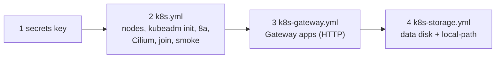

# Build cluster c1 with Ansible

**Status:** draft. c1 was built by these playbooks; this runbook puts the order down on 2026-11-08 from the playbooks' own headers. On 2026-11-08 an agent replayed steps 2 and 4 from empty VMs twice in a row on a second cluster beside c1, on VNet dev (R1 rehearsal runs 3 and 4); step 3 (the Gateway) was not part of those runs. See [Proven runs](#proven-runs).

The playbooks are the by-hand runbook as code. For why each step exists, read [Build a single-node kubeadm cluster by hand](build-kubeadm-cluster.md): `k8s.yml` is its steps 1-10, 8a and the worker form of 36, changed for the home lab in each role's comments.



## Before you start

- Both nodes answer SSH through the host ([Create the c1 node VMs](create-c1-node-vms.md) step 2).
- `dig api.c1.prod.<zone> @10.1.50.1` from the host answers with the control plane's address (the override is in `opnsense_lab_host_overrides`).
- The filled-in inventory has the `k8s_nodes` group with real names and addresses, `k8s_control_plane_endpoint`, `k8s_gateway_zone` and `k8s_gateway_address` (one address from VLAN 10's `.224/27` load-balancer pool, [STD-0002](../standards/0002-ip-address-plan.md)).

## Steps

Run from `hosts/ansible/`.

1. Make the Secrets-at-rest key once, if `~/.config/central-hub/c1-secrets-encryption.key` doesn't exist.

   ```sh
   (umask 077; head -c 32 /dev/urandom | base64 > ~/.config/central-hub/c1-secrets-encryption.key)
   ```

   Name the file in `k8s_control_plane_encryption_key_file`.
   why: the API server stores Secrets in etcd encrypted with this key; a restored etcd backup can't be read without it ([hosts/ansible/README.md, Secrets at rest on c1](../../hosts/ansible/README.md#secrets-at-rest-on-c1)). On a rebuild that restores etcd, keep the old key instead.
   expect: the file is `-rw-------` and holds 44 base64 characters.

2. Build the cluster.

   ```sh
   ansible-playbook -i inventories/home/ playbooks/k8s.yml
   ```

   why: role `k8s_node` prepares every node (kernel, SELinux, firewalld lab zone, containerd, kubeadm, kubelet, kubectl); `k8s_control_plane` runs `kubeadm init`, turns on Secrets at rest, applies the Gateway API CRDs and installs Cilium by Helm with kube-proxy replacement and its Gateway API controller ([D-0017](../decisions/0017-replace-kube-proxy-and-announce-lb-addresses-with-cilium.md), [D-0021](../decisions/0021-use-gateway-api-on-cilium-as-the-way-in-for-web-traffic.md)); `k8s_worker` joins the worker; the last play runs a smoke test pod.
   ※ Cilium is a step inside this playbook, so it has no runbook of its own.
   expect: the smoke test passes (DNS for `kubernetes.default` and a way out to `pkgs.k8s.io`). On the control plane, `kubectl get nodes` shows both `Ready`, and `cilium status --wait` shows every component OK.

3. Make the shared Gateway (HTTP only for now) and prove it.

   ```sh
   ansible-playbook -i inventories/home/ playbooks/k8s-gateway.yml --tags gateway
   ansible-playbook -i inventories/home/ playbooks/k8s-gateway.yml --tags smoke
   ```

   why: one Gateway `apps` for `*.apps.c1.prod.<zone>` at the pinned address is the way in for every app; HTTPS comes after the certificate ([Issue c1's app certificate](issue-c1-app-certificate.md)).
   expect: the smoke run calls an echo app through the Gateway from the host, gets a 404 for an unknown name, resolves the wildcard from the worker, then deletes the echo app.

4. Give c1 volumes: the worker's data disk and the default StorageClass.

   ```sh
   ansible-playbook -i inventories/home/ playbooks/k8s-storage.yml --check --diff
   ansible-playbook -i inventories/home/ playbooks/k8s-storage.yml
   ```

   why: apps ask for volumes with a plain claim; each volume is a folder on the worker's data disk ([hosts/ansible/README.md, Storage on c1](../../hosts/ansible/README.md#storage-on-c1)). The disk is formatted only while `blkid` sees nothing on it, so a kept data disk is never wiped.
   expect: the proof tag writes and reads a file on a claim, then removes it; `kubectl get storageclass` shows `local-path (default)`.

## Proven runs

R1 rehearsal, 2026-11-08, by an agent through the owner's Mac. A 2-node cluster built beside c1 on VNet dev (VLAN 30) from this repository's `main` after PR #78, VMs from `hosts/terraform/home/k8s` with the rehearsal's own state and `create_template = false` (PR #76). Times are measured from the run logs.

| Step | What ran | Run 3 | Run 4 |
|---|---|---|---|
| VMs | `tofu apply` ([Create the c1 node VMs](create-c1-node-vms.md)) | 36 s | 36 s |
| 2 | `ansible-playbook playbooks/k8s.yml` | 284 s | 316 s |
| checks | a read-only playbook: versions, nodes, Cilium image, pods not Running, free memory | not run | 3 s |
| 4 | `ansible-playbook playbooks/k8s-storage.yml` | 36 s | 37 s |
| teardown | `tofu destroy` | 10 s | 10 s |

Result: Kubernetes v1.36.5 on AlmaLinux 10.2, Cilium v1.20.4 replacing kube-proxy, both nodes Ready, a default StorageClass on the worker's data disk. At rest the control plane used 1.6 GB and the worker 0.9 GB of 3.9 GB each (run 4).

What runs 1 and 2 found, and the fix:

| Run | Failure | Fix |
|---|---|---|
| 1 | the inventory named the wrong SSH key | name the key the tfvars put on the nodes |
| 1 | a rebuilt VM on the same address has a new host key | the rehearsal inventory ignores known hosts (rehearsal only, never for c1) |
| 2 | the first `dnf` install lost a file from dnf's cache, racing cloud-init on first boot | PR #78: wait for `cloud-init status --wait`, then retry the first install |

The agents' run logs and worklogs are kept in the agent notebook; this section is the record.

How this build compares with the others rehearsed for c1 (Kubespray, Talos): [Cluster builds compared](rebuild-home-lab-from-scratch.md#cluster-builds-compared-step-7).

## If it fails

- `k8s.yml` stops before `kubeadm init`: fix and run it again; the node roles are safe to repeat.
- After `kubeadm init`: compare with the matching step of the by-hand runbook. To start the cluster over, `kubeadm reset` on every node ([by-hand runbook step 20](build-kubeadm-cluster.md#20-kubeadm-tokens-a-config-file-reset-ca3)), or rebuild the VMs.
- The encryption step stops if the node holds a different key than the controller's file: never change it here; key rotation is a separate job.

## Afterwards

Set `last-tested`. After any later `playbooks/k8s-upgrade.yml`, set the new versions in the inventory, as `hosts.example.yml` says, so a re-run of `k8s.yml` never downgrades the cluster.

## Related

- [Rebuild the home lab from bare metal](rebuild-home-lab-from-scratch.md).
- [Build a single-node kubeadm cluster by hand](build-kubeadm-cluster.md): the whys.
- [Spec: c1's way in for web traffic](../specs/2026-10-c1-way-in-for-web-traffic.md).
