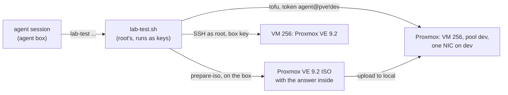

# Build the lab test copy, a nested Proxmox VE on dev

**Status:** draft, not run. The wrapper, its stack and its helper pass offline tests only.

## Why

The host, network and firewall layer has no copy on dev, so a change to it can't pass on dev before prod, which D-0035 rule 3(a) asks for. The copy is one VM in pool dev that runs Proxmox VE itself. Later steps build its own SDN, OPNsense and connector container inside it with the same code that builds the real ones ([the spec](../specs/2026-11-lab-test-copy.md)). This runbook covers only the copy: the VM, its install and the check that its own guests can use KVM.

## What is built



- **The VM.** VM 256 in pool dev, one NIC on the dev VNet, CPU type `host`, 2 cores, 7168 MiB with no ballooning, 32 GB. It never starts with the host. The empty disk comes first in the boot order, so the first boot falls through to the installer ISO and every later boot starts the installed system.
  ※ `hosts/terraform/home/lab-test/`
- **An install with no console.** The agents' Proxmox role has no `VM.Console`. The wrapper downloads the Proxmox VE 9.2-1 ISO, checks it against its pinned SHA-256, and bakes an answer file into a copy of it with `proxmox-auto-install-assistant prepare-iso --fetch-from iso`. That ISO's boot menu picks "Automated Installation" by itself after 10 seconds.
  ※ [Automated Installation](https://pve.proxmox.com/wiki/Automated_Installation), "Prepare an Installation ISO"
- **The answer.** Root signs in over SSH by the box's own key for this wrapper. Root's password is the hash of a random password that only the box keeps, beside the hash, for step 5's sign-in to the copy's own API. The address is static on dev, with dev's gateway as gateway and DNS. The disk is ext4 on `sda`, with swap 1 GB, root at most 12 GB and 1 GB left free, so the data volume gets about 18 GB, room for the nested OPNsense's 16 GB disk. The installer's defaults on 32 GB would leave 8 GB.
  ※ `lab-test-answer.py`; pve-docs, Installation, "Advanced LVM Configuration Options"
- **The assistant.** It ships only as a Debian package. The box runs AlmaLinux 10, which has every library the binary links (glibc 2.39, OpenSSL 3, zstd, libgcc, and libcrypt.so.1 from `libxcrypt-compat`). So the role downloads the pinned `.deb` over plain http, checks its SHA-256 (the only integrity check), takes the binary out with Python and installs it root-owned. The download sits in pve-no-subscription's trixie Packages index.
  ※ `hosts/ansible/roles/agent_box/tasks/lab_test.yml`
- **One upload per answer.** The token can't delete files on `local`. The wrapper keeps the root hash and its password, so the same settings give the same answer, and keeps the prepared ISO on the box under the hash of the source ISO, the assistant and the answer. An unchanged answer reuses that ISO, and its upload is the same file on `local`. When the answer changes, plan drops the old ISO from the state, its file stays on `local`, and the new ISO is a new file.

## Steps

All steps run on the agent box as the session user. The wrapper takes no other arguments.

1. Tear dev down, and destroy the OPNsense test VM if it is there:

   ```sh
   sudo -n -u keys /usr/local/libexec/agent-box/rebuild.sh teardown
   opnsense-test destroy
   ```

   why: the node has the memory for one of dev, the OPNsense test and the copy at a time, and the wrapper refuses otherwise.
   ※ [the spec](../specs/2026-11-lab-test-copy.md), Memory
2. Plan, then apply:

   ```sh
   lab-test plan
   lab-test apply
   ```

   why: `plan` checks the guards (dev's state empty, VM 256 not in dev's tfvars, no dev rebuild running, VM 257 gone, the node's free memory, the box's free disk), downloads and checks the ISO, writes and validates the answer, prepares the ISO and saves a plan. `apply` checks the guards again, then applies only that saved plan. The VM starts and installs. When a guard finds the node short and VM 300 (the notebook's CI runner) running, it shuts VM 300 down and reads the memory again, as the dev rebuild's preflight does: the same token's `VM.PowerMgmt` on pool `ci`, no other guest touched, VM 400 included. It does so only when the owner's short-node pick (`agent_box_short_node`) is set, either value; with none it refuses and stops nothing. Stopping VM 300 ends any notebook job on it, and notebook checks queue until destroy starts it again (log lines `runner stop` and `runner restart`).
   ※ `lab-test.sh`, `guards`, `source_iso` and `prepared`
3. Check:

   ```sh
   lab-test check
   ```

   why: this waits up to 30 minutes for SSH, prints `pveversion`, and checks that the copy's CPU shows `vmx` or `svm` and that it has `/dev/kvm`. It changes nothing.
4. Run the fresh-host steps inside the copy:

   ```sh
   lab-test host
   ```

   why: these are the steps a person runs on a fresh real host before the lab network ([Set up a Proxmox VE host by hand](set-up-proxmox-host.md) steps 1 and 6b, then [Set up the lab network](set-up-lab-network-and-firewall.md) step 1), so they pass on the copy first. Inside the copy, it marks the enterprise apt repositories `Enabled: no` and adds the no-subscription repository, then runs `apt-get update`. It runs `iac-access.sh`, makes the copy's own `iac@pve!apply` token (valid 2 days, saved on the box only), and runs the script again so the token gets its ACLs. Then it runs `playbooks/proxmox-host.yml --tags vmbr1` against the copy, with an inventory the wrapper writes in the shape of `hosts.example.yml`: the copy's address, root by the wrapper's key, vmbr1's MAC `02:00:00:00:02:56` (locally administered, seen only inside the copy) and mgmt address `.2`. Last, it stages the two images the run folders need inside the copy, as [Put the OPNsense image and the Debian 13 template on the host](stage-lab-images-on-proxmox.md) steps 1, 2, 3 and 5 give it. Storage `local` takes `import`. The OPNsense 26.1.6 nano image is checked against its pinned SHA-256, from the release's checksum file, and unpacked under `import/`. The Debian 13 template `debian-13-standard_13.6-1` comes through `pveam`, which checks it against Proxmox's index, and the wrapper checks the same pinned SHA-512 again. Safe to run again.
   expect: `pveum user token permissions` reaches the script's paths, `ip -br link show vmbr1` in the copy shows that MAC, and the last two lines name `local:import/OPNsense-26.1.6-nano-amd64.img` and `local:vztmpl/debian-13-standard_13.6-1_amd64.tar.zst`.
   ※ `lab-test.sh`, `host`; `lab-test-answer.py`, `inventory`
5. Build the copy's own lab layer:

   ```sh
   lab-test lab
   ```

   why: these are [Set up the lab network](set-up-lab-network-and-firewall.md) steps 2 to 4, run inside the copy with the real run folders and the copy's own values. It fetches the copy's CA over SSH and checks that the copy's API answers with it and the copy token. The provider trusts only that CA: Proxmox signs the node's certificate with its own CA and puts the node's address in it (pve-cluster `src/PVE/Cluster/Setup.pm`, `gen_pve_ssl_cert`). Then `network`, `firewall` and `remote-access` each get a plan, an apply and a second plan that must show no changes, with their own state on the box. The values come from `lab-test-answer.py layers`:
   - the copy's node name;
   - made-up STD-0001 names with the copy's env, what and number (`op`/`nw` for VM 100, `de`/`nw` for CT 900);
   - locally administered MACs `02:00:00:00:01:00`, `:01:01` and `:09:00`;
   - WAN link-down (`opnsense_wan_connected = false`), on the copy's own `vmbr9` (`wan_bridge`), a bridge with no ports that the wrapper makes in the copy first. The copy's vmbr0 is dev itself, and the copy's own dev VLAN holds dev's range inside, so the real WAN bridge would put that range on two interfaces next to dev's real gateway;
   - CT 900 on mgmt `.3`;
   - the two staged files.

   `network` and `firewall` use the copy token. `remote-access` signs in as `root@pam` with root's password, because only `root@pam` may set CT 900's `keyctl` and `/dev/net/tun` (pve-container `src/PVE/LXC.pm`, `check_ct_modify_config_perm`). Last, it runs `playbooks/proxmox-host.yml --tags mgmt` against the copy, which gives the copy mgmt `.2` and a route to `10.1.0.0/16` through mgmt's `.1`, the nested firewall. The dev subnet stays a connected route on the copy's vmbr0, which is more specific, so the box keeps its SSH and API path. Safe to run again.
   expect: each folder prints `applied in the copy; a second plan shows no changes`; the last lines show the copy's mgmt address, VM 100 running and CT 900 running.
   ※ `lab-test.sh`, `lab` and `lab_folder`; `lab-test-answer.py`, `layers`
6. Set up the copy's VM 100 with no person at its console:

   ```sh
   lab-test firstboot
   ```

   why: this is [Set up the lab network](set-up-lab-network-and-firewall.md) steps 5 and 6. A person does step 5 by hand at the real firewall's console, and step 6 goes through the QEMU guest agent, which the copy's VM 100 does not have. The nano image has no installer, no SSH and no config on first boot. Its config importer waits for a key press at the console and asks for a device there (opnsense/core 26.1.6, `src/sbin/opnsense-importer`), and Proxmox VE's kernel can't write the image's UFS before import (Ubuntu builds it without `CONFIG_UFS_FS_WRITE`). So the console is the only way in.

   As root on the copy, the wrapper reaches VM 100's serial console the way `qm terminal` does, with `socat` on `/var/run/qemu-server/100.serial0` (qemu-server `src/PVE/CLI/qm.pm`). `lab-test-console.py` then:
   1. signs in as root with the image's default password, or with the copy's own on a second run;
   2. opens the shell from menu 8;
   3. sends `hosts/ansible/bootstrap/opnsense-first-boot.php`, a root hash, `hosts/ansible/bootstrap/opnsense-ansible-user.php`, the API key line, `hosts/ansible/bootstrap/opnsense-ssh-key.php` and the copy's SSH public key in short base64 lines, each checked by SHA-256;
   4. runs the first-boot PHP, then the API user PHP, removes the key line and the hash however that ends, then the SSH key PHP, removes the public key however that ends, and reboots VM 100.

   The PHP does what step 5 does:
   - the mgmt VLAN on the trunk, named `vtnet0_vlan50` as the console names it;
   - LAN on it at mgmt's `.1/24`, with no DHCP, router advertisements or IPv6;
   - WAN on `vtnet1` as a DHCPv4 client only;
   - root's password set to a new random one that only the box keeps;
   - the setup wizard dropped.

   The API user PHP is step 6's: user `ansible` with only the privileges `opnsense.yml` needs, and its API key. The key and secret are new and stay on the box; OPNsense gets only `<key>|<SHA-512 crypt of the secret>`, the format 26.1.6's `ApiKeyField` reads (`src/opnsense/mvc/app/models/OPNsense/Auth/FieldTypes/ApiKeyField.php`).

   The SSH key PHP gives the steps after this one a way to run commands on VM 100, which the API can't do (installing a package from a file, for one). The wrapper makes an ed25519 key for this copy on the box, in its run folder as `opnsense-ssh.key`, and sends VM 100 only the public line. The PHP refuses anything but one ed25519 line. It then sets what System > Settings > Administration sets:
   - Secure Shell on, root may sign in, password and keyboard-interactive sign-in off;
   - listening on LAN only, which is the copy's mgmt VLAN; OpenSSH adds loopback (`openssh.inc`, `openssh_configure_do`);
   - root's authorized keys set to that one line (`auth.inc`, `local_user_set`).

   With SSH on, OPNsense's anti-lockout rule passes port 22 on LAN (`filter.lib.inc`, `filter_core_get_antilockout`). sshd starts with these settings at the reboot. The box reaches VM 100's SSH through the copy, as it reaches the API: `ssh -W` on the copy, which has mgmt `.2`. VM 100's host key is kept in `opnsense-ssh.known_hosts` beside the key. This is for the copy only: on the lab firewall, SSH for agents is a new access right and waits for the owner's go ([sign-in-to-opnsense-through-keycloak.md](sign-in-to-opnsense-through-keycloak.md) step 5).

   It is written against 26.1.6's `config.inc`, `auth.inc`, `console.inc`, `openssh.inc` and `config.xml.sample`. Last, the wrapper waits up to 10 minutes for the mgmt gateway to answer a ping from the copy, then up to 5 for the API user to read `api/interfaces/vlan_settings/search_item` there, one of its own paths (`page-interfaces-vlan-edit`). curl gets the key and secret on stdin and skips the certificate check: OPNsense's certificate is self-signed, and the mgmt VLAN exists only inside the copy. Then it waits up to 5 more minutes for SSH as root by the copy's key, and reads sshd's own settings there with `sshd -T`. They must show root by key, password and keyboard-interactive sign-in off, and listen addresses that are the mgmt gateway, loopback and LAN link-local only, never WAN. Safe to run again.
   expect: `lab-test: console: php opnsense-first-boot.php ...`, then `first boot: LAN vtnet0_vlan50 10.1.50.1/24, WAN vtnet1 DHCPv4 only, root password set`, then `ansible user saved, privileges: 9, api keys: 1`, then `ssh: root by key only, on LAN only, from the next boot`, then `the mgmt gateway 10.1.50.1 answers from the copy`, `the API user ansible answers on https://10.1.50.1/api` and `VM 100 answers SSH as root by the copy's key, on 10.1.50.1 only, with password sign-in off`.
   ※ `lab-test.sh`, `firstboot`, `vm100` and `sshd_settings_ok`; `lab-test-console.py`; `hosts/ansible/bootstrap/opnsense-first-boot.php`; `hosts/ansible/bootstrap/opnsense-ansible-user.php`; `hosts/ansible/bootstrap/opnsense-ssh-key.php`
7. Configure the copy's OPNsense as the real one is configured:

   ```sh
   lab-test opnsense
   ```

   why: this is [Set up the lab network](set-up-lab-network-and-firewall.md) step 7's `playbooks/opnsense.yml`, run unchanged: VLANs, their interfaces, DHCP, the lab rules, the WAN rules and the Unbound host overrides. The copy's mgmt VLAN exists only inside the copy, whose vmbr1 has no ports, so the box reaches VM 100's API through an SSH tunnel to the copy, which has mgmt `.2`. The wrapper writes the inventory group `opnsense`:
   - The API is `localhost` on the tunnel's port. The playbook gives that port to the modules as `api_port`, 443 unless the inventory says otherwise.
   - The TLS bootstrap switch is on, because the copy's OPNsense keeps its self-signed certificate. The TLS check still runs and stops the run if the certificate verifies.
   - Every VLAN has the settings `hosts.example.yml` gives, tenant included. The copy's VLANs reach nothing outside it.
   - Where the real values are private, made-up ones: home LAN `192.0.2.0/24` (RFC 5737), zone `lab-test.test`, and host overrides in the copy's own VLANs.

   The key and secret go in as extra vars from a file only the wrapper's user reads, and that file is removed when the action ends. The DNS proof (tag `dns_proof`) is left out, because it runs `dig` on the controller against the gateway. The playbook runs twice, and the second run must report `changed=0`. Then SSH by the copy's key must still answer with step 6's settings, because later steps use it. Safe to run again.
   expect: `BOOTSTRAP: the OPNsense API's certificate is NOT checked on this run` in each run, then `lab-test: opnsense.yml applied to the copy's VM 100; a second run shows changed=0` and `after opnsense.yml, VM 100 still answers SSH as root by the copy's key, on 10.1.50.1 only`.
   ※ `lab-test.sh`, `opnsense`; `lab-test-answer.py`, `firewall-inventory`; `playbooks/opnsense.yml`, `api_port`
8. Run the WAN safety check on the copy:

   ```sh
   lab-test wancheck
   ```

   why: this is [Set up the lab network](set-up-lab-network-and-firewall.md) step 7's WAN safety check, with its three moments. The copy's WAN is on the portless `vmbr9`, so it reaches nothing outside the copy.
   1. Before link-up, over the console: `dhclient` runs for `vtnet1`, and no `radvd`, Kea or `dhcp6c` runs.
   2. Link-up, through the `firewall` run folder with `opnsense_wan_connected = true`, while `lab-test-wan-watch.py` watches `vmbr9` on the copy for 120 seconds.
   3. A reboot of VM 100 (`qm reboot 100` in the copy) under a 240-second watch of its WAN tap, `tap100i1`. Frames from the WAN count only once that tap is back as a new device, with a new interface index, which only VM 100's new QEMU process gives it. Frames from before the reboot prove nothing about the WAN after it, so they are not counted.

   The watch counts the packets the real check counts, from the WAN's MAC: UDP from port 67, UDP from port 547 and ICMPv6 type 134. Nothing on `vmbr9` would ask a server, so every 5 seconds the watch asks itself from a made-up MAC, with a DHCPv4 discover, a DHCPv6 solicit and a router solicitation. It reads frames on the bridge's ports, where they enter, before the bridge's netfilter hooks. It passes only when it saw frames from the WAN and none of server type. Any failure takes WAN link-down again. WAN stays up when all three pass; `lab-test lab`, run again, takes it down. Safe to run again.
   expect: `pgrep` lists `dhclient: vtnet1`, then `wan-watch: 120s on vmbr9: N frames from the WAN, server-type: 0` with N above 0, `firewall applied in the copy`, `wan-watch: tap100i1 is back as a new device`, then `wan-watch: 240s on vmbr9: N frames from the WAN after tap100i1 came back (M before, not counted), server-type: 0` with N above 0, then `the WAN check passed at link-up and over a reboot`.
   ※ `lab-test.sh`, `wancheck`; `lab-test-wan-watch.py`; `firewall/variables.tf`, `wan_bridge`
9. Set up CT 900's tailnet client, never joined:

   ```sh
   lab-test connector
   ```

   why: on a fresh real host, CT 900 gets its client from [Install the tailnet client in CT 900](set-up-tailnet-client-in-ct-900.md) steps 1 to 3, which are the vendor's Debian repository, the client and IP forwarding. Then it gets its route and advertised routes from `playbooks/tailnet-connector.yml` ([Set up lab DNS](set-up-lab-dns.md)). The wrapper runs that runbook's own lines in the copy's CT 900 through the copy's `pct`, then runs the playbook twice against the copy, and the second run must report `changed=0`.

   It never runs steps 4 and 5, the auth key and the join: those are a tailnet change, and the copy has no key. The advertised routes stay preferences in the client until a login that never comes (`tailscale set` and `tailscale debug prefs` only edit and read the local daemon's preferences, tailscale `cmd/tailscale/cli/set.go` and `debug.go`). The inventory's extra route is the copy's own dev address as a /32, as the real one is the host's home LAN address.

   The wrapper stops before anything if CT 900 is ever logged in. Last, it checks:
   - the route unit is active;
   - the lab range goes through the mgmt gateway on `eth1`;
   - the gateway answers a ping on `eth1`;
   - the client still says `NeedsLogin`.

   Safe to run again.
   expect: `enabled`, both forwarding values `1`, two playbook runs, then `CT 900 has the tailnet client, forwarding, the lab route and its routes advertised, and never joined`.
   ※ `lab-test.sh`, `connector`; `lab-test-answer.py`, `inventory`; `playbooks/tailnet-connector.yml`
10. Turn on the copy's host firewall:

    ```sh
    lab-test safety
    ```

    why: this is [Set up the lab network](set-up-lab-network-and-firewall.md) step 8's firewall, `playbooks/proxmox-safety.yml --tags firewall`, run as that step runs it:
    1. With the switch off, which writes the rules and shows the ruleset.
    2. With `proxmox_firewall_enable` on. This run arms the 10-minute dead-man timer, proves that every way in still works (a new SSH connection, the API on 8006, CT 900 to the mgmt gateway), and cancels the timer.
    3. Once more, which must report `changed=0`.

    The copy's management IPSet holds dev as its "home LAN", because that is where the box reaches it from. Notifications and backups are left out. Their inputs are the owner's ntfy topic and a backup disk, and the copy has neither. The playbook still checks every role's arguments under `--tags firewall`, so the copy's inventory holds a made-up backup disk id, `/dev/disk/by-id/lab-test-copy-has-no-backup-disk`, that names no disk; the backup role never runs. Safe to run again.
    expect: `the copy's host firewall is on, every way in still works, and the dead-man timer is cancelled`.
    ※ `lab-test.sh`, `safety`; `lab-test-answer.py`, `inventory`; `playbooks/proxmox-safety.yml`

    Steps 2 to 10, then destroy, in one run:

    ```sh
    lab-test prove
    ```

    why: the spec's acceptance is two clean runs in a row, build to destroy, with no hand step ([the spec](../specs/2026-11-lab-test-copy.md)). `prove` runs `plan`, `apply`, `check`, `host`, `lab`, `firstboot`, `opnsense`, `wancheck`, `connector` and `safety` in order. Each step runs as its own run of the wrapper, so it keeps its own stop-on-error, and every step uses the prove run's lock, log and central-hub commit. It stops at the first step that fails. Destroy runs either way, so dev can come back.
    expect: `prove: every step passed, build to destroy, with no hand step`. Copy `lab-test log`'s output into the agent notebook's run records, one note per run.
    ※ `lab-test.sh`, `prove`
11. Destroy when done:

   ```sh
   lab-test destroy
   ```

   why: it removes VM 256 and its disk, and on the box the copy's token, inventory, CA, run folder states, OPNsense root password, API key, VM 100's SSH key and its host key, and the last `opnsense`, `connector` and `safety` logs. The prepared ISO stays in the wrapper's state and on `local` for the next build, and on the box. Destroy then lists what it left on `local`. If a guard stopped VM 300, destroy last starts it again once the node has VM 300's memory plus 2048 MiB free, waiting up to 30 s for VM 256's memory to come back; otherwise it prints `runner left stopped` and keeps its mark, so the next `lab-test destroy` tries again.
12. Bring dev back if it is needed (`rebuild.sh up`). The dev rebuild's preflight refuses while VM 256 exists.

`lab-test log` prints the last run's output, then VM 256's state, uptime and memory from Proxmox. It changes nothing.

## If it fails

| Output | Meaning |
|---|---|
| `refused, dev's state holds N resources` | Dev is up. Tear it down first (step 1). |
| `refused, VM 257 (the OPNsense test) exists` | Run `opnsense-test destroy` first (step 1). |
| `refused, short on memory` | The node lacks the copy's memory plus the margin, after stopping VM 300 if it was running. Stop nothing else; report it with the `preflight` lines. |
| `VM 300 was not stopped: the owner's short-node pick (agent_box_short_node) is not set` | The node is short and only VM 300 could free memory, but the owner has not picked what a short node may stop. Report it; don't set the pick yourself. |
| `runner left stopped` | VM 256 is gone but the node does not yet have VM 300's memory plus 2048 MiB free. Run `lab-test destroy` again later; it starts VM 300 when the node has room. `lab-test log` says while VM 300 is still stopped. |
| `refused, short on box disk` | The box's work folder has less than 5 GB free for the source ISO and one prepared copy. Report it. |
| `refused, VM 256 is in the state` | An earlier copy was not destroyed. Run `lab-test destroy`, then plan again. |
| `the ISO does not match its pin` | The downloaded ISO is not the pinned one. Nothing is built. Check the release's SHA256SUMS before you move the pin. |
| An error from `validate-answer` | The answer file does not parse for this assistant release. Nothing is built. Report it with the output. |
| `no SSH to <address> after 30 minutes` | The install did not finish, did not take the answer's address, or dev blocks the box's SSH. Run `lab-test log`, then destroy and report both. |
| `the copy's API does not answer with its own CA and the copy token` | The copy's certificate does not name its address, or the token expired (2 days). Run `lab-test host` again for a new token if `copy-token` is gone; otherwise report it. |
| `<folder>: the second plan is not empty` | The run folder does not converge on an empty host. That is a finding about the run folder: report the plan output. |
| A 403 from `network` on the zone | `iac-access.sh` in the copy predates the `/sdn/zones` ACL; the copy runs `main`'s script, so check `main`. |
| `no login prompt on the console after 15 minutes` | VM 100 did not boot to its login, or the serial socket gave nothing. Run `lab-test log`, then report it. |
| `none of the root passwords works` | VM 100's root password is neither the image's default nor the box's. Destroy and build again. |
| `the command failed (exit N): php opnsense-first-boot.php ...` | The PHP refused or failed; its output is above the line. Report it. |
| `the mgmt gateway ... does not answer` | VM 100 rebooted without LAN on the mgmt VLAN. Report the console output. |
| `the command failed (exit N): cp ansible-apikey.line ...` | The API user PHP refused the key line or failed validation; its output is above the line. The key line is gone from VM 100 either way. Report it. |
| `the SSH tunnel to the copy ended` | The box's SSH to the copy dropped, or the copy refused the forward. Run `lab-test check`, then report it. |
| `opnsense.yml failed on run N` | A task failed on the copy's firewall; Ansible's output is above the line. A finding about the role or about 26.1.6: report the failed task. |
| `the second opnsense.yml run changed something` | The role does not converge on a fresh firewall. Report the second run's changed tasks. |
| `before link-up, WAN is not a DHCP client only` | `dhclient` is not on `vtnet1`, or a DHCPv6 client, router or Kea runs; the console output is above. WAN stays down. Report it. |
| `the WAN check failed at link-up` or `over the reboot` | The watch saw a server-type frame from the WAN (the line above names the kinds), or nothing from the WAN at all. Over the reboot it also fails when `tap100i1 never came back as a new device`, or when the tap came back and the WAN sent nothing after it. WAN is down again. Report the watch line. |
| `CT 900 is logged in to a tailnet` | Someone joined the copy's CT 900. The copy must never join: destroy the copy and remove the device from the tailnet, which is the owner's step. |
| `tailnet-connector.yml failed on run N` or `the second tailnet-connector.yml run changed something` | The role fails or does not converge on a fresh CT 900; Ansible's output is above. Report it. |
| `CT 900's route to the lab or the mgmt gateway ... does not work` | The route unit did not start, or VM 100's LAN is not on mgmt. Run `lab-test check`, then report it. |
| `proxmox-safety.yml failed on run N` | A firewall task failed; if it was after the timer was armed, the timer turns the copy's firewall off within 10 minutes. Report Ansible's output. |
| `the dead-man timer is still armed in the copy` | The enable run did not reach its cancel. Report it; the timer turns the firewall off by itself. |
| `prove: stopped at <step>` | That step failed; its own message is above. The copy is destroyed. Report the log (`lab-test log`). |
| `prove: destroy failed` | VM 256 may still exist and blocks dev. Run `lab-test destroy` again, then report it. |
| `the API user ansible gets no answer` | The gateway answers but the API refuses the key, or the web GUI is not up. Report it with the console output. |
| `the command failed (exit N): php opnsense-ssh-key.php ...` | The SSH key PHP refused the public key or failed; its output is above the line. The public key is gone from VM 100 either way. Report it. |
| `VM 100 does not answer SSH as root by the copy's key` | sshd did not start on LAN, the anti-lockout rule is off, or root's key was not written. Report it with the console output. |
| `VM 100's sshd is not as opnsense-ssh-key.php sets it` | sshd runs, but with password sign-in on or a listen address off LAN; the line names which. Run `lab-test destroy`; nothing reaches WAN, which is on the copy's portless vmbr9. Report it. |
| `stopped, the copy's CPU shows no vmx or svm` | The host's kvm module has nested off. Turning it on stops every guest on the host, so it is the owner's call ([Nested Virtualization](https://pve.proxmox.com/wiki/Nested_Virtualization)). Destroy, then report it. |

## Limits

- Not run yet. Unproven on the box: that the assistant's binary runs on AlmaLinux 10 with `libxcrypt-compat`, that the answer installs as written, and that the host's kvm module has nested on.
- The assistant's package comes over plain http and the ISO over https; each is checked against a pinned SHA-256.
- The image step checks the nano image by its pinned SHA-256 only, not by OPNsense's signature. The 26.1 public key has no independent copy today: the mirror README now lists 26.7's key (read 2026-11-18).
- The copy never joins the tailnet. That would be a tailnet change.
- The DNS proof is not run against the copy (step 7); the names are made, not asked for.
- Step 8 of the real runbook is only half here: the copy runs the host firewall, not notifications or backups (step 10).
- The WAN check on the copy runs on a portless bridge, so its WAN gets no lease and nothing real asks it for a server; only the watch's own requests do. It shows what VM 100 sends, not how the home LAN's devices would take it.
- The watch was tested against a fake WAN on a made-up bridge (client only, DHCPv4 server, router, silent), not against OPNsense.
- CT 900's eth0 sits on the copy's vmbr0, so its DHCP request reaches dev, and dev's DHCP gives it a lease under its made-up name. From step 9 its tailnet client runs, never logged in. What a logged-out client sends to the vendor's servers (for example its own logs) is not measured; the client is the vendor's default build, as on the real CT 900.
- The client comes from the vendor's repository unpinned, as the real runbook installs it, so two runs can get different versions.
- The copy's data volume is about 18 GB, and VM 100's 16 GB disk and CT 900's 2 GB are thin, so together they fill it on paper. Proxmox allows that on LVM-thin.
- Root's password for the copy stays on the box with its hash while the lab-test settings file exists, because the cached prepared ISO holds that hash. The copy is reachable only on dev.
- Unproven until the copy runs: the 26.1 console's prompts as `lab-test-console.py` expects them (October's run measured 26.7), the first-boot, API user and SSH key PHP on a real 26.1.6 OPNsense (the API user PHP ran on 26.7 in October), that `sshd -T` there lists LAN's link-local address and nothing else past the mgmt gateway and loopback, `opnsense.yml` on 26.1.6 (October ran it on 26.7; `oxlorg.opnsense` 26.1.11 is tested on 26.1, `requirements.yml`), that the bpg provider trusts the copy's CA through `SSL_CERT_FILE` (bpg 0.116.0 sets no roots of its own, `proxmox/api/client.go`), that VM 100's create passes through its pre-added pool membership, and that every folder's second plan is empty on an empty host.
- `iac-access.sh` adds VM 100 to pool `firewall` and CT 900 to pool `remote-access` before either exists on a fresh host. The pool update in Proxmox VE's API does not check that the guest exists (pve-manager `PVE/API2/Pool.pm`, the `vms` branch of the pool update), so the pool may list a guest that is not there yet. Whether the later create of VM 100 with that pool then fails has not been measured; the copy is where it will show.

## Exit

`lab-test destroy`, then set `agent_box_lab_test_enabled: false` in the inventory and run the box's role (the settings file stays until the box's work folder is cleared; it holds no secret). The files destroy lists on `local` (`lab-test-256-pve-auto-*.iso`) are for the owner to remove, because deleting them is a delete the agents' token cannot make. The source and prepared ISOs on the box are under `/var/lib/agent-box/lab-test/`.
