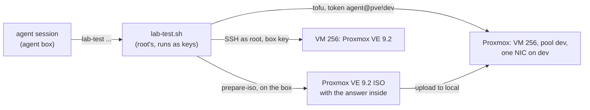

# Build the lab test copy, a nested Proxmox VE on dev

**Status:** draft, not run. The wrapper, its stack and its helper pass offline tests only.

## Why

The host, network and firewall layer has no copy on dev, so a change to it can't pass on dev before prod, which D-0035 rule 3(a) asks for. The copy is one VM in pool dev that runs Proxmox VE itself. Later steps build its own SDN, OPNsense and connector container inside it with the same code that builds the real ones ([the spec](../specs/2026-11-lab-test-copy.md)). This runbook covers only the copy: the VM, its install and the check that its own guests can use KVM.

## What is built



- **The VM.** VM 256 in pool dev, one NIC on the dev VNet, CPU type `host`, 2 cores, 7168 MiB with no ballooning, 32 GB. It never starts with the host. The empty disk comes first in the boot order, so the first boot falls through to the installer ISO and every later boot starts the installed system.
  ※ `hosts/terraform/home/lab-test/`
- **An install with no console.** The agents' Proxmox role has no `VM.Console`. The wrapper downloads the Proxmox VE 9.2-1 ISO, checks it against its pinned SHA-256, and bakes an answer file into a copy of it with `proxmox-auto-install-assistant prepare-iso --fetch-from iso`. That ISO's boot menu picks "Automated Installation" by itself after 10 seconds.
  ※ [Automated Installation](https://pve.proxmox.com/wiki/Automated_Installation), "Prepare an Installation ISO"
- **The answer.** Root signs in by the box's own key for this wrapper. Root's password is the hash of a random password no one keeps. The address is static on dev, with dev's gateway as gateway and DNS. The disk is ext4 on `sda`, with swap 1 GB, root at most 12 GB and 1 GB left free, so the data volume gets about 18 GB, room for the nested OPNsense's 16 GB disk. The installer's defaults on 32 GB would leave 8 GB.
  ※ `lab-test-answer.py`; pve-docs, Installation, "Advanced LVM Configuration Options"
- **The assistant.** It ships only as a Debian package. The box runs AlmaLinux 10, which has every library the binary links (glibc 2.39, OpenSSL 3, zstd, libgcc, and libcrypt.so.1 from `libxcrypt-compat`). So the role downloads the pinned `.deb` over plain http, checks its SHA-256 (the only integrity check), takes the binary out with Python and installs it root-owned. The download sits in pve-no-subscription's trixie Packages index.
  ※ `hosts/ansible/roles/agent_box/tasks/lab_test.yml`
- **One upload per answer.** The token can't delete files on `local`. The wrapper keeps the root hash, so the same settings give the same answer, and keeps the prepared ISO on the box under the hash of the source ISO, the assistant and the answer. An unchanged answer reuses that ISO, and its upload is the same file on `local`. When the answer changes, plan drops the old ISO from the state, its file stays on `local`, and the new ISO is a new file.

## Steps

All steps run on the agent box as the session user. The wrapper takes no other arguments.

1. Tear dev down, and destroy the OPNsense test VM if it is there:

   ```sh
   sudo -n -u keys /usr/local/libexec/agent-box/rebuild.sh teardown
   opnsense-test destroy
   ```

   why: the node has the memory for one of dev, the OPNsense test and the copy at a time, and the wrapper refuses otherwise.
   ※ [the spec](../specs/2026-11-lab-test-copy.md), Memory
2. Plan, then apply:

   ```sh
   lab-test plan
   lab-test apply
   ```

   why: `plan` checks the guards (dev's state empty, VM 256 not in dev's tfvars, no dev rebuild running, VM 257 gone, the node's free memory, the box's free disk), downloads and checks the ISO, writes and validates the answer, prepares the ISO and saves a plan. `apply` checks the guards again, then applies only that saved plan. The VM starts and installs.
   ※ `lab-test.sh`, `guards`, `source_iso` and `prepared`
3. Check:

   ```sh
   lab-test check
   ```

   why: this waits up to 30 minutes for SSH, prints `pveversion`, and checks that the copy's CPU shows `vmx` or `svm` and that it has `/dev/kvm`. It changes nothing.
4. Run the fresh-host steps inside the copy:

   ```sh
   lab-test host
   ```

   why: these are the steps a person runs on a fresh real host before the lab network ([Set up a Proxmox VE host by hand](set-up-proxmox-host.md) steps 1 and 6b, then [Set up the lab network](set-up-lab-network-and-firewall.md) step 1), so they pass on the copy first. Inside the copy, it marks the enterprise apt repositories `Enabled: no` and adds the no-subscription repository, then runs `apt-get update`. It runs `iac-access.sh`, makes the copy's own `iac@pve!apply` token (valid 2 days, saved on the box only), and runs the script again so the token gets its ACLs. Last, it runs `playbooks/proxmox-host.yml --tags vmbr1` against the copy, with an inventory the wrapper writes in the shape of `hosts.example.yml`: the copy's address, root by the wrapper's key, vmbr1's MAC `02:00:00:00:02:56` (locally administered, seen only inside the copy) and mgmt address `.2`. Safe to run again.
   expect: `pveum user token permissions` reaches the script's paths, and `ip -br link show vmbr1` in the copy shows that MAC.
   ※ `lab-test.sh`, `host`; `lab-test-answer.py`, `inventory`
5. Destroy when done:

   ```sh
   lab-test destroy
   ```

   why: it removes VM 256 and its disk, and on the box the copy's token and inventory. The prepared ISO stays in the wrapper's state and on `local` for the next build, and on the box. Destroy ends by listing what it left on `local`.
6. Bring dev back if it is needed (`rebuild.sh up`). The dev rebuild's preflight refuses while VM 256 exists.

`lab-test log` prints the last run's output, then VM 256's state, uptime and memory from Proxmox. It changes nothing.

## If it fails

| Output | Meaning |
|---|---|
| `refused, dev's state holds N resources` | Dev is up. Tear it down first (step 1). |
| `refused, VM 257 (the OPNsense test) exists` | Run `opnsense-test destroy` first (step 1). |
| `refused, short on memory` | The node lacks the copy's memory plus the margin. Stop nothing else; report it. |
| `refused, short on box disk` | The box's work folder has less than 5 GB free for the source ISO and one prepared copy. Report it. |
| `refused, VM 256 is in the state` | An earlier copy was not destroyed. Run `lab-test destroy`, then plan again. |
| `the ISO does not match its pin` | The downloaded ISO is not the pinned one. Nothing is built. Check the release's SHA256SUMS before you move the pin. |
| An error from `validate-answer` | The answer file does not parse for this assistant release. Nothing is built. Report it with the output. |
| `no SSH to <address> after 30 minutes` | The install did not finish, did not take the answer's address, or dev blocks the box's SSH. Run `lab-test log`, then destroy and report both. |
| `stopped, the copy's CPU shows no vmx or svm` | The host's kvm module has nested off. Turning it on stops every guest on the host, so it is the owner's call ([Nested Virtualization](https://pve.proxmox.com/wiki/Nested_Virtualization)). Destroy, then report it. |

## Limits

- Not run yet. Unproven on the box: that the assistant's binary runs on AlmaLinux 10 with `libxcrypt-compat`, that the answer installs as written, and that the host's kvm module has nested on.
- The assistant's package comes over plain http and the ISO over https; each is checked against a pinned SHA-256.
- The copy never joins the tailnet. That would be a tailnet change.
- `iac-access.sh` adds VM 100 to pool `firewall` and CT 900 to pool `remote-access` before either exists on a fresh host. The pool update in Proxmox VE's API does not check that the guest exists (pve-manager `PVE/API2/Pool.pm`, the `vms` branch of the pool update), so the pool may list a guest that is not there yet. Whether the later create of VM 100 with that pool then fails has not been measured; the copy is where it will show.

## Exit

`lab-test destroy`, then empty `agent_box_lab_test` and run the box's role. The files destroy lists on `local` (`lab-test-256-pve-auto-*.iso`) are for the owner to remove, because deleting them is a delete the agents' token cannot make. The source and prepared ISOs on the box are under `/var/lib/agent-box/lab-test/`.
