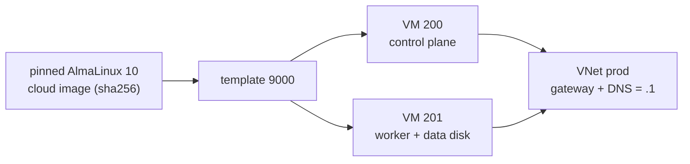

# Create the c1 node VMs on Proxmox

**Status:** draft. `hosts/terraform/home/k8s` was planned and applied against the home lab from the owner's Mac ([hosts/terraform/README.md](../../hosts/terraform/README.md#run-one-folder)); this runbook is written from that code on 2026-11-08 and has not been run as written.



## Before you start

- `tofu plan` in `hosts/terraform/home/network` shows no changes: VNet `prod` exists.
- OPNsense is up on VNet `prod`'s `.1`: the nodes use it as gateway and DNS server.
- `hosts/terraform/home/k8s/home.tfvars` holds the real node names (STD-0001), VM IDs, sizes and addresses, and the public half of the controller's node key ([Set up the lab controller](set-up-lab-controller.md) step 5).
- `PROXMOX_VE_ENDPOINT` and `PROXMOX_VE_API_TOKEN` are set in the shell.

## Steps

1. Plan and apply.

   ```sh
   cd hosts/terraform/home/k8s
   tofu init -backend-config="path=$HOME/.local/state/central-hub/home-k8s.tfstate"
   tofu plan -var-file=home.tfvars -out=k8s.tfplan
   tofu apply k8s.tfplan
   ```

   why: the run folder downloads the pinned image to the host, checks its SHA-256, makes template 9000, and clones one full VM per entry in `nodes` into pool `k8s` (spec `2026-10-home-lab-and-c1`, parts 5 and 6). cloud-init gives each node its fixed address, the `.1` gateway and DNS server, and user `almalinux` with the controller's key.
   expect: the apply ends with no error; output `node_vm_ids` lists 200 and 201.

2. Check from the controller.

   ```sh
   tofu plan -var-file=home.tfvars           # "No changes."
   ssh -i ~/.ssh/central-hub-c1 -J root@<host address> almalinux@<node address> hostname
   ```

   why: the spec's first acceptance check is a clean second plan; SSH through the host is how Ansible reaches the nodes (the inventory's `ansible_ssh_common_args`, [D-0022](../decisions/0022-reach-clusters-by-ssh-now-and-keep-admin-kubeconfigs-for-break-glass.md)).
   expect: no changes; each node prints its STD-0001 name.

## If it fails

- The image download fails its checksum: the pinned build was removed upstream. Pin a newer build and its sha256 in `variables.tf` by STD-0003, in a PR.
- A node can't be reached: check in the Proxmox console that cloud-init set the address, and that OPNsense routes mgmt to prod.
- To start over: `tofu destroy -var-file=home.tfvars` in this folder removes the nodes and the template, nothing else. The worker's data disk goes with it.

## Afterwards

Set `last-tested`. If you changed a size or an address, the change is in `home.tfvars` only; nothing goes in git.

## Related

- [Rebuild the home lab from bare metal](rebuild-home-lab-from-scratch.md).
- [hosts/terraform/README.md](../../hosts/terraform/README.md). [STD-0001](../standards/0001-names.md): node names. [STD-0003](../standards/0003-version-choice.md): version pins.
