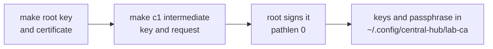

# Create the lab root CA and c1's intermediate by hand

This is the root ceremony. It runs once. Everything else in the lab trusts what it makes, so it is done slowly, by hand, on one machine, with no cluster involved.



## Before you start

- `openssl version` answers. macOS ships LibreSSL; OpenSSL 3 from Homebrew also works.
- Work in the folder the lab keeps its local secrets in, never synced and never in git: `mkdir -m 700 -p ~/.config/central-hub/lab-ca && cd ~/.config/central-hub/lab-ca`.
- Stop if `root.crt` is already there. Making a second root means every device trusts again.
- For the greenfield lab (the owner, 2026-11-08 07:58 UTC), the keys and the passphrase live in this folder and its `lab-ca.env` file, not in a password manager. Every key and password is replaced at the first full lab rebuild.

## Steps

1. Make a passphrase in `lab-ca.env`, then the root key protected by it.

   ```sh
   umask 077
   printf 'LAB_ROOT_CA_KEY_PASSPHRASE=%s\n' "$(openssl rand -hex 32)" > lab-ca.env
   . ./lab-ca.env
   openssl ecparam -name secp384r1 -genkey | openssl ec -aes256 -passout env:LAB_ROOT_CA_KEY_PASSPHRASE -out root.key
   ```

   why: P-384 matches the strength the owner's earlier labs used, and the passphrase means the key file alone is useless.
   ※ [D-0028 rule 1](../decisions/0028-run-a-lab-ca-with-the-root-off-cluster-and-one-intermediate-per-cluster.md)
   expect: `root.key` and `lab-ca.env` exist, both mode 0600.

2. Make the root certificate, valid for 10 years.

   ```sh
   cat > root.cnf <<'EOF'
   [req]
   distinguished_name = dn
   prompt = no
   x509_extensions = v3_root
   [dn]
   CN = Home Lab Root CA
   [v3_root]
   basicConstraints = critical, CA:true
   keyUsage = critical, keyCertSign, cRLSign
   subjectKeyIdentifier = hash
   EOF
   openssl req -new -x509 -key root.key -passin env:LAB_ROOT_CA_KEY_PASSPHRASE -sha384 -days 3650 -config root.cnf -out root.crt
   ```

   why: this certificate is what every device trusts, so it carries only CA powers and no names.
   expect: `openssl x509 -in root.crt -noout -subject -dates` shows the subject and a 10-year window.

3. Make c1's intermediate key and a signing request.

   ```sh
   openssl ecparam -name secp384r1 -genkey -noout -out c1-intermediate.key
   openssl req -new -key c1-intermediate.key -subj "/CN=Home Lab c1 Intermediate CA" -out c1-intermediate.csr
   ```

   why: each cluster gets its own intermediate, so losing one never puts the others at risk. This key has no passphrase, because cert-manager reads it unattended.
   ※ [D-0028 rule 2](../decisions/0028-run-a-lab-ca-with-the-root-off-cluster-and-one-intermediate-per-cluster.md)
   expect: `c1-intermediate.key` and `c1-intermediate.csr` exist.

4. Sign the intermediate with the root, valid for 5 years, path length 0.

   ```sh
   cat > intermediate.ext <<'EOF'
   basicConstraints = critical, CA:true, pathlen:0
   keyUsage = critical, keyCertSign, cRLSign
   subjectKeyIdentifier = hash
   authorityKeyIdentifier = keyid:always
   EOF
   openssl x509 -req -in c1-intermediate.csr -CA root.crt -CAkey root.key -passin env:LAB_ROOT_CA_KEY_PASSPHRASE -CAcreateserial \
     -sha384 -days 1825 -extfile intermediate.ext -out c1-intermediate.crt
   cat c1-intermediate.crt root.crt > c1-intermediate-chain.crt
   ```

   why: path length 0 means the intermediate can sign leaf certificates but never another CA. cert-manager needs the full chain in `tls.crt`.
   expect: `openssl verify -CAfile root.crt c1-intermediate.crt` prints `OK`.

5. Write down the root's fingerprint.

   ```sh
   openssl x509 -in root.crt -noout -fingerprint -sha256
   ```

   why: after a rebuild, the rebuild test compares against this value to prove the root did not change.
   expect: a SHA-256 fingerprint. It is not secret; keep it with the certificate.

6. Point the inventory at the files and record them in `lab-ca.env`.

   ```sh
   chmod 600 *.key lab-ca.env
   cat >> lab-ca.env <<EOF
   LAB_CA_DIR=$PWD
   LAB_ROOT_CA_SHA256=$(openssl x509 -in root.crt -noout -fingerprint -sha256 | cut -d= -f2)
   EOF
   ```

   In the filled-in inventory set `k8s_certs_lab_ca: true`, `k8s_certs_lab_ca_cert_file: ~/.config/central-hub/lab-ca/c1-intermediate-chain.crt` and `k8s_certs_lab_ca_key_file: ~/.config/central-hub/lab-ca/c1-intermediate.key`.

   why: the intermediate must be restorable on every rebuild, and the root key is needed only for the next intermediate. Copy the folder to a USB drive if the Mac itself may be lost before the lab rebuild.
   ※ [D-0028 rule 3](../decisions/0028-run-a-lab-ca-with-the-root-off-cluster-and-one-intermediate-per-cluster.md)
   expect: `ls -l` shows the `.key` files and `lab-ca.env` as `-rw-------`.

## If it fails

- Before any device trusts the root, nothing depends on it: empty the folder and start again.
- If the root key is lost after devices trust the root, the lab keeps working until the intermediate expires, but no new intermediate can be made. Make a new root and trust it everywhere, then retire the old one.
- Tell the owner before trying anything not written here.

## Afterwards

- Set `last-tested` here, with the date and on what.
- Continue with [Trust the lab root CA on a Mac](trust-lab-root-ca-on-mac.md) and [Restore c1's intermediate CA](restore-c1-intermediate-ca.md).
- To renew the intermediate later, `. ./lab-ca.env`, run steps 3, 4 and 6 again, then the restore runbook.

## Related

- [D-0028](../decisions/0028-run-a-lab-ca-with-the-root-off-cluster-and-one-intermediate-per-cluster.md), [spec 2026-11-lab-pki](../specs/2026-11-lab-pki.md).
