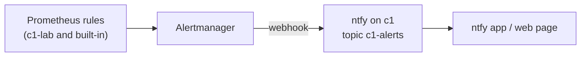

# Get c1's alerts on a phone or in a browser

c1's alerts go from Prometheus to Alertmanager, and from there to **ntfy**, a small push service that runs on c1 (Argo CD app `alerts`). Every alert lands on one topic, `c1-alerts`, formatted by ntfy's built-in Alertmanager template. Whatever subscribes to that topic shows it. Watchdog, the alert that always fires to prove the pipeline works, is not sent.

The ntfy page is reachable only from the lab network and the tailnet, through the shared Gateway. Anyone who can reach it can read and post to the topic. That is a lab pick (148); adding ntfy users is the step up.

## Steps

1. Open `https://ntfy.apps.c1.prod.<zone>/c1-alerts` in a browser on the lab network.
   expect: ntfy's web page, subscribed to `c1-alerts`. Allow notifications when the browser asks.

2. On a phone, install the ntfy app, then add a subscription. Choose "Use another server", enter `https://ntfy.apps.c1.prod.<zone>`, and use topic `c1-alerts`.
   expect: the subscription appears, empty.

3. Send a test from the web page's "Publish" box (or `curl -d "test" https://ntfy.apps.c1.prod.<zone>/c1-alerts` from a lab machine).
   expect: the message shows on every subscriber within seconds.

4. Check Alertmanager's side: in Grafana, Alerting, then Contact points, or `kubectl -n monitoring get alertmanager`.
   expect: Alertmanager is running. The next firing alert arrives as "[FIRING] <alert name>", and later "[RESOLVED]".

## Change it

- **Swap the receiver** (Gotify, email, Matrix and so on): change only `alertmanager.config.receivers` in both `apps/kube-prometheus-stack/values.yaml` and `k8s_observability` `vars/main.yml`. CI's parity check fails if the two differ.
- **Fewer or more alerts:** change the rules (see [Check c1's health](check-c1-alerts-and-dashboard.md)), or add routes to `alertmanager.config.route.routes`.
- **Lock the topic:** add ntfy users (`auth-users`, `auth-default-access: deny-all`) in `apps/alerts/`, and give Alertmanager a token.

## Rebuild from nothing

Argo CD makes ntfy and Alertmanager again. Phones keep their subscription, because the URL and topic don't change. Messages from before the rebuild are gone.

## If it fails

- **No messages at all:** `kubectl -n monitoring logs alertmanager-kube-prometheus-stack-alertmanager-0` shows the webhook's errors. `kubectl -n alerts logs deploy/ntfy` shows what reached ntfy.
- **The phone shows nothing, the web page does:** the phone isn't on the lab network or the tailnet.
- **The way back:** set `alertmanager.enabled: false` in both values files. Alerts then show only in Grafana again.

## Related

- [Check c1's health from its dashboard and alerts](check-c1-alerts-and-dashboard.md)
- `hosts/AGENT-PICKS.md` pick 170
